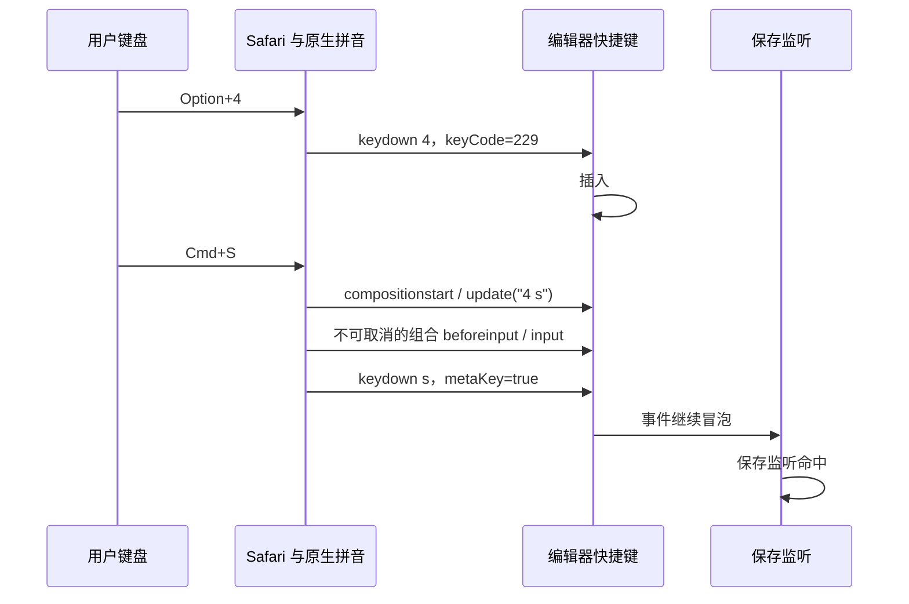

# Safari + macOS 拼音下 Option 快捷键残留的排查与修复报告

日期：2026-11-18。项目：`guji-preview-grid`。

**结果：已修复并完成原生键盘验收。** 在 Safari + macOS 自带拼音中，Vim insert 和普通编辑器均可正常执行 `Option+4 → Cmd+S`，不再出现 `4 s` 组合文本，随后中文输入也正常。有效处理是在**单独按下 Option 时**暂时关闭原生文本输入，让随后的数字直接进入应用快捷键路径；松键或离开该路径时恢复。

此前同步切换焦点、异步恢复焦点、重新挂载输入区域三种方案均未解决问题，已从最终实现中移除。本报告保留这些试验及证据边界，供以后升级编辑器、调整快捷键和排查输入法问题时参考。

报告形成时修复仍是本地未提交改动。文件哈希、版本、事件摘录和验收范围见[结构化证据](evidence/2026-11-18-safari-option-ime.json)。文中“保存执行”主要指隔离诊断页的保存监听命中；诊断页仅计数，不写数据集。

## 1. 现象、影响与复现条件

### 1.1 用户报告

编辑器启用 Vim，进入 insert 模态，使用中文输入法按 `Alt+4`，页面正常插入 `#(4)`；随后按 `Cmd+S` 保存，中文输入法出现 `4 s` 组合文本。用户明确环境为 **Safari + macOS 自带拼音**。本报告中的 Alt 指 macOS 的 Option（⌥），Cmd 指 Command（⌘）。

这属于快捷键处理与原生输入法状态不一致：片段已经插入，但后续物理按键仍可能进入输入法组合路径。原生复现中，预编辑不仅显示候选状态，也进入 CodeMirror 文档，得到 `#(4)4 s甲乙`。

若预编辑之后被提交，多余字符可能留在编辑文档；若保存读取到已污染的编辑缓冲，也存在持久化风险。本次诊断没有证明实际 `.gj` 文件曾写入 `4 s`，不能把潜在影响写成已发生的数据损坏。

### 1.2 最小操作序列

以临时编辑器初始内容 `甲乙`、光标在行首为例：

1. 启用 Vim，按 `i` 进入 insert。
2. 确认使用 macOS 自带拼音，且当前没有正在编辑的拼音候选。
3. 按下 Option，再按 `4`，松开按键。
4. 观察 `#(4)` 已插入。
5. 按 `Cmd+S`。
6. 修复前可见 `4 s` 预编辑；期望只有 `#(4)甲乙`，并正常触发保存。

最终验收还包括：上述序列之后输入并提交“中”，以及关闭 Vim 后重复快捷键。注意，修复前的主要原生复现是在 Vim insert；不能仅由最终普通编辑器验收通过，倒推出已经完成修复前普通编辑器的原生故障对照。

### 1.3 依赖与环境快照

| 项目 | 排查时版本或状态 |
| --- | --- |
| 浏览器、系统、输入法 | Safari、macOS、系统自带拼音，由用户确认 |
| 精确 Safari/macOS 构建号 | 未独立归档完整构建信息，不以测试模拟 UA 代替 |
| `@codemirror/view` | 6.43.15 |
| `@codemirror/state` | 6.7.6 |
| `@replit/codemirror-vim` | 6.4.0 |
| `@uiw/react-codemirror` | 4.25.12 |
| Vitest / jsdom | 5.1.0 / 31.0.1 |
| 验证入口 | 本地 Vite 提供的隔离编辑器，复用项目的实际快捷键和 Vim 扩展 |

依赖版本取自安装包的 `package.json`，不是依赖声明中的版本范围。以后复查应同时核对锁文件和实际安装版本。

## 2. 原有实现与排查入口

| 位置 | 原有职责 | 与本次故障的关系 |
| --- | --- | --- |
| [keymap.ts](../../guji-preview-grid/src/components/editor/keymap.ts)，`altInsertHandler` | 按 `event.code` 识别 `Digit1…Digit9`、`KeyZ`、`KeyX`，调用 `insertSnippet` 并取消默认行为 | 片段插入成功只能说明应用命令执行，不能证明输入法未消费同一物理键 |
| 同文件，`beforeinput` | 拦截 `insertText` 中 `¢`、`Ω`、`≈` 等 Option 布局字符 | 不覆盖 `insertCompositionText`，也不能取消不可取消的原生组合输入 |
| [vim-input.ts](../../guji-preview-grid/src/components/editor/vim-input.ts)，`vimInputGuard` | normal/visual 关闭原生输入；insert 和等待字面字符时允许输入 | insert 下允许正常中文输入符合设计，因此这里会放行意外的预编辑 |
| [DatasetView.tsx](../../guji-preview-grid/src/components/dataset/DatasetView.tsx)，保存监听 | `window` 冒泡阶段识别 Ctrl/Cmd + `key="s"`，取消浏览器默认保存，按 dirty/busy 条件调用保存 | 最初怀疑保存没有匹配，原生日志随后排除了本次路径中的这一解释 |
| [GujiEditor.tsx](../../guji-preview-grid/src/components/editor/GujiEditor.tsx) | 组合 Vim、应用快捷键、语法和 React CodeMirror | 最终修复需兼容扩展整树重配置，不能因此重建或丢失 Vim 状态 |

按 `event.code` 匹配 Option 快捷键仍然必要：macOS 的 `event.key` 可能是布局生成字符，例如英文布局的 Option+4 可以产生 `¢`。本次修复保留物理键匹配，不把快捷键改回布局相关的字符匹配。

原有 `beforeinput` 过滤也保留。它处理另一条已知的 Option 布局字符泄漏路径，与本次提前控制原生输入入口配合使用。

## 3. 原生事件证据

### 3.1 修复前的关键顺序

以下为用户亲自按键时页面日志的保序摘录。为便于阅读省略无关字段；`SAVE 1` 是诊断监听的计数记录，不是浏览器事件。

```text
keydown  key=Alt  code=AltLeft  altKey=true
keydown  key=4    code=Digit4   keyCode=229 altKey=true  isComposing=false
keyup    key=4    code=Digit4   keyCode=52  altKey=true  isComposing=false
keyup    key=Alt  code=AltLeft  altKey=false
keydown  key=Meta code=MetaLeft metaKey=true isComposing=false
compositionstart  data=""
compositionupdate data="4 s"
beforeinput inputType=insertCompositionText data="4 s"
            isComposing=true cancelable=false
input       inputType=insertCompositionText data="4 s"
            isComposing=true cancelable=false
keydown  key=s code=KeyS keyCode=229 metaKey=true isComposing=true
SAVE 1
keyup    key=Meta code=MetaLeft metaKey=false isComposing=true
keyup    key=s code=KeyS keyCode=83 metaKey=false isComposing=true
```

当时页面状态为：

```json
{"doc":"#(4)4 s甲乙","composing":true,"insertMode":true,"save_count":1}
```

最关键的证据有三点：

- Option+4 的 `keydown` 已带输入法标记 `keyCode=229`，但 `isComposing=false`，页面尚未收到 `compositionstart`。
- `4 s` 的 `composition`、`beforeinput` 和 `input` 都出现在保存的 `keydown` **之前**，且组合 `beforeinput` 的 `cancelable=false`。
- 保存键仍是 `key="s"`、`metaKey=true`，保存监听确实命中。保存动作与意外预编辑可以同时发生。

网页不能直接读取 macOS 输入法内部缓冲。把前一个 `4` 与后一个 `s` 连在一起解释为“输入法残留”，是由跨按键事件序列、页面结果及对照试验共同支持的机制判断；不应说已经直接读到了输入法内部存储。

### 3.2 用事件顺序解释为何保存处拦截太晚



将保存监听移动到捕获阶段，只能提前到**同一个保存 keydown 的分发过程**，无法早于已经发生的组合输入。改用 `event.code === "KeyS"` 也不会改变事件顺序；原生记录本来就能匹配 `key="s"`。

### 3.3 两个需要纠正的早期解释

**“输入法把保存键变为 Process，所以没保存”。** 合成探针确认，当前保存监听不能匹配 `key="Process"`，但原生故障记录中的键是 `s`，并且计数为 1。因此 Process 是另一个可能需要关注的输入形态，不是本次故障的已证原因。

**“加高优先级 beforeinput 拦截就能解决”。** 此次 `insertCompositionText` 不可取消；即使捕获到它，也不能靠 `preventDefault()` 阻止原生写入。直接屏蔽 insert 下所有组合文本又会破坏正常中文输入。

### 3.4 日志采集中的误差边界

初版记录器在捕获监听中排入微任务，再读取 `defaultPrevented`。原生事件分发中，这个微任务可能早于后续监听器执行，因而日志里的 `prevented=false` 不能当作“应用最终没有取消事件”的证据。本报告不使用该字段做因果推断。

打开检查器或离开编辑器之后，另观察到 `insertFromComposition("4 s")` 和 `compositionend("4 s")`。这是后续提交阶段，不能混入首次 Cmd+S 的事件顺序，误写成“保存快捷键必定提交候选”。

## 4. 方案试验与结论修正

| 阶段 | 实际操作 | 结果与证据 | 可以得出的结论 |
| --- | --- | --- | --- |
| 初始合成探针 | 在 jsdom 中派发 Alt+4、Cmd+S，并模拟组合 DOM 写入 | 普通快捷键成功；组合文本会被放行 | 找到了代码边界，但没有复现系统输入法内部状态 |
| v1 | 在 `keyCode=229` 的 Option 数字之后同步 `blur()`、`focus()` | 原生日志确认失焦/聚焦确已发生，仍出现 `4 s` | 同步焦点切换不足以清掉这条路径的残留 |
| v2 | 失焦后 `setTimeout(0)` 恢复焦点 | 用户复测仍显示 `4 s`；单元测试和构建当时可通过 | 延后一轮事件没有解决原生问题；测试通过不等于修复通过 |
| v3 | 移出并重挂 `scrollDOM`，再恢复焦点，参考 Vim 插件结束 composition 的方法 | 用户报告仍有异常 | 适用于已开始 composition 的上游方法，不能据此保证清理本次尚未显现的残留 |
| v4-A | 捕获 Option+4 后仅 `stopImmediatePropagation()`，不取消默认行为，让原生输入继续 | 用户确认 A 有残留 | 不能把原因简单归结为应用的 `preventDefault()`；仅放行原生输入也不足够 |
| v4-B | 在单独的 Option keydown 时设 `contenteditable=false`，松键后恢复 | 用户确认 B 正常；日志中数字为 52、保存为 83，无 composition | 提前阻止本次 Option 字符进入原生输入法，是有效路径 |
| v5 | 把 B 整理为 `optionInputGuard`，加入模式、组合状态、平台和恢复条件 | 用户确认 Vim insert、普通编辑器和后续中文均正常 | 正式实现通过此次原生验收 |

最终没有保留 v1～v3 的焦点回调、DOM 重挂或事后删文本逻辑。诊断页的 A/B 开关也没有进入产品。

v4-A 不是完整的“空白 Safari 文本框”实验：它仍运行在隔离 CodeMirror 页面中，只让该快捷键绕过后续按键监听。因此本次结论不外推为所有 Safari 文本框都有同样问题。

## 5. WebKit 源码对机制的支持

排查阅读了 2026-11-18 获取的 WebKit `main` 分支源码：

- [`WebViewImpl.mm`](https://github.com/WebKit/WebKit/blob/main/Source/WebKit/UIProcess/mac/WebViewImpl.mm)：`inputContext()`、`interpretKeyEvent()`、`performKeyEquivalent()`。
- [`WebPageMac.mm`](https://github.com/WebKit/WebKit/blob/main/Source/WebKit/WebProcess/WebPage/mac/WebPageMac.mm)：按键对应的编辑命令执行路径。

其中最直接解释方案 B 的是 `inputContext()`：

```cpp
NSTextInputContext *WebViewImpl::inputContext()
{
    // Disable text input machinery when in non-editable content.
    // 原注释后半段省略。
    if (!m_page->editorState().isContentEditable)
        return nil;

    return [protect(m_view) _web_superInputContext];
}
```

`interpretKeyEvent()` 在没有输入上下文时改走键盘布局命令，并以未被输入法处理的方式继续：

```cpp
if (!inputContext()) {
    auto commands = collectKeyboardLayoutCommandsForEvent(event);
    completionHandler(NO, commands);
    return;
}
```

`performKeyEquivalent()` 也会先经过 `interpretKeyEvent()`，再向网页交付按键。这为“Cmd 快捷键的网页事件到达前，输入法已参与处理”提供了源码依据。

这些源码与实测的 `229 → 52`、`229 → 83` 转变相互印证，但不是安装版 Safari 的精确源码映射。没有原生调试器记录，也没有固定上游 commit，不能声称已经定位到某个 WebKit 提交引入的回归。证据文件保存了当时下载的 `WebViewImpl.mm` 的 SHA-256；远程 `main` 以后会变化，定位时应优先按函数名查找。

## 6. 最终实现

### 6.1 介入点与启用条件

`optionInputGuard` 作为独立的 CodeMirror `ViewPlugin`，以 `Prec.highest` 注册在 `gujiKeymap` 中。它在 **Option 修饰键本身的 keydown** 执行，早于后续数字键被输入法处理。

只有同时满足以下条件才暂停原生输入：

1. 平台字符串含 `Mac`，UA 含 `AppleWebKit`，且不含 `Chrome`、`Chromium`、`Edg/`。
2. `event.key === "Alt"`，并且仅按住 Alt，没有 Ctrl、Meta 或 Shift。
3. `event.isComposing` 为 false，且 `view.compositionStarted` 为 false。
4. 未处于 Vim 非 insert 模态；未启用 Vim 时也可生效。
5. `EditorView.editable` facet 为 true。

这是基于平台/UA 的兼容性判定，不是运行时证明浏览器一定存在缺陷。Safari 是已实机验收环境；其他满足条件的 macOS WebKit 宿主需单独验证。

### 6.2 两态行为与恢复路径

| 当前状态 | 输入或事件 | 动作 |
| --- | --- | --- |
| 正常 | 满足条件的单独 Option keydown | 进入暂停态，DOM `contenteditable=false`、`tabindex=0` |
| 暂停 | Option 仍按住，后续键是已绑定的数字/Z/X | 保持暂停，应用按物理键插入片段 |
| 暂停 | Option keyup，或任意 keyup 显示 Alt 已松开 | 退出暂停，移除临时属性覆盖 |
| 暂停 | 未绑定按键，例如 Option+A | 在该 keydown 中退出暂停，后续监听与默认路径继续 |
| 暂停 | 增加 Ctrl/Meta/Shift，或普通键不再带 Alt | 退出暂停，交给其他快捷键或原生输入 |
| 暂停 | `blur` | 退出暂停，避免漏收 Option keyup 后长期不可输入 |
| 已有组合输入 | Option 或片段快捷键 | 不启动暂停，也不抢占正在进行的输入法组合 |

数字范围是 `Digit1` 到 `Digit9`，不包括 `Digit0` 或小键盘。`KeyZ` 插入 `#(增)`，`KeyX` 插入 `□`。这些映射由 `altSnippet()` 统一解析，原生输入守卫与插入处理器共用同一规则，避免各自维护一份列表而漂移。

插件本身的事件处理返回 false，不吞掉 Option 键。真正命中片段的处理器才取消默认行为并调用 `insertSnippet()`。即使 DOM 暂时不可编辑，CodeMirror 的程序化 `dispatch` 仍可修改文档，因此片段可正常插入。

### 6.3 为什么覆写 contentAttributes，而不修改 editable facet

Vim 已有的 `vimInputGuard` 会根据模态同步 `EditorView.editable`：normal/visual 关闭，insert 开放，`f/r` 等等待字面字符时也开放。

新插件通过下面的动态属性提供器暂停 DOM 输入：

```ts
provide: (plugin) => EditorView.contentAttributes.of((view) =>
  view.plugin(plugin)?.suspended
    ? { contenteditable: "false", tabindex: "0" }
    : null
)
```

状态切换后用空事务 `view.dispatch({})` 触发属性更新，文档和选区保持原样。退出暂停时返回 `null`，由原有 facet 和扩展重新决定 DOM 可编辑性，不强行写成 `true`。

如果改为再增加一个高优先级 `EditorView.editable.of(false)`，Vim 守卫会看到自己的预期（insert 应为 true）与最终 facet 值不一致，并再次发起 reconfigure；覆盖关系可能让暂停失效或产生重复更新。当前实现将“Vim 模态的编辑权限”与“这次 Option 按键期间的 DOM 输入入口”分开管理。

`tabindex=0` 用于保持不可编辑区域仍可聚焦。正式实现不调用 `blur/focus`、不重新挂载 DOM、不销毁 CodeMirror，避免依赖已失败的重置方法，也保留 Vim 实例、选区和插件状态。

### 6.4 为什么同时检查 isComposing 与 compositionStarted

当前 CodeMirror 中：

- `view.composing` 要求组合已经开始且至少发生一次组合文档变化。
- `view.compositionStarted` 在收到组合开始、尚未改文档时就为 true。

只检查 `view.composing` 会漏掉“compositionstart 已发生，但尚无文本变化”的阶段。因而守卫和片段插入器都使用 `event.isComposing || view.compositionStarted` 让位。回归测试分别覆盖事件报告组合中、视图报告组合中、两者都报告三种情况。

### 6.5 实际改动范围

| 文件 | 改动 |
| --- | --- |
| [keymap.ts](../../guji-preview-grid/src/components/editor/keymap.ts) | 增加 `optionInputGuard`、统一 `altSnippet()`、组合输入期间片段快捷键让位 |
| [alt-input.spec.ts](../../guji-preview-grid/test/alt-input.spec.ts) | 新增 14 个参数展开后的回归用例 |
| 本报告及[证据文件](evidence/2026-11-18-safari-option-ime.json) | 记录过程、最终契约、原生证据与验证边界 |

本修复不依赖调整 `DatasetView` 保存监听、修改 Vim 上游包、切换输入法或更换快捷键。工作区内同日还有其他任务的改动，不能把那些 diff 归入本问题。

## 7. 验证结果与覆盖范围

### 7.1 原生验收

v4-B 的实际日志如下：

```text
keydown Alt       → GATE true
keydown 4         keyCode=52  altKey=true isComposing=false
keyup   4         keyCode=52
keyup   Alt       → GATE false
keydown Meta      metaKey=true isComposing=false
keydown s         keyCode=83  metaKey=true isComposing=false
SAVE 1
```

整个 Option+4 → Cmd+S 区间没有 composition 事件。页面状态为 `#(4)甲乙`、`composing=false`、保存计数 1。

v5 正式实现的最终用户反馈是：**“两种模式都正常，中文也正常”。** 两种模式分别为 Vim insert 和普通编辑器。末次直接读取的普通编辑器状态为 `doc="#(4)甲乙"`、`composing=false`、`saves=1`；中文后续输入成功的证据来自用户完整操作后的确认，不把这张末次状态记录误写成包含“中”的快照。

### 7.2 自动化回归

在修复期间执行以下命令：

```sh
cd guji-preview-grid
pnpm exec vitest run test/alt-input.spec.ts test/vim-input.spec.ts test/vim-mode.spec.ts test/editor-command.spec.ts
pnpm build
pnpm exec oxlint src/components/editor/keymap.ts test/alt-input.spec.ts
```

结果：**4 个测试文件、45 项测试通过；类型检查与生产构建通过；变更文件 lint 通过。** 其中 14 项为新增 Option/IME 测试，其余 31 项为已有 Vim 输入、模态和编辑器定位回归。45 不是全项目测试数量，本次没有把它表述为全仓库测试通过。

| 新增回归范围 | 检查内容 |
| --- | --- |
| Vim 开/关各一组 | Option 按下即关闭 DOM 原生输入；facet 仍为 true；焦点、选区替换、片段和保存监听正确 |
| 连续快捷键 | 按住 Option 输入 1/4/9/Z/X，每个片段只插一次，文档更新不提前解除暂停 |
| 正常中文 | 松开 Option 后允许 `zhong → 中` 的预编辑和提交 |
| 未绑定组合 | Option+A 恢复输入并放行 `å`，不是吞掉所有 Option 按键 |
| 其他修饰键 | 加入 Ctrl 后恢复原生入口，不破坏其他组合键路径 |
| 漏收 keyup | 失焦或后续普通键可恢复输入 |
| Vim 模态 | 回到 normal 后仍不可原生输入；等待字面字符时不错误暂停 |
| 组合状态三种组合 | 不抢占已有候选，即使尚未产生文档变化 |
| React 重配置 | 整树 reconfigure 保留暂停和 Vim insert；移除快捷键扩展后恢复 |
| 其他平台/浏览器 | 模拟 Chrome、Firefox、非 macOS WebKit，不应用入口暂停 |

构建输出另有 Vite 配置使用 `__dirname` 的提示和较大产物块提示，不属于本次失败。报告撰写阶段仅检查文档与链接，没有为了修改文档重复执行这些代码测试。

### 7.3 自动化测试的边界

jsdom 没有系统拼音候选窗和原生输入上下文。测试派发 `compositionstart`、不可取消的 `beforeinput` 并修改 DOM，可以验证 CodeMirror 的编辑契约，但不能自行生成 macOS 输入法残留。

本次工具的自动化 `pressKey` 也未触发系统拼音；看似相同的 Alt+4、Cmd+S 操作只走了普通字符事件。v2 的测试和构建通过后，原生复测仍失败，正说明这一区别。因此以后不得只凭这 45 项测试就宣布 Safari 原生问题没有复发。

## 8. 今后如何复测与采集证据

### 8.1 手工验收清单

优先使用临时编辑器或明确可丢弃的编辑内容。若在真实数据集页面执行 Cmd+S，要先确认当前页和预期保存内容。本次隔离诊断页只增加保存计数，没有写数据集。

| 操作 | 应观察到的结果 |
| --- | --- |
| Vim normal 按 `i`，拼音下 Option+4 → Cmd+S | 只插入 `#(4)`；保存命中；无 `4 s` 候选 |
| 随后输入并提交“中” | 正常候选与提交，不被快捷键守卫丢弃 |
| 关闭 Vim 后重复上述动作 | 普通编辑器结果一致 |
| 按住 Option 连续输入 1/4/9/Z/X | 片段各插一次；不出现布局字符或拼音残留 |
| 先有正常拼音候选，再操作 Option | 候选输入得到让位，不凭空插入片段 |
| Option+A、Option+方向键、Ctrl+Option+F | 原生/其他快捷键行为可用；需在目标布局上实测 |
| 按住 Option 后切换窗口，返回输入 | 不会永久停留在不可输入状态 |
| 选中内容后 Option+4；再按 Esc 回 normal | 选区替换和 Vim 模态正确 |

前 3 行已经原生验收通过；其余是后续升级时建议扩展的原生检查范围。相关单元测试覆盖不等于每个键盘布局上都做过实机验收。

### 8.2 最少应记录的字段

记录 `keydown/keyup`、`compositionstart/update/end`、`beforeinput/input`、`focus/blur`；保留以下字段：

- 键盘：`key`、`code`、`keyCode`、Alt/Ctrl/Meta/Shift、`isComposing`、`repeat`。
- 输入：`inputType`、`data`、`cancelable`。
- 编辑入口：事件发生时 `contenteditable`、聚焦元素；如能取得视图，再记录 `compositionStarted`、文档和选区。
- 保存：监听是否命中、当时保存快照；如果要判断落盘，还应另查请求体和文件，不能仅看计数。

必须记录事件顺序；只截图最终文本无法区分“先组合后 keydown”与“先快捷键后默认输入”。不要用捕获阶段排入的微任务读取结果，推断整个事件分发结束后的取消状态。

下面的诊断片段只读取当前编辑区域的事件，不取消事件、不改文档、不执行保存。在开发者控制台使用，结束后调用 `gujiImeDebug.stop()`：

```js
(() => {
  window.gujiImeDebug?.stop();
  const editor = document.querySelector('.cm-content');
  if (!editor) throw new Error('未找到编辑区域');
  const controller = new AbortController();
  const rows = [];
  const types = ['keydown', 'keyup', 'compositionstart', 'compositionupdate',
    'compositionend', 'beforeinput', 'input', 'focus', 'blur'];
  for (const type of types) {
    editor.addEventListener(type, event => {
      const row = {
        sequence: rows.length + 1, time: performance.now(), type: event.type,
        key: event.key, code: event.code, keyCode: event.keyCode,
        altKey: event.altKey, ctrlKey: event.ctrlKey,
        metaKey: event.metaKey, shiftKey: event.shiftKey,
        repeat: event.repeat, isComposing: event.isComposing,
        inputType: event.inputType, data: event.data,
        cancelable: event.cancelable,
        editableAtCapture: editor.getAttribute('contenteditable'),
        focusedAtCapture: document.activeElement === editor
      };
      rows.push(row);
      // 延后记录事件最终取消状态；该回调时刻的文档状态不当作事件原始状态。
      setTimeout(() => { row.defaultPreventedAfterDispatch = event.defaultPrevented; }, 0);
    }, { capture: true, signal: controller.signal });
  }
  window.gujiImeDebug = { rows, stop: () => controller.abort() };
})();
// 复现后查看：JSON.stringify(gujiImeDebug.rows, null, 2)
```

这段代码绑定当前 `.cm-content` 节点；若 React 重建了整个编辑器，需要重新安装记录器。原生输入法行为仍须由真实键盘触发，不以合成 KeyboardEvent 代替。

## 9. 已知边界与维护注意事项

1. **单独的 Option keydown 是前提。** 若用户先在别处按住 Option，再把焦点移入编辑器，或者系统映射/自动化没有派发独立修饰键事件，当前入口可能未提前关闭。这条路径尚未原生验证，不在已确认修复范围内。
2. **未绑定 Option 输入需关注布局差异。** 当前实现在字符 keydown 中恢复入口，单元测试验证了放行路径；Option 死键、长按重复、非 US 布局和极快组合仍应按实际环境验证。
3. **已有组合输入明确让位。** 在候选尚未提交时，Option 数字不会强制插入应用片段，这是为了保留正常输入法操作。
4. **保持两个可编辑性层次独立。** 不要把临时暂停改成 `readOnly`，也不要让它与 Vim 守卫争用 `EditorView.editable` facet。程序化插入必须仍能执行。
5. **保持守卫先运行。** `Prec.highest` 和 Option 修饰键事件是机制的一部分。若新增的监听提前吞掉 Option，需重跑原生验收。
6. **恢复必须覆盖漏收松键。** 除 keyup 外，保留 blur 和后续不匹配按键的释放路径；解除暂停应移除覆盖，让 Vim 模态决定最终可编辑性。
7. **不要靠猜文本补救。** 按字符串删除 `4 s`、吞掉下一次任意 composition，可能误删合法输入；这是本次没有采用的处理，不应伪装成通用输入法修复。
8. **浏览器升级需要重新验收。** UA 筛选是兼容性启发式，WebKit 内部实现和事件顺序可能变化；要移除 workaround，需先在移除后的版本用真实拼音键盘验证。

## 10. 留存与后续定位入口

- [实现](../../guji-preview-grid/src/components/editor/keymap.ts)：`optionInputGuard`、`altSnippet`、`altInsertHandler`。
- [Vim 输入保护](../../guji-preview-grid/src/components/editor/vim-input.ts)：核对 editable facet 的归属与等待字面字符行为。
- [新增回归](../../guji-preview-grid/test/alt-input.spec.ts)：本次边界契约。
- [已有 Vim 输入回归](../../guji-preview-grid/test/vim-input.spec.ts)、[模态回归](../../guji-preview-grid/test/vim-mode.spec.ts)、[定位回归](../../guji-preview-grid/test/editor-command.spec.ts)。
- [结构化证据](evidence/2026-11-18-safari-option-ime.json)：保序事件摘录、各版结果、依赖版本、源码快照哈希、验证范围。

临时 `ime-diagnostic-tmp.html` 与 Safari 验证标签页已在验收后清理。早期 `/tmp` 分析文件不作为长期依赖；本报告与证据文件保留了关键内容。上游源码链接指向可变化的 `main`，排查下一次问题时应记录新的版本与事件，不能把本次结论无条件外推。
