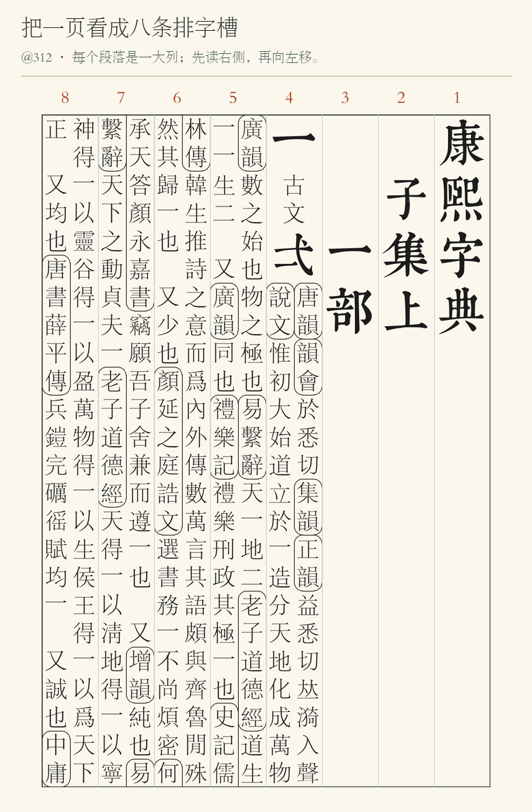
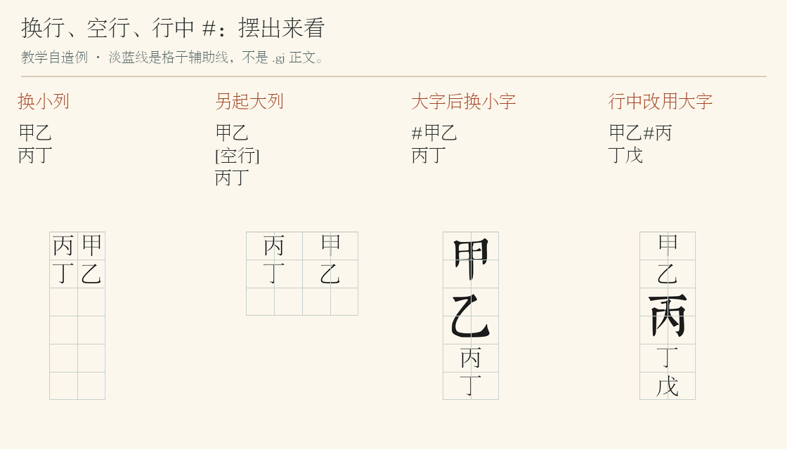
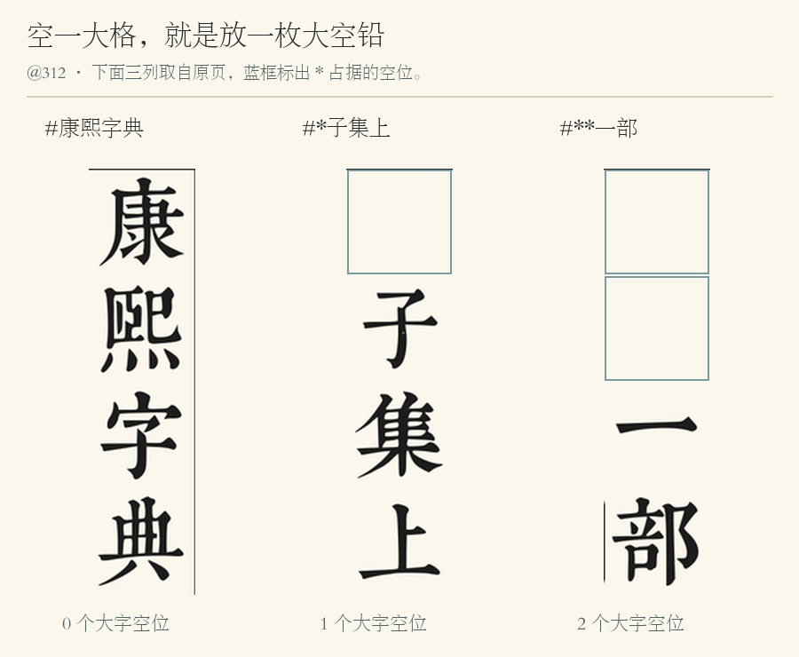
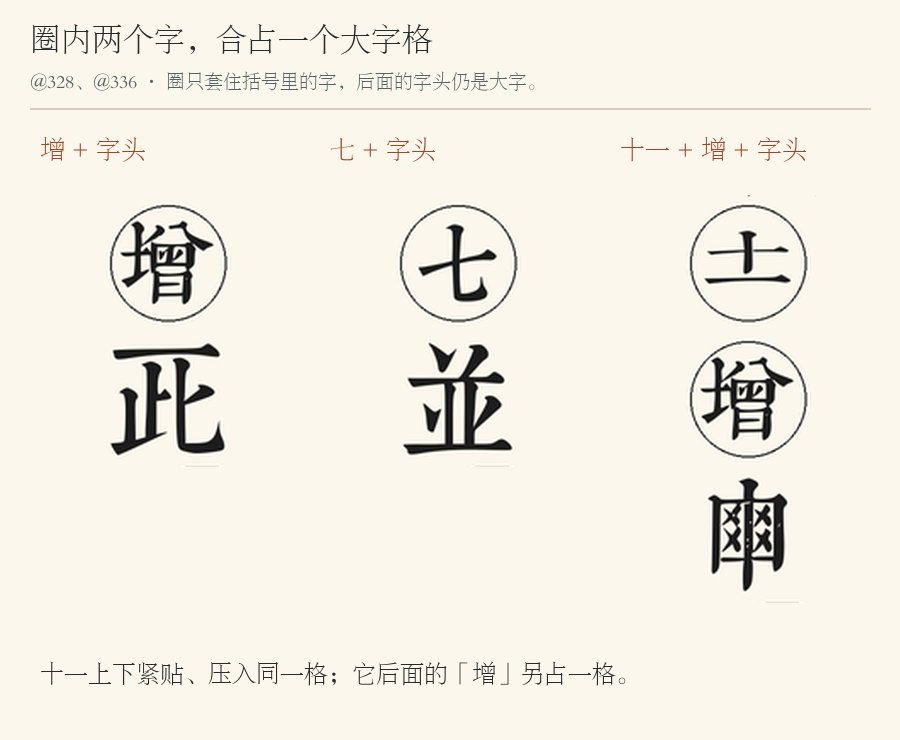
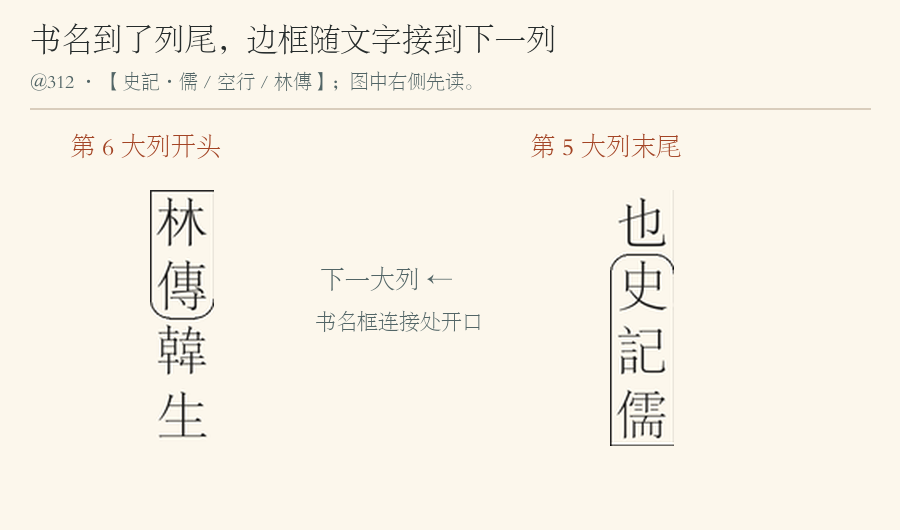
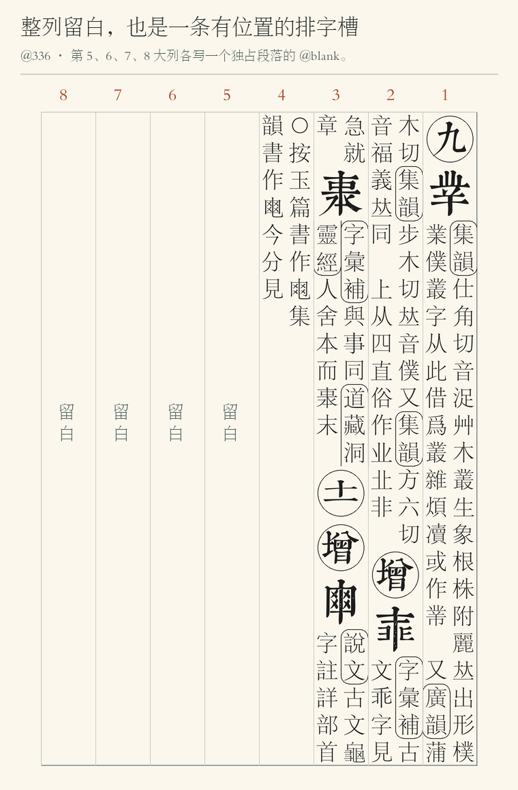
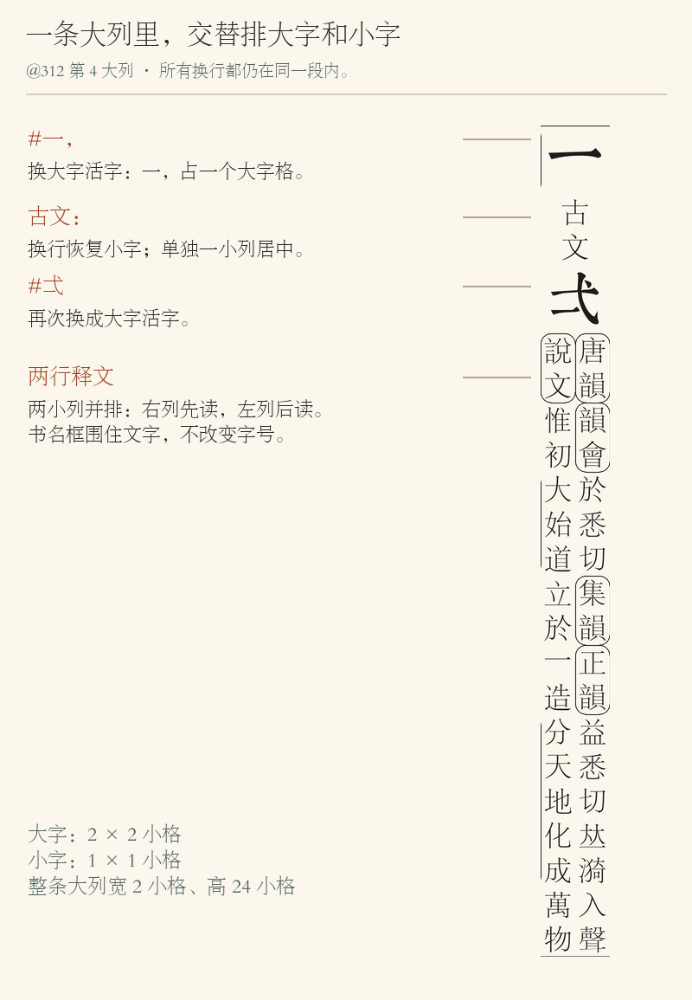
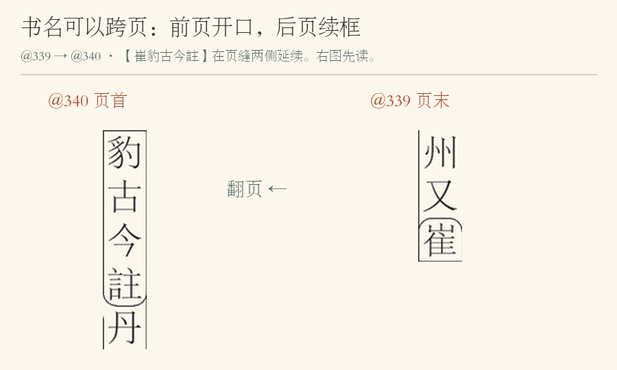

# .gj 语法学习手册：像排活字一样排古籍

把一页古籍想成一个版框，里面从右向左放着几条竖直的**排字槽**。每条槽是一“大列”；槽里可以放大字活字，也可以把小字排成左右两条小列。空位像不着墨的空铅，圈和书名框像套在字外面的装饰。

`.gj` 就是告诉排字工：**在哪里换槽、在哪里换字号、哪里留空、哪些字套框。** 这个类比帮助理解排版，并不表示原书采用活字印刷。

本手册适用当前 **`.gj/2`**，核对日期为 **2026-11-17**。真实例子取自康熙字典武英殿版已完成初校的页面；初校不等于终校。图中正文使用项目现有解析器、字格布局和字体渲染，蓝色格线、编号和旁注是教学辅助。它们是**转写的排版图**，不是扫描原图；图片导出与浏览器的细部笔画、边框可能略有差异。

## 阅读路线

- **先上手**：读第 1—3 节，记住空行、换行、`#`、`*`。
- **照着排**：读第 4—7 节，学习圈注、书名框、页码和真实混排。
- **排错时查**：第 8 节速查表与第 9 节练习。
- **遇到特殊版面**：最后的第 10 节，包含跨页书名、不等长小列、旧写法和输入边界。

> 本文代码块里的实际空行、换行都是语法。行号和“空行”字样只出现在讲解图中，不要抄入 `.gj`。除明确标为整页的例子外，代码块均为局部片段；单独预览时须先加 `@页码` 和一个空行。

## 1. 先认版框：一个段落就是一大列

当前康熙版式一页有 **8 大列**，从右向左排列；每大列宽 **2 小格**、高 **24 小格**。小字占 `1 × 1` 小格，大字占 `2 × 2` 小格，因此一大格相当于四小格。

这些格数来自当前书籍的版式配置，不是 `.gj` 文件的通用页尺寸限制。



图 1：来自 [0312.gj](../kangxi-gold/annotations/0312.gj)。右边三列分别是书名、卷次、部首；第 4 列开始排字头和释文。

### 空行：把这一槽交出去，另起一大列

```text
甲乙
丙丁

戊己
庚辛
```

这有两个段落，也就是两大列。第一段在右，第二段在左。段落内部的两行小字分别排在本大列的右小列、左小列。

连续两个换行符 `\n\n` 构成一个空行；纯空行更多时仍只是分段，可概括为 `\n\n+`。只含半角空格或制表符的行也会被视为空行。**多敲几个空行不会多出几个空大列**；整列留白要用后文的 `@blank`。

文件结束也会结束最后一大列，不必在末尾补空行。

### 单次换行：仍在这一槽里，安排下一小列

```text
甲乙
丙丁
```

小字“甲乙”自上而下排在右边，“丙丁”排在左边。这里的换行是在记录原书的小列切分，不是文字太长后由编辑器随意折行。编辑框因窗口变窄出现的**视觉折行**也不算源码换行。

排版器不会替你把长文自动装满 24 格，再接到下一大列或下一页。小列、大列、页界都应按原书主动划分。

## 2. 换活字：默认小字，`#` 后用大字

每条源码行开始时都默认排小字。遇到 `#`，就把后面的字换成大字活字，直到这条源码行结束。

```text
#一，
古文：
#弌
```

这是 [0312.gj](../kangxi-gold/annotations/0312.gj) 第 9—11 行的原文。三行之间没有空行，所以仍在同一大列：先排大字“一”，下面排小字“古文”，再排大字“弌”。

`#` 后无需加空格。`#一` 的意思是“排大字一”；写成 `#*一` 才是“先空一大格，再排一”。

### 换行同时完成两件事

1. 结束本行 `#` 的大字作用范围，下一行重新从小字开始。
2. 为小字记录下一小列的切分；遇到大字时则按大小字组继续向下排。

因此，**每次换行不一定都意味着另起一个与整列等高的竖条**。大字和小字会在同一大列里上下接续，连续的小字行才组成一组并排的小列。



图 2：教学自造例，便于单独观察每种指令。第一个例子的小字并排；第二个例子因空行分成两大列；第三个例子在大字后接一条居中的小列；第四个例子先小字、再大字、再小字，依次向下。

### `#` 可以放在行中，但不能在同一行切回小字

```text
甲乙#丙
丁戊
```

“甲乙”小，“丙”大；换行后的“丁戊”恢复小字。没有与 `#` 配对的结束符，再写一次 `#` 仍然是大字。

以下内容都**不会结束大字模式**：逗号、句号、冒号、`*`、圈注、书名框，以及“古文”等词语。比如 `#一，古文：弌` 会把“一古文弌”都排成大字。要排成上面的真实例子，就必须换行。

## 3. 放空铅：`*` 空一格，随字号变大变小

`*` 是一个有尺寸、没有墨迹的空位。大字模式中空一**大格**；默认小字模式中空一**小格**。它不改变字号。

| 写法 | 排字工的动作 |
| --- | --- |
| `甲*乙` | 小字甲 → 一枚小空铅 → 小字乙 |
| `#甲*乙` | 大字甲 → 一枚大空铅 → 大字乙 |
| `#*甲` | 一枚大空铅 → 大字甲 |
| `#**甲` | 两枚大空铅 → 大字甲 |


图 3：教学自造例 `#*甲` 换行 `乙*丙`。蓝框是空位的位置；星号本身不印出来。

### 真实标题：缩进是空位，不是标题等级

```text
#康熙字典

#*子集上

#**一部
```

三段对应三大列：第一列从顶上排；第二列先空一大格；第三列先空两大格。



图 4：原文来自 [0312.gj](../kangxi-gold/annotations/0312.gj) 第 3—7 行。竖排的“缩进”是**向下留空**。

正文也能使用 `*`。例如该页第 16 行的 `一，一生二。*又【廣韻】同也。`，在“一生二”之后空一小格，再排“又”。不要因为看到“又”就自动加空格，仍应以原版为准。

建议直接输入可见的 `*`，不要靠连续半角空格或 Tab 计格。全角空格 `　` 与 `*` 等价；半角空格有裁剪、压缩和格式化处理，不能用其数量可靠表达缩进。

## 4. 套圆圈：`#(增)`、`#(一)`、`#(十一)`

在大字模式里，用圆括号包住一字或两字，就给这一格套一个圆圈：

| 写法 | 结果 |
| --- | --- |
| `#(增)` | 大字“增”，外有圆圈，占一大格 |
| `#(一)` | 大字“一”，外有圆圈，占一大格 |
| `#(十一)` | “十”“一”上下紧贴、压缩合排，外有一个圆圈，仍占一大格 |
| `#(十一)(增)𠁴` | 圈“十一”、圈“增”、无圈字头“𠁴”，共占三大格 |

“合排”指排版上合占一格，文本仍保留“十”“一”两个字，不会变成新的 Unicode 字符。



图 5：前两例取自 [0328.gj](../kangxi-gold/annotations/0328.gj) 第 14、17 行；第三例取自 [0336.gj](../kangxi-gold/annotations/0336.gj) 第 18 行。

```text
#(增)𠀢
```

这个例子只圈住“增”，后面的“𠀢”仍是大字，但没有圆圈。`)` 结束圈注，**不结束大字模式**。

普通小字行中的 `(增)` 不会成为圈注。推荐始终写完整的半角括号，圈内只写一字或两字；其他兼容写法见第 10 节。

## 5. 加书名框：`【书名】`

用 `【` 和 `】` 标出书名范围，文字外会出现圆角矩形边框，括号本身不占字格。框不会改变文字原有字号：

```text
【唐韻】【韻會】於悉切
```

这是小字；如果写成 `#【唐韻】`，框内就会排大字。“框”是附着在已排好的字外面的，不是一种字号指令。

`【唐韻】【韻會】` 是两个相邻的书名框；`【唐韻韻會】` 是一个框。当前书名框不支持嵌套。

### 书名可以不断框地跨小列、跨大列

只在书名真正开始处写 `【`，真正结束处写 `】`；中间照原版保留换行或空行。

真实的跨小列例子来自 [0336.gj](../kangxi-gold/annotations/0336.gj) 第 16—17 行：

```text
【字彙補】與事同。【道藏·洞
靈經】人舍本而𠁱末。
```

“道藏洞”位于一条小列末尾，“靈經”接到下一小列开头，合起来是同一书名框。书名中的间隔号 `·` 在当前刻本渲染中被清除，不占格。

再看 [0312.gj](../kangxi-gold/annotations/0312.gj) 第 15—18 行的跨大列原文：

```text
【廣韻】數之始也，物之極也。【易·繫辭】天一地二。【老子·道德經】道生
一，一生二。*又【廣韻】同也。【禮·樂記】禮樂𠛬政，其極一也。【史記·儒

林傳】韓生推詩之意，而爲內外傳數萬言，其語頗與齊魯閒殊，
```



图 6：只放大显示上述原页中的列尾、列首局部。一个书名跨到另一竖列时，连接处的框边开口；不要为了“补齐括号”而把它拆成两个独立书名。

注意区分 **`【】` 与 `《》`**：当前只有 `【】` 创建书名框。`《》` 属于清洗掉的标点，正文文字会保留，但不生成框。

## 6. 换版与留槽：页码、空大列、注释

### `@页码`：开始一页，独占一段

```text
@312

#康熙字典
```

`@312` 与正文之间必须有空行。它标识一页，不会印成正文中的“312”。不要把页码和正文写在同一段，也不要漏掉文档开头的页码；当前主解析器不输出首个有效页码之前的正文。使用正整数页码。

多页文件继续写新的页码段即可：

```text
@1

第一页的正文

@2

第二页的正文
```

这是结构演示，不是康熙字典真实页文。页码指令主动换页；它不会根据文字长度自动分页。

### `@blank`：空一整大列，独占一段

```text
@blank

@blank
```

这保留两条空大列。它们有位置，也计入该页的大列数。`*` 只空一个字格，空行只分段，二者都不能代替 `@blank`。



图 7：[0336.gj](../kangxi-gold/annotations/0336.gj) 第 25—31 行，连续四个独立的 `@blank` 段。左侧“留白”字样和界线是教学标记，实际正文没有这些字。

### `//`：给校对者写备注，后面到本行末尾不排版

```text
#一 // 字头已核
古文：
#弌
```

注释不印出来，也不会占字格。需要整段备注时，用独立的注释段，并用空行与页码、正文隔开：

```text
// 本页备注：待复核异体字

@312

#一
```

避免把整行注释放在页码与正文之间、却不留空行；识别页码时仍然要求它是独立的一段。注释不是“空一行”的排版指令。

## 7. 完整读懂一条真实大列

下面是 [0312.gj](../kangxi-gold/annotations/0312.gj) 第 4 大列的完整内容（第 9—13 行；省去一处行尾半角空格）：

```text
#一，
古文：
#弌
【唐韻】【韻會】於悉切【集韻】【正韻】益悉切，𠀤漪入聲。
【說文】惟初大始，道立於一。造分天地，化成萬物。
```



图 8：从上向下，排字工做了四次安排：

1. `#一，`：排大字“一”。逗号可留在转写里，但当前刻本预览不印它。
2. `古文：`：换行后排小字；这一组只有一小列，所以居中。
3. `#弌`：放一个大字“弌”，接在“古文”下面。
4. 最后两行：恢复小字，组成右、左两小列，并给各书名套框。

**这五条源码行没有空行，因此始终只占一大列。** 若在“古文”之前多插一个空行，它就会离开“一”所在的大列。若删掉 `#弌` 后面的换行，后续释文就会继续使用大字。

想动手时，可复制 [0312.gj 整页源码](../kangxi-gold/annotations/0312.gj) 到预览中，对照图 1 观察。校对应用的“保存回数据集”会写入真实标注；练习可在副本中进行。

## 8. 随手查：符号、作用范围和常见误解

| 写法 | 作用范围 | 记忆方式 / 容易误会之处 |
| --- | --- | --- |
| 空行 `\n\n+` | 两个段落之间 | 换一条排字槽；再多空行也不会产生空槽 |
| 换行 `\n` | 段落内部 | 切小列，并将下一行恢复为小字 |
| 普通文字 | 默认小字，直到遇到 `#` | 不需要专门的小字起始符 |
| `#` | 本行剩余内容 | 换大活字；不是 Markdown 标题等级 |
| `*` | 当前字号的一格 | 空铅；不输出星号 |
| 全角空格 `　` | 同 `*` | 能用，但可见的星号更易校对 |
| `(一)`、`(十一)` | 大字模式中的一格 | 套圈；两字合占一大格 |
| `【……】` | 可跨行、跨大列、跨页 | 加书名框；字号由 `#` 和换行决定 |
| `@123` | 独占一段 | 开始第 123 页 |
| `@blank` | 独占一段 | 保留一整条空大列 |
| `//备注` | 至本行末尾 | 写给校对者；不印、不占格 |
| 文件结束 | 最后一个段落 | 结束最后一大列 |

遇到预览不对，可先按现象找原因：

| 现象 | 优先检查 |
| --- | --- |
| 释文全变大字 | 字头后是否少了换行；书名框不会切回小字 |
| 大列数突然增加 | 是否多插了空行；段落按版式划分，不按词条划分 |
| 一大列变得异常宽 | 是否把三条或更多连续小字行放进了同一小字组 |
| 页底文字看不到 | 是否超过 24 小格；查看页码旁的版式诊断 |
| 空格位置或大小不对 | `*` 是否处在预期的字号范围内 |
| 留白消失 | 是否用多个空行代替了 `@blank` |
| 书名后面一路带框 | 是否漏写了真正结束处的 `】` |
| 圈注成为普通括号 | 是否缺少前面的 `#`，或已经换行恢复了小字 |
| 全页没出现 | 页码是否缺失、为零，或没有独占一段 |

## 9. 三个一分钟练习

下面均为教学自造例。先口头判断，再看答案。

**练习一：** `#*甲` 换行 `乙*丙`，有几个大字空位、几个小字空位？

**答案：** 各一个。换行后的“乙”“丙”已经是小字。

**练习二：** 把小字“古文”放在大字“甲”和大字“乙”之间，而且三者都在同一大列。

```text
#甲
古文
#乙
```

**答案：** 以上写法即可，三行之间不要加空行。

**练习三：** `#(十一)(增)甲` 有几个大字格？

**答案：** 三个。“十一”合占一个格，“增”一个格，“甲”一个格；只有前两格带圈。

## 10. 罕见与边缘排版：遇到时再查

### 10.1 同一大列可以反复“大字—双小列—大字”

一个词条不一定是一大列；一大列也可能有几个字头。应按扫描原版的列边界分段。

例如 [0328.gj](../kangxi-gold/annotations/0328.gj) 第 9—19 行，在同一段中连续出现 `#𠀡`、`#(增)𠀢`、`#(七)並`，每个字头后又接两行小字释文。空行只出现在这一大列真正结束处。

同组两条小列长短不一时，会顶端对齐，下一大字从**较长一条的底部之后**接着排。比如 [0336.gj](../kangxi-gold/annotations/0336.gj) 第 13—15 行：

```text
急就
章。
#𠁱
```

右小列“急就”长两格，左小列“章”长一格。“𠁱”排在两格高度之后；不必给短列补 `*`。只有原书有实际的文字间空位或指定缩进时才加 `*`。

若一个小字组只有一条小列，当前版式会将它居中；若连续放三条以上小字行，排版器会把大列撑宽并发出诊断，不会自动每两行另起一大列。

### 10.2 “古文”本身也可能断在两大列之间

[0340.gj](../kangxi-gold/annotations/0340.gj) 第 11—17 行：

```text
#(四)主
古

文
#丶#宔
【唐韻】之庾切【集韻】【韻會】【正韻】腫庾切，𠀤音麈。君也。
【董仲舒·賢良策】行高而恩厚，知明而意美。愛民而
```

“古”在上一大列尾，“文”在下一大列首。不能为了把“古文”写在一起而删掉空行。这里的 `#丶#宔` 与 `#丶宔` 排版相同，第二个 `#` 只是重复选择大字。

应用会另行识别“古文”、标题、字头以供导航使用；这种语义识别不代替字号指令，也不替你改变分列。

### 10.3 书名跨页，单页文件可能只见半边括号

第 339 页最后一行以 `又【崔` 结束；第 340 页第一条正文以 `豹古今註】丹徼` 开始。完整书名是“崔豹古今註”。



图 9：分别取自 [0339.gj](../kangxi-gold/annotations/0339.gj) 第 32 行和 [0340.gj](../kangxi-gold/annotations/0340.gj) 第 3 行。

在完整多页文档中，保留这一对跨页的 `【`、`】`。在拆开的单页文件中，前页未闭合的 `【` 会使框在页尾开口，后页开头的孤立 `】` 会被解释为前页书名的续段，框上端开口。

这是一种真实的续排情况，不要机械地为每个文件补成一对括号。反过来，普通书名误漏 `】` 也会持续套框，需要检查原版和相邻页，才能区分“合法跨页”与“漏写”。

### 10.4 按语前的小圆点，不是带圈大字

[0328.gj](../kangxi-gold/annotations/0328.gj) 第 41—42 行：

```text
【正字通】俗壺字。○按正
字通收士部，今改入。
```

这里的 `○` 是正文中的一个圆形字符，按当前字号占一格。它不会圈住后面的“按”。当前预览把 `◎`、`〇` 也归一显示为 `○`；格式化会把 `◎` 改写成 `〇`。`#(增)` 才是“给增字套圈”。

### 10.5 源码有标点，刻本图里可以没有

当前渲染会清除以下明确列出的标点，不为它们留格：

```text
。 ， · " : ： 、 《 》
```

因此 `【易·繫辭】` 的框内排成“易繫辭”，`#一，` 只印大字“一”。标点清洗不等于恢复小字；`#一，古文` 的“古文”仍然是大字。

不要据此推断所有标点都被忽略。未列出的符号（如普通括号、问号、分号）没有同样的清洗承诺，也不一定有适合的刻本字形。书名框请用 `【】`，需要留白请用 `*`。

### 10.6 旧写法与输入兼容：识得出，不必照着写

| 遇到的写法 | 当前行为 / 建议写法 |
| --- | --- |
| 独占一段的 `#` | 兼容为空大列；新稿写 `@blank` |
| `#甲#乙#丙` | 三个连续大字；格式化后为 `#甲乙丙` |
| `#（增）` | 兼容全角括号；推荐 `#(增)` |
| `#(一` | 兼容单字圈缺右括号；推荐补全为 `#(一)` |
| `#(z)` 或 `#(Z)` | 兼容为 `#(增)` |
| `#(15)` | 兼容为 `#(十五)`；新稿直接写汉字更直观 |
| 旧稿的 `## 甲`、`### 甲` | 旧版曾表示缩进；当前重复 `#` 不表示级别，应按原版改为 `#*甲`、`#**甲` |
| 旧稿的 `#甲，古文：乙` | 当前全部是大字；应按原字号主动拆行 |

兼容圈注不是任意长度的括号表达式。直接书写时，闭合圈注只识别**一字或两字**；`#(二十一)` 不会作为完整的三字圈识别。某些数字缩写（如 `#(21)`）会先转换成三字汉字，格式化再解析可能改变结果，**不应作为稳定的三字圈语法使用**。需要三字以上圈文时，应另行确认支持方式。

格式化可以统一空格、圈注和重复 `#`，但不会替旧稿猜测字号边界。它还有一个细节：若下一行以逗号开头，且紧接前一行的大字，会将逗号贴回前一大字后面；不会为了“古文”自行添加逗号。

### 10.7 不可见空白、旧文件头与保留符号

- **行首行尾的半角空白会被裁剪**，连续半角空白也有压缩行为；有意义的空位请写 `*`。全角空格会先转为空位，所以看似“全空”的全角空格行未必是段落分隔。
- **旧文件头分隔符 `==` / `===`**：解析器保留了旧的前言裁剪行为，会丢弃最后一次匹配的 `==` 所在行及此前内容。不要把它用于正文装饰、分栏或 Markdown 式横线。新稿直接从 `@页码` 开始。
- **没有通用的反斜杠转义语法**：不要指望 `\#`、`\*` 会印成普通井号、星号。`//` 后的内容即使像网址也会被当作注释；`#`、`*`、`【】`、页码段等保留写法应按其语法使用。
- **书名框不嵌套**，圆括号也不是任意层级的组合语法。省略号等教学占位符若抄入源码，会被当成实际内容处理；引用片段应保留真实字符。

### 10.8 异体字、扩展区字与缺字

“𠀤”“𠀢”“𠁴”等扩展区汉字可以直接写入 `.gj`，一个字仍按一个字格排；不要因为它在某些软件里长度算成 2，就手动拆开。繁简字、异体字不会自动归并，按原书保留。

如果预览出现方框，先确认使用了项目的对应字体、该字体有这个字形。输入一个 `□` 只会排出占位方框，并不会自动生成缺字。私用区字符需要相应的已补录字体；组合字符、异体选择符也不能保证自动合成一个正确字形。

---

配图可用 `python3 tools/docs/render_gj_manual.py` 在仓库根目录重新生成；依赖 Node 的 TypeScript 支持、Pillow、fontTools 和仓库字体。脚本读取原 `.gj`，不重写标注；整页中间图留在 `var/gj-manual/`，本手册插图和来源清单位于 [figures/gj-syntax](figures/gj-syntax/sources.json)。

规则核对入口：[应用语法定义](../guji-preview-grid/README.md#guji-語法gj2)、[行内词法](../guji-preview-grid/src/parser/inline-tokens.ts)、[文档解析](../guji-preview-grid/src/ir/gj2ir.ts)、[字格布局](../guji-preview-grid/src/ir/layout3.ts)、[格式化规则](../guji-preview-grid/src/parser/split-line.ts)。
