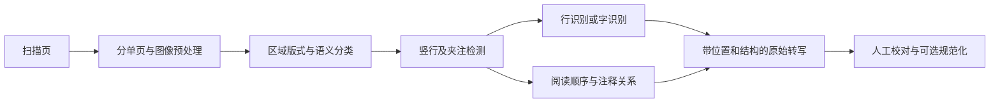

# 中文竖排古籍 OCR：论文、项目与数据集调研

调研日期：2026-11-11。范围以中文刻本、影印本、抄本的竖排页面为主，覆盖文字检测与识别、物理与语义版式、阅读顺序。甲骨文、金文、篆刻和现代横排文档仅作为扩展方向，不与古籍正文 OCR 混为一谈。

本报告核对了作者仓库、机构数据页、论文出版页及部分论文全文。资源规模和方法成绩来自相应来源；未运行模型、未下载完整数据集或验证大型权重文件。公开入口、可取得数据、允许商业使用、可完整复现是四件不同的事。

## 1. 优先关注哪些资源

| 当前目标 | 优先读／试的资源 | 推荐理由 |
| --- | --- | --- |
| 做竖排古籍 OCR 的第一版系统 | **CHAT + kraken**，同时建立 **PaddleOCR** 对照 | 前者已有历史中文专项分割与识别模型；后者工程工具链齐全，便于训练、部署和比较 |
| 识别正文、夹注、眉批、版心等 | **SCUT-CAB** | 直接定义古籍物理与逻辑版式，包含 27 类逻辑元素；比现代论文版式数据更贴题 |
| 字／行检测、文字识别、顺序联合实验 | **MTHv2、M5HisDoc** | 有位置、文本与阅读顺序标注，可以拆分评测各模块 |
| 专门解决“字都识别了，顺序却乱了” | **Reading between the Lines / HanDoc-OrderOCR** | 将阅读顺序作为独立学习任务，直接针对历史中文 |
| 评估 VLM 直接读整页 | **AncientDoc** | 明确覆盖竖排、异体字与注释干扰；提供整页文本评测 |
| 跟进最近的 OCR + 版式共同评测 | **EvaHan2026** | 同时包含印本文字、四类版式元素、手写文字，并公开评测脚本 |
| 大规模预训练、长尾字研究 | **HisDoc1B、CASIA-AHCDB、HierCode** | 分别补充大规模书页、古代手写单字、未见字的结构化表示 |

建议先做“专项模型与通用模型的同页对照”，再决定是否训练。现有论文和仓库成绩使用的输入、字符规范、数据切分不同，不能拼成一个可靠的统一排行榜。

## 2. 竖排古籍需要拆开的任务

| 任务 | 应输出什么 | 古籍特有难点 |
| --- | --- | --- |
| 页面预处理 | 单页、展平图、方向与坐标变换 | 双页扫描、书脊弯曲、透印、黑边、污损；二值化也可能损失淡墨 |
| 物理版式分析 | 文字区域、图像、版框、版心等区域 | 界栏与字的笔画混淆，文本密集，正文和插图交错 |
| 逻辑版式分析 | 正文、夹注、眉批、标题、卷次、页码等语义标签 | 仅凭矩形框不足以表达正文与注释关系 |
| 文字检测 | 竖行／单字的框、多边形或基线 | 长竖行、双行小字、字号变化、粘连和缺损 |
| 文字识别 | 忠实于原图的繁体／异体文字序列 | 生僻字、异体字、字形混淆、字典外字符、手写风格 |
| 阅读顺序与结构恢复 | 区域／行序列及正文—注释关系 | 栏内自上而下、栏间通常自右向左；夹注需要局部结构，不是全页按 x 坐标排序 |
| 校对与规范化 | 原始转写、校订结果与修改记录 | 简繁转换、通假字、补缺、断句标点都可能改变底本信息 |

一种可解释、便于逐项评测的工程方案如下。这是选型建议，不是已验证的最优架构。

不能假定把整页旋转 90° 就能解决竖排问题：旋转会同时改变字形方向，且不会解决多栏和夹注顺序。应依据具体模型的训练约定处理竖行、方向与坐标；保留原始图像和坐标映射。

## 3. 数据集与评测资源

下表中的“有入口”表示来源提供了获取路径，不代表本次已完成下载、解密或审核。

| 资源 | 规模／素材 | 标注与适合任务 | 获取与许可情况 |
| --- | --- | --- | --- |
| **[TKH / MTH][tkh]**（2018） | TKH 1,000 页，约 32 万字、2.3 万行；MTH 约 500 页，多版本汉文佛典 | 主要是单字框与字标签；从规整竖排到大小字混排，适合早期检测／识别基线 | 作者仓库有网盘入口；仅非商业研究 |
| **[MTHv2][mth]**（2020） | 常用统计为 3,199 页、1,081,678 字、6,733 字类；延续 TKH/MTH | 字框与字类；行位置与转写，按阅读顺序保存；边界线段。适合字／行检测、识别与排序 | 作者提供 Google Drive、百度网盘；学术研究使用。README 的 TKH+扩展 MTH 数量为约 3,200，精确实验应按实际文件清单 |
| **[SCUT-CAB][cab]**（2022） | 4,000 页、31,925 个版式元素 | Physical 4 类：版心条、图、版框、文字；Logical 27 类；附正文区域顺序。**古籍语义版式的首选资源** | 当前需机构签章、申请解压密码；CC BY-NC-ND 4.0。HF 有压缩包，不等于免申请 |
| **[M5HisDoc][m5]**（2023） | 8,000 图、403,824 行、4,367,392 字、16,151 字类；4,000 Regular + 4,000 Hard | 字级和行级位置、文字及阅读顺序；多版式、字体、背景与退化条件，适合综合评测 | 当前需机构申请；CC BY-NC-ND 4.0，非商业研究 |
| **[HisDoc1B][hisdoc]**（2025） | 40,281 册、3,163,330 页、约 10.83 亿字、30,615 字类 | 字框、Unicode 文本、阅读顺序、自动标点、书册对应关系；适合预训练和书级实验 | 仓库要求机构申请、非商业研究、CC BY-NC-ND 4.0；[Figshare][hisdoc-figshare] 标注 CC BY 4.0，**存在许可表述冲突，不能直接按宽松版本认定** |
| **[CASIA-AHCDB][casia]**（2019） | 官方简介：超过 220 万单字样本、10,658 类，来自超过 12,000 页古代手写材料 | 四库全书与古代佛经两种来源；单字识别、跨风格和稀有类别研究。**不是整页版式数据集** | 官方页提供多个 ZIP 与 GNTX 格式说明；本次页面未见足够明确的再利用许可，须另核实 |
| **[ICDAR2019 HDRC CHINESE][hdrc]** | FamilySearch 家谱材料；原挑战介绍来源集合超过 20,000 页，后续论文常用子集统计又不同 | 家谱的版式、行／字检测和识别；适合家谱专项研究 | 已核对挑战论文；当前完整下载、使用条件未确认。不要把原始收藏总量当作固定的公开标注集规模 |
| **[CHDAC][chdac]**（2022 竞赛／2023 论文） | 8,000 图；训练／验证／测试为 4,000／1,000／3,000；家谱、医书、佛经、方志 | 正文文本区域、转写与顺序；端到端识别及顺序预测 | 论文可读；本次未确认完整公开下载与相应训练代码。**不要与 M5HisDoc 或 MCS-Bench 当作同一个数据集** |
| **[AncientDoc][ancientdoc]**（2025 预印本／2026 Findings ACL） | HF 卡与正式论文为 **2,973 页**、约百部书、14 类文献；约 97% 楷书 | 整页 OCR、白话翻译、推理 QA、知识 QA、语言变体 QA。适合 VLM 的整页转写评测，非 27 类版式检测标注集 | [HF 数据集][ancientdoc-hf] 提供图像与标注入口；仓库及数据卡声明 CC0-1.0 |
| **[EvaHan2026][evahan]** | 正式论文每项 5,000 训练图 + 200 测试图，A/B/C 三项；A/C 示例包含裁切的竖行文本图 | A 印本文字识别；B `text / image / book_edge / seal` 四类版式；C 手写文字识别；含异体字评测规则 | 仓库公开说明和评测脚本；数据获取仍描述为注册后分发。本次未确认赛后免注册完整下载或开放许可 |

**几个必须保留的数据区别：**

- **M5HisDoc 的 8,000 图不等于 8,000 个独立原始页。** Hard 是对 Regular 做旋转、扭曲、降分辨率等增强得到的 4,000 图。原始 Regular 中含 MTHv2 的 300 图、SCUT-CAB 的 700 图；跨库训练测试要检查原页重叠。
- **HisDoc1B 不是十亿字逐一人工校对。** 论文描述每书取一页，共 40,281 页进行字位置人工修订，随后用检测器、字符识别器、启发式排序和标点模型大规模生成标注。随机抽取 100 页进行标注质量验证。适合作为大规模训练来源；自行建立测试金标更稳妥。
- **CASIA 数量存在版本／统计口径差异。** 官方简介为 10,658 类，官方分表有另一种累计口径；HisDoc1B 对比表写 10,350 类、2,276,740 样本。本报告优先保留 CASIA 官方简介的近似规模，不把几个口径混算。
- **EvaHan 图像数不是整页数。** 正式论文的 A/C 示例为文本片段，不能据 97% 左右的识别成绩推断复杂整页也达到同等水平。仓库早期计划写每项测试 200–500 图，正式论文为 200 图；复现以实际发布版本为准。
- **AncientDoc 的“覆盖战国到清”是文献内容／归属的时间覆盖，不意味着每张图都是相应朝代实物。** 正式论文也解释了晚期重刊、重印与现存数字资源的偏向。其标注采用大模型预标注与人工修订，不应描述为无模型参与的纯人工金标。

**扩展评测：** [MCS-Bench][mcs] 覆盖古文、书法、绘画、甲骨、印章、文物、插图七个子域、45 个任务；适合后续文化遗产理解。它的范围远大于竖排书页 OCR，不宜替代本项目的核心测试集。仓库代码声明 MIT，数据为 CC BY-NC-SA 4.0，并需机构申请。

## 4. 代码、模型与标注工作台

这里有意区分真正采用开源软件许可证的工具、非商业研究代码，以及公开模型。未实际安装或复现。

| 项目 | 已核实的能力／公开内容 | 对竖排古籍的用法与边界 | 许可／复现情况 |
| --- | --- | --- | --- |
| **[CHAT models][chat]** | 历史中文专用 `chat_seg.mlmodel` 与 `chat_rec.mlmodel`；分割区分 Main、Margin、Illustration、Other，行类型含 DoubleLine | 识别模型训练覆盖 10–20 世纪印本与手稿，作者称约 170 万行、超过 16,000 字类；是很值得先试的专项模型 | CC BY-NC 4.0；仓库提供 demo 和 Zenodo 发布。分割模型有二值图、9:16 比例假设；识别建议栏宽超过 90 px。README 尚将阅读顺序模型列为待发布 |
| **[kraken][kraken]** | 可训练的版式、阅读顺序和识别；支持自上而下文字；输出 PAGE XML、ALTO、hOCR 等 | 与 CHAT 配合；也适合自行微调、输出可校对结构 | 引擎 Apache-2.0，模型许可另算；官方说明支持 Linux/macOS，包括 ARM |
| **[eScriptorium][escriptorium]** | 围绕 kraken 的转写、标注、模型训练、人工校对工作台 | 适合古籍研究团队构建标注—训练—校对闭环；不是自带中文高精度识别器 | 软件 MIT；Docker 等部署方式，依赖数据库与任务队列，重于单脚本 |
| **[HRCenterNet][hrcenter]** | 官方 PyTorch 实现；训练、评估、测试代码；权重下载链接 | **历史中文单字检测／分割**，可用于单字裁切与密集字框定位；不是完整文字识别系统 | MIT；较早的研究项目，依赖及权重入口需实际复现验证 |
| **[PageNet][pagenet]** | 整页弱监督识别论文的官方推理实现；包含 MTHv2 配置与权重入口 | 有古籍整页实验，适合研究从页图直接生成文字和位置的路径 | 仅非商业研究；README **明确训练代码未公开**，不能写成完整可训练开源实现 |
| **[HanDoc-OrderOCR][handoc]** | DB++ 检测、SVTR 识别、视觉与空间信息的 CNN 顺序模块；Gradio、Docker、Colab 说明 | 直接研究历史中文阅读顺序；与 AAAI 2024 论文关联，适合拆出顺序模块进行对比 | README 限学术／研究使用，未据此认定为标准宽松开源许可；部署涉及 CUDA，自动准备模型的完整性未实测 |
| **[PaddleOCR][paddle]** | OCR 训练／推理／部署、PP-StructureV3、文档 VLM | 适合搭建模块化工程基线；通用版式类别不能自动覆盖古籍夹注、眉批、版心语义，需要适配 | 项目 Apache-2.0；调研时 README 已介绍 PP-OCRv6 和 PaddleOCR-VL-1.6，应固定具体版本和模型配置 |
| **[PaddleOCR-VL-1.6][paddle-vl]** | 官方公开 0.9B 文档解析模型，模型卡 Apache-2.0；README 声称改进古籍、生僻字、印章场景 | 值得作为当前文档 VLM 对照；没有本项目目标书页上的已验证优胜结论 | 代码／模型入口公开；本次未运行。通用文档榜单成绩不能当作古籍整页 CER |
| **[Tesseract + tessdata_best][tesseract]** | 简／繁体及竖排模型；已确认 `chi_tra_vert.traineddata` 入口存在 | 可作为轻量、离线 CPU 基线；规整刻本值得试，复杂夹注需额外版式与顺序处理 | Apache-2.0；也可查官方文档中的 HanT_vert / HanS_vert 脚本模型 |
| **[EvaHan 评测脚本][evahan]** | `task_a_c_eva.py` 与 `task_b_eva.py`；文字与版式 JSON 输入规范 | 可以借鉴识别、异体字与区域检测的评价接口 | 已有公开脚本；复用前单独核实许可证，不能因为代码公开就推定任意再分发权 |

CHAT 仓库的“超过 99%”是作者对其模型的描述，不是本次测量，也不是对任意古籍、整页排序或手写材料的保证。阅读顺序模型是否公开与引擎是否支持学习阅读顺序也应分开：当前 kraken 支持该能力，不代表 CHAT 已提供对应中文权重。

**暂不作为首选的线索：**

- EvaHan 官方引用 `RAY5/Xunzi_Qwen2_VL_7B_Instruct`；本次读取该 HF README 返回 404，故仅保留为待核实线索，不宣称权重当前可直接下载。
- 检索发现 `wcshds/hiercode`，其 README 自述为“HierCode-style”实现，未建立与论文作者的官方归属；不要把同名仓库自动视作原论文代码。
- 很多“古籍 OCR”小仓库只是 PaddleOCR 包装或传统投影切图，没有专门训练数据、完整评测或清楚许可。本次优先收录有作者来源和方法说明的资源。

## 5. 论文阅读清单

“优先”按本项目价值排序，不表示学术影响排名。数据集论文也列入，因为标注定义和评测规范直接影响实现。

| 优先级 | 论文与出处 | 要读的内容 | 代码／数据关联 |
| --- | --- | --- | --- |
| A | **Cheng et al., SCUT-CAB: A New Benchmark Dataset of Ancient Chinese Books with Complex Layouts for Document Layout Analysis**, ICFHR 2022；[作者项目][cab] | 古籍 4 类物理版式、27 类逻辑版式、正文顺序；标注指南 | SCUT-CAB 数据与指南公开入口，当前需申请 |
| A | **Shi et al., M5HisDoc: A Large-scale Multi-style Chinese Historical Document Analysis Benchmark**, NeurIPS Datasets and Benchmarks 2023；[论文][m5-paper] | 多样式字／行标注、退化增强与综合评测 | [M5HisDoc][m5] |
| A | **Ma, Huang & Liu, Reading between the Lines: Image-Based Order Detection in OCR for Chinese Historical Documents**, AAAI 2024；[DOI][order-paper] | 通过图像视觉特征学习顺序；理解检测、识别与顺序的分工 | [HanDoc-OrderOCR][handoc] |
| A | **Wang et al., Overview of EvaHan2026: The First International Evaluation of Ancient Chinese OCR and Layout Analysis**, LT4HALA @ LREC 2026；[论文][evahan-paper] | 印本／手写／版式分任务；异体字匹配规则；开放与封闭赛道 | [数据说明与评测脚本][evahan]；正式论文表 1、2 可核对样本粒度与规模 |
| A | **Yu et al., Benchmarking Vision-Language Models on Chinese Ancient Documents: From OCR to Knowledge Reasoning**, Findings ACL 2026；[论文][ancientdoc-paper] | VLM 在复杂竖排整页上的转写与理解边界；标注构建过程 | [AncientDoc][ancientdoc]、[HF 数据][ancientdoc-hf]；2025 年预印本为 [arXiv:2509.09731](https://arxiv.org/abs/2509.09731) |
| A | **Ma et al., Joint Layout Analysis, Character Detection and Recognition for Historical Document Digitization**, ICFHR 2020；[DOI](https://doi.org/10.1109/ICFHR2020.2020.00017) | 历史文档版式、单字检测与识别联合处理；MTHv2 的出处 | [MTHv2][mth]；本次确认数据发布，未确认完整官方算法训练实现 |
| B | **Tang, Liu & Chiu, HRCenterNet: An Anchorless Approach to Chinese Character Segmentation in Historical Documents**, IEEE Big Data 2020；[论文](https://arxiv.org/abs/2012.05739) | 密集古籍单字检测，anchor-free 方法与高分辨率特征 | [代码与权重入口][hrcenter]；本文重点是分割，不是字符分类 |
| B | **Peng et al., PageNet: Towards End-to-End Weakly Supervised Page-Level Handwritten Chinese Text Recognition**, IJCV 2022；[论文](https://arxiv.org/abs/2207.14807) | 页级弱监督、定位与识别结合；包含 MTHv2 实验 | [官方推理代码][pagenet]；训练代码未公开 |
| B | **Liu et al., A robust and efficient algorithm for Chinese historical document analysis and recognition**, National Science Review 2023；[全文][chdac] | 多方向检测、双路径识别、裁切校正、启发式阅读顺序；CHDAC 竞赛方案 | 本次未确认相应完整公开代码；不要把论文存在视为工程可直接复用 |
| B | **Shi et al., A large-scale dataset for Chinese historical document recognition and analysis**, Scientific Data 2025；[全文][hisdoc-paper] | HisDoc1B 的半自动构建、字形长尾、书级表示和标点；看清人工／模型标注边界 | [HisDoc1B][hisdoc]、[Figshare][hisdoc-figshare] |
| B | **Zhang et al., HierCode: A lightweight hierarchical codebook for zero-shot Chinese text recognition**, Pattern Recognition 2025；[论文](https://arxiv.org/abs/2403.13761) | 以部件／层次结构编码支持未见字和行识别，适合生僻字问题 | 本次未确认官方完整复现仓库；不应直接等同于古籍整页 OCR 系统 |
| C | **Yang et al., Dense and Tight Detection of Chinese Characters in Historical Documents: Datasets and a Recognition Guided Detector**, IEEE Access 2018；[DOI](https://doi.org/10.1109/ACCESS.2018.2840218) | 识别引导的密集字符检测；TKH/MTH 起点 | [TKH/MTH][tkh] |
| C | **Xu et al., CASIA-AHCDB: A Large-Scale Chinese Ancient Handwritten Characters Database**, ICDAR 2019；[DOI](https://doi.org/10.1109/ICDAR.2019.00132) | 古代手写单字、风格划分、低样本类别 | [官方数据页][casia] |
| C | **Saini et al., ICDAR 2019 Historical Document Reading Challenge on Large Structured Chinese Family Records**, ICDAR 2019；[论文][hdrc] | 家谱复杂结构及文字检测、识别评测 | FamilySearch 来源，需再次确认实际可获取版本 |

### 从论文里可以支持什么结论

- **版式识别仍是独立瓶颈。** EvaHan2026 摘要给出复杂版式最佳 mAP 59.41%、匹配 IoU 76.38%；这与文本识别指标不同，说明“文字识别高分”不足以代表整页结构恢复完成。
- **直接用 VLM 读整页值得测，但不能默认可靠。** AncientDoc 正式论文表 2 报告的 Qwen2.5-VL-7B CER 为 35.47%、Qwen3-VL-8B 为 35.40%；这是该论文的特定设置与版本，并非当前所有 VLM 的最新排名，也不能换算为本项目目标书籍的预期结果。
- **单字检测不等于 OCR 完成。** HRCenterNet 的检测 IoU、PageNet 的 AR*/CR*、整页 CER、版式 mAP 和顺序错误率都对应不同任务；报告结果时应保留原指标定义。

## 6. 数据获取与授权上的实际限制

| 对象 | 本次观察 | 对后续工作的含义 |
| --- | --- | --- |
| M5HisDoc、HisDoc1B | 当前 README 要求高校／研究机构全职人员签署，机构签章，并提交近期相关论文；非商业研究 | 个人开发者不能据“有下载链接”假定已满足使用条件；先确认自身是否符合申请条件 |
| SCUT-CAB | HF／网盘可见，但数据另有解压密码和机构申请流程 | 资源目录应标为“需申请”，而不是“无门槛公开下载” |
| HisDoc1B | GitHub 与 Figshare 许可不一致；Figshare 列出约 8.56 GB ZIP | 需要确认具体文件版本、内容和许可；本次没有下载，不能认定该 ZIP 含完整三百万页原图 |
| CASIA-AHCDB | 官方可见 ZIP 链接，未见完整许可说明 | 下载入口可记录，但商业或再分发权限保持未确认 |
| CHAT | 模型 CC BY-NC 4.0，引擎 kraken 是 Apache-2.0 | 更换或开放引擎不会自动改变模型权重的非商业限制 |
| AncientDoc | 仓库／数据卡 CC0-1.0 | 这是发布者的许可声明；原始扫描图像及来源机构的适用条件仍应按具体材料确认 |
| EvaHan2026 | 评测代码公开，数据描述仍为注册分发 | 评测脚本可供研究参考；赛后数据访问、权重和代码许可分别确认 |

这些是已观察到的资源条件，并不代表已经替用户提交申请、接受协议或取得授权。

## 7. 对 guji-ocr 的建议

### 第一轮：用少量精标页建立可比较的基线

建议从实际目标书籍选 **100–200 页**，覆盖规整刻本、双行小字／夹注、眉批、图文混排、残损／透印、手写等类型；另留整部未参加开发的书做泛化测试。数量是启动建议，不是保证统计充分的标准。

至少保存：原图、书名／版本／卷页、区域类别及位置、行框或基线、原始繁体转写、阅读顺序、正文—注释关系。训练与测试按书／版本切分，不随机把相邻页混到两边。

对照路线可选：

1. **CHAT + kraken**：专项历史中文模型，先检验真实目标书页是否符合分割模型的图像假设。
2. **PaddleOCR 检测／识别 + 古籍排序模块**：用于模块化训练与工程部署；需要补充古籍版式标签和顺序规则。
3. **PaddleOCR-VL-1.6 或明确固定版本的其他 VLM**：整页转写对照；对小字密集区域再做分块实验，并记录分块是否引入漏字与重复。
4. **Tesseract 竖排繁体模型**：可选 CPU 基线，用来衡量复杂方案带来的实际收益。

### 第二轮：按错误来源决定投入

| 首轮主要错误 | 优先工作 | 对应参考 |
| --- | --- | --- |
| 行漏检、小字被合并、界栏被当文字 | 行／区域检测与古籍数据微调 | MTHv2、M5HisDoc、HRCenterNet |
| 夹注、正文、版心混合 | 语义版式和局部父子关系 | SCUT-CAB、CHAT DoubleLine |
| 字大多正确，但段落与行序错乱 | 单独评估顺序模块，比较规则与学习方法 | HanDoc-OrderOCR、NSR 2023、MTHv2 |
| 生僻字、异体字频繁出错 | 先检查字符集覆盖与标注规范，再考虑部件建模、领域训练 | CASIA-AHCDB、HierCode、HisDoc1B |
| 手写风格迁移困难 | 以目标抄本微调，按书／书写者留出测试 | CHAT、CASIA-AHCDB、EvaHan C |
| 校对成本高 | 增加位置回溯、低置信度复核、原文／校订双层存储 | eScriptorium、PAGE XML / ALTO |

### 建议统一记录的评测

- **文字**：原字形严格 CER = (替换 + 删除 + 插入) / 参考字符数；额外提供规范化／异体字映射后的 CER，映射规则固定且可查。CER 可能超过 100%，不能强行截断后比较。
- **检测与版式**：字／行检测召回率、版式 mAP、各类召回率；正文和夹注分别统计。检测区域匹配的 IoU 阈值明确记录。
- **阅读顺序**：独立的顺序指标（例如成对先后关系准确率、ARD），加整页是否有顺序错误的比例；说明漏检区域如何处理，避免只对共同元素排序而掩盖漏检。
- **整页质量与成本**：完整页 CER、遗漏／重复、人工校对耗时、每页耗时、峰值内存／显存；单独记录长页、罕见字与复杂注释子集。
- **生成式模型**：核查补字、漏字、重复、自动简繁转换和无依据补全；语言通顺不应替代忠实转写指标。

原始识别结果、规范化结果、断句标点与人工校订最好分层存储。检索索引可以使用规范化文字，但保留与原始页图、行／字位置的对应关系。

## 8. 后续获取顺序与尚未确认的事项

按投入回报，建议先取得并确认 **MTHv2 / SCUT-CAB / M5HisDoc** 的可用版本，再测试 **CHAT / PaddleOCR**，用 **AncientDoc / EvaHan** 补充独立评测。HisDoc1B 更适合在明确训练目标、算力和许可后引入。

尚未确认：各网盘大文件是否仍可完整下载；申请是否可被批准；模型依赖在当前硬件上的可运行性；全部权重的可取得性；ICDAR2019 HDRC 与 CHDAC 的现行完整数据入口；HierCode 官方训练实现；Xunzi-VL 引用模型的当前发布位置。

有些公开古籍图书馆只提供扫描材料，并不提供字框／行框／转写金标。AncientDoc 论文提到 [Harvard HOLLIS](https://hollis.harvard.edu/) 等图像来源，可用于后续选材；不能把馆藏图像数量计作已标注 OCR 训练数据。大规模抓取与申请不在本次调研范围内。

## 来源索引

上述链接优先指向原作者、出版机构和数据发布机构。机器可读条目见同目录 `resources.json`；其中记录类型、任务、入口、许可、核实层级与限制。所有网页观察日期均为 2026-11-11，README、数据卡与访问政策后续可能变化。

[tkh]: https://github.com/HCIILAB/TKH_MTH_Datasets_Release
[mth]: https://github.com/HCIILAB/MTHv2_Datasets_Release
[cab]: https://github.com/HCIILAB/SCUT-CAB_Dataset_Release
[m5]: https://github.com/HCIILAB/M5HisDoc
[m5-paper]: https://proceedings.neurips.cc/paper_files/paper/2023/hash/f7b424d242cc6bb7708cff241367334d-Abstract-Datasets_and_Benchmarks.html
[hisdoc]: https://github.com/SCUT-DLVCLab/HisDoc1B
[hisdoc-paper]: https://pmc.ncbi.nlm.nih.gov/articles/PMC11775332/
[hisdoc-figshare]: https://figshare.com/articles/dataset/HisDoc1B_Dataset/26272375
[casia]: https://nlpr.ia.ac.cn/pal/CASIA-AHCDB.html
[hdrc]: https://arxiv.org/abs/1903.03341
[chdac]: https://pmc.ncbi.nlm.nih.gov/articles/PMC10246825/
[ancientdoc]: https://github.com/bytedance/AncientDoc
[ancientdoc-hf]: https://huggingface.co/datasets/ByteDance/AncientDoc
[ancientdoc-paper]: https://aclanthology.org/2026.findings-acl.1438/
[evahan]: https://github.com/GoThereGit/EvaHan
[evahan-paper]: https://aclanthology.org/2026.lt4hala-1.23/
[mcs]: https://github.com/SCUT-DLVCLab/MCS-Bench
[chat]: https://github.com/colibrisson/CHAT_models
[kraken]: https://github.com/mittagessen/kraken
[escriptorium]: https://gitlab.com/scripta/escriptorium
[hrcenter]: https://github.com/Tverous/HRCenterNet
[pagenet]: https://github.com/HCIILAB/PageNet
[handoc]: https://github.com/Polo-Marco/HanDoc-OrderOCR
[order-paper]: https://doi.org/10.1609/aaai.v38i21.30572
[paddle]: https://github.com/PaddlePaddle/PaddleOCR
[paddle-vl]: https://huggingface.co/PaddlePaddle/PaddleOCR-VL-1.6
[tesseract]: https://github.com/tesseract-ocr/tessdata_best
