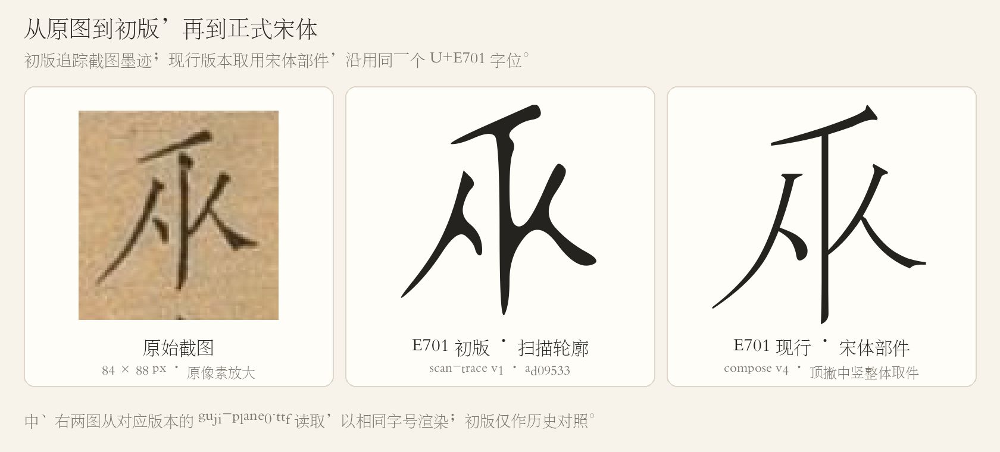
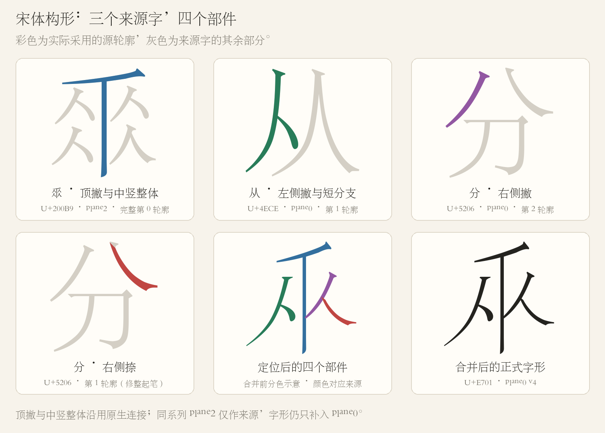
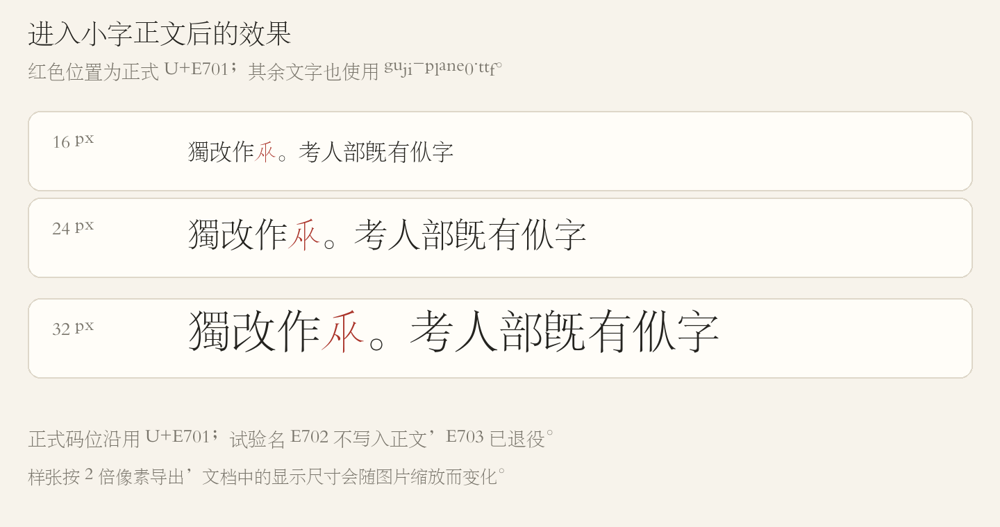

# 从刻本截图到小字宋体：U+E701 造字纪实

2026-11-15。本文记录康熙字典「乑」字按语中一个特殊刻形的补字过程：为什么需要补字，怎样从现有宋体字形中取部件，以及最终如何进入项目字体。

最终采用的是**同系列小字字体的原生部件构形**：从「𠂹、从、分」三个字中抽取四个部件，其中顶撇与中竖作为一个完整部件整体提取，参照原图的笔画位置组合，写入 `guji-plane0.ttf` 的 **U+E701**。该字仅用于小字内容；大字字体已移除此字。最初转正的宋体方案来自试验 E702 v3；随后按用户要求，将分开提取的顶撇和中竖改为整体取件，形成当前 **compose v4**。正式码位始终是 E701，正文不需要更换字符。



图 1：从左到右为 **84 × 88 px 原始截图、初版 E701（scan-trace v1）、现行 E701（compose v4）**。初版直接读取历史提交 `ad09533` 中的小字字体；现行版读取当前正式小字字体，两版以相同字号渲染。它们是同一码位在不同阶段的字形，正文现在采用右侧宋体版本。

## 一、缘起：按语中的一个字，不能用相近字代替

问题出现在武英殿版康熙字典的项目图像页 **@349（0349.jpg）**，属于「乑」字条按语的续文。有关句子为：

> 又諸韻書俱書作乑，《正字通》獨改作〔图示字形〕。考人部旣有㐺字，則此亦不宜兩混，特攺正。

这里的「〔图示字形〕」是本文为便于阅读加入的代称。康熙字典网站的[乑字释文](https://www.kangxizidian.com/search/index_v.php?stype=Word&sword=%E4%B9%91&detail=y)在同一位置采用「〈亻下从人人〉」描述，并另注「㐺字作〈亻亻亻〉」。网站把「乑」字条的起页记为 348；本次补字所在的续文在图像页 349，两者所指位置不同。

这段按语本身就在辨别字形。直接借用现成的「㐺」会抹去原文所讨论的区别，而描述性文本或方框占位又不能给出原页的单字形态。项目因而需要为这个位置保存一个独立、可排版的显示字形，并以私用区码位登记。这里的「造字」是为已有刻形补造字体字形；U+E701 是本项目的约定，不是对该字新增一个通用 Unicode 身份。

### 图像条件决定了路线

最初可用的单字截图只有 **84 × 88 px**。随后核对了整页扫描 `0349.jpg`，尺寸为 **1130 × 1719 px**，目标字的有效墨迹也只有约六七十像素的尺度。本次取得的整页材料没有提供明显更高的单字细节。放大可以帮助观察，但不能恢复缺失的笔锋与断笔信息。

因此工作分为两个阶段：先验证低分辨率截图能否形成可用轮廓，再解决它与小字宋体混排时的风格协调问题。

## 二、方法的演进：先保留刻形，再构造宋体

第一阶段从截图提取轮廓。图像先二值化，再用 3 × 3 十字形结构元做两次迭代的闭运算，桥接断笔，并去掉小噪声域。随后进行 Moore 邻域边界追踪、Douglas–Peucker 简化，再以折线顶点作为二次贝塞尔控制点、相邻边的中点作为曲线上点，使边缘平滑。得到的轮廓按字体内「㐺」的包围盒与字宽校准尺寸，成为最初的 `scan-trace` 版本。

图 1 中间展示的就是这一**初版 E701**：它的笔画粗细与边缘起伏来自清洗后的截图墨迹，平滑处理使像素边界成为连续曲线。图中的字形取自当时实际补录的字体，历史文件 SHA-256 为 `6cdaddc31a13c41bdc602e904fc6d28a6b99422ed62d31651aac7c46345a8f9e`。这张历史对照不会改变当前字体中的宋体字形。

这个阶段证明了截图能够转成字体轮廓，也保留了刻本外观；但扫描边缘的粗细和不规则起伏，在小字宋体正文中仍显得突出。用户随后要求从小字字体已有的部件构造新字，使它具有宋体的笔锋与粗细关系。

| 阶段 | 做法 | 后续处理 |
| --- | --- | --- |
| 初版 E701 | 清洗截图并追踪轮廓 | 曾用于正式补录，后被小字宋体版本替换；源材料保留 |
| 初版 E702 | 直接复制「㐺」 | 与原图差别大，未作为最终字形采用 |
| 修订 E702 v3 | 从小字字体抽取五个部件，按原图构形 | 用户选定，转正到 U+E701 |
| E703 | 其他合成、重绘试验 | 按用户要求删除，不进入正式字体 |
| 宋体 v4 整体取件 | 从「𠂹」一次提取顶撇与中竖的完整连写轮廓；其余部件保持不变 | 当前正式版本，仍使用 U+E701 |

「E702」在不同试验阶段曾指代不同实现。**本文所说的获准方案是修订后的宋体部件构形，不是最初复制「㐺」的版本。**早期「〈亻人人〉」等描述只作检索与占位线索，最终笔画布局以原图和审定轮廓为准。

## 三、宋体构形的部件究竟来自哪里

当前四个部件取自同系列的中华书局宋体小字字体：「𠂹」在 [`guji-plane2.ttf`](../../guji-preview-grid/public/fonts/guji-plane2.ttf)，「从、分」在 [`guji-plane0.ttf`](../../guji-preview-grid/public/fonts/guji-plane0.ttf)。两份字体均以 1024 units/em 为坐标基准。plane2 只作为部件来源读取，最终 U+E701 仍仅写入 plane0。



图 2：前四格展示部件在**来源字中的位置**，灰色为其余轮廓；第五格为定位后的四个部件，第六格为合并后的正式字形。蓝色的顶撇与中竖是**同一条完整闭合轮廓**，只有一次整体仿射变换，保留来源字中的原生连接。

| 图中颜色 | 最终承担的部分 | 来源字、码位与字体 | 提取位置 | 具体处理 |
| --- | --- | --- | --- | --- |
| 蓝色 | 顶撇与中竖整体 | 𠂹 · U+200B9 · plane2 | 第 0 轮廓，完整提取 | 顶撇、长竖及两者的连接一起提取；整体缩放、倾斜和定位，无切口、无另添竖笔起笔装饰 |
| 绿色 | 左侧长撇及其短分支 | 从 · U+4ECE · plane0 | 第 1 轮廓，完整提取 | 部件本身已包含长撇与短分支；沿用 v2 的整体仿射定位 |
| 紫色 | 右侧向中竖接入的撇 | 分 · U+5206 · plane0 | 第 2 轮廓，完整提取 | 取「分」上部左侧的撇；沿用 v2 的目标位置与比例 |
| 红色 | 右侧向外舒展的捺 | 分 · U+5206 · plane0 | 第 1 轮廓的捺笔路径 | 沿用 v2 的主体和末端处理：省去独立起笔装饰，再接入撇笔，避免多余凸刺 |

轮廓编号从 **0** 开始，是生成器按当前来源字体解析出的顺序，不是笔顺编号。紫色笔画在来源字「分」中位于左侧，移入目标字后承担右侧撇笔。

### 为什么改为整体取件

宋体 v2 曾分别取「乑」的顶撇和「丨」的中竖，再在连接处合并。用户指出，两者应作为一个连写部件提取，并举「乑、𠂹」为例。

本次检查发现，「乑」的顶撇与中竖虽连在一起，但同一轮廓还带有右侧分支，需先去掉这些分支；「𠂹」的第 0 轮廓则已经是独立的顶撇—中竖部件。因此选择「𠂹」，**完整复制这一轮廓**，保留原生转折、竖干和底部收笔。来源记录中不再出现单独的「丨」部件。原 v2 方案仍保存为历史记录。

### 从部件到整字，做了哪些调整

原图用于确定笔画相对位置，部件轮廓由字体提供。顶撇与中竖接受同一个仿射变换：横向比例 0.66、纵向比例约 1.012608，纵坐标加入 0.068 倍横坐标形成轻微倾斜，再整体平移到目标位置。这保持了顶撇与中竖之间的连接关系，单独拆取时「丨」的头部装饰也不再出现在连接处。

该变换在字体坐标中为：

```text
x′ = 0.66x + 193.38
y′ = 0.068x + 1.0126083333333333y − 55.97839166666667
```

左侧部件和右侧撇、捺沿用 v2 的源路径及变换后路径，经逐项校验完全一致。四个部件均保持正向，没有镜像翻转。原生整体部件经缩放后的中竖比旧拆笔版略细，需结合小字混排检查，不能只比较放大字形。

部件安放后，使用 `skia-pathops` 合并交叠路径，得到 **2 条闭合轮廓、99 个轮廓点**。四个来源部件与两条成字轮廓是不同层面的计数。

精确来源保存在：

- [`guji_songti_components.py`](../../tools/dataset/guji_songti_components.py)：当前整体取件构造，并保留旧 v2 的复现分支。
- [`e701-songti-v4.json`](../../tools/dataset/font-sources/e701-songti-v4.json)：四个部件的路径、整体变换、plane0 来源字哈希、plane2 外部来源字哈希、合并轮廓和度量。
- [`e701-songti-v2.json`](../../tools/dataset/font-sources/e701-songti-v2.json)：原来将顶撇与中竖拆为两件的历史方案。

生产补字工具会同时检查目标字体内的来源字和外部 plane2 中的「𠂹」；来源轮廓发生变化时会拒绝套用旧方案。本次也验证了错误的外部来源哈希会被拒绝。

## 四、结果：正式码位稳定，只进入小字字体



图 3：红色位置使用正式 U+E701，其余文字也用同一小字字体绘制。样张以两倍像素导出，图片在文档中的显示缩放会改变视觉尺寸；这是混排示例，不是不同屏幕渲染效果的保证。

最终状态如下：

| 项目 | 结果 |
| --- | --- |
| 正式码位 | **U+E701**，项目私用区字位；正文继续使用原码位 |
| 正式方案 | `compose`，宋体部件构形 |
| 收录范围 | **仅 `guji-plane0.ttf`**；注册表标明 `usage: small-only` |
| 小字构形版本 | 4；顶撇与中竖整体取自「𠂹」 |
| 注册表操作版本 | 4；本次仅更新小字字形，保留仅小字范围 |
| 轮廓 | 2 条闭合轮廓，99 个轮廓点 |
| 字体单位与字宽 | 1024 units/em；横排 advance 为 1024，竖排 advance 为 1024 |
| 度量 | `hmtx = [1024, 17]`，`vmtx = [1024, 22]` |
| 小字 best cmap 数量 | 30,707；宋体替换前后不变 |
| 试验码位 | 正式字体未增加 U+E702 / U+E703；E703 展示已移除 |
| 大字字体 | E701 的映射、轮廓及相关记录已移除；保留其他字形和此前补录的 U+2BD6E |
| 小字缓存戳 | `e701-4-joined` |
| 大字缓存戳 | `001015-2bd6e-no-e701` |

U+E701 的显示依赖本项目的小字字体及注册约定。将文本交给别的字体时，仍需同时提供这份字位说明。以后可以继续改进宋体构形，并以新版本替换同一码位，正文引用不随设计迭代而变化。

### 验证了什么

转正时检查了非目标字形的轮廓字节和横竖排度量，确认它们不变；cmap 与 glyphOrder 不变，目标字的字宽保持 1024。演示子集与正式字体在 16、24、32、220px 下逐像素一致；浏览器检查了实际墨迹，避免把「字体已加载」误认为「字形已画出」。转正阶段的应用验证为 7 个测试文件、272 项测试通过，并通过生产构建。

本次整体取件修订通过生产构建，演示子集在 16、24、32、220px 下与正式字体逐像素一致。浏览器检查确认四个部件来源图正常加载，U+E701 在 200px 下有 3,995 个实际墨迹像素。另完成以下复核：

1. 从来源部件重新生成并合并轮廓，结果与审定轮廓的编译 SHA-256 完全一致：`0ef6027de1532c8bc037f5944ab4080e7e14651298ba2f61d468a36d898493c4`。
2. 先以登记版本 3 干跑，再执行替换；非目标字形、度量和 cmap 不变。整体取件的源轮廓与「𠂹」第 0 轮廓逐项相同，其余三个部件与 v2 路径逐项相同。旧 v2 仍能复现其原编译哈希。

新方案的归一化墨迹 chamfer 距离为 **0.558**，高于旧拆笔版的 0.440，也超出旧方案的 0.5 阈值。完整部件的原生连接与较细中竖改变了墨迹分布，本方案在 JSON 中显式采用 **0.6** 阈值，并在流水中记录；旧 v2 的默认阈值仍为 0.5。该指标只记录与清洗扫描的墨迹距离，不评价宋体设计优劣；完整来源轮廓、单一仿射、非目标字形不变及渲染检查共同验证本次修改。

## 五、留痕、复核与后续改进

截图原件、清洗图、初版扫描轮廓和最终宋体方案均已入库：

| 材料 | 用途 |
| --- | --- |
| [原始截图](../../tools/dataset/font-sources/e701-scan-original.png) | 保留低分辨率原件，供人工对照 |
| [清洗墨迹](../../tools/dataset/font-sources/e701-scan-clean.png) | 现有差异检查的参照图 |
| [扫描轮廓 v1](../../tools/dataset/font-sources/e701-scan-v1.json) | 记录第一阶段的扫描追踪结果 |
| [宋体方案 v4](../../tools/dataset/font-sources/e701-songti-v4.json) | 当前四部件构形、跨字体来源与整体取件的精确记录 |
| [宋体方案 v2](../../tools/dataset/font-sources/e701-songti-v2.json) | 旧五部件方案，作为历史复现资料保留 |
| [PUA 注册表](../../guji-preview-grid/src/pua-registry.json) | 字位、适用字体、版本、哈希及操作历史 |
| [生产补字工具](../../tools/dataset/guji_pua_patch.py) | 按登记应用字形，并执行备份及验证 |

生产工具同时处理 `hmtx` 与 `vmtx`，以保证横排、竖排度量完整；cmap 注入限制在适用的 Unicode/Windows 子表，避免把高位 PUA 写入范围有限的旧 Mac 子表。正式替换还要求显式版本、前置文件哈希及备份，以便回滚。

截至本文，两个字体文件的 SHA-256 基线为：

```text
guji-plane0.ttf  17,251,780 B
b4433eb2cb5218d3e507dd1757398813ac105d6c384dbbf8a841a60107b53c0f

guji-large.ttf   46,623,752 B（不含 E701，保留 U+2BD6E）
99be6a77b93afa746b2d29e37d6014cab9f9c21471f685a2392426760a17dabf
```

在具备 fontTools、Pillow、NumPy、SciPy 的环境中，可从仓库根目录执行当前方案的无写入复核：

```sh
python3 tools/dataset/guji_pua_patch.py --cp E701 --font guji-plane0.ttf \
  --replace --expected-version 4 --dry-run
```

如需从四个原生部件重建合并轮廓，还需要 `skia-pathops`（本次验证版本为 `0.8.0.post2`）：

```sh
python3 tools/dataset/guji_songti_components.py
```

后一个命令只在内存中重建并比较审定哈希，不保存字体。以后改进构形时，应先更新、审看部件方案，再冻结新轮廓、递增登记版本，并保持 U+E701 这一正文引用。上面的版本号是本文快照，运行时须以注册表为准。

完整操作与回滚信息见[字体操作登记簿](../font-operations.md)第 3–6 条、[小字宋体转正报告](2026-11-15-U+E701小字宋体转正.md)和[仅限小字的范围修订](2026-11-15-U+E701仅限小字.md)。小字转正的字体提交为 `7ff192c`，从大字移除的提交为 `8fd8063`。本次整体取件修订见[修订报告](2026-11-15-U+E701顶撇中竖整体取件.md)。前期报告中的双字体状态和 v2 拆笔构形属于历史阶段，当前状态以本文和注册表为准。

本文三张插图由已入库的原始截图、历史提交 `ad09533` 中的初版小字字体、当前正式字体和审定 JSON 生成；部件图中的彩色路径对应 JSON 的 `source_path` 与 `path`。图片随文档入库，查看本文无需启动本地演示服务，也不依赖读者安装该字体。
