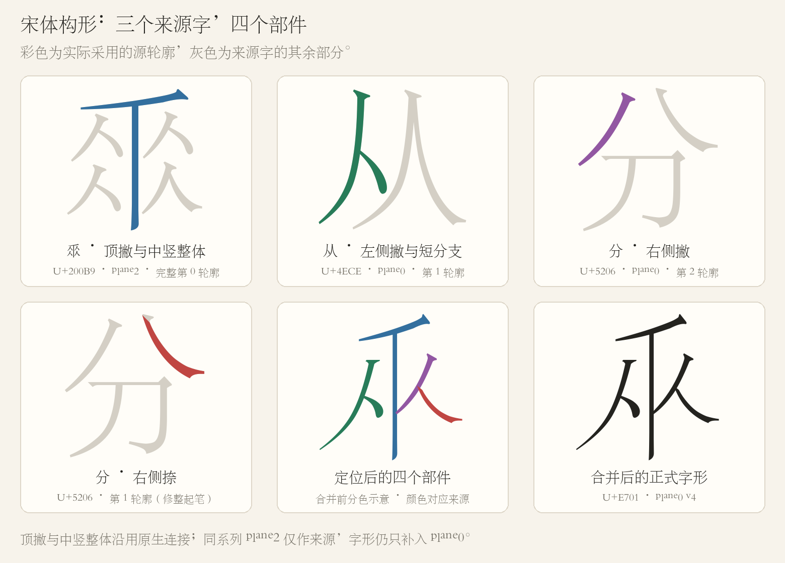

# U+E701 顶撇与中竖整体取件

2026-11-15T16:03:48+08:00，按用户要求，顶撇与中竖改为从同一个字形中作为一个部件整体提取。当前方案完整采用小字字体 `guji-plane2.ttf` 中「𠂹」U+200B9 的第 0 轮廓，保留原生连接。仅替换 `guji-plane0.ttf` 的 U+E701；plane2 只读，大字字体仍不含 E701。

## 来源与处理

「乑」的顶竖所在轮廓还包含右侧分支，需要切除；「𠂹」的第 0 轮廓已经是独立、完整的顶竖部件，因此选用后者。源记录与该轮廓逐项相同，只有一次整体正向仿射变换：

```text
[0.66, 0.068, 0, 1.0126083333333333, 193.38, -55.97839166666667]
```

其余三个部件为「从」的左部、「分」的撇和捺，源路径、变换后路径与 v2 完全一致。四个部件合并为两条闭合轮廓、99 点。旧 v2 配方保留，生成器仍能复现旧轮廓。



## 字体操作记录

| 项目 | 修改前 | 修改后 |
| --- | --- | --- |
| plane0 SHA-256 | `0e5eda61b7324f8bcf9c420a9633537799021a45f0bcfdad22574fac25a1d257` | `b4433eb2cb5218d3e507dd1757398813ac105d6c384dbbf8a841a60107b53c0f` |
| 字节数 | 17,251,812 | 17,251,780 |
| 注册操作版本 | 3 | 4 |
| 小字构形版本 | 2 | 4 |
| 轮廓点 | 110 | 99 |
| best cmap 数量 | 30,707 | 30,707 |
| hmtx / vmtx | [1024, 17] / [1024, 22] | 不变 |
| 小字缓存戳 | e701-2-songti | e701-4-joined |

新方案：[e701-songti-v4.json](../../tools/dataset/font-sources/e701-songti-v4.json)。完整叙述见[造字纪实](2026-11-15-U+E701造字纪实.md)。

`guji-plane2.ttf` 哈希保持 `80df094a2e63091b222706696a8b244c9dba45219af866226a097d0fbb2bf28d`；`guji-large.ttf` 哈希保持 `99be6a77b93afa746b2d29e37d6014cab9f9c21471f685a2392426760a17dabf`。未修改系统字体或正文标注。

## 验证及检查阈值

- 先干跑，后替换；全部非目标轮廓字节和度量不变，cmap/glyphOrder 不变，横竖排 advance 与 bearing 不变。
- 当前四部件重新生成的编译 SHA-256 为 `0ef6027de1532c8bc037f5944ab4080e7e14651298ba2f61d468a36d898493c4`，与冻结轮廓一致；旧 v2 重建哈希仍为 `cf037276c525b01352d93433e936f47b9da9d354eaf33ff50c2a5c962f9041eb`。
- 新增跨字体来源校验；把外部「𠂹」的预期哈希故意改错，生产工具按预期拒绝。正常来源通过。
- 新方案 chamfer 为 **0.558**，超过旧拆笔方案的 **0.5** 闸。整体原生部件的连接与较细中竖改变了墨迹分布，本方案明确登记 **0.6** 阈值，机器流水含 `chamfer_gate`。默认旧方案仍使用 0.5，命令行 `--gate` 可显式覆盖。这个数值不作为设计优劣评分。
- 子集与正式字体在 16、24、32、220px 下逐像素一致。来源字「𠂹」另有仅含 U+200B9 的演示子集；正式 plane2 不变。
- 浏览器来源图均加载成功，来源字字体已加载；U+E701 在 200px 下实际墨迹为 3,995 px。截图：`var/unihan/font-trial-preview/joined-topstem-v4-browser.jpg`。
- `npm run build` 通过。本次未改应用逻辑，未重复运行历史 272 项应用测试。

## 留痕与回滚

生产工具已向 `var/unencoded/kangxi-unencoded/font-patches.jsonl` 追加替换记录。字体提交与哈希基线见[登记簿第 6 条](../font-operations.md)。

修改前的小字字体备份：

`var/unencoded/kangxi-unencoded/font-backups/guji-plane0.ttf.0e5eda61b7324f8bcf9c420a9633537799021a45f0bcfdad22574fac25a1d257.ttf`

上一个完整状态的 Git 提交为 `6a5dd38`。回滚时需同时恢复 plane0、注册表及对应方案，并更新缓存戳；其他字体不需要回滚。旧演示页归档于 `var/unihan/font-trial-backups/before-joined-topstem-v4/`。
