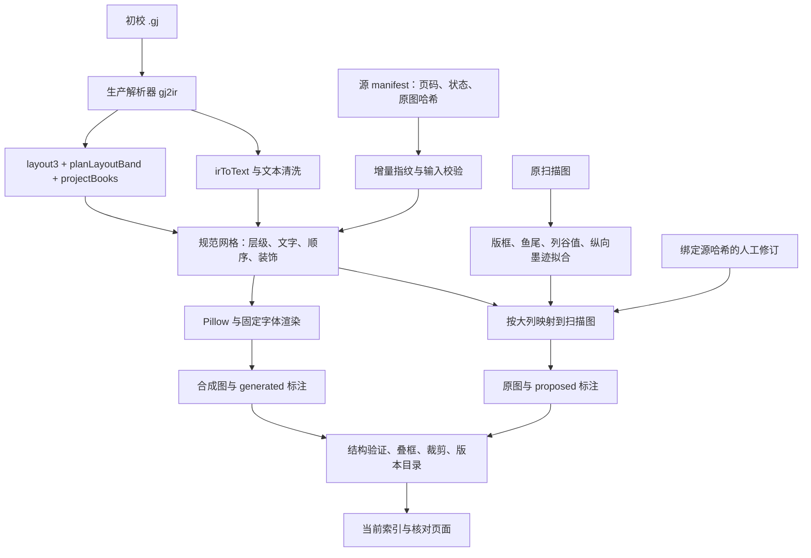

# 古籍版式与文字 OCR 数据集构建技术报告

日期：2026-11-16。对象：康熙字典武英殿版已完成初校的 45 页，即 @312–358，除去 @329、337。本文说明已经实现并运行的构建方法；后续改进单列于第 10 节。操作入口见[增量构建指南](../development/ocr-dataset.md)，运行记录见[构建验收](2026-11-16-OCR数据集构建验收.md)。

目前已生成同源的 **45 张原扫描图和 45 张合成渲染图**，以及文字、分层版式、阅读顺序和裁剪样本。两种输入域共享初校转写，各自使用独立的几何坐标。合成图坐标由生成图像的布局直接给出；原图坐标由“扫描图版框与墨迹测量 + `.gj` 布局先验”联合推定，仍属于待复核候选。

原图定位的核心是：**先测出适合容纳正文的列网格和纵向范围，再把已知文字结构投影进去。** 本实现没有逐字识别原图，也没有通过字形匹配确定每个字符的笔画边缘。45 页构建成功证明导出和数据契约可用，不证明原图框已达到检测评测所需的精度。

## 1. 数据范围与两种输入方案

先用六页贯通解析、渲染、扫描图定位、裁剪和核对，再增量加入其余 39 页：

| 页码 | 主要覆盖内容 |
| --- | --- |
| @312 | 标题、标题层级及初始留白 |
| @333 | 常规正文和局部小字列片段 |
| @318 | 大小字混排、空位和折行 |
| @328 | 圈号、合字及空列 |
| @342 | 私用字 U+E815，两处实例 |
| @349 | 私用字 U+E701，以及需要排除的版心／鱼尾 |

| 项目 | 已构建规模与口径 |
| --- | --- |
| 独立来源页 | 45，来源状态均为 `first` |
| 原图尺寸 | 宽 1,130 px，高 1,665–1,719 px；合成图使用对应页尺寸 |
| 整页图像 | `scan` 45 张、`synthetic` 45 张 |
| 每域文字 | 15,266 个非空白 Unicode 码点 |
| 每域大列 | 360 个 band，其中 352 个非空 |
| 每域文字片段 | 1,222 个：947 个非空小字 run、275 个大字／合字格 |
| 每域字格 | 15,262 个非空 glyph slot；四个双码点合字使码点数多 4 |
| 空白字格 | 326 个，另存 `gaps`，不作为文字检测目标 |
| 两域裁剪总数 | 3,148，即 `2 × (352 + 1,222)`；不另行导出全部小字单字裁剪 |
| 装饰结构 | 1,041 个书名 overlay 投影为 1,116 个片段，另有 73 个圈号 |

裁剪是整页的派生视图，不是新增独立内容。原图与合成图也不能相加宣称有 90 页独立转写。

| 用途 | 方案 1：原扫描图 | 方案 2：`.gj` 合成渲染图 |
| --- | --- | --- |
| 文字识别开发 | 保留原刻字形、缺损、纸纹与印刷噪声；目标文字为初校质量 | 图文严格同源，适合监督链路回归和训练辅助 |
| 版式几何 | 自动坐标为 `proposed`，需人工复核 | 字格几何为 `generated`，与生成画布一致 |
| 阅读顺序 | 来自 IR，几何与文本的对应需核对 | 来自同一 IR 和布局计划 |
| 主要限制 | 初校不等于终校，候选框不等于定位金标 | 字体与原刻有域差异，不能替代真实扫描评测 |

## 2. 构建流程与唯一转写源

构建器读取 `kangxi-gold/manifest.json`，默认只选择 `first` 和 `final` 页面，使用当前 `.gj` 作为唯一转写源。源库已存的 JSON/TXT 不是输入前提；构建时重新派生 IR 和文本，并把它们保存进本次产物，不覆盖源库三件套。



实现分工如下，原图定位的完整细节见第 5 节。

| 模块 | 职责 |
| --- | --- |
| [build_ocr_dataset.py](../../tools/dataset/build_ocr_dataset.py) | 选页、指纹、版本目录、裁剪、索引、修订导入 |
| [export_ocr_layout.mjs](../../tools/dataset/export_ocr_layout.mjs) | 调用生产解析／排版，导出规范字格和阅读顺序 |
| [ocr_render.py](../../tools/dataset/ocr_render.py) | 固定字体渲染、网格转像素、字形掩码范围、叠框 |
| [ocr_scan.py](../../tools/dataset/ocr_scan.py) | 原图网格检测、逐大列纵向拟合、候选坐标和修订 |
| [kangxi_column_seg.py](../../tools/eval/kangxi_column_seg.py) | 复用版框候选、鱼尾、谷值拟合辅助函数 |
| [ocr_review.html](../../tools/dataset/ocr_review.html) | 叠图核对、文本联动、大列／片段坐标编辑和下载 |
| [verify_ocr_dataset.py](../../tools/dataset/verify_ocr_dataset.py) | 独立核对构建后的图像、文本、几何、裁剪和哈希 |

## 3. 规范布局、文字与阅读顺序

### 3.1 使用生产 IR 和布局计划

导出器直接调用预览应用的 `gj2ir`、`layout3`、`planLayoutBand`、`projectBooks`、`irToText`，避免重新实现一套 `.gj` 语法。IR 基本层级为 Page → Band → Line → Element；书名和圈号以 overlay 表达。

当前康熙版式为每页 8 个大列、16 个小列位、24 个小字行位；标准大字占 2×2 小字格。局部并行的小字 run 从右向左排列，并行组高度取最长 run；大字格结束前一并行组，并沿纵向继续堆叠。窄组可能带半格偏移。标题层级影响初始留白，显式空列、空格保留空间位置。

这里的 run 是一个局部连续排版片段，不能当作贯穿全页的物理列。`small`、`large` 是字号类别，不能直接推成“夹注”“正文”“词条字头”等语义类别。

### 3.2 先确定读序，再附坐标

`layout3` 的 `band.items` 会先收集大字，再收集小字 run，数组顺序不是阅读顺序。既有 45 页审计中，直接串接该数组有 41 页与目标文本不一致。

导出器按 `planLayoutBand.segments` 遍历：大字段按 element ID 取布局对象，并行段按计划中的 run 顺序取对象，然后附上实际排版位置。导出末尾强制检查：

```text
连接所有 region.text = 连接所有 glyph.text = 清洗后 irToText 的非空白文本
```

任一不一致即使页面失败，不能以图像看起来正确代替标签读序校验。

### 3.3 码点、合字和空位

`text_range=[start,end)` 指向清洗后非空白文本中的 Unicode **码点**，不是 UTF-8 字节或 JavaScript UTF-16 code unit。小字 `source.raw_range` 对应 IR line 原文码点区间；IR 内另保留源码 UTF-16 位置映射。标签不擅自做繁简转换或 NFKC 归一化。

四处合字分别为“十五”“十一”“十二”“十二”。每处是一个空间字格、两个目标码点，因此不能要求“一框一字符”。326 个空白字格不分配文字偏移，另记为 gap。书名框和圈线进入 `decorations`，不变成额外正文字符；书名片段保存原 overlay 引用和上下开口状态，没有虚构跨全书统一的书名 ID。

## 4. 方案 2：从 `.gj` 渲染图像与标注

### 4.1 渲染后端与坐标

当前后端标识为 `guji-grid-pillow/1`：使用生产 IR／布局的几何，以 Pillow 绘制到独立画布。它不是浏览器 CSS 截图，不保证与预览逐像素一致。

样式 v1 的 `[左,上,右,下]` 页边距为 `[124,160.5,104,107]` px，纸色 `#dcb68a`，墨色 `#1c1c1c`，绘制外框、不绘制内部界栏。设图像宽高为 `W,H`，列位数为 `C`、行位数为 `R`，则：

```text
ux = (W - 左边距 - 右边距) / C
uy = (H - 上边距 - 下边距) / R
x(c) = 左边距 + c × ux
y(r) = 上边距 + r × uy
```

图像绘制与所有层级的框共用这个变换。最终坐标采用左上原点、x 向右、y 向下的像素 `xyxy` 半开区间；标签保留浮点坐标。裁剪时左／上向下取整，右／下向上取整，并把实际整数裁剪范围写入 `bbox_in_page`。

### 4.2 字体、合字和墨迹框

大字只查 `guji-large.ttf`；小字依次查 `guji-plane0.ttf`、`guji-plane2.ttf`、`guji-planef.ttf` 的 cmap。没有系统字体回退；缺 cmap 或字形掩码为空都会使本页失败。

使用 Pillow BASIC 排版引擎，以 2 倍分辨率绘制，再用 Lanczos 缩小。基础字号相对于横向格宽分别为小字 0.8、大字 1.8、圈内大字 1.5。多码点合字先竖向叠放，再压缩进同一格；圈线和书名框最后单独绘制。

两类框必须分开理解：

- `bbox`：布局字格占位矩形，描述文字被安排在哪个格中。
- `glyph.ink_bbox`：单独字形掩码的非零范围换算到输出像素坐标，不含装饰线；测量发生在整页最终降采样之前，不能宣称是最终 PNG 上阈值分割得到的严格笔画框。

PUA 字符保存原码点、字体文件和出现位置，汇总于 `pua.json`。U+E701 有项目登记，U+E815 的语义身份尚未裁定；可渲染不等于已证明其对应某个标准汉字，不能凭外形替换标签。

## 5. 方案 1：原扫描图上如何生成候选定位

### 5.1 定位依据及坐标阶段

输入有两部分：原图提供实际版框、墨迹密度和列间隙；IR 提供每页应有的列数、每段大小字、行位、空位和阅读序。图像侧不预测字符身份，IR 侧也不直接给出扫描图像素坐标。

当前方法标识为 `image-grid+IR-local-layout/1`。虽然复用了旧列分割模块的辅助函数，数据集构建**不调用其 `segment()`，也不读取其中的 OCR 数据库或缓存**，只调用 `frame_candidates`、`fishtail_x` 和 `_fit_for_block` 等网格辅助逻辑。因此本算法没有“先跑 OCR，再用识别文字对齐”的步骤。

坐标分三阶段：整页扫描像素 → 版框内局部横向网格 → 每个大列的局部二维映射。后两步均含版式先验，不能称为全自动无先验字符检测。

### 5.2 灰度二值化

原图转灰度后，定义暗像素掩码：

```text
D(y,x) = 1，当 I(y,x) < 140；否则为 0。
```

阈值、宽度先验和像素搜索范围针对本批宽 1,130 px 的扫描图设置。当前没有自适应阈值、去倾斜、透视校正或分辨率归一化。

### 5.3 保留多个版框候选

`frame_candidates(D, expected_w=960)` 通过长直线的高墨迹占比寻找版框：

1. 在纵向 `[0.2H,0.8H)` 内计算每个 x 的暗像素比例，选比例大于 0.50 的列。
2. 在横向 `[0.2W,0.8W)` 内计算每个 y 的暗像素比例，选比例大于 0.50 的行。
3. 相邻选中坐标间隔不超过 3 px 时合为一簇，用簇的平均坐标表示框线。初始上下边取水平簇的首尾，之后还会重新约束。
4. 对每条可能的右边线 `xR ≥ 480`，从 `xL < xR-576` 的左边线中选择宽度最接近 960 px 的配对；无合适左边线时尝试 `xL=xR-960`。
5. 按宽度接近先验的程度排序，并补入未出现的最外侧线对。

保留多候选是因为正文框线、版心框线与裁切边缘可能竞争。没有足够水平／垂直线证据时会无候选，不能依靠人工 band 修订跳过这一检测阶段。

### 5.4 用鱼尾排除版心

在 `x≥0.55W`、`y∈[0.06H,0.40H)` 的右上区域计算逐列暗像素比例。若有连续至少 18 个像素列的比例大于 0.45，把第一段的左缘记为 `x_tail`，随后只保留：

```text
候选正文框的右边线 < x_tail - 12
```

这一步利用鱼尾的连续黑色实体排除右侧版心。仅依靠列谷值时，版心边缘也可能被当成正常列界；六页初版中的 @349 曾因此横向偏移约一个小列位。鱼尾未检测到时不增加该约束，不代表图中一定没有鱼尾。

### 5.5 从墨迹谷值拟合 16 个小列位

对每个保留的版框候选，四边内缩 6 px。宽度不足 `16×50×0.8=640` px，或切片为空／过窄时放弃该候选。

在候选内部沿 y 求均值，得到横向墨迹剖面 `p(x)`；用 11 px 均值窗平滑，首尾 11 px 用邻段均值修补卷积边缘影响。令平滑剖面中位数为 `m`，谷值候选满足：

```text
p(x) ≤ p(x-1)，p(x) ≤ p(x+1)，且 p(x) < 0.62m
```

距离小于 40 px 的相邻谷只保留较深者，再到未平滑剖面的 ±8 px 内找最小值精定位。墨迹左右范围取剖面超过 `max(0.05,0.35m)` 的位置首尾；有效位置数不超过 10 时改用切片全宽。

随后在候选切片的局部 x 坐标拟合 17 条线，形成 16 个小列位：

```text
Lk = R - k × p，k = 0,…,16
p：从 50 到 70 px，步长 0.2 px
R：从 ink_hi-8 到 ink_hi+8 px，步长 1 px
E(p,R) = Σv min_k |v-Lk| + |L16-ink_lo|
```

这里 `v` 为实测谷值，`ink_lo/ink_hi` 为墨迹范围；取边界约束下 `E` 最小的网格。若边界容不下网格，辅助函数会每次向两侧放宽 40 px 后递归重试。实际 `L0` 在右、`L16` 在左。

该目标函数是谷值到最近网格线的**单向距离和加左端锚点**。它没有逐条网格线都必须得到图像支持的约束，也不是概率模型。拟合后，每条线若在 ±5 px 内有谷值，就吸附到最近谷值并标记为有图像支持；否则保留预测线。

不同版框候选之间，最终选择有谷值支持的网格线数量最多者；相同数量保留先出现的候选，因此版框的初始排序影响平局结果。这里比较的是支持线数量，不是前述 `E` 的大小。

**2026-11-18 实现修正：**原图字格叠图复核发现 @313 的短鱼尾未被检出，含右侧版心的候选以 13 条谷值支持胜过正文框的 10 条，导致整页右移约一个小列位。现由 `ocr_scan.select_body_grid()` 先检查版框覆盖：对同一实测左框线（含间距不超过小列宽 1/3 的双线），若较窄候选的网格左缘位于框内半小格范围内，而较宽候选新增的右侧宽度至少有一半转成了左侧未覆盖区域，就排除较宽候选，再按谷值支持数选择。图像裁切边及网格越出左框的候选不能作为排除依据。@313 网格横向范围因此从 `[156.4,1110]` 修正为 `[107,1041]` px；完整字格投影和数据集定位共用此修正。本报告原始导出产物与统计未重新生成。

把局部线坐标加回切片起点后，每两小列合成一个大列，按右到左编号：

```text
第 j 个大列的 x 范围 = [L(2j+2), L(2j)]，j=0,…,7
```

**实现边界：**中间奇数网格线用于诊断两个小列位的边界支持情况，但最终字格投影是在大列内均匀划分，未直接采用吸附后的内部小列线。内部两小列不等宽时，即使找到偏移的谷值，子框仍可能有误差。

### 5.6 重新检测上下框线，避免包含页脚

初始水平线首尾可能纳入页脚水印。横向网格选定后，再在下列 x 区间计算逐行暗像素比例：

```text
[max(版框左边+20,80), min(版框右边-20,W-80))
```

上边线只在 `[0.05H,0.25H)` 搜索，下边线只在 `[0.78H,0.97H)` 搜索。选暗像素比例大于 0.50 的行，将间隔不超过 2 px 的行合为一组，以组内暗像素比例总和最大的组为框线。正文初始上边取上框线组最后一行加 3 px，下边取下框线组第一行减 3 px。

找不到任一边时页面失败。当前实现先拟合横向网格、后修正上下边，并不会用修正后的正文高度重新迭代横向拟合。

### 5.7 根据 IR 字格分布逐大列拟合纵向位置

所有大列先共享初值：`t0=y0`，`h0=(y1-y0)/24`。随后允许每个大列有独立的起点 `t` 和行距 `h`，吸收局部上下偏移和高度差。

对大列左右各内缩 3 px，沿 x 求暗像素均值并以 5 px 窗平滑，得到纵向剖面 `q(y)`。从该大列的 IR 字格取不重复的行跨度 `(ai,bi)`；左右并行的小字若占相同行跨度，不重复加权。空大列保留初值，评分为 `null`。

搜索范围及约束为：

```text
h ∈ [0.96h0, 1.04h0]，步长 0.3 px
t ∈ [t0-22, t0+22]，步长 1.5 px
丢弃 t < t0-8 或 t+24h > t0+24h0+8 的组合
```

对第 i 个行跨度，预期中心为 `ci=t+(ai+bi)h/2`，边缘位置集合为各个 `t+ai h` 与 `t+bi h`，共享边缘按出现次数保留。对剖面线性插值，定义：

```text
inside   = mean_i,δ q(ci + δh)，δ ∈ {-0.18, 0, 0.18}
boundary = mean_e q(e)
score(t,h) = inside - 0.55 × boundary
             - 0.000015 × (t-t0)² - 0.002 × (h-h0)²
```

取分数最高者，得到本大列框 `[xL,t,xR,t+24h]`。公式偏好预期字格中心附近有墨、边缘少墨，并以较弱惩罚限制漂移；大字以其完整跨度参与，空白字格不施加虚假的文字中心约束。

这个分数没有字符身份信息，也没有最小通过阈值。左右小列共用剖面，字内空白、圈线、污点或两侧错行都可能影响评分；得分高不意味着单字都对齐。

### 5.8 将规范字格投影到原图

设一个大列在规范网格中的左边为 `c0`、宽为 `C`（通常为 2），其扫描框为 `[xL,yT,xR,yB]`。对规范点 `(c,r)`：

```text
sx = (xR-xL)/C
sy = (yB-yT)/24
x = xL + (c-c0) × sx
y = yT + r × sy
```

每个 region、glyph、gap、decoration 的 `grid_bbox` 四边按所属大列转换。超出图像边界的部分裁到图像内，并设置 `clipped`；若得到空框则失败。自动结果使用 `bbox_type=estimated-layout-cell`，原图不生成 `ink_bbox`。

这种逐大列映射只能表达水平／垂直缩放和平移，不能描述旋转、透视或弯曲。它产生的是估计字格占位框，而非笔画紧框，也不是把合成图像素坐标直接复制到原图。

### 5.9 @349 的数值演算

当前产物中，大列 `p0349-b1`（从右数第二列）的规范框为 `[12,0,14,24]`，扫描框为 `[777.8,175.0,902.0,1586.68]`。因此：

```text
sx = (902.0-777.8)/2 = 62.1
sy = (1586.68-175.0)/24 = 58.82
```

该列大字片段 `p0349-b1-e2` 的文字为 `𠂣`，规范框 `[12,9,14,11]`，映射过程为：

```text
x1 = 777.8 + (12-12)×62.1 = 777.8
x2 = 777.8 + (14-12)×62.1 = 902.0
y1 = 175.0 + 9×58.82 = 704.38
y2 = 175.0 + 11×58.82 = 822.02
原图候选 bbox = [777.8,704.38,902.0,822.02]
```

片段读序 `order=4`（从 0 起），文本范围 `[66,67)`，`ink_fraction=0.19198`，`geometry_status=proposed`。所在大列纵向分数为 `0.18984`，两个小列位的边界诊断均为 `grid`。这个例子说明：坐标、文本与推定依据可以追踪，但有明确数值并不等于已获得人工确认。

### 5.10 六页实测与质量提示

下表取自 2026-11-16 当前有效产物。`block` 是选定版框左右边与修正后正文上下边；每列后续仍单独做纵向拟合。`pitch` 是吸附前的横向小列距，不是纵向行距。

| 页码 | block `[x0,y0,x1,y1]` / px | pitch / px | 谷值支持线 | 鱼尾左缘 x / px |
| --- | --- | ---: | --- | ---: |
| @312 | [1,168,1014,1564] | 59.4 | 10/17 | 未检出 |
| @333 | [67,167,1050,1585] | 59.6 | 12/17 | 1104 |
| @318 | [0,185,1016,1562] | 59.6 | 15/17 | 未检出 |
| @328 | [4,142,1039,1584] | 60.2 | 10/17 | 未检出 |
| @342 | [56,189,1037,1591] | 59.4 | 13/17 | 未检出 |
| @349 | [39,176,1024,1594] | 59.8 | 12/17 | 1082 |

45 页支持线数量为 3–16/17。@336 有较多空列，只有 3/17；@344、346 为 16/17。固定输出 8 大列、17 条线来自先验，支持线数量只反映其中多少条邻近谷值，既不是检测召回率，也不是坐标准确率。当前没有基于支持数的自动拒收门槛。

每个 region 计算整数取整框内的暗像素占比 `ink_fraction`；小于 0.015 时添加 `low-ink:<id>`，字格越界裁切时添加 `clipped-glyph-proposals`。当前 45 页这些告警均为空，但错误地框到邻字也可能有足够墨迹，因此不能以“无告警”代替叠图复核。

所有 band 框的外包矩形形成 `content_bbox`，其上下左右之外最多生成 4 个 `ignore_regions`，表示未转写区域。该办法不能保证正文外包矩形内部没有印章、框线或其他非目标文字，未实现精细装饰掩码或整页所有文字的转写。

## 6. 标签组织与人工复核

两域标签 schema 为 `guji-ocr/1`，共用 `source_page_id` 和文本来源，分别保存图像哈希和像素几何。

| 字段／对象 | 含义 |
| --- | --- |
| `bands` | 大列范围、顺序、标题层级及所属 region ID |
| `regions` | 小字 run 或大字／合字格，含文字、读序、文本区间及 glyph ID |
| `glyphs` | 非空字格，可能承载多个码点，保留来源和字号 |
| `gaps` | 空白字格的空间信息 |
| `decorations`、`overlays` | 书名片段、圈线、开口状态及语义引用 |
| `reading_order`、`glyph_reading_order` | 显式有序 ID 列表 |
| `proofread_status` | 源转写的初校／精校状态 |
| `geometry_status` | 本图几何生成／候选状态；原图 region 可单独标为已复核 |

文字校对状态与定位校对状态相互独立。源页成为 `final` 不会自动使原图字框成为 `reviewed`。

核对页支持页码、输入域、标注层、缩放及点击文字联动。建议先检查整页正文和读序，再看大列，最后核对文字片段及特殊字格；这只是复核顺序建议，本次没有记录逐框人工耗时或一致性指标。

人工可编辑大列框或 region 框，下载 `guji-ocr-review/1` JSON 后用构建器导入。导入会检查源 `.gj` 和原图 SHA-256、页面尺寸、框边界，以及 ID 是否仍存在于重新解析的布局中。有效修订合并存入需版本管理的 `kangxi-gold/scan-reviews/NNNN.json`。

两种修订的传播范围不同：

- **大列修订**在自动检测后、投影前应用，改变其内所有子框的映射；`band_geometry_status` 只表达大列复核状态。
- **region 修订**在投影后直接替换该 region 的框，并标为 `reviewed`；其 glyph、装饰不会跟着重新投影，也不会自动变为已复核。

页面级 `geometry_status` 仍为 `proposed`，当前没有人工逐字终校状态的完整编辑层。裁剪索引暂复制页面级状态，即使某个 region 已复核，对应扫描裁剪仍显示 `proposed`；需要精确筛选时，应通过 ID 查询 `scan.json` 的逐 region 状态。

源码修改可能使位置式 ID 变化，旧修订因此报 stale。应重新核对并显式归档旧修订，不能只改哈希绕过验证。由于自动检测先执行，修订文件目前也不能救援完全检测不到版框的页面。

## 7. 增量构建与可复现性

### 7.1 何时重建一页

每页输入指纹包含 `.gj` 哈希、原图哈希、来源状态、尺寸、来源 URL、该页定位修订，以及公共实现指纹。公共指纹包含 IR／parser 源码、导出器、构建器、渲染器、扫描定位器、所复用分割代码、PUA 登记、字体文件字节、样式和运行依赖版本。

输入指纹相同且该页全部产物校验和完整时才能跳过。仅检查文件存在或修改时间不足以判定有效。

| 变化 | 本次实际支持的行为 |
| --- | --- |
| 新页从 `draft` 变为 `first` | 下次运行纳入，只构建新增页 |
| 一页 `.gj` 或有效定位修订改变 | 重建该页，其余有效页跳过 |
| 产物丢失或损坏 | 校验失败，重建对应页 |
| 公共实现、字体或运行依赖改变 | 指纹改变，相关页面需重建 |
| 页降为 `draft` 或从源清单移除 | 移出当前索引，保留历史版本 |
| `--pages` 只选部分页面 | 未选中的完整且未变页面保留；已过期但未重建的页进入 deferred，不混入当前集 |
| 部分页构建失败 | 该页不进入当前索引，有效页继续生成，并返回非零退出码 |

新增初校页后仍运行同一条命令：

```sh
python3 tools/dataset/build_ocr_dataset.py
```

这是按需执行的增量构建，没有后台文件监控或定时触发。核对页模板会随索引重新导出，不参与每页图像指纹。

### 7.2 版本目录与发布边界

每页保存于 `objects/NNNN/<完整指纹>/`，包含 `source.gj`、`ir.json`、`text.txt`、两域图像／标注、叠框、裁剪和 `provenance.json`。先在临时目录生成并校验，再重命名进入版本目录；同指纹旧目录需替换时保留为 `.damaged-*`，包括显式 `--force` 重建场景。

输出根使用 `fcntl` 文件锁，避免并发写入。页面完成后、发布索引前再检查源文件、图像及状态是否变化，避免把编辑过程中的过期结果作为当前有效页。各索引文件分别原子替换，**不是多个索引之间的整体事务**；任务中断后应重跑，并检查 `last-build.json` 和独立验证结果。

默认目录为 `var/datasets/kangxi-ocr/`，属于可再生产物，不纳入 Git。代码、报告、轻量证据和人工修订纳入 Git；原扫描图保持来源存放策略。构建器会校验原图与源 manifest 的哈希、尺寸，不会遇到不一致时悄悄下载或更换图片。

### 7.3 本次运行环境

本次当前有效 manifest 的时间为 `2026-11-16T09:11:53.012831+00:00`。版本为 Python 3.9.6、Pillow 11.3.0、NumPy 1.26.2、FreeType 2.13.3、fontTools 4.60.2、Node v26.13.0。详细实现／字体哈希、逐页指纹见[构建证据](evidence/2026-11-16-ocr-dataset-build.json)，定位参数与上述算例见[原图定位证据](evidence/2026-11-16-ocr-scan-localization.json)。

## 8. 验证结果及其解释

已实际完成六页试建、扩展 45 页、重复构建和隔离副本中的增量行为检查。45 页全部生成成功，最终重复运行 `built=[]`、`skipped=45`；浏览器检查覆盖两域、多标注层、文字联动、坐标下载和导入重建。

验证分三层：

1. **结构与实现契约**：生产解析／排版无阻断诊断，文字与读序相等，空白、合字、PUA、装饰和来源引用按约定保留；新增 7 项数据集单元测试。
2. **产物完整性**：逐页校验图像尺寸、边界、文本区间、字形可见性、裁剪尺寸和全部产物哈希；独立验证器通过 45 页。
3. **视觉核对**：六页试样图文检查及全量文字片段叠框缩略图浏览；修复过正文延伸到页脚、@349 网格误入版心的问题。

这些检查没有提供逐字人工终校、原图字符框 IoU／mAP、复核者一致性或 OCR 模型 CER。自动验证保证数据在约定内自洽，视觉检查能发现明显系统偏移，仍不能量化全部候选框的准确性。本次未训练或评测 OCR 模型。

## 9. 数据使用与评测口径

当前所有视图统一使用 `split_group=kangxi-wuyingdian-development`，尚未随机拆分训练／验证／测试集。后续应先按来源书、版本或连续页组确定集合，再派生两域、裁剪及增强，避免同页文字泄漏。

- `pages.jsonl` 提供整页图与文本，可用于初校级转写开发；若要求全部可见文字，应先补齐版心、页脚等未转写内容。
- `recognition.jsonl` 提供大列及局部片段图文对；原图裁剪应经过定位核对再作为严格识别标签。
- 合成 `generated` 框适合合成图上的版式监督；真实扫描检测评测应建立独立复核的定位子集。
- 原图、合成图训练收益需在隔离的真实扫描页上比较；同一页的合成图训练、原图测试只能称为同内容跨域诊断。

“整页全部文字”“正文区域文字”和“给定片段识别”应使用独立评测协议。不得在比较时静默移除水印、改变忽略区或清洗规则。当前仅 45 页、2,204 种码点且长尾显著，重复渲染或增加噪声并不会增加独立文字覆盖。

## 10. 后续改进方向（尚未实现）

| 优先方向 | 当前不足 | 建议验证方法 |
| --- | --- | --- |
| 建立人工定位子集 | 候选框尚无定量定位精度 | 分标题、正文、混排、圈号合字、PUA 分层抽样，记录修订量、IoU 和复核耗时 |
| 增强原图几何模型 | 固定阈值和像素尺度，不能表达倾斜、透视、弯曲 | 先建立缩放／倾斜失败样本，再评估去倾斜和分段映射 |
| 利用内部小列实测边界 | 当前在大列内等分，未直接采用内部吸附线 | 对两小列不等宽页面比较局部框误差与读序保持情况 |
| 字格局部精化 | 字格来自全列线性投影，没有逐字笔画检测 | 在已确认片段内部尝试受约束投影／连通域或图像配准，并允许拒绝困难样本 |
| 复核工作流完善 | 无逐字编辑层；region 修订不传播至子框；检测失败无法纯手工起步 | 补 glyph 状态和审计信息，验证父子修订传播；支持独立正文框初始化 |
| 置信诊断校准 | 支持数、拟合分数和墨迹比例没有准确率含义 | 对照人工结果设置拒收阈值，分别报告漏检与误接收 |
| 合成到扫描的适配 | 字体、纸纹和缺损存在域差异 | 固定模型与训练预算，比较原图、合成图、混合／适配三种设置 |

后续工作应优先形成经过复核的原图定位基准，再用它衡量候选定位和训练收益。现有构建器已经把新增初校页纳入、图文导出、候选定位、修订回流和版本追溯连接起来，新增页面可沿同一流程持续积累。
