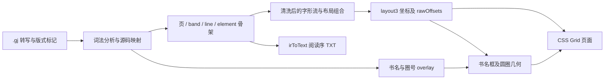

# 古籍排版的数据结构、算法与 .gj / IR 优化评估

核查日期：2026-11-16。对象：当前工作区的《康熙字典》武英殿版 45 页 `.gj`、IR v3、TXT，以及实际解析、布局、渲染代码。本文区分**实测结果、代码推论、拟议设计**。§1 采用最新修订语料；§5.1 保留初始问题依据，实现状态见 §5.5。

同日更新：用户已修复 @318、@320、@322、@325、@327 的 `.gj` 分段错误，对应 JSON/TXT 已全部同步。45 页现在均为 8 band、16 小字格宽、24 格高；正文阅读序不变。另已实现 profile 统一、版式诊断、空大列语法、布局计划及跨页书名投影等优化，详见 §5.5。修订前的[最初快照](evidence/2026-11-16-gj-layout-audit-before-0318-fix.json)和[仅修复 @318 时的快照](evidence/2026-11-16-gj-layout-audit.json)保留作历史依据。

核心判断：现有系统适合描述为“**有序转写骨架 + 局部并列／纵向堆叠的版面组合 + 跨边界标注及溯源映射**”。它具有值得专门研究的古籍约束，但仍建立在有序树、序列、区间集合、图和约束布局等经典方法上。“树和一维流都不成立”“发现了新的基本数据结构”均不是当前证据支持的结论。论文更有希望的贡献是：为竖排刻本给出精确的组合规则、可追溯映射及局部修订算法，并证明它们降低版面错误和人工修订成本。

## 1. 45 页重新核查

机器证据：[最新全量审计 JSON](evidence/2026-11-16-gj-layout-optimized.json)。复跑脚本：[audit_gj_layout.mjs](../../tools/eval/audit_gj_layout.mjs)，使用 Node 原生 TypeScript 支持，直接调用生产 `gj2ir`、`layout3`、`irToText`，不是另写一套布局算法估计格数。

```sh
node tools/eval/audit_gj_layout.mjs docs/research/evidence/2026-11-16-gj-layout-optimized.json --check --strict-layout
```

脚本在内存中重建，不覆盖 `.gj`、标注 JSON、TXT 或 manifest；证据包含逐页 `.gj` 哈希及相关实现文件哈希。初次核查运行了 IR 的 30 项验收；优化后的完整测试与构建结果见 §5.5。派生文件同步后，`python3 -I kangxi-gold/scripts/verify_dataset.py` 对 45 页标注及 45 张原图的完整性、哈希和尺寸检查全部通过。这不是对所有扫描原图的逐字复校。

| 指标 | 当前实测 | 口径 |
| --- | ---: | --- |
| 页数 | 45 | @312–358，集合中不含 329、337 |
| manifest 状态 | 45 `first` | 339 现在也为 `first`；状态标签不等于独立终校证明 |
| `.gj`／JSON／TXT | 各 45 份 | 当前重新解析结果与已存 JSON、TXT 均 45/45 一致；318／320／322／325／327 的派生文件已同步 |
| 页标 | 45 | 不是 44 |
| 有效源码行 | 1,146 | 包含 45 个页标；不能全部称为物理小列 |
| 标题 band | 7 | level=1/2/3 |
| band | 360 | 45 页均为 8 |
| IR line | 1,101 | 其中含标题行与没有元素的占位行 |
| element | 1,242 | large 275；small 967 |
| 合字元素 | 4 | 多码点共占一个大字格 |
| 骨架原始码点 | 18,814 | large 279；small 18,535；含转写标点、空格 |
| TXT 非空白码点 | 15,266 | 经现有清洗；不能与上一行混用 |
| 书名 overlay | 1,041 | 逐页 JSON 记录总数，跨页片段可能分开计数 |
| 书名 span | 1,116 | 74 个 overlay 多 span，其中 28 个跨 band |
| 未闭合尾片段／续入片段 | 7／10 | 是文件边界状态，不自动等于同一书名的全局身份 |
| 圈号 overlay | 73 | 字面 `#(` 仅 66 次，另外含省略 `#` 的糖 |
| 字面 `*`／`古文` | 326／56 | `*` 定义为空格；`古文` 的出现次数不是语义变体关系数 |
| 页首以小字开始 | 39 | 支持存在大量续文；不是 39 个词条已完成语义链接的证明 |
| 实际布局页高 | 45 页均 24 小字格 | 全部 band 均未超高 |
| 实际布局页宽 | 45 页均 16 小字格 | 360 个 band 均为 2 格宽；无宽度、重叠或溢出告警 |

### 1.1 最重要的统计纠正：文本长度不是占格

参考汇总的“28–30 格，最大 34 格，约 46% 超过 24”实际上混入了转写标点。当前 1,101 个 IR line 中，**495 行的原始码点数大于 24（44.96%）**，但经真实 `layout3` 清洗、分组后，**948 个小字 run 全部不超过 24 格**，其中 461 个恰好为 24；45 页布局高度均为 24，溢出 band 为 0。

例如 `p0313-b0-l0`：

```text
原始（28 码点）：所以行之者，一也。 又正一。唐書·司馬承楨傳得陶隱居正一
渲染（24 字格）：所以行之者一也 又正一唐書司馬承楨傳得陶隱居正一
```

所以，不能据这组数字推出“折行天然不是物理小列”。准确说法是：**fold 是转写者记录的断行证据，目标可对应原书的小字列片段，但不等于扫描检测得到的带坐标 TextLine，也不保证每条源代码行独占一根贯通全页的列。** 大字行、混合大小字行和空白占位都要单独解释。

### 1.2 8 band 是版式约定的表现，不是独立发现的自然常量

`gj2ir` 按空行切 chunk，生成 band；`layout3` 将每个 band 排成至少两小字格宽。优化后默认版式配置明确记录预期 8 大列，并诊断与之不符的输入；这仍不是 band 与扫描原图大列一一对应的证明。

当前有 **8 个完全没有元素的 band**，来源是独占一段的 `#`，例如 336 的末四段。这些 band 的布局高度为 0，却各自保留两格宽。因此“内容多少不影响 band 数”部分来自人工空位编码，不能作为模型独特性的独立实验证据。

@318 已修复：此前高度分别为 1 和 23 的相邻 band 合并为一个 24 格高的 band，“今”与后续“上／古文／丄／𠄞”恢复为同一大列的上下段。该页由 9 band、18 格宽恢复为 8 band、16 格宽，骨架文字序列与去空白后的 TXT 阅读序不变。

其余四页也已由用户修复分段，派生文件已同步：

| 页面 | 修复前（历史快照） | 修复后 |
| --- | --- | --- |
| 320／322／327 | 各 9 band、18 格宽，相邻短 band 分别为 5+19、4+20、3+21 格高 | 合并误断开的段；各 8 band、16 格宽，每个 band 高 24 格 |
| 325 | 8 band、17 格宽；出现三小列组和末尾单小列组 | 将末三组的空行移到正确列界；8 band、16 格宽，每个 band 高 24 格 |

上述修订均只改变分段，骨架文字序列和 TXT 去空白后的阅读序逐字符不变。**当前没有待复核的宽度异常页**；几何检查通过不能代替逐字终校。

首次核查目视抽查了 318、325、351 原图，没有重新证明“351 当前尾部仍过裁”。当前 351 的末尾“部首”在原图可见，原参考中的遗留提醒不能原样作为本次发现。

### 1.3 “零漂移”必须限定比较对象

当前事实是：

- 45 页重新生成的 IR 与已存 JSON 一致，IR 文本与已存 TXT 一致。318／320／322／327 的 TXT 均从 9 个 band 行变成 8 行，325 仍为 8 行且行界已重排；五页去空白后的阅读序均不变。
- 45 页移除所有 overlay、src、cpSrcs 后，`layout3` 输出保持一致。
- 与旧 `parsePages` 文本相比，只有 **37/45 页相同**；336、339、341、348、349、351、357、358 有差异，检查到旧解析器把闭合圈号的 `)` 等语法字符漏入正文。

原 `build_annotations.ts` 对附加页的旧口径差异只警告，随后却输出“零漂移校验全部通过”；优化后已分别报告生成数量、旧解析器一致性及缺源页，几何检查独立执行。`ir2blocks(gj2ir(t)) === parsePages(t)` 属旧版本设计；v3 主路径已移除 `ir2blocks`。不应为了恢复旧缺陷而反向修改 v3。

## 2. 当前 .gj、IR 与渲染流程究竟表达什么

`.gj` 是一门紧凑的、面向人工校对的转写与版式标记语言，不是单纯正文，也不是完整语义词典。空行切 band，换行切 IR line，`#字` 产生大字元素，`# / ## / ### + 空格` 产生标题 band，`【】` 创建书名标注，圈号糖同时产生一个大字／合字格及圆圈标注；`*` 转为空格，独占一段的 `@blank` 明确保留空大列（兼容旧 `#`）。字头簇糖依赖局部上下文，未提供通用嵌套标注语法。

当前 IR 骨架是**货真价实的固定深度有序树**：

```text
Document → Page[] → Band[] → Line[] → Element[]
                                      text / large|small / ligature
Document → Overlay[] ──引用──→ Line 范围或 Element
```

“每层都是数组”“深度固定”不会使它不再是树。加入 overlay 的引用后，整个对象关系可以看成“有序树 + 交叉引用图”。字头、正文和标题的文字只在骨架存一次，这一点值得保留。



原 `layoutComposite` 的组合规则现已拆为 `planLayoutBand` 与坐标放置两个阶段；默认版式下仍是以下确定性组合：

1. 连续小字行组成一个并列组，每行在组内占一条局部小列；阅读序为右列到左列，各列从上到下。
2. 小字组高度取各小列清洗后长度的**最大值**，不是总字数。
3. 遇到大字，结束此前小字组，放入一个 2×2 格，再开始后续小字组。
4. 各组／大字依序向下堆叠；band 宽度取 `max(2, 各小字组列数)`；较窄组居中，可能半格偏移。
5. 各 band 按阅读顺序从页面右侧向左排列。书名框随后按行内原始码点区间投影到清洗后的格子。

例如“大字甲 + 右列乙丙 + 左列丁戊”的阅读序是 `甲乙丙丁戊`，布局高度是 `2 + max(2,2) = 4` 格，不是 6 格。局部并列组结束后，后继大字必须等两条小列都结束才开始。这种同步规则比简单“旋转一串文字”更有解释力。

现有渲染器按版式配置裁剪可见高度（默认 24），并作溢出提示；**它不负责自动决定最佳折行、分页，也没有一般性的二维装箱搜索**。当前范围更接近“按转写断点回放版面”，而不是从连续语义文本生成全书的新排版。

## 3. 哪些是古籍的特点，哪些是经典方法

### 3.1 特点在于约束组合及保真目标

| 古籍问题 | 模型／算法要求 | 与本语料的关系 |
| --- | --- | --- |
| 竖排右起与大小字混排 | 有向阅读序；按局部组布局；组间同步 | 已出现 |
| 双行小字、古文变体、圈号与合字 | 字号、字形占格、文字身份和装饰分开 | 已出现；不能把所有 small 一概解释为语义夹注 |
| 词条、引书与页／列边界不一致 | 物理分段与逻辑分段分别建模，引用连接 | 大量续文、74 多 span 书名、7 处可连接跨页书名 |
| 转写标点原书不占位 | 文字视图与显示字形视图分别计量 | 已出现，也是本次统计误差的来源 |
| 原刻版面已有答案 | 折行、空位、缩进是待保留／待核实的证据 | 不应一律用自动均衡重排替换 |
| 抬头、避讳、眉批、侧批、版心、图表 | 多区域、留白、依附、可能多种阅读序 | 更广泛古籍需要；本次 45 页不能证明全部覆盖 |

“复刻原书”和“重新排版”须明确区分。复刻时原列不等长可能是必须保留的事实；重排时可选择均衡双行和自动分页。二者共用文字与部分规则，但验收目标不同。LuaTeX-CN 已明确分开这两种输入方式，不能将这种区分本身宣称为本项目首创。

### 3.2 树没有被否定，单一包含树不适合承担所有关系

在固定的 Page→Line 包含树里，一个跨页书名不能作为单个普通子树同时属于两页。可采用外置标注、片段链接、页界里程碑、多棵树共享文本或 DAG。上述方法都有长期研究积累。

但参考汇总把“书名包含在引文里”误说成“书名标签相互交叠”。全量语料实测：

- 原始 `【】` 的嵌套开启次数为 **0**。
- 书名与书名满足 `a < c < b < d` 的交叉区间对为 **0**。
- 当前 overlay 类型只有 `circle` 和 `book-title`，没有义项、引文、词条或异体关系的正式模型。

因此可以说“物理边界与书名边界不对齐，外置标注更自然”，不能说“已用真实语料证明大量语义区间互相交叠”。真正嵌套的结构本来就适合树；困难的是非良好嵌套的重叠、非连续范围和多重阅读序。

### 3.3 一维流仍然有效，源到版面的映射却不是双射

给定一种阅读序，文本可线性化；断行、字号、合字和空位也能作为事件附着于序列。Rope、piece table 等容器可以存这些带属性的序列。它们不能**凭裸字符串恢复已经丢弃的版面信息**，不意味着一维模型没有表达能力。

而且编辑器会在任意位置插入、删除、改字，不能把转写过程当作只能追加的 log。

源位置、码点、显示字形和字格之间应建模为**可溯源的部分对应关系**：标点可能映射到零个格，合字多个码点映射到一个字形／大字格，大字覆盖多个小格，空白可占格但没有可见墨迹。现有 `cpSrcs` 与 `rawOffsets` 已在解决其中两段映射，称其为“分段双射”会掩盖这些真实情况。

### 3.4 算法层面仍属于经典范围

给定断点与分组，当前 `layout3` 在固定 profile 下可按文本和结构规模线性扫描，做并列取最大、纵向累加、横向前缀和。它是一种受限的布局组合／坐标赋值算法。

如果将来需要自动选择双行切点、列界、页界，则可把状态设为文本位置、剩余格数、当前小列、待闭合组等，用动态规划／最短路径选择合法断点。若加入任意浮动注释和避让，可以再研究约束求解。**当前没有这种优化器，也没有足够依据将问题直接定性为一般二维装箱或 NP-hard。**

可形式化一个小型布局代数：`Glyph`、`Gap`、纵向 `Stack`、横向 `Parallel`，另有单向引用的 `Decoration`。固定布局中 `H(Stack)=ΣH`，`H(Parallel)=max(H)`，宽度作对应组合。这依然可以用树实现；研究价值在于古籍约束、语义与几何的对应、编辑后的行为，而不在否认树。

## 4. 已有博客、论文、标准与开源项目

本次做了中文／英文公开网页检索，并读取下列一手材料。没有穷尽知网、万方、台湾学位论文库或所有商业排版系统；“尚未找到完全同题论文”不能推出“没有人做过”。远程内容会更新，访问记录和已下载文本哈希见[来源核查 JSON](evidence/2026-11-16-gj-layout-sources.json)。

| 来源 | 已核查内容及与本题的关系 | 限制 |
| --- | --- | --- |
| [LuaTeX-CN](https://github.com/open-guji/luatex-cn) | 直接相关的古籍排版开源实现，Apache-2.0。古籍正文、双行夹注、眉批／侧批、版心；区分 `ltc-guji` 自动排版和 `ltc-guji-digital` 数字化复刻 | 本次读文档与关键源代码，未运行整套 TeX 回归，不转述项目自报准确率为本机实测 |
| [LuaTeX-CN 核心流水线](https://github.com/open-guji/luatex-cn/blob/main/tex/core/luatex-cn-core-main.lua)及[网格实现](https://github.com/open-guji/luatex-cn/blob/main/tex/core/luatex-cn-layout-grid.lua) | 已有“展平节点流 → 网格虚拟布局／layout_map → 物理渲染”，还有 occupancy map、自动列页边界、版心避让 | 是必须对照的直接先例，不能把同类三阶段管线当作新贡献 |
| [LuaTeX-CN 数字化命令](https://github.com/open-guji/luatex-cn/blob/main/tex/digital/luatex-cn-digital.sty) | `双列{右小列{…}左小列{…}}` 显式给出两小列，并关闭自动均衡；与本题 fold 保真的需求直接对应 | [LAYOUT_MAP.md](https://github.com/open-guji/luatex-cn/blob/main/docs/LAYOUT_MAP.md)还明确标注 v2 是目标设计、当前代码为 v1；不能将目标字段全当已实现 |
| [vRain](https://github.com/shanleiguang/vRain) | MIT；Perl 竖排 PDF 工具，双排小注、版框、鱼尾、圈线等标记。源代码有字位计数器 `$pcnt` 和预计算左右子列坐标 `@pos_l/@pos_r` | 已有“线性文本位置到竖排坐标”的直接实现；不是 OCR 对齐／编辑锚定系统的完整对照 |
| [开源古籍：古籍排版](https://www.openguji.com/typesetting) | 技术文章，讨论夹注、版心、字体、句读及现有工具，适合作需求综述 | 工具优劣是作者判断；页面“当前进展”落后于其 GitHub，不据此判断项目成熟度 |
| [古籍酷：排版 2.0 技术详解](https://ocr.gj.cool/article/2026-10-16-new-layout-engine)（2026-10-16） | 讨论 `area_ids` 区域归属、`anno` 单字大小属性、区域内排序、倾斜校正，说明“大小”和“是不是夹注”不能混同 | 核心是图像版面分析／阅读顺序恢复；不是公开完整的文本生成排版器，亦非同行评审论文 |
| [Wai Wong, Typesetting Chinese: A personal perspective](https://tug.org/TUGboat/tb26-2/wong.pdf), TUGboat 26(2), 2005, 111–114 | 已读全文及版面图；讨论传统中文书籍版面、装订、字型度量及 TeX 本地化。是排版历史和需求的学术技术背景 | 没有提出本题所需的现代 IR／增量布局算法 |
| [Sperberg-McQueen & Huitfeldt, GODDAG: A Data Structure for Overlapping Hierarchies](https://cmsmcq.com/2000/poddp2000.html) | 已读作者公开版的摘要与模型论述。用有序 DAG 表示多父、重叠、不同序的文档；也系统讨论里程碑、片段和 standoff | 通用文档结构研究，不专指古籍。作者页面注明正式卷为 Springer 2004，DDEP-PODDP 2000，LNCS 2023，139–160；不要混淆会议年份与卷出版年份 |
| [W3C Web Annotation Data Model](https://www.w3.org/TR/annotation-model/) | TextPositionSelector／TextQuoteSelector；正文明确指出位置偏移对修改很脆弱，建议关联资源状态 | 是锚定互操作先例，不自动解决重复古文的重定位歧义 |
| [PAGE XML](https://github.com/PRImA-Research-Lab/PAGE-XML)及[2019 schema](https://www.primaresearch.org/schema/PAGE/gts/pagecontent/2019-07-15/pagecontent.xsd) | 已核查 region／TextLine／Word／Glyph、Coords、ReadingOrder、Relations。是 OCR 物理证据交换的重要对照 | 物理检测行与 `.gj` 转写行不能直接冒充同一单位。项目所引 ICPR 2010 论文页面本次未返回正文，不列为已读全文 |
| [W3C 中文排版需求 CLReq](https://www.w3.org/TR/clreq/) | 提供中文竖排、标点、字体等通用基础；原文明确说古籍排版超出本文范围／尚未完整覆盖 | 不能把 CLReq 当作完整的古籍版式标准 |
| [Knuth & Plass, Breaking paragraphs into lines](https://doi.org/10.1002/spe.4380111102), 1981 | 自动断行与全局优化的经典对照；题名、作者、卷页通过 Crossref 核查 | 本次未新读全文；本项目固定 fold 回放不需要直接套用其完整优化模型 |

TEI 的 standoff、facsimile 等传统同样是正式投稿前应补齐的文献线索；本次 TEI 官方章节连接超时，未把其最新版本列为已核查全文。GODDAG 与 W3C 标注规范已经足以说明“外置区间／图引用”并非新的基本思想。

## 5. 针对 .gj 和 IR 的优化建议

建议保留 v3 的文字单一存储路径、骨架／overlay 分离、UTF-16 与码点单位区分、可无 src 布局等设计。现阶段不需要把整个 IR 改造成一个通用图数据库，也不需要将每个字符都持久化成冗长 JSON 节点。

### 5.1 初始问题与建议验收（实现进度见 §5.5）

| 优先级 | 改进 | 依据与建议验收 |
| --- | --- | --- |
| P0 | 统一 profile 的实际来源 | IR 存 `meta.profile`，但 TS `layout3`／`irToText` 直接读常量 `GUJI_PROFILE`，Python 评测读文档 profile。初次探针显示 TS 输出不变；现已修复，最新探针为生效。应明确选择“固定版本 profile，拒绝不兼容输入”或“全部消费者读文档 profile”；后者要把 profile 传给 page 文本导出。验收包括 TS／Python 同一 profile 一致 |
| P0 | 版式参数与诊断显式化 | 将 24 格上限、预期大列数／小列比例、字号占格移到有版本的版式配置；检查宽度、空列、意外三小列、重叠与溢出，而不只检查高度。318／320／322／325／327 已由用户修订并同步；默认版式诊断现已实现 |
| P0 | 明确 band 的物理含义和空位语法 | 当前空行表示布局分组，不表示词条；空 `#` 暗中生成空白 band。为新格式设计显式“空大列／留白”表达，旧形式兼容解析为同一标准 IR。空白是版面事实，不应只靠容错副作用存活 |
| P0 | 将审计结果分成不同契约 | 分别报告源码→IR 新鲜度、IR→TXT 一致性、旧解析器比较、几何合法性、原图复核。不能再用一个“零漂移”覆盖五种不同证明 |
| P1 | 一套带溯源的词法 token 流 | 目前 `gj2ir`、旧 parser、字头簇扫描器仍有镜像逻辑；`*`、圈号糖、裸字字头规则易分叉。共享 tokenizer 和诊断，formatter／高亮／IR 消费同一 token；允许闭合标准圈号，历史省略形只作兼容 |
| P1 | 区分结构 ID、顺序和持久锚点 | `p0312-bN-lM` 是序号型 ID，不是编辑稳定 ID；overlay `o0` 又是单文档局部编号。需把 `ord` 与身份分离，用编辑事务维护实体 ID／引用映射。外部标注可加文档版本及上下文 quote，但重复文本不得自动强配 |
| P1 | 文档装配与跨页续接 | 7 个尾片段都可在相邻页找到续入；还剩 3 个没有相邻开启的续入片段（343、348、351），须保留 unresolved。增加全书连接层、明确页序及缺页信息，不凭书名相同就合并 |
| P1 | 按全局 span 次序生成分页书名框 | 原渲染 `bookBoxesFor` 仅比较本页 span，其他页 key=-1；对已合并、openedHere=true、closed=true 的跨页 overlay，页缝开口有被判为闭合的风险。将全局片段序号／续入续出属性投影到页级片段，跨页渲染另设验收 |

稳定 ID 改动不能只把字符串换成 UUID：原 `MatrixPages.tsx` 通过 `line.id` 的字符串形状推算所属 band 和行序。本轮已改为显式成员／位置索引，身份字段不再兼做路径编码；跨编辑事务的持久身份仍需另行设计。

### 5.2 用布局计划承接几何，不让 IR line 兼任所有概念

建议在现有骨架之上增加**可重建的 LayoutPlan**，先作为内部派生结构，而非立即升级全部持久化 schema：

```text
转写骨架：文本、字号／合字、fold、源锚点
版式配置：页框、列数、字号占格、复刻／重排模式
布局计划：Column → Stack(Glyph / Gap / Parallel(Run...))
放置结果：source anchor → placement[]，placement → source range[]
标注投影：semantic/style spans → 页内几何片段[]
```

其中 `Column` 是物理大列槽，`Run` 是该列某一高度段的一条小字列；它们不强求与源代码行、逻辑词条一一对应。第一版可只把现有 `layoutComposite` 内部临时 groups 物化成清楚的派生节点，并提供调试视图，不改变现有正确页面的布局。

扫描证据另挂 `facsimile/alignment`：页图身份、bbox／polygon、检测器来源、人工修订状态及所锚定文本范围。**渲染得出的理想字格坐标不可当成扫描图的人工 GT。** 有坐标的 OCR TextLine 和不带坐标的 transcription fold 可以通过多对多关系连接，不必强迫二者共用一个 `line` 类型。

### 5.3 文字、字形、语义的进一步分离

- 继续用码点作为文本区间单位，但在字形视图中处理 grapheme cluster／IVS。码点迭代能避免拆代理对，不能保证组合字形不拆开；本次语料不能验证未来所有 IVS 输入。
- 保留现有 `ligature` 兼容，未来通过字形映射／占格属性表达“两字合一格”“一字特殊刻形”等，不把占格绑定到是否有圆圈。PUA／自造字关联现有 registry，保留文字身份与字形依据。
- 如要做词典研究，再添加 entry／sense／citation／variant-of 等语义标注或关系；从字头和 `*` 提取只能是候选，不能称为完整无损语义恢复。圆圈装饰与其中“增／笔画数”的意义也要区分。
- 把编辑转写、原刻显示、阅读导出、CER 评测视图分别命名，保存规则版本。删除标点的视图不是原始转写的可逆表示；当前 `fidelity: full` 不表示可从 IR 重建全部注释、空白和语法糖。

### 5.4 性能优化应服务可观测问题

目前 45 页无需因“树不够快”重构。扩展到整书时可按 band／物理列缓存布局，维护 overlay→line、line→run、ID→父级等索引；将现有按字符找 region、按 band 过滤所有 span 的重复扫描改为游标扫描。渲染时按页／行索引书名，避免每页遍历全部 overlay。

固定断点布局本身已可线性处理；增量目标应描述为“修改范围及其依赖的布局重新计算”，不是承诺任意编辑 O(1)。band 宽度变化仍会移动其左方列；自动重排模式中插一字可能影响以后很多页。必须明确失效范围和最坏情况。源映射压缩／区间树等优化应在整书测量后再做，不以增加模型复杂度换取未经证实的收益。

### 5.5 已落实的代码优化（2026-11-16）

本轮保留 IR v3 的持久化骨架，优先落实已证实的契约修复：

| 改进 | 当前实现与验收边界 |
| --- | --- |
| 文档 profile 单一来源 | `layout3`、`irToText` 与 Python `ir_reference` 均读文档规则；`irPageToText` 必须显式传入 profile。归一化有序执行，支持展开／收缩并保存 `rawRanges`；非法空匹配和多码点剔除项直接报错。新文档不共享可变 profile 数组 |
| 版式配置与诊断 | 新增可选 `meta.layout`，配置版本 1，缺省为武英殿版 8 大列、每列 2 小格、24 行、大字 2×2。布局与渲染共用配置；诊断列数、页宽、band 宽、空列、重叠、溢出。空列为信息，其余异常可令严格审计失败 |
| 显式空大列 | 独占一段的 `@blank` 与旧 `#` 解析到同一空骨架；格式化保留该指令，高亮识别为结构标记。现有语料无需批量换写 |
| 可重建布局计划 | `planLayoutBand` 产出有序 `glyph / parallel / gap` 段，再放置到字格。计划不写入标注 JSON；当前是确定性回放，未增加自动断行或通用约束搜索 |
| ID 与位置解耦 | `lineIds` 明确记录成员，`indexLayout` 建立 line→run／band／page 索引；渲染和审计不再解析 ID 的字符串路径。持久 ID 尚未实现，解析输出仍为序号 ID |
| 跨页书名投影 | `projectBooks` 使用全局 span 顺序，正确生成页缝上下开口；单行多 run 分开成框，profile 收缩区间仍可命中，纯标点段不产生空框。覆盖仅渲染部分页面及无 src 输入 |
| 减少重复扫描 | 字符索引预存大字／小字目标，光标定位二分后直接返回；书名投影按行索引，按页分发框；解析书名区域使用前向游标。未据此宣称整书速度倍数 |
| 分开审计契约 | `--check` 检查派生文件新鲜度和骨架独立性，`--strict-layout` 额外检查几何告警；旧解析器文本比较单列，原图复校明确标为未由脚本执行。构建脚本不再以“零漂移全部通过”掩盖兼容性差异 |

最新[优化后审计](evidence/2026-11-16-gj-layout-optimized.json)记录 45/45 JSON、TXT、骨架独立性通过；45 页全部 8 band、16 格宽、24 格高。只有 8 条空大列信息，无几何告警。默认 profile 下正文仍为 15,266 个非空白码点；与旧解析器的比较仍为 37/45，差异没有被当作 v3 回归失败。

验证包括 `pnpm test` **326/326 通过**、`pnpm build` 成功、TS／Python 自定义 profile 对照、45 页派生文件比对、与优化前引擎在相同修订源码上的字格坐标比对，以及临时副本中的全量标注构建。浏览器确认 @325 修复后为 16×24 格、8 个 band、无告警、无控制台错误；修复前也验证过宽度提示。修订分段后的几何变化来自用户的 `.gj` 修复；代码优化保留同一输入的既有默认布局。

完整 tokenizer 统一、跨编辑事务的持久锚点、独立单页 JSON 的全书装配、IVS／字形身份及多书增量布局实验仍属后续设计。它们涉及历史语法消歧或新编辑事务／数据约定，本轮没有通过猜测连接关系或替换全部 ID 来实现。

## 6. 能否发表论文，以及怎样形成可信贡献

可以作为论文方向。现在已经有一个有用的系统原型和足够发现问题的先导语料，但**尚不足以支持“新型数据结构”或“通用古籍排版算法优于现有方法”的研究结论**。

一个较聚焦的题名是：

> **面向中文竖排刻本的可追溯版面表示与局部重建方法**
>
> A Provenance-Aware Representation and Incremental Layout Reconstruction for Classical Chinese Vertical Books

建议先在三个可能的贡献中选一个主轴，其他作为支撑：

| 主轴 | 需要真正增加的知识 | 当前距离 |
| --- | --- | --- |
| 模型／系统 | 给出有限布局构件、精确语义、不变量与交换映射，说明比现有编码更少歧义、更易维护 | v3 是良好起点，缺正式语义、多书验证及稳定锚定 |
| 算法 | 在明确约束下求解断点／分组或增量更新，证明正确性与复杂度，并给同输出下的成本比较 | 当前是确定性回放；不能仅把原有扫描循环重命名为新算法 |
| 人机协同／数字人文 | 证明折行证据、版面诊断和可追溯修改减少校对工作、保持文献事实 | 有真实工作流；缺受控任务、人工耗时和复核一致性数据 |

优先建议主打“**可追溯模型 + 局部修订系统**”，或将算法问题收窄为“给定字符序和部分列界的约束版面修复”。OCR 只提供噪声证据，原图／人工约束决定验收，避免将生成漂亮页面与忠实复刻混为一谈。

### 6.1 最小可行实验设计

1. **冻结当前 45 页为开发案例。** 补充独立复核的列槽、大小字组、空白区域、跨页续接金标；318／320／322／325／327 已修复并同步派生 JSON/TXT，当前宽度候选为零；后续修订也应保持派生文件同步。不能把现有 `.gj` 结构直接当作其自身算法的真值。
2. **补充版式跨度。** 在条件允许时加入 3–5 种版式／版本，例如经注、史书、带眉批刻本；约 200–500 页可作工程规划起点，并非统计学保证。按书或版本留出测试，避免同书相邻页随机切分造成过乐观结论。
3. **公平基线。** 比较当前 v3、常规 HTML/CSS 结构方案、TEI／PAGE 加映射的方案，以及 LuaTeX-CN 数字化模式；vRain 用于兼容的自动生成子集。格式与排版引擎是不同对象，不应直接混成一个“性能排行榜”。记录每种方案所需人工标记量。
4. **布局与语义指标。** 阅读序错误、可见文字保留率、列／组边界 F1、与复核字格或扫描位置的几何误差、跨页标注连续性、非法重叠／溢出数；单报 CER 会漏掉文本正确但版面错误的问题。
5. **编辑指标。** 插删字、合并／拆分 fold、改 band、改单字为合字、跨页移动等固定任务；报告受影响引用比例、重算节点数、P50／P95 延迟、人工修正次数与分钟数。正确性优先于变快。
6. **消融与限制。** 分别去掉稳定锚定、显式并列组、源映射、跨页连接或版式诊断，测量各自贡献；对原刻缺损、异体判读、未覆盖版式单列失败，不将无法处理页面剔除后再报高分。

若定位为应用／数字人文／文档工程论文，清楚的问题、可复现系统和人工成本证据可能比“新数据结构”口号更有说服力；若定位为算法论文，则必须进一步给出新的求解或增量策略及严格比较。可考虑文档工程、数字文献和数字人文方向的会议／期刊，再根据成果性质匹配，不能预先保证录用。

## 7. 建议的实施顺序

第一步先做规范与证据修正：把本文确认的统计口径写入后续设计，分开生成一致性与版面正确性，冻结一套可复跑的审计。

第二步的 profile 生效方式、版式参数、空白槽和跨页片段投影已落实（§5.5）；五个分段错误页也已由用户修复。完整词法统一仍须逐项验证历史省略语法。

第三步在已有派生布局计划基础上，按实际编辑需求引入持久锚点，给出现有语法到新内部表示的等价迁移；外部书籍和 OCR 适配只通过清楚的接口增加。

第四步冻结实现与多书测试集，运行比较实验，再决定投稿主张。当前值得保留的成果是 v3 的分层与真实校对流程；需要加强的是概念边界、数据身份、几何约束与实验，而不是另起一个声称取代树／流的新抽象。

## 8. 本地实现定位

- [语法说明](../../guji-preview-grid/README.md)：`.gj` 符号与字头簇糖。
- [IR 类型](../../guji-preview-grid/src/ir/types.ts)：骨架、overlay、单位约定。
- [gj2ir](../../guji-preview-grid/src/ir/gj2ir.ts)：空行分块、序号 ID、书名装配与 cpSrcs。
- [layout3](../../guji-preview-grid/src/ir/layout3.ts)：24 格上限、清洗、小字并列／组间堆叠。
- [MatrixPages](../../guji-preview-grid/src/components/matrix/MatrixPages.tsx)：书名框、诊断提示、按配置裁剪；[投影索引](../../guji-preview-grid/src/ir/projection.ts)负责关联。
- [文本抽取](../../guji-preview-grid/src/ir/text.ts)、[Python 评测](../../kangxi-gold/scripts/eval_cer.py)：统一按文档 profile 处理，保留有序归一化规则。
- [构建脚本](../../kangxi-gold/scripts/build_annotations.ts)：样例强断言与附加页警告的区别。
- [既有 IR 设计](../design/guji-ir.md)：历史 v1／v2 契约与现行 v3 分别阅读，不能混为现状。

本次更新包括代码优化、回归测试、最新审计证据，以及用户修订的 320／322／325／327 派生 JSON/TXT 同步；旧 v3 文件继续兼容，版式配置为可选元数据。
