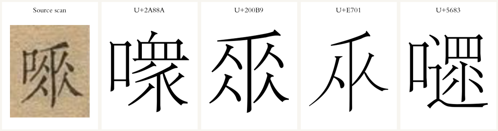
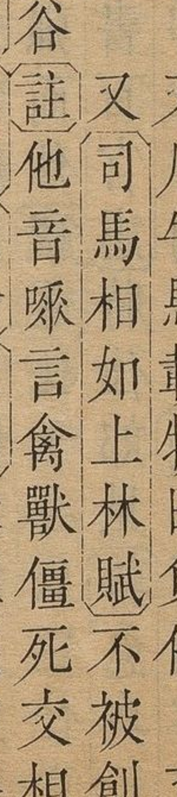

# 他条〈口𠂹〉的 Unicode 与小字字体核验

> 后续状态：用户授权后已执行 U+E705 小字补录，见[调研核验与补录全过程报告](2026-11-18-U+E705口𠂹调研核验与补录报告.md)。以下保留补录前的判断与数据快照。

核验日期：2026-11-18。用户称第 403 页；本次对照原图、网站详情和仓库转写，定位为**武英殿本图像第 407 页「他」条**。本次为补录前调研，没有修改字体、分配 PUA 或替换正文。

**结论：未在已查资料中确认〈口𠂹〉的独立标准码位；现用三份小字字体未检得匹配字形。为了忠实显示原刻，建议新增小字专用 PUA 字形。**不能直接用𪢊 U+2A88A 或既有 E701 代替，也不能将“未查到”写成 Unicode 官方确认永久未收录。



## 出处与构形

- 字头：他 U+4ED6，子集中人部；网站定位为武英殿本 407 页第 1 字，同文书局本 92 页第 9 字，Unihan `kKangXi 0092.090`。
- 本地正文：[0407.gj](../../kangxi-gold/annotations/0407.gj)。原页为 1130×1662 px；上下文裁框 `(670,830,820,1500)`，左上原点、右下排除。
- 相关原文：`又【司馬相如·上林賦】不被創刃，怖而死者，他他藉藉，塡坑滿谷。【註】他音〈口𠂹〉。言禽獸僵死交相積也。`
- 康熙网站和汉典「他」条均使用〈口𠂹〉描述。网站占位只是证据线索，不能单独证明未编码。



截图可描述为 **`⿰口𠂹`**：左口，右侧顶撇连接长竖，两侧各有上下两组人形分支。这里的 IDS 只是构形描述。本次直接查验的是康熙原页及其引文，没有独立校勘《上林賦》原始注本，不据字音猜测将目标替换成别的口部字。

| 相近对象 | 码位与区别 |
| --- | --- |
| 𪢊 | **U+2A88A，`⿰口衆`**。plane2 已有；右侧上部多出血／罒形围框，与截图顶撇—中竖结构不同。Unihan 为 J 源 `JK-65075`、`kRSUnicode 30.12`、15 画，不能只因“口＋众形”就认作目标 |
| 𠂹 | **U+200B9**。plane2 已有，作为右部件整体看与目标骨架对应，但单字没有左口，不能直接输入它代替整字 |
| E701 | 项目既有 PUA；另一条原文的特殊刻形，分支数量、位置不同。不能改写或复用该字位 |
| 嚃 | **U+5683**，当前字体为口与遝形。即使相关音读可供后续考证，现有字形仍不对应截图 |

## Unicode 检索范围

读取本地 **Unihan 18.0.0**；沿用当日取得的 **CHISE 18 个文件、102,894 条记录**（Basic、扩展 A–J、兼容区）以及 **BabelStone Unicode16.0 / 2025-06-27** 快照。

字面子串 `⿰口𠂹`、`口𠂹`、`⿰口乑`、`⿰口㐺`、`⿰口众`、`⿰口⿻⿱㇒丨𠈌` 均零命中；`⿰口衆` 在 CHISE 与 BabelStone 各命中𪢊，实形不符。没有递归穷举所有等价拆解，因此 IDS 零命中不等于正式排除。

IVD 2025-07-14 快照没有 U+2A88A 记录；有他及𠂹的相关序列，但本次未渲染所有外部集合的变体。现用三份小字字体都没有 format-14 cmap，不能据此从它们调用目标。GlyphWiki 搜索返回 HTTP403，没有将访问失败算作不存在证据。

原行、网页摘录、文件哈希与限制见[机器核验记录](evidence/kou-200b9/audit.json)。数据版本与结论范围固定于本次检查，不作永远未编码的断言。

## 字体候选查验

逐份读取实际 TTF，避免系统字体回退掩盖覆盖情况。三份小字文件与此前 E701／E704 核验时的 SHA-256 一致；本次重新生成候选图及未映射字形图册。

| 字体 | best cmap 数 | 纳入检索的非空映射 |
| --- | ---: | ---: |
| guji-plane0.ttf | 30,708 | 28,997 |
| guji-plane2.ttf | 61,228 | 61,119 |
| guji-planef.ttf | 42,620 | 42,520 |
| 合计 | 134,556 | **132,636** |

[检索工具](../../tools/dataset/guji_font_shape_search.py)以截图灰度 `<120` 提取墨迹；U+2E80 以上映射以 96px 字号画入128px画布，墨迹 bbox 等比归一化到64px画布内最大58px，计算双向平均距离变换。每份保存前100项，人工查看前48项，共144个字体／码位实例，均未匹配。

全字体首位分别为 U+3A3C（1.168）、U+2CDB7（1.142）、PUA U+F5B34（1.120），均不是目标；圆点、符号也能得到低分，不能把算法首位当成答案。

为降低全字体无关字干扰，又对 **Unihan口部或 IDS 左口结构的并集**筛出当前 plane0／plane2 内 **3,328** 个映射，按同一方法排序并查看前48项，仍未见目标。该轮与前144项可能重叠，不算192个独立候选。

- [全部字体各前100项](evidence/kou-200b9/font-search.json)，[口部专项前100项](evidence/kou-200b9/mouth-candidates.json)。
- [plane0图册](figures/kou-200b9/guji-plane0.ttf.candidates.png)、[plane2图册](figures/kou-200b9/guji-plane2.ttf.candidates.png)、[planeF图册](figures/kou-200b9/guji-planef.ttf.candidates.png)、[口部专项图册](figures/kou-200b9/mouth-candidates.png)。
- [未映射字形图册](figures/kou-200b9/unmapped-plane0.png)：plane0共96项，目视未见目标；plane2／F仅`.notdef`。plane0 GSUB仅有`vert`，对具体检查的口、他、嗒、嚃、乑没有替换；另外两份无GSUB。
- [实际字体哈希与覆盖](evidence/kou-200b9/font-coverage.json)，[原截图](figures/kou-200b9/scan-original.png)、[检索用阈值墨迹](figures/kou-200b9/scan-mask.png)。

以上为全映射算法候选生成、有限候选目视复核以及相关字／未映射／替换机制检查，不是人工遍看全部132,636个映射，也没有搜索所有第三方字体。

## 是否补录及建议方案

**按本项目忠实保留刻本字形的目标，建议补录。**可在小字 plane0 用新的项目 PUA 字位登记 `⿰口𠂹`，从现有小字字体取完整口与𠂹，整体调整宽度、比例及基线；随后检查小字号、横竖排度量、既有字形不变、当前共享字体哈希与来源记录。这里是方案建议，尚未构造或批准具体轮廓，也没有选定码位。

右部宜使用完整𠂹；它与 E701 不是同一构型。正式补录前应继续保留描述性占位。若将来查到可靠标准编码或统一字形依据，再评估迁移，而不把 PUA 当通用编码。

## 来源与复跑

- [康熙「他」条](https://www.kangxizidian.com/search/index_v.php?stype=Word&sword=%E4%BB%96&detail=y)、[武英殿本407页原图](https://p.kangxizidian.com/kangxi2/0407.jpg)、[汉典「他」条](https://www.zdic.net/hans/%E4%BB%96)。
- [Unihan](https://www.unicode.org/Public/UCD/latest/ucd/Unihan.zip)、[CHISE IDS](https://github.com/chise/ids)、[BabelStone IDS](https://www.babelstone.co.uk/CJK/IDS.TXT)、[IVD快照](https://www.unicode.org/ivd/data/2025-07-14/IVD_Sequences.txt)。文件哈希以本地证据为准。

```bash
python3 tools/dataset/guji_font_shape_search.py \
  docs/research/figures/kou-200b9/scan-original.png \
  --output var/font-audit/0407-recheck.json
```

这会用运行时的三份小字字体；重现本次排名须先核对哈希。此次没有补字，不写入正式字体操作流水，也不将本项登记成已经完成的补录。
