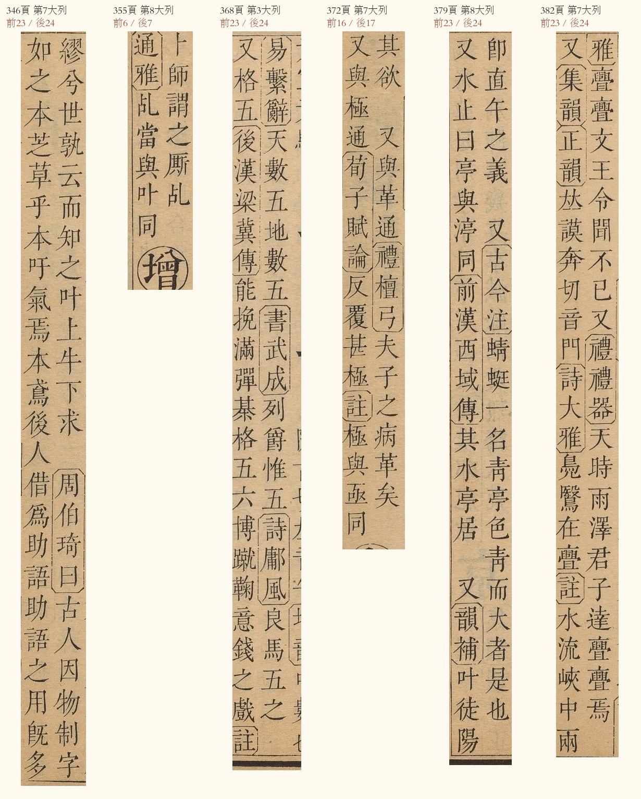

# 康熙字典 70 页小字均式布局核查

日期：2026-11-18。范围：当前工作区 `kangxi-gold/manifest.json` 中的 70 页，@312–@383，不含 @329、@337。

> 后续更新：本报告下文保留首轮核查时的状态与统计。@371 此后已完成初校；针对 @316 的进一步检查又修复了七处释义间隔，当前 70 页全部为初校，720 组双小列均符合占格均式规则。最新结果见[“又”字跨列释义间隔补查](2026-11-18-又字跨列释义间隔补查.md)。

## 结论

**计入必要空位后，这批初校材料没有发现普通双列释文违反均式布局的已确认原版例外，也没有发现流式反例。先前列出的六处前列偏短，均属于转写漏写空格占位符，不能作为原版例外。墨字数与占格数仍须分开统计。**

2026-11-18 根据用户纠正更新：已在 @355、@368、@372、@379、@382 的指定前列末尾补入 `*`；用户随后补齐了 @346“周伯琦曰”前的内部空位。六处均已完成修正。撤回此前把上述五处描述为“原版前短后长例外”的判断。

需要区分三件事：

1. 均衡的是包含必要空位的排版位置，不只是墨字数。“又”前等处的留白可能使实际字数相差两三个字。
2. 新释义或补充释义前的间隔是实际占格。`*又` 是康熙字典常见的固定搭配；当“又”在后小列开头时，它前面的 `*` 可以落在前小列末尾。补充释义不以“又”开头时也可能有同样间隔，如 @355 的“通雅乩當與卟同”。
3. 提示古字形的“古文”采用居中单列，不能强制拆成“古／文”双列。

还有一个范围问题：**当前清单实际为 69 页 `first`、1 页 `draft`；草稿是 @371。** 本报告检查了全部 70 页源码，但正式初校统计使用 69 页。@371 的原图另作目视核对，草稿中的折行异常不作为原版排法证据。

## 方法与统计口径

从每页当前 `.gj` 直接调用项目现用解析器和 `planLayoutBand`，按大列、大字及圈注边界提取连续小字组。不依赖历史 JSON/TXT 快照，也不先重新均分文本；后者会抹掉要检查的例外。

各大列从右向左编号，组内先读右小列（前列），再读左小列（后列）。剔除不占格的标点、书名框符号、语法指令；扩展区汉字按一个 Unicode 码点计一字。分别统计：

- **占格数**：小字及源码明确记录的空位；不自动给短列补尾部空格。
- **墨字数**：去除这些空位后的非空白字符数。
- 严格均分条件：`前列数 − 后列数 ∈ {0, 1}`。

“小字组”是一个大列中被大字、圈注或列边界截断的连续小字区域。它可以是前页续文、两字头间的释文或某条释文的尾部；不按整个词条跨列合并。

| 项目 | 全部 70 页源码 | 其中 69 页初校源码 |
| --- | ---: | ---: |
| 已记录大列 | 531 | 523 |
| 小字组 | 753 | 743 |
| 双小列组 | 714 | 709 |
| 单小列组 | 34 | 34 |
| 三条及以上小列组 | 5 | 0 |
| 双小列按占格数严格均分 | 712 | 709 |

六处空位全部补齐后，初校 709 组中，593 组等长，116 组前列多一格，709/709（100%）满足占格均分条件。因此，709 组普通双列释文中没有已确认的原版均式例外。

这 709 组中有 219 组下接大字／圈注，覆盖用户特别指出的同一大列内多字头情形。上述统计也包含整列排满的情形：24/24 等组合与流式结果可能一致，不能把每一组都算作两种算法的独立区分证据。短释文、列中换字头与未满列的页尾提供了更直接的均式证据。

## 用户给出的两个例子

- **@383，第 1 大列**：`崔靈恩改易詩亹作娓周伯琦` / `亦从娓廢亹皆臆說不足信`，为 **12/11**。总计 23 字，在列高 24 小格的条件下，原版仍分成两小列，并没有全放前列。
- **@381**：17 组双小列全部按占格数满足严格均分。包括第 4 大列的 `集韻／同乘`（2/2）、`集韻享古作／𠅠註詳六畫`（5/5）、`集韻克古作𠅡／註詳儿部五畫`（6/6）、`正字通／同孰`（3/2）；第 5 大列的 `字彙補古文聒字／註詳耳部六畫`（7/6）。小字组结束后即继续排下一大字或圈注。

对应源文件：[0383.gj](../../kangxi-gold/annotations/0383.gj)、[0381.gj](../../kangxi-gold/annotations/0381.gj)。

## 六处漏写空位：原图核对与修正

下表区分修正前的源码占格数和当前结果。列尾为释义间隔而保留的空白应以 `*` 明确记录，不能当成不计格的短列。

| 页码／大列 | 修正前 | 空位位置与性质 | 当前结果 |
| --- | --- | --- | --- |
| @346，第 7 大列 | 23/24 | “叶上牛下求”与“周伯琦曰”之间的内部空位 | 用户已补内部 `*`，24/24 |
| @355，第 8 大列顶部 | 6/7 | “卜師謂之廝乩。*”之后，后列是补充释义“通雅乩當與卟同” | 已补末尾 `*`，7/7 |
| @368，第 3 大列 | 23/24 | “良馬五之。*”之后，后列由“又格五”起 | 已补末尾 `*`，24/24 |
| @372，第 7 大列顶部 | 16/17 | “病革矣。*”之后，后列由“又與極通”起，下接圈“七” | 已补末尾 `*`，17/17；墨字数仍为 15/17 |
| @379，第 8 大列 | 23/24 | “是也。*”之后，后列由“又水止曰亭”起 | 已补末尾 `*`，24/24；墨字数仍为 22/23 |
| @382，第 7 大列 | 23/24 | “君子達亹亹焉。*”之后，后列由“又集韻正韻”起 | 已补末尾 `*`，24/24 |

这六处都是源码缺少占位符。@368、@372、@379、@382 的 `*` 与下一小列开头的“又”连成阅读序上的 `*又`；换小列不应使这个间隔消失。@355 则说明补充释义的间隔并不只出现在“又”字前。

本次修复用户指定并已核对原图的五处列尾空位，并纳入用户补齐的 @346 内部空位，不据“又”字全局自动插入空位。补写后各组高度与后续字头位置不变，变化是原有留白在转写中得到明确记录。



图中六张原图的 SHA-256 均与 manifest 相符，裁切坐标及核对记录见机器可读证据。

## 另两类必须保留的特殊情况

### 内部留白：墨字数不等于排版长度

初校 709 组中，310 组含源码明确记录的空位。只按墨字数应用严格方向条件，只有 579 组通过，130 组不通过；其中 28 组的墨字数绝对差大于一。这不表示存在 130 组流式布局。

例如 **@380 第 2 大列**：

- 前列：`諒同信也孟子君子不亮惡乎執古詩十九首君亮執高節賤`，24 字。
- 后列：`妾亦奚爲*又明也*又姓*又集韻呂張切音良書說命亮`，21 字加 3 个空位。

原图两列都是 24 格。若强行把 45 个墨字重新切成 23/22，会破坏原有留白与列边界。用户提供的 @381 第 2 大列也有类似现象：墨字 18/19，计入内部空位则为 19/19。

### “古文”居中单列

34 个单小列片段全部是“古文”提示语：26 个完整“古文”，另有 4 个“古”和 4 个“文”，后者分别在 @319、@320、@340、@375 跨大列接续。合计 30 处提示语。

例如 @312 大字“一”与古字形“弌”之间的“古文”，是居中纵排的单小列。它的功能和普通双列释文不同。**“两大字之间有小字”本身不足以触发均分；还需要识别这种单列提示语。**

## @371：草稿异常不能当作流式反例

这页当前标为 `draft`。源码出现 3、4、5 条小列并排，以及 13/5、3/24 等失衡，排版诊断同时报告宽度溢出。

原图核对显示：前两大列为前条续文，当前草稿从原图第 3 大列的“𠄨”开始录入，且把随后一些实际小列又拆成多个文本行。它有内容遗漏和列结构错误，不能算作已完成初校，也不能把草稿渲染结果用作原版流式布局的证据。原图可见的短释文仍为相近长度的双列，没有发现明确流式排法。

## 对规则的建议表述

> 普通释文在每一大列内，以大字／圈注等上下边界分组，采用两小列均式排布，前后等长或前列多一格。内部及列尾的新释义、补充释义间隔均须以 `*` 记录并计入占格；`*又` 可跨小列。“古文”等居中单列提示语另行处理。已有初校折行以原图为准，不应被自动均分覆盖。

本批普通双列释文支持采用均式规则进行草稿排版与占格校验。校验前应确保必要空位完整，并将“古文”等居中单列另行处理；不能从本批材料直接推断全书所有版本，也不应只按墨字数自动重排已校文本。

## 复现与边界

```sh
node tools/eval/audit_small_column_balance.mjs var/balanced-layout-audit/audit.json
```

- [核查脚本](../../tools/eval/audit_small_column_balance.mjs)：从当前源码重新统计，不修改语料。
- [统计与原图核对证据](evidence/2026-11-18-small-column-balance.json)：含清单、源码和实现哈希，逐页状态、全部非双列组、差异组、对照样本及原图裁切坐标。
- 完整逐组结果保存在本地 `var/balanced-layout-audit/audit.json`，可重新生成。

本次是 **70 页源码的全量结构检查 + 异常及对照原图的定向核对**，不是对 70 张扫描图逐字重新终校。原图目视核对包括 @346、@355、@368、@371、@372、@379、@380、@381、@382、@383；居中“古文”的全量数量来自现有初校结构。结论适用于本批材料，不能直接推广为整部康熙字典所有版本的无例外定律。

初次审计新增脚本、报告和证据。此次依据用户纠正，在 @355、@368、@372、@379、@382 的 `.gj` 指定行尾各补一个 `*`，并纳入用户补齐的 @346 内部 `*`，同步更新统计与判断。提交同时收录核查所用的 @377–@383 新页及已有清单变更，以保持 70 页输入完整；未修改预览排版算法。
