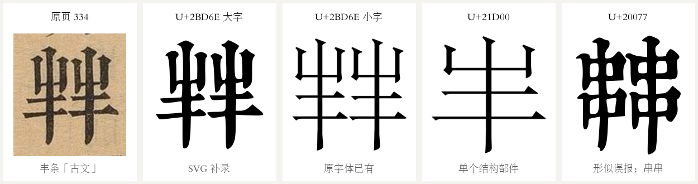
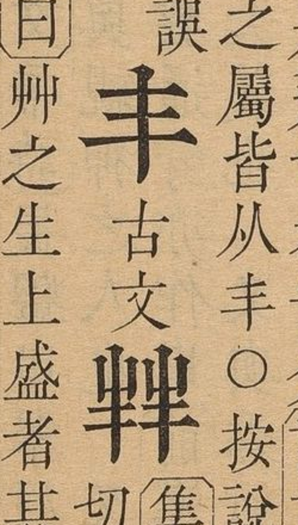

# 第 334 页丰条古文𫵮：出处、编码调研、字体核验与补录全过程

汇编及补充核验日期：**2026-11-18**。实际补录时间：**2026-11-13 19:41:39 +08:00**，字体提交 `0ca95d6`。本文汇合早期身份核验、落地记录、机器流水和本次只读复查；**今天没有再次补录或改动字体**。全部字体操作的入口为[字体补录 Changelog](../font-changelog.md)。

结论：该形是丰条所列古文 **𫵮，U+2BD6E，Unicode 扩展 E**。站方图片名中的 K0000 表示站方当时未提供码位映射，不能据此认定 Unicode 未编码。原小字字体 plane2 已有此字；本次历史补录解决的是康熙刻形大字字体缺字，正式写入仓库 `guji-large.ttf` 与本机康熙字体，没有为它另占 PUA。



## 1. 出处、来源字头与完整语境

| 项目 | 核实结果 |
| --- | --- |
| 直接依据 | 康熙字典网站提供的武英殿版扫描、站方字头 SVG、本项目 `.gj` 转写 |
| 图像页 | **@334 / 0334.jpg**；原图 1130 × 1711 px |
| 所属条目 | **丰 U+4E30**，子集上丨部；𫵮紧随「古文」二字 |
| 站方索引 | 丰为武英殿本 334 页第 3 字；𫵮作为第 4 个字头图像，文件 `0334-04-K0000.svg`，零基序号 3 |
| 同文书局／Unihan 定位 | 丰：79 页第 8 字、`kKangXi 0079.080`；𫵮：`0079.090`、`kIRG_GSource GKX-0079.09` |
| 本地转写 | [0334.gj](../../kangxi-gold/annotations/0334.gj)，以 `#𫵮` 保留大字排版 |
| 原页上下文裁框 | `(360,940,610,1380)`，左上原点，右下排除；图示放大两倍，不增加原图细节 |

该段实际转写如下，保留 `.gj` 的物理折行与大字标记；它明确把𫵮列为丰的古文，而不是一条另有释义的独立字条：

```text
#丰，
古文：
#𫵮
【集韻】符風
切，音馮。丰

茸，草盛貌。【說文】从生，上下達也。【徐曰】艸之生，上盛者，其下必深
根也。毛氏曰：凡邦夆峰豐等字从此。*又容色美好貌。【詩·鄭風】

子之丰兮。*【六書正譌】
俗作丰，上畫从丿者，非。
```



网站丰条详情也明确显示「字頭：丰　古文：𫵮」，将扫描、网站索引与转写相互印证。引用《集韻》《說文》《詩》《六書正譌》是该康熙条的内容；本次没有独立校勘这些书的原本，不将康熙引文当作已完成的原始文献调查，也不据此断定该古文的最早年代。

**两种部首信息应分开读**：丰条在康熙的丨部；Unihan 对独立码位 U+2BD6E 给出 `kRSUnicode 45.7`（屮部）和 `kTotalStrokes 10`。这是条目编排与码位索引的不同口径，不应据后一项把原书丰条改归屮部。

## 2. 字形特征、相近字与部件构型

CHISE 与 BabelStone 都把 U+2BD6E 写作 **`⿰𡴀𡴀`**，即两个 U+21D00 结构左右并置。原刻左右各有贯穿的竖干、上段两侧短竖及下段横画。宋体与康熙刻形的笔锋、粗细、连接处不同，但部件位置和整体构型一致。

这里的 IDS 是结构说明；不能把两个独体部件的笔数简单相加去改写 Unihan 的总笔画，也不能把 SVG 的两条闭合轮廓误认为“两笔”。这次实际制作采用站方**整字 SVG**，没有用小字字体中的两个𡴀拼出大字。

| 对照对象 | 码位／结构 | 为什么需要区分 |
| --- | --- | --- |
| 丰 | U+4E30 | 原书来源字头与「古文」关系的依据；现代整字形不能替代需要展示的古文；同时是字体尺寸与基线的校准锚 |
| 𡴀 | U+21D00；CHISE 保留整字，BabelStone 为 `⿻凵𰀁` | 目标的单个结构部件；一个𡴀不是整字𫵮 |
| 𠁷 | U+20077；`⿰串串` | 最强形似误报。两旁是串形，内部封闭框与目标不同，康熙槽位也不符 |
| 𤛙 | U+246D9 | 历史第二候选，Unihan 为牛部，槽位 `0704.081`，不能取代丰条古文 |
| 𠧄、𤚅、韕 | U+209C4、U+24685、U+97D5 | 其他形似候选，槽位分别为 `0157.191`、`0702.141`、`1394.240`；墨迹接近不构成身份依据 |
| 小字𫵮 | plane2 的 U+2BD6E | 身份正确、字体原本收录；是宋体风格，不能据此声称康熙大字字体也已收录 |

## 3. Unicode 码位调研：从 K0000 到标准码位

### 3.1 历史调查链

2026-11-13 先从站方字头名册定位 K0000，取得 SVG 和同页邻字，再对原康熙字体做形似初筛。形似第一名仍不能定案，因此用字头相邻次序与 Unihan 康熙槽位确认身份：

| 334 页字头次序 | 字 | Unicode | `kKangXi` |
| --- | --- | --- | --- |
| 1 | 丮 | U+4E2E | 0079.060 |
| 2 | 丯 | U+4E2F | 0079.070 |
| 3 | 丰 | U+4E30 | 0079.080 |
| 4 | 𫵮，站方 K0000 | **U+2BD6E** | **0079.090** |
| 5 | 丱 | U+4E31 | 0079.100 |

U+2BD6E 的 `GKX-0079.09` 又与字头位置一致。历史记录还保存了 GlyphWiki `u2bd6e` 的 `kx-0079009`、`kx-007909`、`extd-02374` 别名以及两个 `u21d00` 的构形，作为当时图形交叉核对。这部分为**历史已存证记录**，不是声称本次重新访问了 GlyphWiki。

### 3.2 本次补充核验与历史勘误

本次读取本地 Unihan **18.0.0**、2026-11-18 缓存的 CHISE **18 个文件、102,894 条记录**（Basic、扩展 A–J 与兼容区）、BabelStone **Unicode 16.0 / 2025-06-27** 文件，并检查官方 Blocks.txt。重现了码位、来源槽位、邻字顺序与 `⿰𡴀𡴀` 记录。各文件哈希、原行、网站摘录见[来源证据](evidence/u2bd6e/source-excerpts.json)。

旧材料有两项明确文字错误，保留历史文件但不得继续引用为事实：

1. **Ext-C 应为 Ext-E**。官方区块为 `2B820..2CEAF; CJK Unified Ideographs Extension E`，U+2BD6E 位于其中。该错误没有造成实际补错码位。
2. 旧 JSON 的 79 页名册将 **U+4E2B** 旁标作「丬」，实际上 U+4E2B 是「丫」。本报告只采用与本案直接相邻、重新查验的名册，不沿用该错误。

本案不是靠 IDS 未命中推测未编码，也不是靠某个相似度阈值猜出码位；**邻字、槽位、G 源、IDS 与原刻共同确认标准身份**。旧记录所谓“首例缺字”只指当时项目抽查进度，不代表对整部康熙所有字头完成了普查。

## 4. 字体覆盖及候选查验

历史调查的主要对象为康熙字典體 `KX_47043_14`，与仓库入库基线 `guji-large.ttf` 字节相同。原字体 best cmap 为 **49,407** 项：BMP 24,858、扩展 B 24,548、扩展 G 1（U+317AB），没有 U+2BD6E。原小字 plane2 则已有该码位，因此一般系统回退可能显示出字，却掩盖大字字体缺字。

历史初筛将原 SVG 栅格化，对 cmap 候选做 **128px 归一化双向 chamfer**。已保存的前五名如下；历史证据没有完整排名，本次不补造剩余候选：

| 候选 | 当时分数 | 判定 |
| --- | ---: | --- |
| 𠁷 U+20077 | 0.731 | 低于当时 0.785 的参考标尺仍是误报；槽位 `0080.111` 与本案不符 |
| 𤛙 U+246D9 | 0.904 | 牛部，字形与出处不符 |
| 𠧄 U+209C4 | 0.937 | 不是该字 |
| 𤚅 U+24685 | 0.942 | 不是该字 |
| 韕 U+97D5 | 0.967 | 不是该字 |

真正的𫵮不在被检索字体里，**没有可参与排名的“真字分数”**。最终由编码证据否决候选，再由 cmap 判定补录需求。历史数据见[原始核验 JSON](evidence/2026-11-13-kangxi-unencoded-0334-04-fontcheck.json)，其中区块和 U+4E2B 名册错误按上一节勘正。

本次重新读取四份正式字体及原备份：大字和系统字体都有 U+2BD6E；plane2 仍是原有宋体；plane0、planeF 没有该码位。当前字体／码位、轮廓、横排度量与哈希见[现状快照](evidence/u2bd6e/current-fonts.json)。没有把浏览器回退或系统已安装字体当作单份 TTF 覆盖的证明。

## 5. 补录方法、精确来源与执行

采用**站方整字矢量轮廓转 TrueType**，保留康熙刻形。作者工具为 [kangxi_font_patch.py](../../tools/dataset/kangxi_font_patch.py)。源 SVG 和校准 SVG 此前仅在忽略目录，本次补入版本库以便追踪：

| 来源 | SHA-256 |
| --- | --- |
| [𫵮源 SVG](evidence/u2bd6e/0334-04-K0000.svg) | `40aca218281b9efe68b7046acac6448684457cf34cf5a756d65fb857d00f13fd` |
| [丰校准 SVG](evidence/u2bd6e/0334-03-00054-4E30.svg) | `79391933238c65e3e99cf0f0eb07996875eb5361a16b8ee5e27ff7f5ee743a45` |

SVG 使用站方 1280 坐标系，外层有缩放及 y 轴翻转。工具读取内部 `path d`，以已在字体里的丰及对应 SVG 的 bbox 求等比缩放（x/y 比例的均值）与平移，而不是直接把页面像素坐标当成字体坐标。历史实际变换为：

```text
x′ = 0.8739049307949839 x − 43.22935579573286
y′ = 0.8739049307949839 y − 230.9405008921147
```

随后按原脚本的笔传递顺序进行路径解析、Cu2Qu 三次转二次曲线（`max_err=1.0`、`reverse_direction=True`）及仿射变换，整数化为 TrueType 轮廓。加入 `glyf`、glyphOrder、maxp、hmtx 与全部 format-12 cmap；横排 advance 取丰的 1024。这份大字字体没有 vmtx 表，不能把后来 E701 的双向度量处理套写到本次历史操作。

正式操作之前先在临时字体做 PoC 与浏览器并排查看，系统原字体备份在字体安装目录之外。**2026-11-13 19:41:39** 对仓库和系统两份字体执行；各自先保存临时 TTF、渲染比较，合格后原子替换，记录 JSONL。历史命令及双字体结果见[落地报告](2026-11-14-kangxi-guji-large补录U+2BD6E落地报告.md)；原始事件另固化为[历史流水](evidence/u2bd6e/historical-events.json)。

该早期脚本没有 `--dry-run`，已有目标码位时会拒绝；缺少 `rsvg-convert` 时其代码会跳过栅格距离检查。因此不能将它描述为具备后来 PUA 工具的全套防护，也不应为“复核”直接对当前生产字体重跑。历史流水记载了实际非空分数，说明那次完成了栅格检查。

## 6. 补录结果、后续操作与当前状态

| 项目 | 原字体 | 补录结果／当前状态 |
| --- | --- | --- |
| best cmap | 49,407 | **49,408** |
| 字节数 | 46,698,456 | **46,623,752** |
| 新 glyph | 无 | `u2BD6E` |
| 轮廓／点数 | 无 | **2 / 348**；点数为本次复查 |
| bbox | 无 | **[88, -135, 944, 735]** |
| hmtx / UPM | — | **[1024, 88] / 1024** |
| SVG 与渲染 chamfer | — | 历史 0.029，闸 0.15；本次复算 **0.028631762** |
| 编译轮廓 SHA-256 | — | `3e62bc086fca4a34c90741ed64726f16c2c6e1e0ade08c4d01406144fa408fd0` |

字体整体序列化使文件体积减小，不能将其解释成删掉了 75 KB 的字形。当前三项关键整文件哈希是：

```text
原始大字／系统备份
  dfc5876c1a580922798e5da3f7b58d6bdcf419c294622d67a8a07cf3256da87f
仓库 guji-large.ttf
  99be6a77b93afa746b2d29e37d6014cab9f9c21471f685a2392426760a17dabf
系统 ~/Library/Fonts/KX_47043_14.ttf
  7d916ab6e4bcc935894cd372997ebc7536e315a1e8ae7270d39e53e2dbb9c4fa
```

仓库版与系统版的整文件哈希不同，但本次确认 U+2BD6E 的编译轮廓、bbox 与横排度量相同；应分别记录文件身份，不能只保留其中一份哈希。

| 时间／提交 | 与本字相关的后续事件 |
| --- | --- |
| 2026-11-13，`0ca95d6` | 正式补录；大字缓存戳 `001015-2bd6e` |
| 2026-11-14，`bcaed54` | 仓库重构；脚本移到 tools/dataset，源材料移到 var/unencoded |
| 文档于 2026-11-15 提交，`f3cfefd` | 建立留痕登记、复核哈希、修正流水路径漂移；字体未改 |
| 2026-11-15，`ad09533` | 同一大字文件曾增加 E701；𫵮保留 |
| 2026-11-15，`8fd8063` | 大字 E701 撤销，整份大字文件恢复到 `99be6a77…`；缓存戳变为现行 **`001015-2bd6e-no-e701`** |
| 2026-11-18，本报告 | 出处汇编、勘误、原 SVG 固化与只读重建；不记作新补字事件 |

### 本次新发现的复现条件

用**当前字体**中的丰校准，得到 scale `0.8724078412714721`，重建字形与已补字形不完全相同。原因可直接复查：原备份中丰存储的 bbox 是 `[73,-133,948,742]`，字体重存后的 bbox 为 `[74,-133,947,741]`。轮廓边界重算改变了校准输入。

改用**补录前原字体**存储的边界，上面的历史 scale 与平移即可恢复，重建轮廓编译 SHA-256 与当前𫵮逐字节一致。两次尝试和解释均保存在[重建证据](evidence/u2bd6e/rebuild.json)，不能只给出四舍五入的 0.8739 并承诺精确重现。

## 7. 验证范围、复现与回滚

历史已完成的验证包括：补录前临时字体 PoC、原 SVG／渲染距离闸、邻字大样及浏览器语境、双字体 cmap、备份与文件哈希。没有查到该次专门的应用单元测试数量，因此不挪用后来 E701 或 E704 的测试数字。

本次新执行：读取当前四字体及系统／备份字体；重新查原页、网站、Unihan／IDS／区块；重新渲染对照图；复算距离；用原基线在内存重建𫵮并对照编译哈希。**没有重新安装字体、运行应用测试或再次操作生产字体。**

可从仓库根执行新附的[只读复核脚本](../../tools/dataset/verify_u2bd6e_report.py)：

```bash
python3 tools/dataset/verify_u2bd6e_report.py
```

脚本通过 `git show 80cea9a:guji-preview-grid/public/fonts/guji-large.ttf` 在内存读取原字体，校验原文件和两份 SVG 哈希，按历史顺序转换后对比当前 glyph。依赖 fontTools、Pillow、NumPy、SciPy（后几项由既有工具导入）；不保存字体、注册表或流水。复现须保留 Git 基线对象；浅克隆若不含它，应先获取该历史。

原回滚依据为 Git 基线 `80cea9a`，系统备份为 `~/.kx-font-backup/KX_47043_14-v001014-orig.ttf`。将来回滚前须确认是否已有后续补字；只有确认整文件恢复不会丢失后续工作时才恢复原件，同时更新缓存戳与登记。若已有后续补字，应针对本码位移除或重建，保留历史流水。即便撤销大字补录，正文仍应使用标准 U+2BD6E，小字 plane2 可以显示此字。

## 8. 资料索引与持续追踪

- [丰条详情](https://www.kangxizidian.com/search/index_v.php?stype=Word&sword=%E4%B8%B0&detail=y)、[334 页扫描](https://p.kangxizidian.com/kangxi2/0334.jpg)、[站方目标 SVG](https://p.kangxizidian.com/kxzt/0000s/0334-04-K0000.svg)。页面裁框与原图哈希见[图像来源](evidence/u2bd6e/page-source.json)。
- [Unicode Blocks](https://www.unicode.org/Public/UCD/latest/ucd/Blocks.txt)、[Unihan](https://www.unicode.org/Public/UCD/latest/ucd/Unihan.zip)、[CHISE IDS](https://github.com/chise/ids)、[BabelStone IDS](https://www.babelstone.co.uk/CJK/IDS.TXT)。版本和逐文件哈希以本报告证据快照为准。
- [历史身份核验流程](2026-11-13-kangxi-未编码字头字体核验流程.md)、[历史补录方法](2026-11-13-kangxi-字体补录流程.md)、[正式落地报告](2026-11-14-kangxi-guji-large补录U+2BD6E落地报告.md)、[操作登记簿](../font-operations.md)。旧报告的统计与“当前”措辞均属于各自日期。

若将来调整刻形、改用另一版本底本或撤销系统同步，应追加新的操作事件、来源和前后哈希；标准码位身份与字体设计版本分别维护。本文没有向 Unicode 提交编码申请，也无需用 PUA 代替已确认的 U+2BD6E。
