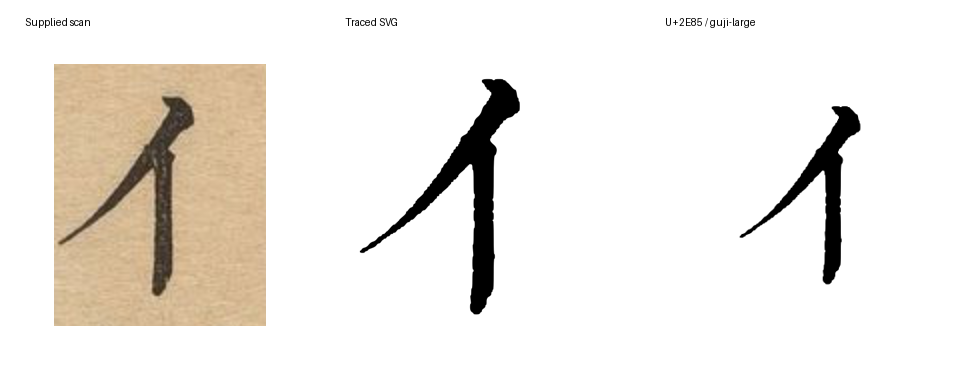

# 第 398 页人部偏旁 U+2E85「⺅」补录报告

2026-11-18。用户提供第 398 页第三大列倒数第二个大字的截图，要求查找大字字体，若缺失则将截图转为 SVG 后补入。经提示码位与字符不一致，用户明确选择正确的 **U+2E85「⺅」**。

## 码位与现有字体核验

| 码位 | Unicode 名称／字符 | 补录前 guji-large | guji-plane0 |
| --- | --- | --- | --- |
| U+2E85 | CJK RADICAL PERSON，⺅ | 缺 | 有 |
| U+2F08 | KANGXI RADICAL MAN，⼈ | 缺 | 有 |
| U+4EBB | CJK UNIFIED IDEOGRAPH-4EBB，亻 | 缺 | 有 |

先前文字将 U+2F08 对应为「⺅」不正确。本次只新增 U+2E85，不在 U+2F08 写入另一字符的字形，也不将 U+4EBB 设为别名。

对大字字体的 49,401 个 U+2E80 以上非空映射做扫描形似检索，查看前 48 个候选，未见目标同形；靠前的豸、丩、彳等均有结构差异。仅有的三个未映射字形是 `.notdef`、`.null`、`nonmarkingreturn`；GSUB 特性只有 `vert`。这是一项全映射候选检索加有限候选目视复核，不宣称人工遍看所有字形。

- [补录前四字体 cmap、Unicode 名称及哈希](evidence/0398-person-radical/before.json)
- [前 100 个检索候选](evidence/0398-person-radical/font-search.json)与[前 48 个候选图](figures/0398-person-radical/candidates.png)

## 字形来源与 SVG

使用用户提供的 **212×262 px** 截图；不从其他字体拼部件。灰度 `<120` 提取墨迹，保留最大连通块并填补墨迹内部的小孔。提取有向像素外边界，以 Ramer–Douglas–Peucker 容差 0.65 px 简化，再用相邻段中点与原顶点组成二次贝塞尔闭合路径。原始墨迹 5,044 px，补孔后 5,052 px；874 条像素边界简化并平滑为 250 段二次曲线。纸色和纸纹不进入 SVG；保留长弧撇、顶部连接及右竖的原刻轮廓。

- [原始截图](../../tools/dataset/font-sources/0398-person-radical/source.png)
- [清洗后二值图](../../tools/dataset/font-sources/0398-person-radical/mask.png)
- [透明底 SVG](../../tools/dataset/font-sources/0398-person-radical/outline.svg)
- [可复现脚本](../../tools/dataset/guji_person_radical_patch.py)



SVG 保留原截图坐标。写入字体时采用等比变换，以大字字体「人 U+4EBA」的纵向墨迹范围 `[-113,725]` 校准高度，横向在 1024 units 字宽内居中，不把窄偏旁拉宽至整字。此为单字截图的字体排印校准，不是声称恢复了扫描原页的绝对字号。

另核对了 [16／24／40／64 px 字号及邻字对照](figures/0398-person-radical/font-sizes.png)。

## 写入、验证与留痕

只写 `guji-preview-grid/public/fonts/guji-large.ttf`，新增 `uni2E85`；同时覆盖 Unicode／Windows 的 format-4 与 format-12 cmap 子表。字体无 vmtx，保持原字的横向度量及所有既有轮廓。小字三字体与系统字体不变。

缓存戳从 `001015-2bd6e-no-e701` 更新为 `001016-2bd6e-2e85`。398 页现有草稿的第 7 行仅替换这一字符：

```diff
-#**人部*亻同$
+#**人部*⺅同$
```

该页原已在用户工作区但尚未跟踪，本次保留为工作区草稿，不将整份用户草稿纳入字体提交。

正式写入时间：**2026-11-18T15:54:59+08:00**。字体提交：`81959da`。

| 项目 | 结果 |
| --- | --- |
| cmap 映射数 | 49,408 → 49,409 |
| 保持不变的既有字形及 hmtx | 49,411 个，逐一比较编译轮廓与度量通过 |
| 新字形 | 1 轮廓，500 点；bbox `[228,-113,796,725]`，advance 1024 |
| SVG → TTF 对称 chamfer | 0.078790，阈值 0.15 |
| 清洗截图 → TTF 对称 chamfer | 0.020716，阈值 0.5 |
| 文件字节数 | 46,623,752 → 46,624,948 B |
| 补前 SHA-256 | `99be6a77b93afa746b2d29e37d6014cab9f9c21471f685a2392426760a17dabf` |
| 补后 SHA-256 | `3973ccbe8bbdb4b91af44269a12f9b9f58daeb0c225d78e3a934f676f1c4c231` |

上述距离在 128×128 归一化墨迹上计算；不是 Unicode 身份判定依据。生产解析器派生结果确认 ⺅ 为第三大列的倒数第二个大字，见[398 页派生记录](evidence/0398-person-radical/annotation-derived.json)。

浏览器刷新后已目视确认 398 页原图／矩阵／编辑器三栏中的对应字头，见[页面截图](figures/0398-person-radical/browser-page398.jpg)。`npm run build` 通过；构建保留 Vite 配置兼容提示及既有大分块提示，无构建错误。另复核小字三字体 SHA-256 与补前完全一致。

初次干跑的原有字形核验已通过，但 SVG 比较步骤沿用了方形字头工具，将非方形截图强制栅格为 256×256，得分 1.265 而拒绝写入。改为只指定栅格宽度、保持原比例后重新执行；未放宽质量阈值，也未改动已生成的字形。该次干跑没有替换正式字体。

## 复现与回滚

脚本默认只生成临时字体并核验，不替换正式文件。输入整字体 SHA-256 必须是本次补录前基线；对已补录字体再次执行会拒绝。可将下列 `--font` 指向按哈希保存的补录前备份以复现：

```bash
python3 tools/dataset/guji_person_radical_patch.py --trace --font var/unencoded/kangxi-unencoded/font-backups/guji-large.ttf.99be6a77b93afa746b2d29e37d6014cab9f9c21471f685a2392426760a17dabf.ttf
```

`--trace` 重建 SVG 和二值图；省略时使用存档 SVG。`--apply` 仅允许写仓库的大字字体，在验证、基线复查及备份成功后原子替换并追加流水。正式操作记录见[机器证据](evidence/0398-person-radical/patch-verification.json)、[登记簿](../font-operations.md)和[Changelog](../font-changelog.md)。

回滚时从本次字体提交的父版本恢复大字字体及 CSS，或使用上述哈希命名的备份；398 页这一字符按需要恢复为亻。不得整仓库回滚，以免覆盖同时进行的其他校对与排版工作。
