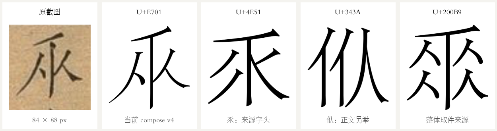
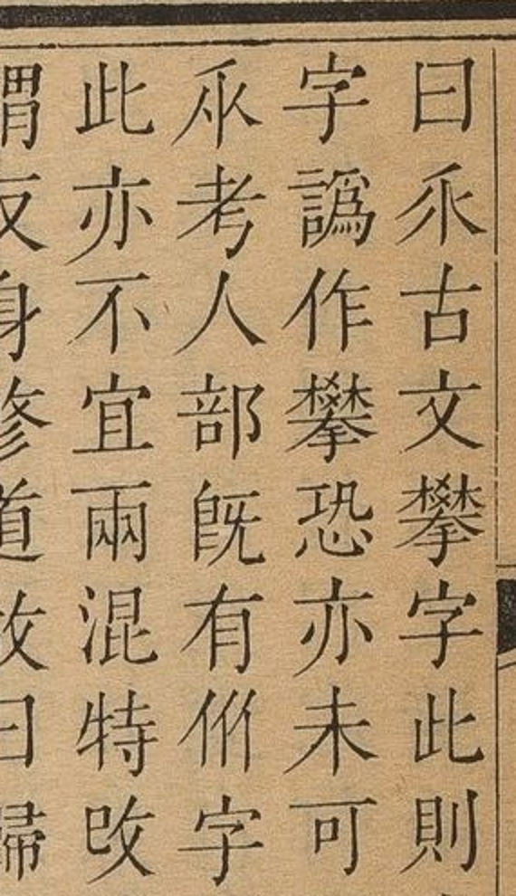
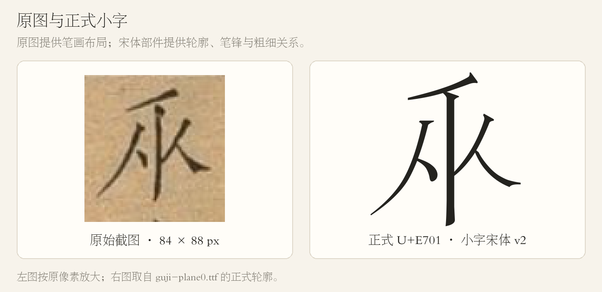
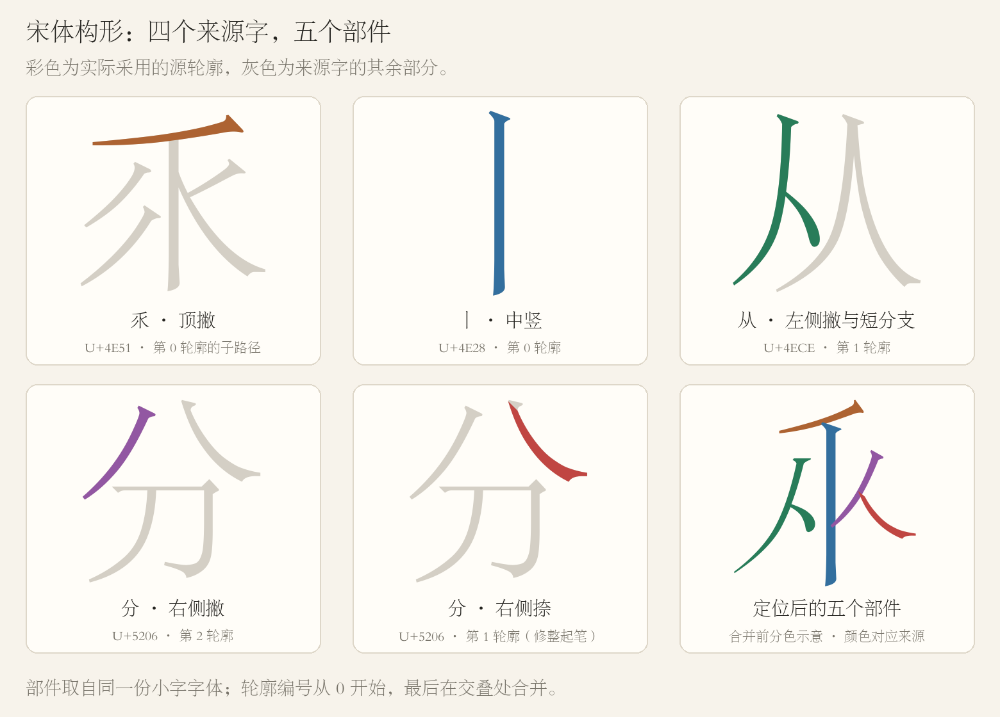
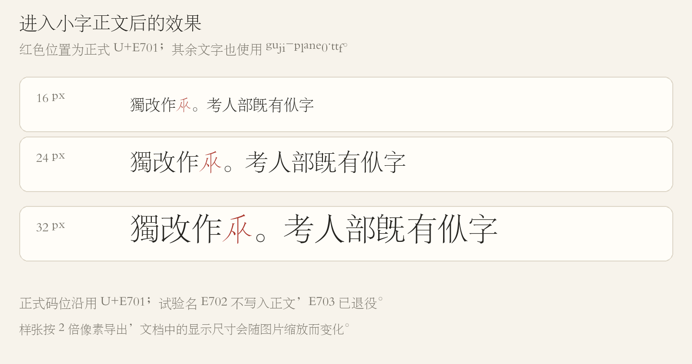

# 第 349 页乑条按语刻形：Unicode 调研、字体核验与 U+E701 补录全过程

汇编及补充核验日期：**2026-11-18**。首次补录：**2026-11-15 10:07:56 +08:00**；现行字形定稿：同日 **16:03:48**。本文按 U+E704 全过程报告的口径，汇合出处、历史造字、各次正式变更与新的只读核验。**本次只补文档、证据和说明，不重新补录字体。**完整操作时间线见[字体补录 Changelog](../font-changelog.md)。

结论：目标是《康熙字典》乑条按语中「《正字通》獨攺作」之后的特殊刻形。**本项目尚未确认它的独立标准 Unicode 码位**；现用字体的相近字不能忠实显示该形。因此以 **PUA U+E701** 保持稳定文本引用，现行方案为从「𠂹、从、分」取四部件构形的 **compose v4**，只存在于小字 `guji-plane0.ttf`。最初大字补录已撤销。

**整字体快照说明**：本文的统计、哈希及 `current-fonts.json` 保留本次核验时状态，早于当日 15:54:59 的 [U+2E85 大字补录](2026-11-18-U+2E85补录报告.md)。后续共享字体增字不代表 E701 也被重绘；最新整文件基线见[操作登记簿](../font-operations.md)，不覆盖本报告历史证据。



## 1. 出处、来源字头与原文

| 项目 | 核实结果 |
| --- | --- |
| 直接依据 | 康熙网站武英殿版扫描、历史保存的单字截图、本项目 `.gj` 转写 |
| 来源字头 | **乑 U+4E51**，子集上丿部；网站标为武英殿本 **348 页第 4 字** |
| 目标出现页 | 乑条跨页按语的续页 **@349 / 0349.jpg**，不是另一个独立编号字头 |
| 同文书局／Unihan | 乑：82 页第 15 字，`kKangXi 0082.150`；这个槽位属于乑，不能直接移作目标刻形的独立编码依据 |
| 关键句 | `又諸韻書俱書作乑，《正字通》獨攺作〔目标形〕。考人部旣有㐺字，則此亦不宜兩混，特攺正。` |
| 本地转写 | [0348.gj](../../kangxi-gold/annotations/0348.gj)、[0349.gj](../../kangxi-gold/annotations/0349.gj)；目标位于小字正文 |
| 截图／原页 | 原始单字图 **84 × 88 px**；349 页原图 **1130 × 1719 px** |
| 本报告上下文裁框 | `(750,155,1035,650)`，右下排除，放大两倍；包含目标及「考人部旣有㐺字」等语句 |

@349 起首相关段落按当前 `.gj` 抄录如下。代码块用 `\uE701` 表示私用字位，实际文件保存的是一个真实 U+E701 字符：

```text
曰：乑古文攀字，此則未知所據。《正字通》云：《漢書》本作从，用古從
字譌作攀，恐亦未可深信。又諸韻書俱書作乑，《正字通》獨攺作

\uE701。考人部旣有㐺字，則
此亦不宜兩混，特攺正。
```



网站详情正文用 **`〈亻下从人人〉`** 占位，后面又有 **`㐺字作〈亻亻亻〉`** 的字形说明；这有助于识别网站如何描述缺字，但不是标准 IDS 或 Unicode 映射。网站写「獨改作」，当前原页转写写「獨攺作」，本报告分别保留来源的用字，不悄悄统一二者。

本次直接核验的是《康熙字典》引述《正字通》及对相关字形的辨析，**没有独立取得《正字通》《漢書》原本逐页校勘**。因而这里的“出处”是可定位的康熙条及其引文，不声称已经确定该形最早出现在哪一版《正字通》。乑的字音和释义也不能未经论证全部赋给项目 PUA 字位。

## 2. 部件特征与容易混淆的构型

目标上方为斜向顶撇，接近或连接中央长竖；左侧长撇带短分支，右侧另有向中竖接入的撇及向外伸出的捺。原刻低分辨率图中顶撇与中竖连接处存在细节歧义；现行宋体按用户审定的**整体连写部件**实现，保留原生接合。它不是把「亻」「人」「人」三个独体字放到同一格就能精确复原的构型。

注册表早期的 **`⿰亻⿱人人` / 〈亻人人〉** 是便于检索的近似描述，最终身份由原页位置、截图及冻结轮廓共同限定。它不代表本次证明了一个标准 IDS，也不能据此直接把目标等同为亻旁加仌。

| 对照对象 | 码位／已查结构 | 差别与处理 |
| --- | --- | --- |
| 乑 | U+4E51，来源字头 | 宋体顶撇与竖干连写，但左右分支与目标不同；不能因为释文属于乑条就用整字乑替代 |
| 㐺 | U+343A；`⿰亻𠆧`；康熙 `0095.220` | 原文专门另举人部㐺并讨论不宜混同；现字体的三个侧立人形不合原图。初稿整字复制方案被否决 |
| 𠆧 | U+201A7；`⿰亻人` | 是㐺的相关部件，左右结构，不是目标整字 |
| 仌 | U+4ECC；`⿱人人` | 两人上下叠置；曾作为临时拼接来源，不能凭“人人”描述认作目标 |
| 仌 | U+2F819，CHISE 同记 `⿱人人` | 兼容区结构检索命中；该记录不是对目标独立编码的确认 |
| 𠂹 | U+200B9；BabelStone `⿻⿱㇒丨𠈌` | 有完整独立的顶撇—中竖轮廓，适合作供体；其余四个人形分支明显多于目标，不是整字替代品 |
| 从 | U+4ECE | 取其中左人轮廓，包括长撇与短分支；不复制整个从 |
| 分 | U+5206 | 取上部撇、捺，舍弃刀部；右捺连接处处理另见 §5 |
| `⿲亻亻亻` | 字形描述 | 与网站㐺说明有关；本次 IDS 子串检索命中𨴟内部结构，不能据此把带門整字当作目标 |

## 3. Unicode 调研过程及结论边界

### 3.1 历史判断与今天的补充核验

早期资料已经记载目标与㐺有别、没有确认标准码位，随后选择 PUA。**没有找到完整的早期 Unicode 查询日志及全字体候选排名**，因此不能补写成“2026-11-15 已按今天的方法查遍全部数据”。本节与下一节的系统查询是 **2026-11-18 新做的补充核验**。

| 来源及实际范围 | 查验内容 | 结果及限制 |
| --- | --- | --- |
| 本地 Unihan 18.0.0 | 乑、㐺、𠆧、𠂹、仌的字典索引、来源及部首笔画 | 确认乑为 `0082.150`、㐺为 `0095.220`；两者已有码位不能自动证明目标属于哪一种编码 |
| CHISE IDS，18 文件、102,894 条记录 | Basic、扩展 A–J、兼容区；查询完整描述与相关部件 | `⿰亻⿱人人`、`⿰亻仌` 子串均零命中；`⿰亻𠆧` 命中㐺；`⿱人人` 命中仌及仌；`⿲亻亻亻` 命中𨴟的内部结构 |
| BabelStone IDS，Unicode 16.0，2025-06-27 | 同样的描述查询与相近字交叉核对 | 㐺、𠆧、仌及𠂹的结构与上述分析相容；无目标独立条目的确认 |
| IVD，2025-07-14 快照 | 检查相关基字的已注册变体序列 | 有 **乑 U+4E51 + U+E0100**，也有𠂹的相关序列；本次没有逐字形渲染这些外部集合，不能声称全部已排除 |
| 康熙网站详情、原页及 `.gj` | 确认来源字头、跨页位置和占位说明 | 网站以 `〈亻下从人人〉` 描述，原文另举㐺；这是来源定位，网站未映射本身不是“Unicode 未收录”的证明 |

上述查询是对所列文件的**字面 IDS 子串检索**，没有递归穷举所有可等价拆解。Unicode 字形统一、IDS 漏收、资料版本差异都可能影响判断，因此准确结论是：**在已查资料中尚未确认目标的独立标准码位，也未确认能在当前字体中调用它的变体序列。**旧登记里的“无 Unicode 码位”应按这个有范围的结论理解，不能作为官方不存在证明。

逐文件哈希、查询命中原行、Unihan 属性、IVD 行及网站原文已保存到[来源与编码证据](evidence/e701/source-excerpts.json)。本次没有向 Unicode 或 IVD 提交申请；PUA 是项目内显示与转写约定。

## 4. 字体候选查验全过程

### 4.1 还原补录前的搜索对象

为避免“搜到后来补入的 E701，误认成字体原有字”，从 Git **`ad09533^`** 导出补录前 `guji-plane0.ttf`。另两份小字字体与该历史提交的文件 SHA-256 完全相同，直接只读搜索现有 plane2、planeF。

| 字体 | 补录前 best cmap | 实际纳入候选的非空映射 | 处理 |
| --- | ---: | ---: | --- |
| guji-plane0.ttf | 30,706 | 28,995 | 使用 Git 导出的旧文件，不含 E701／E704 |
| guji-plane2.ttf | 61,228 | 61,119 | 与历史字节相同 |
| guji-planef.ttf | 42,620 | 42,520 | 原字体第 15 平面私用字也纳入 |
| 合计 | 134,554 | **132,634** | 单位为字体／码位实例，非去重后的独立字类 |

工具为 [guji_font_shape_search.py](../../tools/dataset/guji_font_shape_search.py)。目标输入是已保存的 `e701-scan-clean.png`；像素灰度 `<120` 作墨迹。逐个读取 cmap 中 U+2E80 以上码位，96px 字号绘入 128px 画布，将墨迹 bbox 等比缩放进 **64px** 画布内最大 58px 区域，计算双向距离变换均值。每份保留前 100 名，目视复核前 **48** 名，共 **144** 项。

### 4.2 候选结果及人工排除

| 字体 | 最高位候选举例 | 观察 |
| --- | --- | --- |
| plane0 | U+2EA2 1.425；氺 U+6C3A 1.549；永 U+6C38 1.566 | 中竖和斜笔造成形似，结构不等于目标 |
| plane2 | U+115C0 1.735；U+26CF1 1.773；U+22115 1.795 | 第一项只呈现小墨点，暴露归一化与距离算法的局限；其后密集字亦不是目标 |
| planeF | U+FC7CD 1.252；U+F0ECF 1.341；U+FC6B1 1.352 | 古文字或符号可以获得低分，不能以排名判定现代刻形身份 |

直接指定的相近字另做同尺度比较：乑 **1.902**（plane0 第 18 名）、㐺 **2.728**、仌 **4.185**、𠆧 **3.853**、𠂹 **2.047**。㐺等即使不进前 100，仍因原文关系独立查看，不能让算法排名决定哪些字才值得研究。

结果材料：

- [三份字体前 100 名完整分数](evidence/e701/font-search.json)。
- [plane0 前 48 项](figures/e701/guji-plane0.ttf.candidates.png)、[plane2 前 48 项](figures/e701/guji-plane2.ttf.candidates.png)、[planeF 前 48 项](figures/e701/guji-planef.ttf.candidates.png)。
- [补录前 plane0 未映射字形图册](figures/e701/unmapped-plane0.png)：96 项，含 `.notdef`、拉丁字、标点、假名等，目视未见目标；这 96 项的编译轮廓与当前版本逐项一致。
- [补充核验记录](evidence/e701/supplemental-checks.json)：历史字体来源、逐项未映射字形哈希、相近字分数及可复跑命令。

另检查调用机制：三份小字字体都没有 format-14 cmap；plane0 的 GSUB 只有 `vert`，对本次具体检查的乑、㐺、仌没有替换；plane2／planeF 没有 GSUB，未映射字形各仅 `.notdef`。没有发现可通过这些机制调用的目标形。

因此，本次可支持“**现用小字字体中未检得目标现成形**”。这包含全部映射的算法候选生成、有限候选人工复核及未映射／替换检查，**不等于人工逐一看遍 132,634 项，更不等于证明任何 Unicode 字体都不可能提供此形**。64px 检索分数与后文 128px 补录回归闸不能混用。

## 5. 从扫描描摹到宋体部件：全部方案与取舍



### 5.1 扫描轮廓 v1

初版以 84 × 88 px 截图为底稿，灰度 `<128` 二值化，用 3×3 十字结构元做两次闭运算、剔除小于 6px 的连通域，以 Moore 邻域法追踪外边界与孔洞，Douglas–Peucker 简化（冻结文件 `epsilon=1.2`），再以二次曲线平滑。以㐺 U+343A 的字框作字体坐标校准，形成 [e701-scan-v1.json](../../tools/dataset/font-sources/e701-scan-v1.json)。源图与清洗图均保存；历史清洗脚本的关键原行、哈希及各阶段配方哈希见[补充证据](evidence/e701/supplemental-checks.json)。不能把清洗后的边缘当作原刻全部真实细节。

该方案分别写入小字与大字。它解决缺字，却保留了低分辨率刻形的粗细与轮廓特征；后来小字版改用同系列宋体部件，大字版被撤销。初版不是当前版本。

### 5.2 E702／E703 临时试验

| 试验 | 实际内容 | 结果 |
| --- | --- | --- |
| 初版 E702 | 整字复制㐺 | 与原图不同，未采用 |
| 初版 E703 | 㐺左侧亻 + 仌右侧缩放拼接 | 只是近似结构试验，未转正；后来还有其他合成／重绘尝试 |
| 修订 E702 v3 | 五个宋体部件：乑顶撇、丨中竖、从左部、分的撇与捺 | 被选定，**转正为 E701 的 compose v2** |
| E701 compose v4 | 改为𠂹的顶撇与中竖整体取件，其他三部件沿用 | 当前正式方案 |

初版试验脚本的说明和文件哈希固化在[补充证据](evidence/e701/supplemental-checks.json)。**“采用 E702”指修订后的 E702 v3，不是最早直接复制㐺的方案。**试验编号与正式注册版本是两套编号；E702／E703 没有进入正式字体，现也保留不用，以免与旧预览混淆。没有完整存证的中间重绘，不补造准确时刻和笔点数。

### 5.3 现行 v4 的四个部件



| 部件 | 字体／来源字／轮廓 | 精确处理 |
| --- | --- | --- |
| 顶撇与中竖整体 | plane2，𠂹 U+200B9，轮廓 0 | 完整提取一条闭合轮廓；只施加一次整体正向仿射，保留原生连接 |
| 左长撇与短分支 | plane0，从 U+4ECE，轮廓 1 | 完整取件，依据三对锚点整体定位 |
| 右侧撇 | plane0，分 U+5206，轮廓 2 | 取分上部左撇，整体定位到目标右侧 |
| 右侧捺 | plane0，分 U+5206，轮廓 1 的经修订路径 | 省去独立起笔衬线后接入撇笔，避免连接点多出凸刺；不能描述成原轮廓完全未改 |

轮廓编号从 0 开始，是字体数据顺序，不是汉字笔顺。四部件使用 1024 units/em；顶撇与中竖的变换为：

```text
[0.66, 0.068, 0, 1.0126083333333333, 193.38, -55.97839166666667]
x′ = 0.66x + 193.38
y′ = 0.068x + 1.0126083333333333y − 55.97839166666667
```

旧 v2 把乑的顶撇子路径与丨分开提取再连接。乑的原轮廓还带右侧分支，若整条取件必须切掉分支；𠂹的轮廓 0 则已是完整独立的顶竖部件，因而更适合用户提出的整体取件要求。其余三个部件的源路径、目标路径与 v2 完全一致。

四部件经 `skia-pathops` 合并交叠，得到 **2 条闭合轮廓、99 点**。完整路径、变换、来源 glyph 哈希、最终坐标、flags、端点和度量保存在 [e701-songti-v4.json](../../tools/dataset/font-sources/e701-songti-v4.json)；[v2 配方](../../tools/dataset/font-sources/e701-songti-v2.json)仍可复现。生成器为 [guji_songti_components.py](../../tools/dataset/guji_songti_components.py)，默认只在内存重建，不保存生产字体。

## 6. 正式补录、替换、撤销的完整时间线

时间均为 2026-11-15、Asia/Shanghai；精确时刻取机器流水，不以 Git 提交时刻代替执行时刻。

| 时刻／注册版本 | 正式操作与范围 | 字体结果 | 字体提交 |
| --- | --- | --- | --- |
| **10:07:56 / v1** | scan-trace 初次插入 plane0 与 large；未同步系统字体 | 小字 cmap 30,706→30,707；18,386,644→17,251,716 B；大字 49,408→49,409；46,623,752→46,624,036 B | `ad09533` |
| **14:24:28 / v2** | 试验 E702 v3 宋体方案转正到 E701，仅替换 plane0 | 17,251,716→17,251,812 B；2 轮廓、110 点；cmap 不变；large 此时仍是扫描版 | `7ff192c` |
| **14:37:18 / v3** | 撤销 large 中 E701，限定 small-only | 大字恢复 49,408 cmap、46,623,752 B，保留 U+2BD6E；小字 v2 轮廓不变 | `8fd8063` |
| **16:03:48 / v4** | 顶撇与中竖改为整体取件，仅替换 plane0 | 17,251,812→17,251,780 B；2 轮廓、99 点；cmap 不变 | `859ad28` |

**v3 是登记范围修订，不是第三版宋体轮廓。**正式正文一直用 E701；E702／E703 仅为试验。相关原始事件及后续提交确认共 7 条，保存在[历史事件归档](evidence/e701/historical-events.json)。

关键哈希与缓存戳：

| 阶段 | 文件 SHA-256 | 缓存戳／说明 |
| --- | --- | --- |
| 小字 v1 | `6cdaddc31a13c41bdc602e904fc6d28a6b99422ed62d31651aac7c46345a8f9e` | 扫描描摹 |
| 大字 v1 | `f79d2765b6900a90822971eea286631e93f08f43080d1b8f3e2b8b20af63b9f0` | 曾经含 E701 |
| 小字 v2 | `0e5eda61b7324f8bcf9c420a9633537799021a45f0bcfdad22574fac25a1d257` | `e701-2-songti` |
| 大字 v3 撤销后 | `99be6a77b93afa746b2d29e37d6014cab9f9c21471f685a2392426760a17dabf` | `001015-2bd6e-no-e701`，仍为当前大字 |
| 小字 v4 当时 | `b4433eb2cb5218d3e507dd1757398813ac105d6c384dbbf8a841a60107b53c0f` | `e701-4-joined`，这是历史整文件状态 |
| **2026-11-18 当前小字** | `f7e40e014584f6f4fd73ac1de97b2e9aac414e5eeb0e9c9a3847a78e4c27a20b` | **`e701-4-e704-1`**，因同字体后来加入 E704；E701 仍为 v4 |

初次补录时字体体积显著缩小包含 fontTools 整体重序列化效应，不表示清理或删掉了约 1 MB 的旧字。历史前后体积只作为文件身份记录。

## 7. 字位登记、注入工具及结果核验

PUA 注册表记录 `cp: E701`、`usage: small-only`、`version: 4`、配方、来源图、字体范围与历史。生产工具 [guji_pua_patch.py](../../tools/dataset/guji_pua_patch.py)同时处理 glyf、横竖排度量与适用 cmap；替换要求显式版本、前置文件哈希及备份。先保存临时文件核验，再原子替换并更新注册表和流水。

v4 增加跨字体供体校验，保证 plane2 的𠂹来源正确；v2/v4 替换均验证非目标轮廓与横竖度量不变。2026-11-18 增加 E704 时，工具进一步同步了同一字体各 PUA 条目的**当前整文件哈希基线**。因此 E701 的 `sha256_after` 变成 `f7e40e01…`，并不表示当天又重画一次 E701；真正字形历史以操作记录及编译轮廓哈希为准。

| 当前 E701 项目 | 2026-11-18 实测 |
| --- | --- |
| 正式字体／glyph | 仅 guji-plane0 / `uniE701` |
| 方案／登记 | compose v4 / 注册 v4 |
| 轮廓／点数 | **2 / 99** |
| bbox | **[17, -146, 985, 848]** |
| UPM、横排及竖排 advance | **1024、1024、1024** |
| hmtx / vmtx | **[1024, 17] / [1024, 22]** |
| 编译轮廓 SHA-256 | `0ef6027de1532c8bc037f5944ab4080e7e14651298ba2f61d468a36d898493c4` |
| 当前整字体 cmap／glyph 总数 | **30,708 / 30,804**，已包括另一个 E704 |
| 当前文件大小 | **17,252,348 B** |
| 其他字体 | large、plane2、planeF、系统康熙字体均无 E701；正式字体没有 E702／E703 |



### 历史验证与阈值演变

- **v1**：清洗图与补字渲染 chamfer，小字 **0.366**、大字 **0.405**，阈值 0.5；扫描形后来分别被替换和撤销。
- **v2**：chamfer **0.440**，阈值 0.5；非目标字形／度量、cmap 与 glyphOrder 不变；**7 个文件、272 项应用测试及生产构建通过**。
- **v3**：删除大字 E701 后，其余 glyf 字节及度量保持一致，整个大字文件恢复到此前含𫵮的版本；小字哈希不变，构建通过。
- **v4**：chamfer **0.558**，明确将本方案闸定为 **0.6**；对错误外部供体哈希做拒绝验证；新轮廓精确重建；演示子集与正式字体在 16、24、32、220px 下逐像素一致；浏览器 200px 下实际墨迹 3,995 px；生产构建通过。此阶段没有重新运行那 272 项测试。

v4 相对扫描的距离大于 v2，反映整体原生部件与中竖粗细的变化。放宽阈值不是“更精确”或“设计更好”的证明；接受依据还包括整体取件、连接关系、部件来源、既有字形不变与小字查看。上述是 **128px 归一化**的补录回归检查，不能与 §4 的 64px 候选排序横比。

### 本次只读复核

本次重新读取字体和来源，确认 E701 编译轮廓仍为 v4；由四部件重建得到同一哈希。对当前包含 E704 的 plane0 执行 E701 替换 **dry-run**，结果整份 TTF 的前后 SHA-256 都为 `f7e40e01…`，字节数、cmap 和所有其他轮廓／度量不变，距离为 0.558，闸 0.6。没有写入字体、注册表操作历史或流水。

本次还新做了 §3、§4 的资料／候选检索、原页定位和图册查看。证据见[现行字体快照](evidence/e701/current-fonts.json)与[补充验证](evidence/e701/supplemental-checks.json)。今天没有再跑应用测试、生产构建或浏览器自动化；上文相应结果均明确属于历史阶段。

## 8. 复跑、回滚和以后如何维护

从仓库根只读复核当前正式字形：

```bash
PYTHONPATH=var/unihan/font-tool-deps python3 tools/dataset/guji_songti_components.py
python3 tools/dataset/guji_pua_patch.py --cp E701 --font guji-plane0.ttf \
  --replace --expected-version 4 --dry-run
```

生成器需 fontTools、NumPy、skia-pathops；注入工具另需 Pillow、SciPy。`var/unihan/font-tool-deps` 是本机现有依赖位置，换机可安装到自己的 Python 环境。若登记版本推进，先读当前注册表，不机械照抄 `4`。

复跑本次**补录前**候选搜索，可在忽略目录导出旧字体；以下仅写临时材料和候选结果：

```bash
mkdir -p var/font-audit/e701-recheck
git show 'ad09533^:guji-preview-grid/public/fonts/guji-plane0.ttf' \
  > var/font-audit/e701-recheck/guji-plane0.ttf
python3 tools/dataset/guji_font_shape_search.py \
  tools/dataset/font-sources/e701-scan-clean.png \
  --font var/font-audit/e701-recheck/guji-plane0.ttf \
  --font guji-preview-grid/public/fonts/guji-plane2.ttf \
  --font guji-preview-grid/public/fonts/guji-planef.ttf \
  --output var/font-audit/e701-recheck/font-search.json
```

plane2／planeF 若以后修改，须也从该历史 ref 导出，不能再用当前版本声称复现旧排名。输出的候选分数有渲染库环境依赖，先核对文件哈希与算法参数。

可用回滚节点：v1 提交 `ad09533`、v2 `7ff192c`、小字范围修订 `8fd8063`、v4 `859ad28`。各次替换／移除之前的自动备份路径与哈希保存在历史事件中；v4 前的小字备份以 `0e5eda61…` 命名。**当前小字已有 E704，不能直接以旧整份 TTF 覆盖来回滚 E701，否则会连带丢失 E704。**应只替换／移除目标字形，更新共享哈希、注册版本、缓存戳及流水，并检查正文仍可正确显示。

若未来找到可靠的标准码位或已登记变体，应先核验原页结构及该字体实形，再设计文本映射和向后兼容；不得把 E701 重新分配给别的字。无配套字体的通用文本可显示描述性占位并附原图／报告，避免把 PUA 误当成各系统通用汉字。

## 9. 原始材料、历史报告与本次证据

- [乑条网站详情](https://www.kangxizidian.com/search/index_v.php?stype=Word&sword=%E4%B9%91&detail=y)、[348 页扫描](https://p.kangxizidian.com/kangxi2/0348.jpg)、[349 页扫描](https://p.kangxizidian.com/kangxi2/0349.jpg)；[原图哈希及裁框](evidence/e701/page-source.json)。
- [原始截图](../../tools/dataset/font-sources/e701-scan-original.png)、[清洗图](../../tools/dataset/font-sources/e701-scan-clean.png)、[scan-trace v1](../../tools/dataset/font-sources/e701-scan-v1.json)、[compose v2](../../tools/dataset/font-sources/e701-songti-v2.json)、[compose v4](../../tools/dataset/font-sources/e701-songti-v4.json)。
- [造字纪实](2026-11-15-U+E701造字纪实.md)、[宋体转正](2026-11-15-U+E701小字宋体转正.md)、[仅限小字](2026-11-15-U+E701仅限小字.md)、[整体取件](2026-11-15-U+E701顶撇中竖整体取件.md)。这些旧文保存当时状态，30,707 cmap、`b4433eb2…` 与 `e701-4-joined` 均不是加入 E704 后的整字体现状。
- [Unihan](https://www.unicode.org/Public/UCD/latest/ucd/Unihan.zip)、[CHISE IDS](https://github.com/chise/ids)、[BabelStone IDS](https://www.babelstone.co.uk/CJK/IDS.TXT)、[IVD 2025-07-14](https://www.unicode.org/ivd/data/2025-07-14/IVD_Sequences.txt)；所读快照哈希见 §3。
- [PUA 注册表](../../guji-preview-grid/src/pua-registry.json)、[字体操作登记簿](../font-operations.md)、[全量 Changelog](../font-changelog.md)。本报告及证据作为历史补录的汇编和补充核验，不另计一次字体操作。
