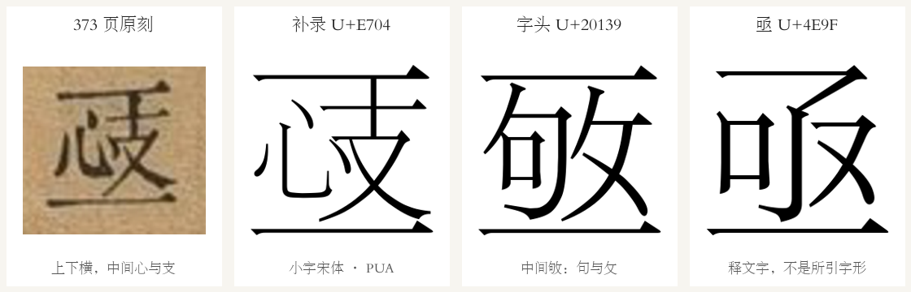
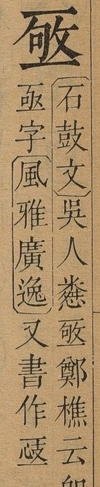
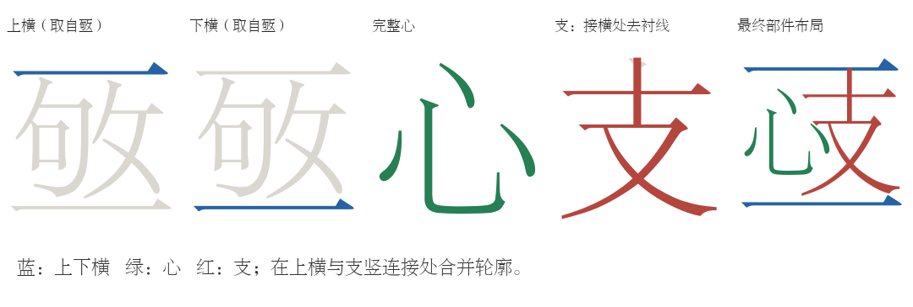
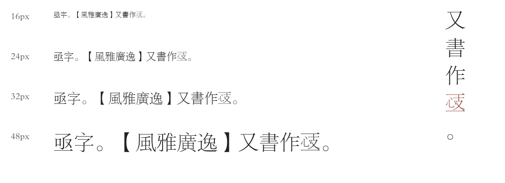
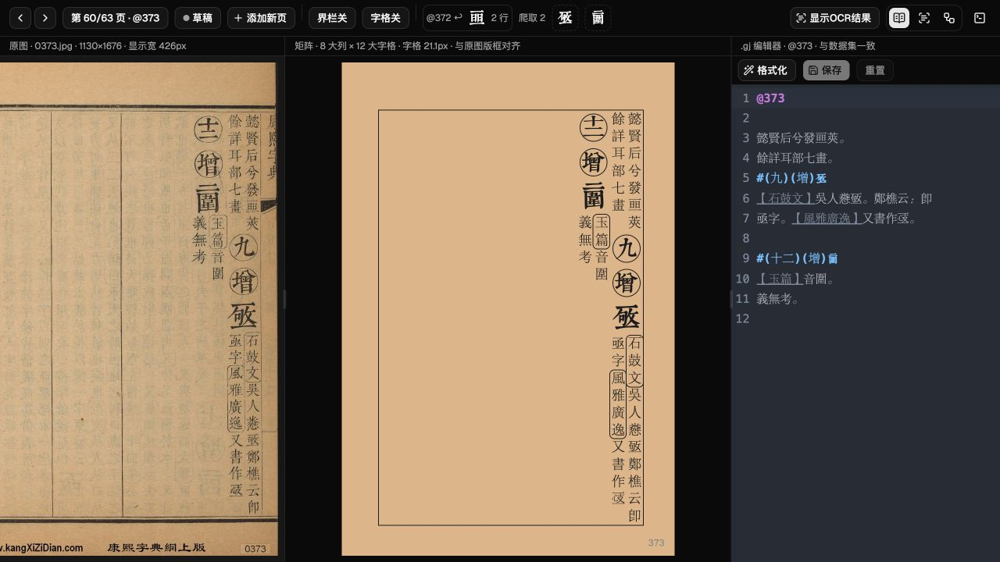

# 第 373 页〈二心支〉：出处、编码调研、字体核验与补录全过程

记录日期：2026-11-18。正式补录时间：**10:09:09 +08:00**。字体提交：`5280746`。本次经用户明确要求执行，正式字位为 **PUA U+E704**，只写入 `guji-plane0.ttf`，用于小字正文。

本次结论是：**尚未确认原刻〈二心支〉的独立 Unicode 码位；现用三份小字字体未检得该形。为忠实呈现释文所引的另一种写法，以原生宋体部件补入一个项目私用字位。**这不是宣布 Unicode 永久不收该异体，也不是把 PUA 当作通用汉字编码。日后若取得可靠标准编码证据，应重新评估映射。

**后续共享字体状态**：本文哈希、计数与缓存戳记录 E704 首次写入时的历史状态。随后同一 `guji-plane0.ttf` 又加入 [U+E705](2026-11-18-U+E705口𠂹调研核验与补录报告.md)、[U+E706](2026-11-18-U+E706亻亻亻调研核验与补录报告.md)和 [U+E707](2026-11-19-U+E707貝司调研核验与补录报告.md)；截至 2026-11-19，整文件 SHA-256 为 `3409fd6c…`，E704 仍为 v1，编译字形哈希仍为 `f28a8bf7…`。最新整文件基线见[操作登记簿](../font-operations.md)，下文历史数值不随新补字覆盖。



## 1. 出处与原文定位

| 项目 | 核实结果 |
| --- | --- |
| 直接依据 | 康熙字典网站所提供的武英殿版扫描；用户提供的单字截图；本项目 `.gj` 转写 |
| 项目／网站图像页 | **@373 / 0373.jpg**，不是把其他版本的书内页码直接换算成 373 |
| 书卷、部首 | 子集上，二部；字头归在「九」「增」之下 |
| 来源字头 | **𠄹 U+20139**；网站称武英殿本 373 页第 1 字 |
| 另一版本定位 | 网站称同文书局本 87 页第 18 字；Unihan `kKangXi 0087.180`、`kIRG_GSource GKX-0087.18` |
| 异体出现处 | 该字头释文末句，`【風雅廣逸】又書作〈二心支〉。` |
| 本地转写 | [0373.gj](../../kangxi-gold/annotations/0373.gj)，正文小字；本次将描述性占位替为一个 U+E704 |
| 扫描规格与裁框 | 原图 1130 × 1676 px；本报告目标裁框 `(960,1430,1018,1482)`，左上原点、右下排除 |

补录前的完整相关段落为：

```text
#(九)(增)𠄹
【石鼓文】吳人𢠴𠄹。鄭樵云：卽
亟字。【風雅廣逸】又書作〈二心支〉。
```

补录后末行是 `亟字。【風雅廣逸】又書作\uE704。`；这里用转义显示字位，实际 `.gj` 保存一个真实的 U+E704 字符，不保存六个 ASCII 转义字符。



必须区分三个证据层次：本次直接见到的是《康熙字典》的刻本字形；《風雅廣逸》是该条所引的书名；“鄭樵云：卽亟字”是该条所载的解释。本次**没有独立查验《風雅廣逸》原书或《石鼓文》原拓**，因此不把康熙引文提升为对这些原始文献的直接版本学核验，也不另外推定该写法的创制年代或作者。

用户截图为 124 × 114 px。完整原页中该字只有几十像素见方，另存的 58 × 52 px 裁图能确认其位置，但未提供更高笔锋细节。制作宋体时以截图确认结构，以字体原生轮廓提供清晰笔锋，未声称逐像素复制刀刻效果。

## 2. 字形特征及相近字、相近部件

目标可用描述性 IDS 写成 **`⿳一⿰心支一`**：上下各一横，中间左心、右支；支的竖干向上接入上横，下横独立。IDS 是检索／记录结构的字符串，不是一个单字编码。

左部保留完整「心」的点、竖弯钩等四笔，不能改成没有底部弯钩的「忄」。右部是「支」的十与又，不是攴的卜与又，也不是攵。外侧上下横在布局上夹住中间部件，不是把完整「二」放在字的上方。按部件通常笔数可解释为 2+4+4，但这仅作构形说明；字头的“二部九画”属于𠄹条，不据此改动字头分类。

| 对照对象 | 码位／构型 | 与目标的区别及处理 |
| --- | --- | --- |
| 𠄹 | U+20139；`⿳一敂一`，CHISE 也记 `⿴𠄠敂` | 中间是敂，可再理解为句与攵；并非心与支。其上下横可作为部件来源，整字不能直接替代目标 |
| 亟 | U+4E9F；资料有 `⿱⿻了叹一` 等地域构型 | 原文释义相关，但现用字体的口、又及中竖等布局不是目标。替成亟会抹去“又書作”展示的差别 |
| 忮 | U+5FEE；`⿰忄支` | 与检索词心／支接近，但左边是忄且没有外侧上下横；未采用 |
| 𠄮 | U+2012E；`⿴𠄠𢆶` | 全字体形似检索的高位候选；同有上下横，中间是两幺，不能凭分数代替目标 |
| 心／忄 | U+5FC3 / U+5FC4 | 独体心有底部弯钩；忄的三笔布局不符。本次用完整心，整体压缩定位 |
| 支／攴／攵 | U+652F / U+6534 / U+6535 | 十与又、卜与又、反文是不同部件；本次用支的整体结构，不拼成反文 |
| 二／𠄠／上下两横 | U+4E8C / U+20120 / IDS 描述 | 仅凭部件名不能定字；独体二两横的位置不适合直接当作外围。最终取自同系列𠄹的两条外围横画 |



## 3. Unicode 码位调研过程与边界

### 3.1 先定字头，避免把字头编码误套到释文异体

在本地 Unihan 中查到 U+20139 的康熙槽位与 G 源，上述 `0087.180`、`GKX-0087.18` 均指向𠄹字头。CHISE 与 CJKVI／BabelStone 的结构说明相互吻合，且实际字体渲染证实其中为敂。由此确认：**字头的编码已知，不等于“又書作”之后的形也已经找到标准码位。**

### 3.2 数据来源、版本与检索

| 来源 | 本次实际使用 | 结果／限制 |
| --- | --- | --- |
| Unicode UCD／Unihan | 本地 Unihan 标头 18.0.0；2026-11-18 获取官方 latest ReadMe 同样返回 18.0.0 | 核实字头的书目映射；Unihan 并非完整字形拆解库，不能凭属性未命中证明某形未编码 |
| CHISE IDS | 当日从 GitHub 获取 Basic、Ext-A 至 Ext-J、两份兼容区共 **18 个文件、102,894 条记录**；Ext-B 分为 6 文件 | 检索心／忄与支同现、忮、`⿴二`、`⿴𠄠`、上下横夹字及𠄹，未找到目标独立条目 |
| CJKVI IDS | 既有本地 `cjkvi-ids.txt` | U+20139 记作 `⿳一敂一`；仅作交叉核对，未当成最新 Unicode 全覆盖声明 |
| BabelStone IDS | 下载文件声明 Unicode 16.0、2025-06-27，共 97,680 项 | U+20139 同样为 `⿳一敂一`；直接心／支组合仅命中忮等相关字，未见目标 |
| IVD | 2025-07-14 `IVD_Sequences.txt` 快照 | 无 U+20139 记录；U+4E9F 有 E0100–E0103 序列。本次未逐一独立渲染这些跨字体变体，因此不声称它们全部已排除；现用字体无 format-14 cmap，不能靠这些序列调用目标 |
| 康熙网站详情 | 成功取得𠄹条，正文仍用 `〈二心支〉` 描述 | 与缺少直接字形映射相符，但网站未编码不等于 Unicode 未编码 |

直接访问汉典及 GlyphWiki 页面时返回 HTTP 403，未取得可用正文；没有把未读到的内容计作证据。此次结论依赖实际取得的数据与字体，不依赖猜测搜索结果。

逐文件 SHA-256、下载 URL、查询范围与此前字体哈希保存在 [补录前核验快照](evidence/e704/audit-before.json)；[来源摘录](evidence/e704/source-excerpts.json)保存网站原文、Unihan 字头属性、相关 IDS 原行及官方版本说明。大体量下载缓存仍位于 `var/font-audit/0373/`，关键结论和哈希已纳入版本管理。重新下载的上游文件可能变化，应比对哈希后再宣称复现了同一数据快照。

**结论措辞的边界**：本次“未找到独立码位”是有范围的核验结果。IDS 可以漏收、存在多种拆解，Unicode 还可能统一某些字形差别；不能把形似分数或 IDS 零命中当作官方排除证明。U+E704 只解决本项目的忠实显示与稳定文本引用，不替代今后的文字学或编码研究。

## 4. 现用字体及候选查验全过程

小字栈为 `GujiPlane0 → GujiPlane2 → GujiPlaneF`，对应中华书局宋体三个平面。补录前逐份读取真实 TTF，而非依赖系统字体回退后的肉眼显示。

| 字体 | best cmap 映射数 | 纳入形似检索的非空映射 | 主要观察 |
| --- | ---: | ---: | --- |
| guji-plane0.ttf | 30,707 | 28,996 | 有亟、心、支、忮及既有 PUA E701，没有目标 |
| guji-plane2.ttf | 61,228 | 61,119 | 有𠄹；其中间为敂，没有目标 |
| guji-planef.ttf | 42,620 | 42,520 | 第 15 平面私用字亦纳入检索，未找到目标 |
| 合计 | 134,555 | **132,635** | 计数是字体／码位实例，不是去重后的字类数 |

候选生成步骤：用户截图灰度 `<120` 视为墨迹；每个 cmap 中 U+2E80 以上字符以 PIL 96px 绘入 128px 画布；各自按墨迹 bbox 等比缩放至 64px 画布内最大 58px；计算双向平均距离变换（symmetric chamfer）。每份保留前 100 个候选，并目视查看前 48 个，共 **144 个字体／码位候选**，均未匹配。

检索高位候选包括 Plane0 的 U+FFED 黑方块、薼、蘨、蕙，Plane2 的𡓸、𠄮、𡌥，PlaneF 的 U+F184B、U+F184D、U+F0F33 等。黑方块和密集字形也可能取得较低分，这是距离算法的局限，不能把第一名当作答案。候选表和图册已保存：

- [三份字体前 100 项数值](evidence/e704/font-search.json)
- [Plane0 前 48 项](figures/e704/guji-plane0.ttf.candidates.png)、[Plane2 前 48 项](figures/e704/guji-plane2.ttf.candidates.png)、[PlaneF 前 48 项](figures/e704/guji-planef.ttf.candidates.png)
- [96 个 Plane0 未映射字形图册](figures/e704/unmapped-plane0.png)

还检查了 cmap 之外的情况：三份字体哈希与 367 页核验时一致，因此复用该次生成的未映射图册并重新逐项查看；Plane0 有 96 项，另外两份仅 `.notdef`。三份都没有 format-14 cmap；Plane0 只带 `vert`，其中亟不参与替换，另两份没有 GSUB。没有查到可调用的目标隐藏异体。

上述是全映射生成候选、有限候选目视复核，加上未映射／替换机制检查；不是宣称人工看遍每一个映射。可复跑脚本见 [guji_font_shape_search.py](../../tools/dataset/guji_font_shape_search.py)。补录后直接跑当前字体会多出 E704，重现补录前排名须使用对应旧字体。

## 5. 补录方案与部件精确来源

采用 **compose v1**，不用扫描描摹。三个来源字提供四个逻辑部件，原有 8 条轮廓经连接处布尔合并后得到 7 条轮廓。源轮廓编号从 0 开始，是字体内部顺序，不是笔顺。

| 部件 | 来源 | 取件与变换 |
| --- | --- | --- |
| 上横 | plane2，𠄹 U+20139，第 3 轮廓 | 整条保留，`x′=x, y′=y+23` |
| 下横 | plane2，𠄹 U+20139，第 4 轮廓 | 整条保留，同样上移 23 units |
| 左心 | plane0，心 U+5FC3，第 0–3 轮廓 | 四笔共同做一次正向仿射变换，目标 bounds `(44,138,559,664)`；不换成忄，不逐笔重新描画 |
| 右支 | plane0，支 U+652F，第 0–1 轮廓 | 外轮廓与内白共同变换，目标 bounds `(390,10,984,789)`；保留十与又整体，仅调整顶端与上横的连接 |

字体坐标 y 向上、unitsPerEm=1024；表中 bounds 为变换后的逻辑部件边界，最终整数化字形 bbox 另见结果表。

“支”的顶端原有独立字起笔衬线；直接接在上横下会多出斜刺。最终在源轮廓 `(478,649)`、`(524,649)` 两条竖干边之间，将原来上端衬线段替为到 y=852 的平直延伸，再整体放置，让这段与上横交叠并合并。此处**不是未经修改地复制完整支外轮廓**；修改部位、断言、路径和变换都在生成器／配方中明确保存。又内部的反向轮廓保留，避免填死内白。

初稿已能成字，但支顶的独立衬线不适合连接；调整连接并收窄、右移支部后形成现行方案。两个阶段均在内存或 `var/` 预览字体中检查；**正式生产字体只插入一次 E704 v1**，不把临时试画计作另一次正式补录。

- [部件生成器](../../tools/dataset/guji_erxin_zhi_components.py)：默认只重建、比较；`--write-recipe` 才更新作者配方，始终不写生产字体。
- [冻结配方](../../tools/dataset/font-sources/e704-songti-v1.json)：全部来源字形 SHA-256、完整路径、变换矩阵、整数轮廓坐标、flags、端点、度量及字形哈希。
- [原始截图](../../tools/dataset/font-sources/e704-scan-original.png)与[核验二值图](../../tools/dataset/font-sources/e704-scan-mask.png)：灰度阈值 120，无闭运算或轮廓描摹。

## 6. 字位登记、正式写入及工具保障

选择 **U+E704**，位于项目自补段 E700–E7FF；避开站方 E815–E864。E702／E703 曾用于 E701 历史试验，因此保留不用，避免旧预览材料与新字发生歧义。注册表记录结构、出处、与𠄹／亟的关系、`small-only` 范围和本报告链接。

执行命令：

```bash
python3 tools/dataset/guji_pua_patch.py --cp E704 --dry-run --cache-version e701-4-e704-1
python3 tools/dataset/guji_pua_patch.py --cp E704 --cache-version e701-4-e704-1
```

生产工具验证来源及冻结轮廓，先写临时 TTF，验证 cmap、轮廓、度量和渲染，检查输入哈希未在操作中变化，创建按哈希命名的备份，再原子替换，最后更新注册表并追加机器流水。仅处理 `guji-plane0.ttf`；plane2 是只读取件来源，大字、PlaneF 与系统字体不写入。

本次补强两项与新增字位直接相关的保障：

1. `verify_addition` 检查只能增加目标 cmap 和末尾一个 glyph，逐一比较 **30,803 个既有 glyph** 的编译轮廓及 hmtx／vmtx。
2. 同一字体有多个 PUA 条目时，同步这些条目的当前整文件哈希基线；保留各事件历史哈希、字形版本。否则插入 E704 后，E701 下次替换会被旧整文件哈希误拒绝。本次 E701 仍为 v4，没有重绘。

机器流水在 `var/unencoded/kangxi-unencoded/font-patches.jsonl`，该目录被 gitignore；为长期追踪，本次事件及验证结果另存入 [patch-verification.json](evidence/e704/patch-verification.json)。[字体操作登记簿](../font-operations.md)与[全量 changelog](../font-changelog.md)同步登记。

## 7. 补录结果与验证

| 项目 | 结果 |
| --- | --- |
| 码位／glyph | U+E704 / `uniE704`，登记 v1，compose v1 |
| 字体范围 | `guji-plane0.ttf`，仅小字 |
| cmap | 30,707 → **30,708** |
| glyph 总数 | 30,803 → **30,804** |
| 轮廓／点数 | **7 / 181** |
| bbox | `[25,-61,998,848]` |
| hmtx / vmtx | `[1024,25]` / `[1024,22]`，竖排原点为 870 |
| 文件字节数 | 17,251,780 → **17,252,348**，增加 568 B |
| CSS 缓存戳 | `e701-4-joined` → **`e701-4-e704-1`** |
| 新字轮廓 SHA-256 | `f28a8bf767d91fa2ae6cbf73b5ba8ef70869e4e4ddac3487cb00e135555b3604` |

字体补录前 SHA-256：

```text
b4433eb2cb5218d3e507dd1757398813ac105d6c384dbbf8a841a60107b53c0f
```

字体补录后 SHA-256：

```text
f7e40e014584f6f4fd73ac1de97b2e9aac414e5eeb0e9c9a3847a78e4c27a20b
```

渲染与扫描在 128px 归一化尺度下的 chamfer 为 **1.717**，该方案显式回归闸为 **1.8**。它高于 E701 的历史数值，反映两种不同字形、不同原图条件下宋体与刀刻的差别；**不能用来宣称达到描摹级复原，也不能与候选搜索的 64px 分数混用**。该闸只防止之后明显错位，最终接受依据还包括明确部件、连接关系、稳定来源、实际字号和浏览器查看。正因为不是扫描描摹，不能用改宽阈值代替这些检查。

按同一 220px 渲染、128px 归一化方式检查相近字作为负对照：𠄹为 **2.123**、亟为 **2.492**、忮为 **4.488**、𠄮为 **2.065**，均不能通过 1.8 闸。该组对照能排除这些具体误用，仍不构成对所有错误字形的充分识别器；数值已保存在机器证据中。

完成的验证：

- 生成器精确重建冻结字形，字形编译哈希一致；正式字体的轮廓与冻结配方一致。
- 原有 30,803 个 glyph 的轮廓和横竖排度量保持一致；其他三份正式字体哈希不变且没有 E704。
- 故意修改本地来源字哈希、外部来源字哈希、冻结字形哈希，均被拒绝；故意改既有“心”的 advance，新增保护同样拒绝。
- E701 v4 在新字体上执行替换 dry-run，输出整个 TTF 与输入字节一致，证明共享基线可继续工作且 E704 得以保留。
- 16、24、32、48px 混排及竖列大样目视检查；没有依赖系统回退展示新字。
- 浏览器打开真实 @373，单个 `.m-cell` 使用小字栈，实际字号约 16.9023px，`document.fonts.check('24px GujiPlane0', '\uE704')` 为 true；截图确认编辑器与正文显示。
- **17 个测试文件、453 项测试通过；TypeScript 与 Vite 生产构建通过**，产物字体哈希与正式字体一致。构建仍提示既有 `__dirname` 和大 chunk 警告，不影响构建成功。





## 8. 复现、回滚与后续追踪

只读复核现行字形（作者工具需要 skia-pathops；应用冻结配方无需该库）：

```bash
PYTHONPATH=var/unihan/font-tool-deps python3 tools/dataset/guji_erxin_zhi_components.py
python3 tools/dataset/guji_pua_patch.py --cp E704 --font guji-plane0.ttf \
  --replace --expected-version 1 --dry-run
python3 tools/dataset/render_e704_report.py
```

`var/unihan/font-tool-deps` 是本机已有依赖目录；换机可在 Python 环境安装 `fonttools`、`skia-pathops`、`numpy`、`scipy`、`Pillow`，然后直接运行生成器。版本推进后 `--expected-version` 应取注册表当前值，不能机械照抄历史命令。

重跑候选搜索：

```bash
python3 tools/dataset/guji_font_shape_search.py \
  tools/dataset/font-sources/e704-scan-original.png \
  --output var/font-audit/0373/recheck.json
```

以上默认使用当前三份字体，故会搜到新补字；如需历史检索，先从字体提交的父版本或本次备份导出旧字体，并用重复 `--font` 参数传入。不要把补录后的命中当作此前字体本来就有该字的证据。

本次回滚点是字体提交的父版本，以及：

```text
var/unencoded/kangxi-unencoded/font-backups/
  guji-plane0.ttf.b4433eb2cb5218d3e507dd1757398813ac105d6c384dbbf8a841a60107b53c0f.ttf
```

若将来回滚，应核对备份哈希、同步还原对应注册表基线和该页描述性占位，递增 CSS 缓存戳并追加撤销记录。已有后续补字时，不得直接复制整份旧 TTF 覆盖新字；应制作针对目标字位的移除操作。保留历史注册记录，不将 E704 再分配给别的字。

此次为忠实转写提供稳定的本地字形，不代表提交了 Unicode 提案，也没有向第三方发布或同步系统字体。通用文本导出时应携带 PUA 登记说明及字体；不具备字体的接收端可显示 `〈二心支〉` 或 IDS 作为解释。未来发现独立标准码位、可靠地域异体或更清晰原刻时，应在本报告后追加版本记录并核对迁移方案。

## 9. 外部来源

- [康熙字典𠄹条](https://www.kangxizidian.com/search/index_v.php?stype=Word&sword=%F0%A0%84%B9&detail=y)
- [第 373 页原始扫描](https://p.kangxizidian.com/kangxi2/0373.jpg)
- [Unicode UCD 当前版本说明](https://www.unicode.org/Public/UCD/latest/ucd/ReadMe.txt)、[Unihan](https://www.unicode.org/Public/UCD/latest/ucd/Unihan.zip)
- [CHISE IDS](https://github.com/chise/ids)、[CJKVI IDS](https://github.com/cjkvi/cjkvi-ids/blob/master/ids.txt)、[BabelStone IDS](https://www.babelstone.co.uk/CJK/IDS.TXT)
- [IVD 2025-07-14 快照](https://www.unicode.org/ivd/data/2025-07-14/IVD_Sequences.txt)
