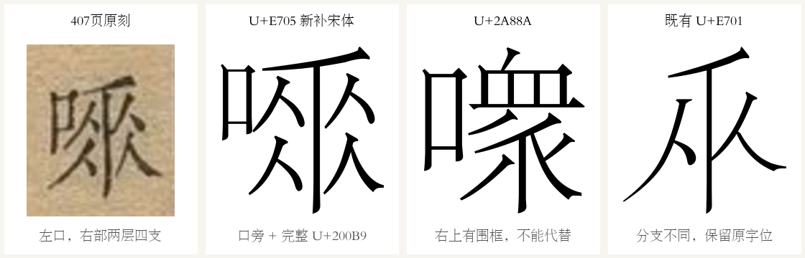
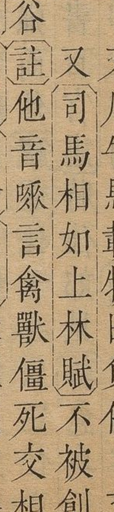
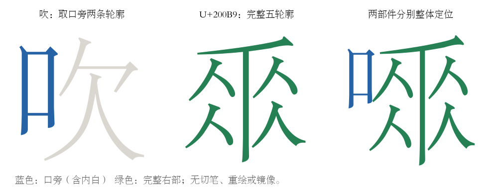
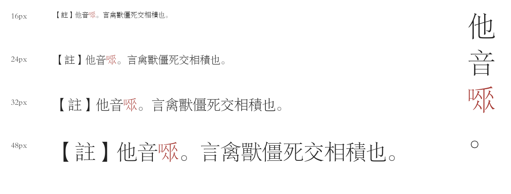

# U+E705〈口𠂹〉调研、核验与小字字体补录全过程

日期：2026-11-18；时区：Asia/Shanghai。正式写入时间：**17:14:41+08:00**。操作者：Codex；写入工具：`tools/dataset/guji_pua_patch.py`。

**结果：为《康熙字典》武英殿本第 407 页「他」条的注音字〈口𠂹〉，新增项目私用字位 U+E705，仅补入小字 `guji-plane0.ttf`，登记 v1。**正文工作区草稿的一个描述性占位已替换为单个 E705。未确认该刻形的独立标准 Unicode 码位；本次 PUA 分配不等于 Unicode 收字或字符身份的最终考定。

用户起初称第 403 页，原图、网站页位及仓库正文交叉核对后确定是 **407 页**。调研先于补录；用户随后指令“执行”。[补录前调研快照](2026-11-18-407页口𠂹码位与小字字体核验.md)保留当时的建议状态，本报告记录其后实际实施与限制。



## 1. 出处及字形身份

| 项目 | 核对结果 |
| --- | --- |
| 来源字头 | **他 U+4ED6**，子集中人部；目标是条内注音字，不是另一个字头 |
| 武英殿本 | 站方图像第 **407** 页，第 1 字头；文件 `0407.jpg` |
| 同文书局本 | 92 页第 9 字；Unihan `kKangXi 0092.090` 对应「他」，不能当作目标注音字自己的字典索引 |
| 原文 | `又【司馬相如·上林賦】不被創刃，怖而死者，他他藉藉，塡坑滿谷。【註】他音〈口𠂹〉。言禽獸僵死交相積也。` |
| 描述性 IDS | `⿰口𠂹`；用于记录和检索，不是已注册标准字符身份的证明 |
| 原图 | 1130×1662 px；上下文裁框 `(670,830,820,1500)`，左上原点，右下排除 |
| 输入截图 | 110×128 px，已保存[原始截图](figures/kou-200b9/scan-original.png)，未以重新绘制的图冒充来源 |
| 正文位置 | [0407.gj](../../kangxi-gold/annotations/0407.gj)，本次操作时第 15 行的 `【註】他音…` |



原刻左部是口，右部顶撇连接长竖，长竖左右各有上下两组人形分支。保留的是这一部件关系；新字采用现有宋体笔形，不逐像素描摹原刻。截图右部的比例和局部刀刻形态与宋体供体仍有差异。

直接核查来源为[康熙网站「他」条](https://www.kangxizidian.com/search/index_v.php?stype=Word&sword=%E4%BB%96&detail=y)、[407 页原图](https://p.kangxizidian.com/kangxi2/0407.jpg)和[汉典「他」条](https://www.zdic.net/hans/%E4%BB%96)。两个网站均以〈口𠂹〉描述。未独立校勘《上林賦》的原始注本，不能据这次工作进一步断言注者身份、确切音读或与某现代字的同一关系。

原页 SHA-256：`ca552b0734084c10d7e25679bb7bd593423e87bef46973d92098740346978d48`；输入截图：`d2acf2e878f54f32764910a59fd2215381cf09ac65d1308d4c203c9fcbcc03cd`。网址、摘录、数据文件哈希和相关属性详见[来源与编码核查 JSON](evidence/kou-200b9/audit.json)。

## 2. Unicode 码位调研

检查了本地 **Unihan 18.0.0**、CHISE IDS 的 **18 个文件／102,894 条记录**（基本区、扩展 A–J、兼容区）以及声明为 **Unicode 16.0、2025-06-27** 的 BabelStone IDS 快照。快照哈希已记录，不能把不同版本的资料合称为一个完整的最新标准数据库。

| 检索项 | 结果与解释 |
| --- | --- |
| `⿰口𠂹`、`口𠂹` | 所查 IDS 字面子串零命中 |
| `⿰口乑`、`⿰口㐺`、`⿰口众` | 零命中；这些只是扩大检索的近似结构，并非预先认定等同 |
| `⿰口⿻⿱㇒丨𠈌` | 展开描述零命中 |
| `⿰口衆` | CHISE、BabelStone 都指向 **𪢊 U+2A88A**；核对字体实形后排除直接替用 |
| IVD 2025-07-14 | 未见 U+2A88A 记录；有他、𠂹的相关序列，但没有逐一核对所有外部变体字形 |
| GlyphWiki | 请求 HTTP 403；访问失败不计为不存在证据 |

结论限定为：**在这些资源与检索方法内，尚未确认目标刻形的独立标准码位。**字面 IDS 查询没有递归穷举所有等价拆解，也没有证明所有统一汉字的所有地域／历史字形都不涵盖目标。Unihan 没有给出一个可以由本次证据确定采用的目标码位，网站占位本身也不够构成“Unicode 未收录”的证明。

若以后找到可靠标准码位或统一字形依据，应另作身份核验与迁移记录；不能静默改写 E705 的历史含义。

## 3. 小字字体查验及相近字排除

补录前直接读取三份实际 TTF，不依赖系统字体回退。

| 字体 | best cmap 映射数 | 进入全映射形似检索的非空映射 |
| --- | ---: | ---: |
| guji-plane0.ttf | 30,708 | 28,997 |
| guji-plane2.ttf | 61,228 | 61,119 |
| guji-planef.ttf | 42,620 | 42,520 |
| 合计 | 134,556 | **132,636** |

检索步骤：截图灰度 `<120` 取墨迹；U+2E80 以上映射以 96px 字号画入 128px 画布，再按墨迹 bbox 等比归一化到 64px 画布的最大 58px 区域，计算双向平均距离变换。每份保留前 100 项，目视各前 48 项，合计 144 个字体／码位实例。全字体首位为 U+3A3C（1.168）、U+2CDB7（1.142）、U+F5B34（1.120），均不是目标。

又按 Unihan 口部或 IDS 左口结构取并集，在 plane0／plane2 筛出 **3,328** 项，检查专项前 48 项，仍未见相符字形。专项与全字体候选可能重复，不能合称为 192 个独立字符。plane0 的 **96 个未映射字形**也已看图检查；plane2／F 未映射仅 `.notdef`。三字体均无 format-14 cmap；plane0 GSUB 只有 `vert`，所查口、他、嗒、嚃、乑无替换；其他两份无 GSUB。

这是全映射生成候选、有限候选目视核验及隐藏字形机制检查，**不是逐个目视全部 132,636 个映射，也不是全球字体普查**。

| 对象 | 相近处 | 不能直接替用的原因 |
| --- | --- | --- |
| **𪢊 U+2A88A** | `⿰口衆`，plane2 已有 | 右上有血／罒形围框，原刻是顶撇连中竖；Unihan J 源 `JK-65075`，口部 12 画、总 15 画 |
| **𠂹 U+200B9** | 顶撇、中竖、两层四支；plane2 已有 | 可提供完整右部，单字本身没有左口 |
| **PUA E701** | 顶撇与长竖有共同视觉特征；其 v4 也取自𠂹的第 0 轮廓 | 出自 @349 乑条按语，分支结构不同；不得复用或覆盖旧字位 |
| **嚃 U+5683** | 口部；可作为后续音义研究线索 | 当前字体右部为遝形，与截图结构不符；本次未确定文字学同一关系 |
| **乑、㐺、众及“口＋这些部件”** | 可扩大 IDS 候选范围 | 部件数、位置或竖笔关系不同；近似检索词不等于可用字形 |

证据：[全字体排名](evidence/kou-200b9/font-search.json)、[口部专项排名](evidence/kou-200b9/mouth-candidates.json)、[字体覆盖](evidence/kou-200b9/font-coverage.json)、[plane0 图册](figures/kou-200b9/guji-plane0.ttf.candidates.png)、[plane2 图册](figures/kou-200b9/guji-plane2.ttf.candidates.png)、[planeF 图册](figures/kou-200b9/guji-planef.ttf.candidates.png)、[口部图册](figures/kou-200b9/mouth-candidates.png)、[未映射图册](figures/kou-200b9/unmapped-plane0.png)。

## 4. 字位分配与补录范围

在项目 PUA 区间分配 **U+E705**。写入前已核对注册表、四份仓库字体 cmap 和相关仓库用例，没有占用。E702／E703 是 E701 历史试验字位，保留不用；E701／E704 各自身份不变。

- 正式对象：仅 `guji-preview-grid/public/fonts/guji-plane0.ttf`。
- 登记方案：`compose`，新条目 v1，`usage=small-only`。
- 小字缓存戳：`e701-4-e704-1` → **`e701-4-e704-1-e705-1`**。
- 大字缓存戳仍为 `001016-2bd6e-2e85`；plane2、planeF、大字及系统字体均未写入。
- 字符身份、来源、范围及流水见 [pua-registry.json](../../guji-preview-grid/src/pua-registry.json)。E701 v4／E704 v1 只同步共享字体的文件哈希基线，没有递增字形版本。

PUA 需要随项目字体使用；脱离该字体不保证显示或表达相同含义。跨系统交换宜同时附带 `⿰口𠂹`、来源页位和本报告链接。

## 5. 部件选取、试作与冻结配方



左口取 **吹 U+5439 的第 0、1 轮廓**，包括外轮廓和内白，保留该字体原生口旁的笔画比例。没有使用压扁独体「口」的方案。右部取 **𠂹 U+200B9 的全部五条轮廓**，共同做一次正向仿射；不单独重排分支，也不拆开顶撇与中竖。

| 部件 | 供体 | 轮廓索引 | 目标 bbox（字体单位，y 向上） |
| --- | --- | --- | --- |
| 左口 | plane0 吹 U+5439 | 0、1 | `[30,290,235,745]` |
| 右𠂹 | plane2 𠂹 U+200B9 | 0–4，整字 | `[195,-146,998,848]` |

两逻辑部件、七轮廓、176 点。没有切笔、重绘、镜像、扫描追踪或布尔并集。两部件包围盒的横向范围略有交叠，但实际墨迹不碰接：各部件独立渲染为 2048×2048、以 alpha>128 取墨迹后，交集 **0 像素**。这是该栅格分辨率上的检查，不能冒充解析几何证明。

仿射参数采用 `[xx,xy,yx,yy,dx,dy]`，即 `x'=xx*x+yx*y+dx`、`y'=xy*x+yy*y+dy`：

```text
口: [0.7009878419452887, 0, 0, 0.6661786237188873,
     6.166413373860184, 232.7086383601757]
𠂹: [0.8766375545851528, 0, 0, 1.0354166666666667,
     155.55131004366814, -20.714583333333337]
```

这是非等比缩放，原刻和新字比例并非完全相同。最终口旁的高度、宽度和右部留白经过 A–J 十组临时布局比较；A–D 使用临时 TTF，E–J 用 SVG 检查相接和间距，J 再生成临时字体核对实际字号。所有试作均在本地 `var/font-audit/0407/`，正式字体只插入一次 v1。保留[早期 A–D 比较](figures/e705/trials-a-d.png)、[后续 E–J 比较](figures/e705/trials-e-j.png)和[参数记录](evidence/e705/layout-trials.json)；试作字母不是注册表版本。

冻结配方为 [e705-songti-v1.json](../../tools/dataset/font-sources/e705-songti-v1.json)，保存来源、变换、路径、最终坐标、标志、端点、指令和字形哈希。[生成器](../../tools/dataset/guji_kou_200b9_components.py)默认只读重建并比较整份配方；`--write-recipe` 只生成 JSON／SVG，不写正式字体。

| 校验对象 | SHA-256 |
| --- | --- |
| 吹完整供体字形的编译 glyf | `4e0a0b7ca1b0b3271abd4575662977d7d64d7b27ffc247d54a1b4ba3ad506ae0` |
| 𠂹完整供体字形的编译 glyf | `98d1e5de079b836853273d7a08bd9202f623318e66a6c1087c512dda0fe83608` |
| E705 冻结字形的编译 glyf | `1fe4d3e014eb00135b454eba31cbab7263e1a62aea67105a419d68bbb1cf3ec7` |

## 6. 核验方法及形似分数的局限

正式渲染与阈值截图的 chamfer128 为 **3.2564178284556133**。创作阶段曾暂设 3.0，预览结果超过该值；最终在正式 dry-run 前把配方回归阈值定为 **3.4**。这一调整不能解释为字形质量“变好”，只是记录采用宋体部件后的基线。

对照试验直接说明这道数值闸很弱：

| 对照 | chamfer128 | 是否低于 3.4 | 构形判断 |
| --- | ---: | --- | --- |
| E705 最终字形 | 3.256418 | 是 | 通过完整部件和目视核验 |
| 𪢊 U+2A88A | 3.305195 | **是** | 围框不同，不能替用 |
| 𠂹 U+200B9 | 2.512088 | **是** | 缺左口，不能替用 |
| E701 | 4.128970 | 否 | 分支不同 |
| 嚃 U+5683 | 4.024390 | 否 | 右部不同 |

所以 **分数不承担字符识别或结构正确性的证明**；不能以“过闸”排除错字。主要约束是完整供体轮廓、来源哈希、冻结字形哈希、部件间距和小字号目视。本节的 128px 归一化评分也不能与候选检索的 64px 分数直接比较。

另做三项故障注入检查：篡改内部供体哈希、外部供体哈希、冻结轮廓哈希，均被构形工具拒绝；这些检查没有写生产字体。完整结果见 [extra-checks.json](evidence/e705/extra-checks.json)。



## 7. 正式写入结果与原字保护

先 dry-run，再正式执行：

```bash
python3 tools/dataset/guji_pua_patch.py --cp E705 \
  --dry-run --cache-version e701-4-e704-1-e705-1
python3 tools/dataset/guji_pua_patch.py --cp E705 \
  --cache-version e701-4-e704-1-e705-1
```

以上是首次写入历史命令，**不要在已补字体上重复执行插入**。工具将旧字体按哈希备份，验证临时结果后原子替换，并更新注册表及机器流水。

| 项目 | 补前 → 补后 |
| --- | --- |
| 文件字节数 | **17,252,348 → 17,252,900**（+552） |
| best cmap | **30,708 → 30,709** |
| glyphOrder 数 | **30,804 → 30,805** |
| 新字形名 | `uniE705` |
| UPM／轮廓／点数 | 1024／7／176 |
| 整字 bbox | `[30,-146,998,848]` |
| hmtx | `[1024,30]`（横向 advance、左边距） |
| vmtx | `[1024,22]`（竖向 advance、上边距；竖向原点 870） |
| 其他字形 | 补前 **30,804 个**逐一比较编译 glyf、hmtx、vmtx，全部不变；旧 cmap 映射、glyphOrder 保留 |

生产小字字体 SHA-256：

```text
前 f7e40e014584f6f4fd73ac1de97b2e9aac414e5eeb0e9c9a3847a78e4c27a20b
后 d95b07155dd6993f86175cc6ee979403be7fa712b4f79881981011d80d276da8
```

写入后重新读取生产文件验证；E701 字形哈希仍为 `0ef6027de1532c8bc037f5944ab4080e7e14651298ba2f61d468a36d898493c4`，E704 仍为 `f28a8bf767d91fa2ae6cbf73b5ba8ef70869e4e4ddac3487cb00e135555b3604`。plane2、planeF、大字、系统字体的完整文件哈希均与[补前快照](evidence/e705/before.json)一致，且均未映射 E705。

完整事件、备份位置、生产核验、其他字体哈希见 [patch-verification.json](evidence/e705/patch-verification.json)。字体与配方／详报提交：**`5943c3eb75e6fe62d0dd3283fcc82174f38a0621`**。后续补记提交号的文档提交不再改字体字节。

## 8. 正文、浏览器与构建核验

只将现有 `0407.gj` 的一个 `〈口𠂹〉` 换为一个 U+E705，保留其余字节，没有执行整页格式化或改变草稿状态。替换前后哈希及计数见 [annotation.json](evidence/e705/annotation.json)。该页原本是未跟踪草稿，**整页未纳入字体提交**；报告保存这一范围区别，防止把补字误认作整页终校。

浏览器重新加载后，在 @407 实际矩阵找到且只找到一个含 E705 的 `.m-cell`，字号 **17.022px**；截图目视可见左口与完整右部，没有缺字方框。CDP `CSS.getPlatformFontsForNode` 确认这一节点实际使用自定义字体 **ZhongHuaSongPlane00**、`glyphCount=1`，不是只看 CSS 声明猜测字体命中。编辑器显示与数据集一致，草稿状态保留。[浏览器核验记录](evidence/e705/browser.json)记录节点、上下文和字体结果；这不代表整页排版或全部文字校对通过。

`npm run build` 通过，[完整输出已存档](evidence/e705/build-output.txt)。输出仍有 Vite 对未来 native config 的 `__dirname` 提示及大于 500 kB 的 chunk 提示；没有因为这些既有构建提示更改本任务范围。此任务未重跑整套应用测试，也不借用其他并行任务的测试数；采用字体全量保留检查、冻结配方重建、故障拒绝、静态渲染、实际页面核验及构建作为验证。

报告图片由[渲染脚本](../../tools/dataset/render_e705_report.py)从正式生产字体重新生成；供体示意从受版本管理的配方和字体构建，不依赖忽略目录内的创作缓存。

## 9. 追踪、复现和回滚

只读复现命令（在仓库根目录）：

```bash
python3 tools/dataset/guji_kou_200b9_components.py
python3 tools/dataset/render_e705_report.py
```

第一条比较全部冻结配方并输出字形哈希；第二条重生报告图，需要 fontTools、Pillow 和 `rsvg-convert`。现有[形似搜索工具](../../tools/dataset/guji_font_shape_search.py)亦可重跑，但当前字体已含 E705；若要复现补前候选排名，必须使用补前哈希版本。

本机自动回滚点：

```text
var/unencoded/kangxi-unencoded/font-backups/
guji-plane0.ttf.f7e40e014584f6f4fd73ac1de97b2e9aac414e5eeb0e9c9a3847a78e4c27a20b.ttf
```

该备份保留 E701／E704，未含 E705。本次字体提交的父版本也提供相同的字体 blob。回滚必须同时处理 E705 登记、共享哈希、小字缓存戳及使用处的描述性占位，并追加撤销事件；不能只换 TTF 留下失效正文。若此后另有补字，不得直接覆盖整份旧字体，应做有针对性的撤销，保护后续变更。0407 页属于用户工作草稿，只逆转本次单个字符替换，不能整页回退。

本地 `var/` 保存原始查询缓存、临时字体和机器流水；版本库保存本报告、补前调研、关键 JSON、截图、候选图、冻结配方和正式字体。资料完整度边界见各 JSON，未归档全部第三方数据库文件，不承诺离线无依赖复跑整个 Unicode 检索。

历史入口：[字体补录 Changelog](../font-changelog.md) · [字体操作登记簿及当前哈希](../font-operations.md)。
