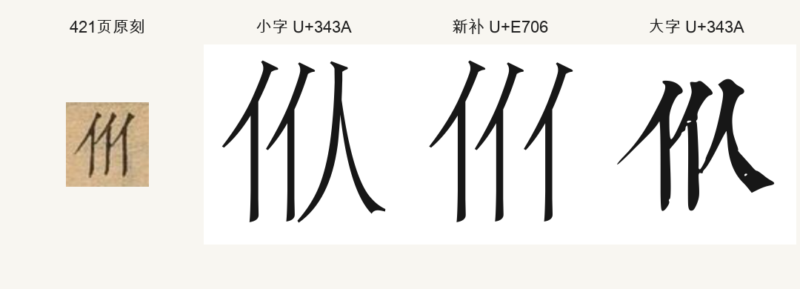
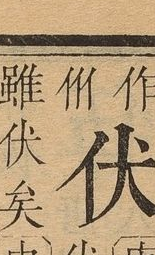
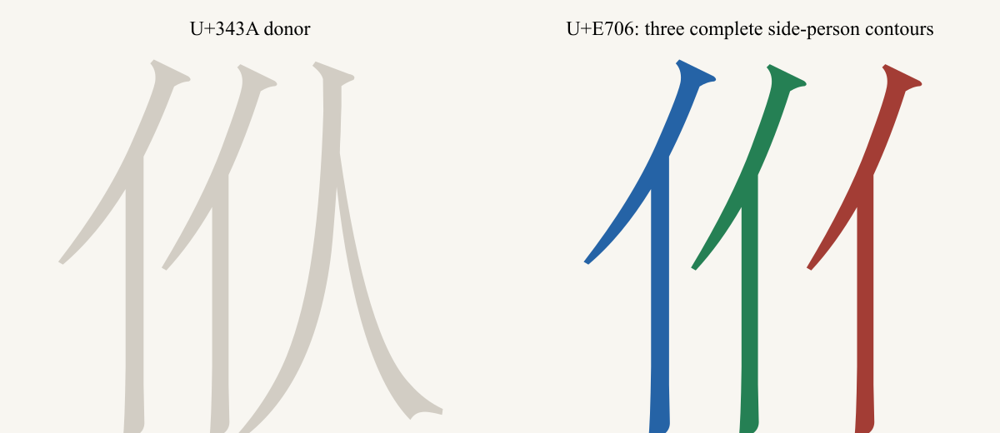
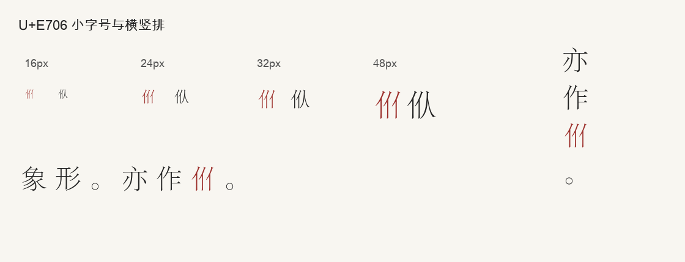

# U+E706〈亻亻亻〉调研、核验与小字字体补录全过程

核验与补录日期：2026-11-18。

**结果：第 421 页〈亻亻亻〉属于已编码字符㐺 U+343A 在原文中明确另举的字形异体；现有小字 U+343A 不能保留这项字形区别。因此项目分配 PUA U+E706，仅补入 `guji-plane0.ttf`，登记 v1，并将 421 页的一个描述性占位替换为单个 E706。**U+343A 本身未修改；E706 不是新的通用 Unicode 字符。



## 1. 出处与字符身份

来源是《康熙字典》武英殿本第 421 页㐺条：

> 【正字通】衆本字。【六書本義】从人，三成類爲意。象形。亦作〈亻亻亻〉。

仓库位置为 [0421.gj](../../kangxi-gold/annotations/0421.gj)。原页 SHA-256 为 `226f0f99f878e06200c8e9d02d656e15f80e2892b6e50a1fdafa9f945965274f`；用户截图 SHA-256 为 `a84887b80784ed856ec03a96b64bbcfcce4d4f247271247f140b7b4d954548f5`。



本地 Unihan 18.0.0 明确收录 **㐺 U+343A**：`kKangXi 0095.220`、G 源 `GKX-0095.22`、总笔画 6。CHISE 与 BabelStone IDS 都将 U+343A 描述为 `⿰亻𠆧`。目标可描述为 `⿲亻亻亻`，但这只是字形结构；IDS 中同一子串还出现在门内构件𨴟 U+28D1F，不能把𨴟当成目标码位。

原句以“亦作”说明这是㐺的另一写法。所查 IVD 2025-07-14 快照未见 U+343A 的标准化变体序列，三份小字字体也都没有 format-14 cmap。结论应写成“字符已编码、精确异体字形没有现成调用方式”，而不是“Unicode 未收录该字符”。

## 2. 补录前字体核验

补录前直接读取三份小字字体，U+343A 只在 plane0 映射。plane0 的 U+343A 有三条轮廓：两个侧立亻和右端人形；右端与原刻第三个侧立亻不同。plane2、planeF 没有 U+343A。

以用户截图灰度 `<80` 取墨迹，对补前 plane0、现行未改的 plane2／planeF 全映射生成候选：分别检查 **28,998、61,119、42,520** 个非空映射，每份保存前 100 项。首位是 U+6673、U+2AA81、PUA U+F45A3，均不是目标；候选图目视和 plane0 的 96 个未映射字形检查也未见目标。证据见 [font-search.json](evidence/e706/font-search.json) 及[补前调研记录](evidence/e706/audit.json)。这不是全球字体普查，不能证明所有外部字体均无该字形。

现有 U+343A 与截图的 chamfer128 为 **5.641716**，结构差异明显；新补 E706 为 **0.752764**。分数只作本项目回归检查，字符身份仍由原文㐺条和构形核验决定。

## 3. PUA 分配与范围

项目 PUA 区间中 E702、E703 是 E701 历史试验保留位；E706 是 E705 后第一个未占用正式字位。正式登记：

- U+E706，scheme=`compose`，v1，usage=`small-only`；
- 只写 `guji-preview-grid/public/fonts/guji-plane0.ttf`；
- 不写 plane2、planeF、大字 `guji-large.ttf` 或系统康熙字体；
- 不替换或重绘标准 U+343A；
- 缓存戳更新为 `e701-4-e704-1-e705-1-e706-1`。

PUA 必须随项目字体使用。对外交换时应同时附 U+343A、结构描述 `⿲亻亻亻`、来源页位和本报告链接。

## 4. 字形构造与冻结配方



新字直接使用 plane0 U+343A 的现有宋体轮廓：

| 部件 | 供体轮廓 | 变换 `[xx,xy,yx,yy,dx,dy]` |
| --- | --- | --- |
| 左亻 | U+343A 第 1 轮廓 | `[1,0,0,1,65,0]` |
| 中亻 | U+343A 第 2 轮廓 | `[1,0,0,1,75,0]` |
| 右亻 | 再用第 2 轮廓 | `[1,0,0,1,370,0]` |

三条轮廓均完整提取，只做平移；没有缩放、镜像、切笔、描摹、布尔并集或手工改点。最终字形为 3 轮廓、72 点，编译 glyf SHA-256 为 `b70f363fdaae3b9abb0798b70c4d480fca9a4ac513b6baeb389633fd7bea727c`。

冻结配方为 [e706-songti-v1.json](../../tools/dataset/font-sources/e706-songti-v1.json)，记录 U+343A 供体哈希、轮廓索引、变换、最终坐标、标志、端点与度量。[生成器](../../tools/dataset/guji_three_person_variant_components.py)默认重建并逐项比较冻结配方；`--write-recipe` 只写创作 JSON，不触碰生产字体。

## 5. 正式写入与保护检查

正式写入前执行 dry-run，随后由同一工具备份旧字体并原子替换：

```bash
python3 tools/dataset/guji_pua_patch.py --cp E706 \
  --dry-run --cache-version e701-4-e704-1-e705-1-e706-1
python3 tools/dataset/guji_pua_patch.py --cp E706 \
  --cache-version e701-4-e704-1-e705-1-e706-1
```

| 项目 | 补前 → 补后 |
| --- | --- |
| 文件字节数 | **17,252,900 → 17,253,152**（+252） |
| best cmap | **30,709 → 30,710** |
| glyphOrder | **30,805 → 30,806** |
| 新字形 | `uniE706` |
| bbox | `[86,-124,955,848]` |
| hmtx / vmtx | `[1024,86]` / `[1024,22]` |
| 字体 SHA-256 | `d95b0715…` → `25857b0b476193a79e4b280e42302f0e00977385d2bbc62e603cc8e3a00568ed` |

补前 **30,805 个**字形逐一比较编译 glyf、hmtx 与 vmtx，全部不变；旧 cmap 与 glyphOrder 保留。U+343A、E701、E704、E705 的字形哈希前后分别保持 `87c61df8…`、`0ef6027d…`、`f28a8bf7…`、`1fe4d3e0…`。plane2、planeF、大字和系统字体均未写入且不映射 E706。

自动回滚点：

```text
var/unencoded/kangxi-unencoded/font-backups/
guji-plane0.ttf.d95b07155dd6993f86175cc6ee979403be7fa712b4f79881981011d80d276da8.ttf
```

完整事件与验证见 [patch-verification.json](evidence/e706/patch-verification.json)。

## 6. 正文、浏览器、测试与构建

只将 0421.gj 中一个 `〈亻亻亻〉` 替换为一个 U+E706，替换后该页 E706 恰有 1 个、描述性占位为 0、U+343A 字头仍有 1 个。该页原本是未跟踪草稿，本次不把整页状态解释为终校通过。[annotation.json](evidence/e706/annotation.json)记录替换范围及哈希。



在 1440×1000 浏览器视口打开 @421，矩阵中只找到一个含 E706 的 `.m-cell`，字格约 **29.80×32.04 px**，字号 **23.8469 px**。CDP `CSS.getPlatformFontsForNode` 确认实际使用自定义字体 `ZhongHuaSongPlane00`、`glyphCount=1`，不是系统回退。记录见 [browser.json](evidence/e706/browser.json)。

应用验证：Vitest **22 个测试文件、784 项测试全部通过**；`npm run build` 通过。构建仍报告既有的 Vite native config `__dirname` 未来兼容提示和大于 500 kB 的 chunk 提示，本次未扩大范围处理。

报告图片由 [render_e706_report.py](../../tools/dataset/render_e706_report.py)从正式字体、冻结配方和存档截图生成。只读复现：

```bash
python3 tools/dataset/guji_three_person_variant_components.py
python3 tools/dataset/render_e706_report.py
```

回滚时必须同时处理 E706 字体映射、注册表、缓存戳和 0421.gj 的一个使用处，并追加撤销事件；若后续还有补字，不得直接覆盖整份旧字体。
