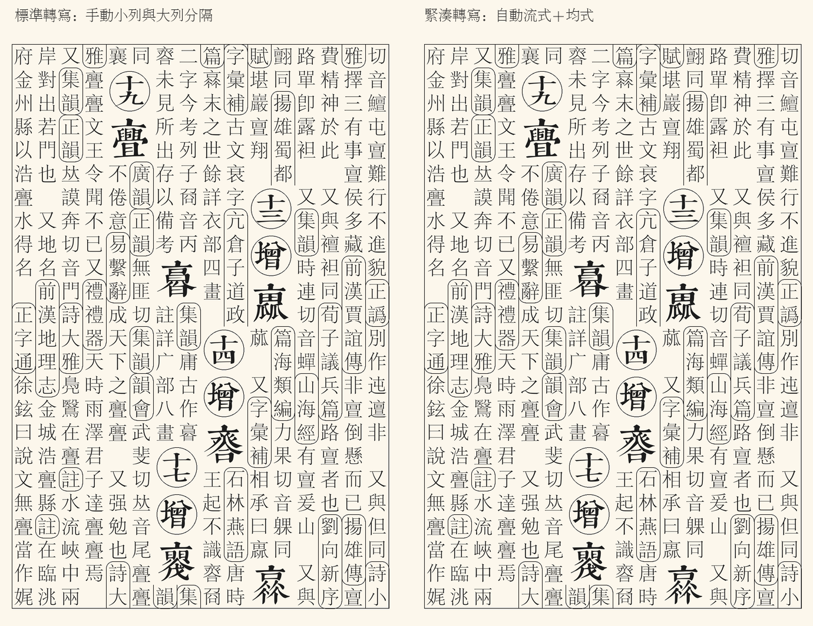
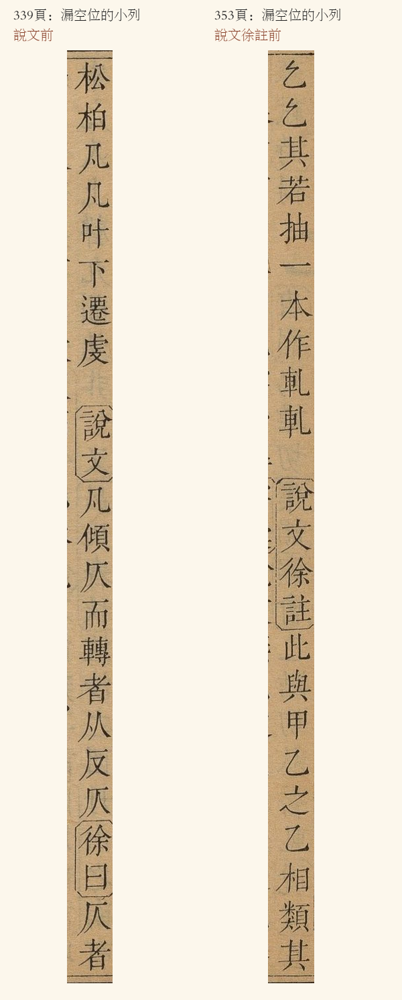

# 康熙字典自动流式＋均式排版可行性

> 历史状态说明：下文记录正式接入之前的原型评估。随后提交 `8346886` 已将 `.gj` 切换为自动流式＋均式，并以 `$`／`¥` 明确强制换列，未采用本文早期建议的双 `.gj` 输入模式。正式实现、独立回归基线与复现边界见[升级纪实](2026-11-18-排版引擎自动流式与均式升级纪实.md)。原型脚本导入生产解析器，在新版代码上复跑不能直接重现旧解析语义下的比较；历史数值以已归档证据为准。

日期：2026-11-18。研究问题：在 8 大列、每列 12 大字格、大小字高度比 2:1 的固定版式下，能否删去 `.gj` 的物理小列换行和大列空行，保留文字、空位、大小字及装饰标记，并自动恢复原排版。

## 结论

**可行。382 页的紧凑输入经过自动流式＋均式排版，与现有标准写法的显示几何完全一致；同一渲染器生成的图片逐像素相同。**

外层依阅读序安排大字和小字区域，内层将落在当前大列中的小字片段均分为右、左两小列。普通小字的人工折行与大列空行可以成为自动推导结果，不必继续作为输入要求。

有两个必须明确的解释：

- 小字组可以跨大列。作为纵向排版的区域，并不意味着整段释文必须不可分割地放在一列。
- “12 大字格”表示容量，而非只能在 12 个整数格位上起排。排版游标须以 **24 个小格高度**计量；小字组高度为奇数时，下一大字可从半个大格的位置开始。

本次只新增验证原型与证据。**当前正式解析器仍依赖显式折行**；直接把紧凑写法交给当前应用，会排成一大列并溢出。实现新的自动模式后才可使用紧凑输入。

## 382 页的可重复验证

原型先从当前 382 页标准转写中删除所有物理小列换行和大列分隔，只保留 `@382` 与大小字切换所需的行边界。随后在完全不读取原来的列边界的条件下，自动生成显式折行，再交给项目现有解析器、布局器和装饰投影器。

比较时忽略重新生成的元素 ID、行 ID、源码偏移，逐项检查实际影响显示的内容：

| 检查项 | 结果 |
| --- | --- |
| 页宽／页高、8 大列范围 | 一致，16 × 24 小格 |
| 阅读序、大小字和合字占格 | 一致 |
| 334 个非空字形单元的内容与坐标 | 全部一致 |
| 9 个显式空位的坐标 | 全部一致 |
| 35 段书名框及跨列开口方向 | 全部一致 |
| 7 个圈注的位置 | 全部一致 |
| 680 × 1000 像素确定性栅格图 | 逐像素一致 |

“334 个字形单元”按显示单元计数；圈内“十三”等两个码点合占一大格，因此不是 Unicode 正文字数。



两图使用相同的项目 Pillow 渲染器。逐像素一致是这两张图的验证结果；没有另行比较浏览器截图。浏览器使用的文字、空位与装饰几何来自相同生产代码，几何已独立核对。

输入与产出副本：

- [标准转写](figures/kangxi-auto-flow/0382-standard.gj)
- [紧凑转写](figures/kangxi-auto-flow/0382-compact.gj)
- [自动恢复的显式折行](figures/kangxi-auto-flow/0382-auto-folded.gj)

自动产出可把同一行的多个大字拆成若干 `#` 行，书名框旁标点归属也可与原文行边界不同；这不影响显示。验证目标是相同渲染，不要求源码逐字节相同。

## 精确算法

以小格为单位：大列高度 `H = 24`，大字高 `2`、宽 `2`，普通小字高 `1`、宽 `1`。每列从上往下排，满列后移到左侧下一大列。

遇到大字单元时，占用两小格高度。圈“十三”、圈“增”和字头是三个大字单元，合计六小格高度；“十三”不能按两个大格计。若当前列剩余不足两小格，则移到下一大列。

遇到普通小字组，令剩余文字与空位数为 `N`，当前列剩余高度为 `R`：

```text
本列容纳的数量 K = min(N, 2 × R)
前小列长度 A = ceil(K / 2)
后小列长度 B = floor(K / 2)
本列片段高度 = A

先排前 A 个字格，再排后 B 个字格。
若还有剩余文本，进入下一大列，重复计算。
若该小字组结束，则下一大字从当前片段底部继续。
```

关键顺序是 **先按当前大列剩余容量取片段，再均分这个片段**。不能先把整个长释文均分为两条长列后再截断，也不能强制把完整释文搬到下一大列。

标点、`【】`、字号标记不计格；书名正文计格；`*` 明确计一个当前字号的空格。扩展区汉字按码点识别，不按 UTF-16 长度计格。

## 382 页逐列推导

下表左右均为阅读顺序；高度使用小格。小字“24/24”表示前后小列分别占 24 格。

| 大列 | 依次排入的内容 | 总高度 |
| --- | --- | ---: |
| 1 | 页首续文 24/24 | 24 |
| 2 | 续文 24/24 | 24 |
| 3 | 续文 6/5 → 圈十三、圈增、𠆁 → 小字 10/10 → 𠆂 | 6 + 6 + 10 + 2 = 24 |
| 4 | 𠆂释文 12/11 → 圈十四、圈增、𠆋 → 小字 6/6 | 12 + 6 + 6 = 24 |
| 5 | 𠆋续文 9/9 → 𠆌 → 小字 6/6 → 圈十七、圈增、𠆝 → “集／韻” | 9 + 2 + 6 + 6 + 1 = 24 |
| 6 | “同／襄” → 圈十九、亹 → 小字 19/19 | 1 + 4 + 19 = 24 |
| 7 | 亹续文 24/24 | 24 |
| 8 | 亹续文 24/24 | 24 |

三个能区分算法的例子：

1. 页首连续小字有 107 格。自动取 48、48、11 格，分别排为 24/24、24/24、6/5。无需输入两个大列空行。
2. “𠆋”的释文有 30 格，而第 4 大列只剩 6 小格高。先排 12 格为 6/6，再把余下 18 格排到第 5 大列为 9/9。若把整组视为不可拆分，会与原版不同。
3. “【集韻】同襄”共 4 格。第 5 大列只剩 1 小格高，先排“集／韻”，剩余“同／襄”在第 6 大列首均分。第 5 大列的“𠆌”从小格第 10 行开始，“十七”从第 18 行开始，说明不能强制大字从整数大格位置开始。

## 扩展到当时的 70 页

以下保留初次验证时工作区的 70 页统计。此时 manifest 已将全部 70 页标为 `first`，@371 的续文与列结构也已补齐；与较早审计的“69 页初校、1 页草稿”是不同时间点的数据。

| 自动排版规则与输入 | 与对应标准写法完全一致的页数 |
| --- | ---: |
| 仅普通流式＋双列均式 | 37/70 |
| 加上标题独占大列、“古文”居中单列 | 68/70 |
| 再在试验副本补齐两处经原图确认的漏空位 | 70/70 |

第二行当时只剩 @339、@353 两页不同。其原因不是已经证明的版式例外，而是显式折行隐藏了内部漏空位：

| 页码 | 标准转写的问题 | 试验副本的修正 |
| --- | --- | --- |
| @339，第 2 大列后小列 | “叶下遷虔”与“【說文】”之间原图空一格，原转写没有占位符 | `叶下遷虔。*【說文】` |
| @353，第 1 大列后小列 | “一本作軋軋”与“【說文徐註】”之间原图空一格，原转写没有占位符 | `一本作軋軋。*【說文徐註】` |



初次试验只在内存与试验副本补入上述 `*`，修正后的显式转写与自动排版全部一致，得到表中的 70/70。

**2026-11-18 后续修复：按用户要求，已将两处 `*` 写入原始 `0339.gj` 第 7 行和 `0353.gj` 第 4 行。** 直接读取修正后的源文件验证，两页的自动排版均与显式折行完全一致，不再需要内存补空位。初次统计与哈希作为历史证据保留，本次复核另记在证据文件的 `sourceCorrections` 字段。

这也补充了前一轮核查的边界：一组 24/23 可以符合均式规则，却因漏了内部空位而无法在取消物理列边界后复现。**“每组长度均衡”本身不足以证明自动流式与显式分列等价。**

## 可以取消什么，仍须保留什么

普通释文的物理小列换行和大列空行可以取消。输入仍须表达文字阅读序、大小字切换、空位、圈注与书名框，以及以下边界：

- **页界**：本试验保留 `@页码`，逐页自动排大列；尚未验证把全书合并为无页界连续文本后的自动分页。
- **标题**：书名、集名、部首标题须明确或由书籍规则识别为独占大列；若当作普通连续大字，会紧接向下排列。原型复用现有康熙标题识别。
- **“古文”提示语**：是居中单列，可跨大列拆成“古”“文”。原型用独立小字组文本识别，正式实现宜由书籍语义层输出居中单列属性，避免影响普通释文中出现的“古文”二字。
- **页面留白与特殊版面**：终页剩余大列可自然留空；其他显式留空、强制换列等特殊需求仍应有覆盖手段，不能仅由三个尺寸参数推出任意版面。

`*` 的遗漏对紧凑输入更敏感：旧格式会在下一显式列边界重新开始，新格式可能把后面的文字持续前移。应保留容量溢出诊断、逐页对照，以及向显式折行格式导出的能力。

## 落地建议

采用显式可选的自动排版模式，保留当前按物理折行解释的模式。两种输入模式生成统一的页、大列、小字组及字格放置结果，复用现有文字与书名框／圈注渲染。

第一步可以用预处理器把紧凑输入转成等价显式折行；本次原型已经验证这条路径。正式接入编辑器时，需要把自动插入的分列映射回原始紧凑文本的码点位置，以维持光标、字符高亮和书名框联动。不要将预处理后的新行号直接当作用户输入的源位置。

模式应由数据集／文档元数据或清楚的格式标记选择，避免猜测一个现有 `.gj` 的换行是物理分列还是编辑性换行。固定版式确定自动放置容量，但不会自动消除标题与单列提示语的语义差异。

## 复现与证据

```sh
node tools/eval/verify_kangxi_auto_flow.mjs
```

- [验证脚本](../../tools/eval/verify_kangxi_auto_flow.mjs)：只读现有源文件，实验产物默认写入 `var/kangxi-auto-flow/`。
- [机器可读证据](evidence/2026-11-18-kangxi-auto-flow.json)：70 页的逐项结果、源文件哈希、382 页排版轨迹、两处试验修正与图片比较结果。
- 当前正式解析器直接读取 382 页紧凑输入时，诊断为“一大列 356 小格高，超出 24 格”；这与原型成功自动分成 8 大列是不同路径。

本次核对的是与现有初校标准转写的显示等价性，不是对 70 张扫描图重新逐字终校，也不证明所有康熙字典版本均无例外。验证原型没有接入正式预览应用；初次评估没有修改原始标注，后续按用户要求仅补入 @339、@353 的两处 `*`，未修改 manifest。
