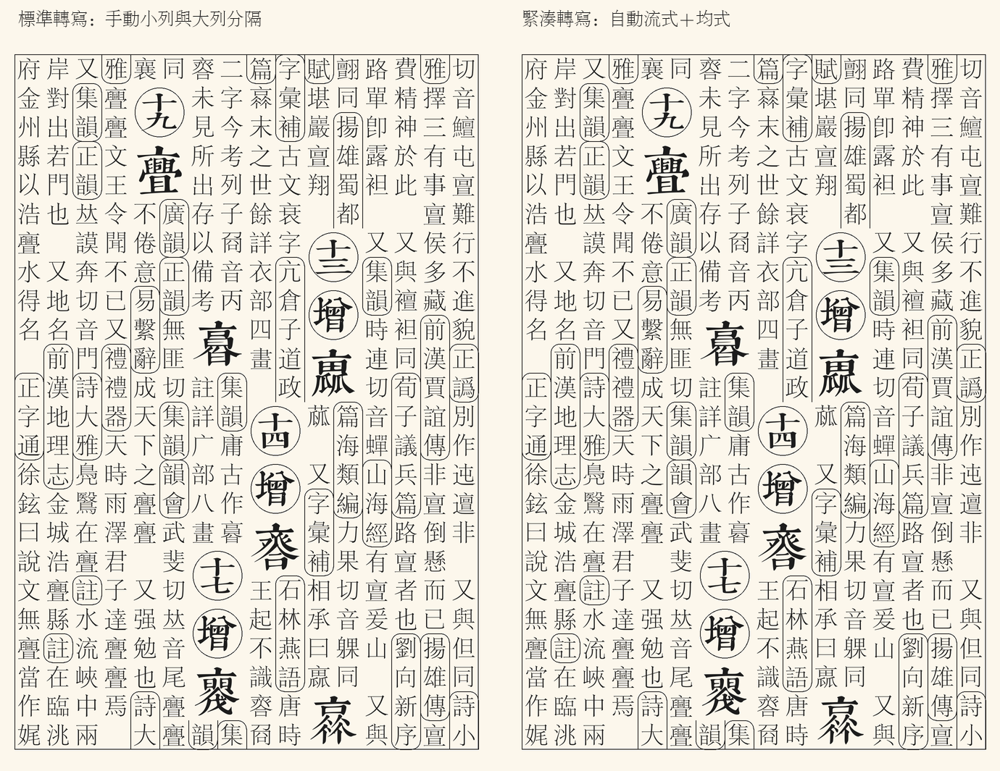
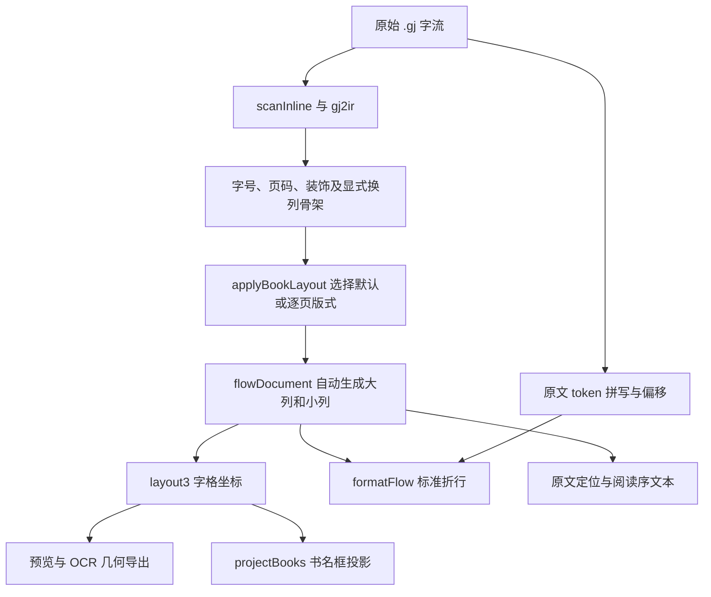

# 排版引擎自动流式＋均式升级纪实

日期：2026-11-18。正式实现提交：`8346886581dc6d923e0ed01ec7661545789511d9`（下称 `8346886`）。本文记录此次升级的起因、判断修正、算法与工程决策、新旧行为、验证依据和后续维护边界。描述以该提交为准，不随后来新增的页面或工作区状态改变。

这次升级将 `.gj` 中普通小字的换行和大列之间的空行，从输入必须提供的版面约束，改为引擎可以推导的格式化结果。正式规则为：**大列之间流式排版；每个大列内的小字片段均式排版；特殊提前换列用行尾 `$`／`¥` 明确指定。** 文字、大小字、必要空位、圈注、书名框和页码仍由源文件提供。

382 页的 15 行紧凑写法可以直接预览，格式化后精确恢复为用户给出的 41 行标准写法。70 页已校正文的新旧显示几何一致；固定回归基线额外包含一个空白页，共 71 页。这里的“一致”包括字格、显式空位、圈号、书名框和阅读顺序，不等于对原图重新完成了逐字终校。

阅读入口：日常输入看[语法手册](../gj-syntax-guide.md)，数据结构看 [IR 设计](../design/guji-ir.md)，逐页哈希及本次文档复核结果看[升级证据](evidence/2026-11-18-layout-engine-upgrade.json)。

## 1. 升级前：版面主要由换行写出来

### 1.1 原引擎已经具备什么

此次升级建立在已有 Guji IR v3、共享词法、书籍版式配置和字格渲染器上。升级前已经能够处理大小字混排、显式空位、多码点圈注合字、跨列／跨页书名框、编辑器定位，以及固定页框的溢出诊断。

但 `.gj/2` 把源码的物理结构当作排版结构：

- 空行结束一个大列，生成一个 `IRBand`。
- 带内的物理行生成 `IRLine`；连续小字行并排放置。
- 大字把前后小字组分开，各组自上而下接续。
- `#` 从当前位置到物理行末选择大字。
- 格式化主要归一空位、圈注及冗余字号标记，保留人工折行。

因此，正确的人工折行可以复现均式排版；错误折行也会被忠实执行。多拆一行可能形成三条甚至更多小列，少留一个空行可能使大列过高，删掉小字换行会把文字排成一条很长的小列。

**旧引擎不能简单概括为“小字先填满前列的流式引擎”。** 它主要执行用户给定的折行，通常不自动决定前后小列应在哪里切开。本次要解决的是这一人工依赖，同时排除“用贪心填满前小列”作为自动算法的候选。


### 1.2 为什么需要改变

同一段文字补一个字、增加一个空位，可能需要人工重切后面的两小列和大列边界。爬取或 OCR 得到的文字即使阅读顺序正确，也未必带有原书精确的折行位置，旧流程还需进行 OCR 折行、按大列重组和人工调整。

更隐蔽的问题是，人工列界能掩盖内容中的漏空位：下一物理小列依然从顶端排起，视觉上不一定明显；一旦取消人工列界，少掉的一格就会影响后续分配。因此，“现有页面能显示”不足以证明它已具备自动重排所需的完整信息。

## 2. 规则怎样被发现，又怎样被修正

### 2.1 383 页证明未满列的小字也要均分

用户先指出 383 页和 381 页的原版特征，并明确了两个术语：

| 术语 | 小字排法 |
| --- | --- |
| 流式布局 | 先填满前小列，剩余文字再进入后小列 |
| 均式布局 | 在同一大列的小字区域内尽量均分，前列最多比后列多一格 |

383 页第 1 大列的短续文为 12／11，共 23 字。在一小列最多容纳 24 格的条件下，贪心流式可以把这 23 字全放在前列；原版仍排为两小列。这比整列 24／24 更能区分算法，因为满列时两种算法可能恰好产生相同结果。

381 页进一步说明，这条规律同样适用于同一大列内两个字头之间的释文。例如“集韻／同乘”为 2／2，“正字通／同孰”为 3／2。不能只在整条大列末尾做一次均分；每个被大字或圈注分开的普通小字组，都有自己的均分边界。

### 2.2 曾经列出的“前短后长例外”，实际是漏了 `*`

首轮检查一度把若干前列比后列短一格的情况判断为原版例外。用户指出，这些位置的句末留白是新释义或补充释义前的间隔，应显式写成 `*`；后列从“又”开始时，阅读序上的 `*又` 可以跨越小列边界。

下表保留这次判断修正，避免后来再次把墨字数或缺失占位符当作排版规则的反证。

| 位置 | 原转写的占格数 | 正确解释及修正 |
| --- | ---: | --- |
| @355，第 8 大列顶部 | 6／7 | “卜師謂之廝乩”后漏一个 `*`；“通雅乩當與卟同”是补充释义，修正为 7／7 |
| @368，第 3 大列 | 23／24 | “良馬五之”后补 `*`，后列接“又格五”，修正为 24／24 |
| @372，第 7 大列顶部 | 16／17 | “病革矣”后补 `*`，后列接“又與極通”，修正为 17／17 |
| @379，第 8 大列 | 23／24 | “是也”后补 `*`，后列接“又水止曰亭”，修正为 24／24 |
| @382，第 7 大列 | 23／24 | “君子達亹亹焉”后补 `*`，后列接“又集韻正韻”，修正为 24／24 |
| @346，第 7 大列 | 23／24 | 用户补齐“周伯琦曰”前的内部 `*`，修正为 24／24 |

由此确定：**均分的是字格，包括空字格；不是只数印有墨字的位置。** @372 修正后墨字数仍可为 15／17，@379 仍可为 22／23，但实际占格满足均式规则。

另一个结论是，补充释义不一定以“又”开头，@355 的“通雅”即为例子。引擎也不能见到“又”就自动插空位。

### 2.3 “已经均衡”仍不能证明空位完整

后续针对跨小列、大列和页界的“又”字衔接做了补查。41 处衔接中修复 7 处：@316、@320、@323、@324、@362、@367 的前一片段末尾，以及 @338 的后一小列开头。

其中一些修正前已经是 5／4、24／23 或 9／8，满足“前列最多多一格”。这说明单纯的长度差检查只能排除一部分错误，不能发现所有漏空位。@338 的空位必须写在后一小列开头，也不能为了让数字好看而一律补到前列末尾。

另有三处保留：@317、@360 的原图没有支持增加间隔；@372 的“又从二”属于字形分析中的部件描述。详见[衔接补查报告](2026-11-18-又字跨列释义间隔补查.md)。这一轮之后，70 页共 720 组双小列按占格全部满足均式条件：610 组等长、110 组前列多一格。

可行性试验又找出两处内部空位遗漏，并按用户要求写回源文件：

```gj
叶下遷虔。*【說文】
一本作軋軋。*【說文徐註】
```

分别位于 @339 和 @353。它们是从“局部长度符合规则”走到“整个页面可以自动复原”的最后两处已确认输入修正。

### 2.4 草稿异常和“古文”标签必须分别处理

首轮 70 页清单实际包含 69 页初校和 @371 一页草稿。@371 的缺续文、多小列等异常不能用作原版流式排法的证据；随后续文和初校状态补齐，才形成后续的 70 页初校统计。

“古文”则是确有用途差异的排法：独立提示古字形的小字“古文”居中纵排，不分为左右两小列。核查记录中的 34 个单小列片段，来自 26 个完整标签和 4 对跨大列的“古”／“文”，合计 30 处。普通释文中出现“古文”二字，不因此整段改为居中单列。

这两类情况分别属于输入质量问题和书籍特定排法，不能混为普通双列释文的均式例外。

## 3. 从可行性原型到正式实现

### 3.1 先证明不用原折行也能还原

在改生产解析器之前，原型先删除 382 页的小字换行和大列空行，保留页码、字号边界与文字标记，再依据固定容量生成折行。生成结果交给旧生产解析器和渲染器，和原标准写法比对。

这样得到的结果有独立性：原型不能读取原来的列边界，也不能先把“正确答案”重新均分再声称证明了原版规则。

原型扩展至当时 70 页时，结果分为三步：

| 试验条件 | 与显式标准转写一致 |
| --- | ---: |
| 只有普通流式＋双列均式 | 37／70 |
| 加上标题独占列与“古文”居中单列 | 68／70 |
| 再在试验副本补齐 @339、@353 两处空位 | 70／70 |

最终这两处空位已写回正式 `.gj`，不需要在生产代码中按页号修补。原型结果及图片见[可行性报告](2026-11-18-康熙字典自动流式与均式排版可行性.md)。

### 3.2 原型建议与最终方案有哪些不同

早期报告建议把自动排版做成可选模式，并曾用康熙标题词形识别来让标题独占大列。用户随后明确提出正式要求：`.gj` 全面改用自动流式＋均式，并新增行尾 `$`／`¥` 处理特殊换列。

最终实现因此作了以下选择：

| 问题 | 最终选择 | 原因 |
| --- | --- | --- |
| 新 `.gj` 是否继续按空行分列 | 不再这样解释 | 同一字流的不同整理方式应得到相同版面 |
| 如何表达标题、短列等提前结束 | 行尾 `$`／`¥` | 源文件明确表达排版意图，不依赖标题名称猜测 |
| 旧 IR 如何显示 | `lineLayout: "fold"` 保留显式骨架 | 兼容已有快照，不等于提供旧 `.gj` 解析开关 |
| 是否先生成一份新字符串再解析 | 正式路径直接重排骨架并维护来源映射 | 防止编辑器定位误指向格式化后字符串的位置 |
| 格式化是否另写一套算法 | 与预览共享 `flowDocument` | 防止保存格式与预览版面分歧 |
| 是否重写渲染器 | 复用 IR v3 布局与装饰投影 | 排版决策改变，已验证的字格绘制和框线模型继续使用 |

### 3.3 可追溯提交

| 提交 | 本次演进中的作用 |
| --- | --- |
| `8522723` | 收录 70 页核查材料，补齐六处相关空位，修正“例外”的判断 |
| `076a533` | 修复短跨页续文及 @371，为后续完整初校语料比较提供条件 |
| `de05893` | 修复七处跨列／跨页释义间隔，补充“均衡不等于空位完整”的证据 |
| `cb13bc4` | 补齐 @339、@353，并提交自动排版原型、382 页样例和验证证据 |
| `8346886` | 正式接入自动排版与格式化、`$`／`¥`、标题迁移、测试和语法文档 |

这是同一天内多轮核查与实现的顺序，不应把较早报告中“仍未接入正式引擎”的描述当作升级后的状态。

## 4. 最终排版算法

### 4.1 以小字格为计算单位

康熙武英殿版的三个独立参数是每页 8 大列、每列 12 大字格、小字格与大字格高度比 1:2。由此得到：

| 项目 | 数值 |
| --- | ---: |
| 每大列的小列数 | 2 |
| 每大列可用高度 | 24 小格 |
| 大字单元 | 宽 2 小格，高 2 小格 |
| 普通小字单元 | 宽 1 小格，高 1 小格 |
| 整页版框 | 16 × 24 小格 |

源码中大字合字的码点数不等于占格数。`#(十三)(增)𠆁` 是三个大字单元，占六小格高度；“十三”仍只占一个圈内大字格。`*` 按所在字号占格，书名正文占格，书名括号和被 profile 清洗的标点不占格。

游标使用小格高度，不能每次把它向上取整到整数大字格。小字组高度为奇数时，后续大字允许从半个大字格的位置开始，这是 382 页正确排版所需的条件。

### 4.2 外层流动，内层均分

大字单元依阅读顺序向下排；若剩余高度不足以容纳完整大字，就移到下一大列。

对连续普通小字，设当前组剩余占格数为 `N`，当前大列剩余高度为 `R`：

```text
K = min(N, 2 × R)       // 先取本列能够容纳的片段
A = ceil(K / 2)         // 前小列：右侧，先读
B = floor(K / 2)        // 后小列：左侧，后读

依次取前 A 格和后 B 格，分别向下排。
当前纵向游标增加 A。
该组若仍有剩余，进入下一大列，重复计算。
该组若已结束，接着排下一个大字或处理显式边界。
```

“小字组作为整体”的含义是两小列共同占据一个上下接续的区域，**不是整条释文不可拆分**。正确顺序是先按当前列容量取片段，再均分该片段。既不能先把整条长释文切成两半后截断，也不能为了放完整条释文而放弃当前大列的剩余空间。

最小普通小字组只有一个字时按 1／0 处理：字在前小列，后小列为空。IR 用 `emptyRun` 表达空的后轨道，不制造一个用户没有输入的 `*`。这和“古文”居中单列是两种不同情况。

### 4.3 强制换列的准确含义

行尾 `$` 或 `¥` 结束当前大列。对于标记之前尚未排入的小字，先均分并放置，再结束大列。它不表示“换到第二小列”。

312 页的三个标题如下：

```gj
@312

#康熙字典$
#*子集上$
#**一部$
#一，
古文：
#弌
```

规则还包括：

- `$`／`¥` 不占字格，不进入导出正文；格式化统一为 `$`。
- 允许标记后跟半角空白或 `//` 注释，如 `甲乙$ // 本列结束`。
- 普通行中间的 `$`／`¥` 不被识别为换列指令。
- 满列之后的 `$` 不额外插入空列；连续的独立 `$` 也不制造空大列。
- 页尾不足 8 大列时由版框自动留白；`$` 不是任意空列数量的表达语法。
- 页码由 `@页码` 提供。第九大列仍保留数据并报溢出，不自动生成下一个页码。

### 4.4 “忽略换行”保留哪些必要边界

本次忽略的是换行的**分列作用**。物理行仍结束 `#` 字号作用域和 `//` 注释，`@页码` 仍独占一行。例如：

```gj
#甲
乙丙
```

表示大字“甲”加小字“乙丙”；写成 `#甲乙丙` 会变成三个大字。小字之间可以自由整理换行，大小字之间的作用域边界不能无条件删除。连续的独立大字行也在格式化中保留，避免将多个字头的导航语义合并。

## 5. 新旧引擎的行为对比

| 维度 | 升级前 `.gj/2` | 升级后 `.gj/3` |
| --- | --- | --- |
| 小列切分 | 由物理换行指定 | 普通连续小字在本列容量内均分 |
| 大列边界 | 由空行指定 | 容量满列自动流动，特殊边界由 `$` 指定 |
| 空行与缩进整理 | 可能改变页面结构 | 空行不改变分列，字号／注释边界仍有语义 |
| 小字组跨大列 | 人工写出切分位置 | 自动取满当前容量后续排 |
| 多字头混排 | 依赖每段人工折行准确 | 各组独立均分，再向下接续大字 |
| 标题提前结束 | 依赖标题后的空行 | 标题行尾显式写 `$` |
| 382 页紧凑输入 | 一大列，约 356 小格高并溢出 | 正确生成 8 大列，每列 24 小格高 |
| 格式化 | 保留已有分列，主要归一拼写 | 根据与预览相同的规则重建标准折行 |
| 编辑器定位 | 直接对应物理行 | 自动小列中的字符映射回原始输入偏移 |
| 漏空位 | 可能被后续显式列界遮蔽 | 可能影响后续分配，必须检查 `*` 完整性 |
| 持久 IR | `sourceFormat: gj/2`，`lineLayout: fold` | `sourceFormat: gj/3`，`lineLayout: auto`；IR 结构版本仍为 3 |
| 特殊旧布局 | 直接由折行骨架表示 | 旧 `fold` 快照仍可显示；新 `.gj` 需使用当前规则 |

示例可以更直接地说明“同一文本，不同整理方式”的变化：

```gj
@1
甲乙丙丁戊
```

旧路径把五个小字作为一条小列；新路径自动排为 3／2，格式化为：

```gj
@1

甲乙丙
丁戊
```

再把“甲乙丙丁戊”拆成更多物理小字行或插入空行，新路径仍得到相同的 3／2。上述变化是明确的语法升级，不能把所有未迁移旧稿都视为行为完全兼容。

## 6. 382 页：一页同时验证多个关键条件

完整输入保存在[紧凑样例](figures/kangxi-auto-flow/0382-compact.gj)，期望输出保存在[标准样例](figures/kangxi-auto-flow/0382-standard.gj)。两个文件分别为 15 行、41 行，均包含页码、空行和字号行；这是该页的输入形式对比，不是全语料节省比例。

### 6.1 逐大列推导

下表高度单位都是小格，`24／24` 表示前后两小列各 24 格。

| 大列 | 内容依阅读序排入 | 占用高度 |
| --- | --- | ---: |
| 1 | 页首续文 24／24 | 24 |
| 2 | 续文 24／24 | 24 |
| 3 | 续文 6／5 → 圈十三、圈增、𠆁 → 10／10 → 字头𠆂 | 6 + 6 + 10 + 2 = 24 |
| 4 | 𠆂释文 12／11 → 圈十四、圈增、𠆋 → 6／6 | 12 + 6 + 6 = 24 |
| 5 | 𠆋续文 9／9 → 𠆌 → 6／6 → 圈十七、圈增、𠆝 → 集／韻 | 9 + 2 + 6 + 6 + 1 = 24 |
| 6 | 同／襄 → 圈十九、亹 → 19／19 | 1 + 4 + 19 = 24 |
| 7 | 亹续文 24／24 | 24 |
| 8 | 亹续文 24／24 | 24 |

其中最有区分度的三个位置是：

1. 页首连续小字 107 格，先取 48、48、11 格，得到 24／24、24／24、6／5。
2. “𠆋”的 30 格释文先占第 4 大列剩余的 6 格高度，排为 6／6；余下 18 格在第 5 大列排为 9／9。
3. “【集韻】同襄”遇到第 5 大列只剩一格高度时，先排“集／韻”，再把“同／襄”放到第 6 大列首。书名“集韻”的框线也必须随这两小列正确投影。

### 6.2 验证到什么程度

| 项目 | 结果 |
| --- | --- |
| 紧凑输入与标准输入的自动布局 | 相同 |
| 紧凑输入的格式化输出与标准文件 | 字符串完全相同，SHA-256 相同 |
| 再格式化一次 | 结果不变 |
| 大列高度 | 8 列均为 24 小格 |
| 非空显示字形单元 | 334 个，内容和位置一致 |
| 显式空位 | 9 个，位置一致 |
| 书名框片段 | 35 段，位置及开口方向一致 |
| 圈注 | 7 个，位置一致 |

“显示字形单元”不等同于码点数，圈内“十三”等合字只占一个单元。正式实现还用原始紧凑文本验证逐字光标定位，以及点击每个自动大列后的编辑器落点。



这张图来自升级前的可行性阶段：同一 Pillow 渲染器生成的两张 680 × 1000 图片逐像素相同。它是栅格证据，不能表述成浏览器像素对比。正式实现阶段另在浏览器检查了 312 页标题分列和 382 页预览，没有把该检查当作像素级基准。

## 7. 工程实现：一套排版决策，多种输出

### 7.1 新管线



通用 `gj2ir` 不默认猜测“这本书就是康熙字典”。它解析语义骨架，再由 `applyBookLayout` 明确选择书籍几何并执行自动排版；康熙应用入口用 `parseKangxiDocument` 包装这两步。

```ts
const doc = applyBookLayout(gj2ir(source), bookLayout);
const pages = layout3(doc);
```

`layout3` 继续消费已经物化的大列／小列骨架。直接修改 `meta.layout` 后只调用 `layout3`，不会自动替已有骨架重新分列；更换版式应调用 `applyBookLayout`。修改影响字格数的 profile 后同样需要重新生成自动布局，并补相应回归用例。

### 7.2 源码位置与排版位置分离

自动分出来的两条小列可能来自同一条很长的源码行，也可能跨越许多人工换行。引擎为这些小列生成新的 ID，同时保留 `cpSrcs`，把每个骨架码点指回原始 `.gj` 的 UTF-16 偏移。

这解决了两个常见实现陷阱：

- 不能把格式化后新增的行号或偏移当作用户输入位置。
- 不能按 JavaScript 字符串长度把扩展区汉字拆为两个字格。

书名 overlay 的行内范围以 Unicode 码点计，源码位置以 UTF-16 码元计；圈内多字合字共享一个大字格。自动重排会重建 overlay 的目标行和范围，保持框线与文字一起移动。圆圈仍引用相应大字元素，装饰不反过来决定字格容量。

没有源码偏移的 IR 仍可渲染；移除 overlay 也不应改变基础字格布局。序号 ID 不保证跨编辑永久稳定，联动始终使用当前这份 IR。

### 7.3 显式边界与自动边界分开保存

新的元数据是：

```json
{
  "version": 3,
  "meta": {
    "sourceFormat": "gj/3",
    "generatedBy": "guji-ir/3-auto",
    "lineLayout": "auto"
  }
}
```

这是字段摘录，不是一个可独立渲染的完整文档。IR 结构版本仍为 3，几何快照仍为 v1。

`IRBand.breakAfter: true` 表示用户写出的 `$`／`¥` 边界。普通容量分列没有这个标记。重新选择书籍版式时，引擎可以合并旧的自动列界再重新分配，同时保留用户要求的强制换列。

“古文”单列目前由康熙预设识别：只对完整小字组清洗后恰为“古文”“古”或“文”的情况启用居中。这是当前的书籍特例实现；若今后要支持更多居中提示语，宜扩展明确的排版语义，不要泛化为任何含“古文”的释文都居中。

### 7.4 格式化还要保护哪些信息

`formatFlow` 复用自动骨架，从原始 token 取回标点、书名括号、圈注拼写及注释，再按生成的列界组织文本。`formatDocument` 负责前置的空位、圈注和按语符号归一，数据集界面把当前版式传给格式化器。

除主算法外，实际实现还处理了：

- 行尾标记前的整理空白不能被误转成一个 `*`。
- 注释中的语法字符仍是注释；纯注释文档、空页注释也要保留。
- 跨物理行或页界的书名继续连接；只有闭括号的页首书名按续框处理。
- 内部的字面 `$`／`¥` 不能因为格式化刚好把它放到行尾，就变成新的命令。
- 同行重复 `#` 可以归一，独立的大字作用域要保留字头导航含义。
- 既有行首逗号回贴规则忽略中间的整理空行，避免格式化第二遍才发生变化。

这些边界决定“一次格式化稳定”“保存后版面不变”是否成立，不能只验证普通汉字串的切分长度。

### 7.5 主要代码入口

| 文件 | 责任 |
| --- | --- |
| [inline-tokens.ts](../../guji-preview-grid/src/parser/inline-tokens.ts) | 共享词法，识别行尾强制换列及字号、圈注、书名、注释 |
| [gj2ir.ts](../../guji-preview-grid/src/ir/gj2ir.ts) | 读取原始字流，生成页与语义骨架，记录来源和装饰 |
| [auto-flow.ts](../../guji-preview-grid/src/ir/auto-flow.ts) | 容量分配、组内均分、原文及 overlay 映射 |
| [document-layout.ts](../../guji-preview-grid/src/ir/document-layout.ts) | 注入书籍／逐页版式，调用重排，保留旧快照兼容入口 |
| [layout3.ts](../../guji-preview-grid/src/ir/layout3.ts) | 把物化骨架转成实际字格位置，保留异常布局诊断 |
| [format-flow.ts](../../guji-preview-grid/src/parser/format-flow.ts) | 由同一骨架恢复可读标准写法 |
| [linkage.ts](../../guji-preview-grid/src/ir/linkage.ts) | 由来源映射进行光标、字符高亮及列点击定位 |
| [kangxi_semantics.py](../../tools/dataset/kangxi_semantics.py) | Python 侧忽略强制换列符，保持标题／字头提取与前端一致 |

## 8. 新版引擎的实际优势

### 8.1 校对内容后可以直接重排

校对者主要维护文字、字号、空位及特殊边界。小字组补字、删字、补 `*` 后，相关小列和后续大列由引擎重新分配，不必逐条手工移动换行。格式化还能把结果重新展开为接近原书分列的标准写法，便于逐列核对。

这减少了结构性编辑需求，但本次没有测量人工分钟数或平均节省比例。

### 8.2 紧凑输入与可读转写可以共存

数据库或人工可以提供紧凑释文，校对者也可以保留分列式文本；只要字流、大小字作用域、空位和显式边界相同，普通小字的整理方式不影响页面。382 页给出了精确的实证。

这样既适合连续输入，也便于阅读和版本审查。格式化引起的换行差异与实际增删字可以分开理解，不过这不意味着所有文本 diff 都会自动变小。

### 8.3 规则能覆盖列中多字头和跨列短片段

容量和均分共同工作，使“上一条释文尾部—新字头—短释文—再一个字头”的组合不必依赖逐页特判。“【集韻】同襄”这种只有四格却跨大列的情况也由同一算法处理。

只有标题提前结束和居中“古文”等已确认的结构需要显式边界或书籍规则；没有在生产代码中写入“382 页第几列切在哪里”。

### 8.4 预览、格式化和导出更容易保持一致

三个消费端共用生产解析与布局骨架，改动版式时只需要一套容量决策。编辑器定位保留原始来源，装饰根据新骨架投影，避免“页面看起来对了，点击却跳错位置”或“格式化保存后又变样”。

这也是继续生成字格、阅读序和合成图数据的基础。它证明管线内部的一致性，不证明 OCR 识别准确率因此提高。

### 8.5 异常表达更明确

旧空行既可能是整理文字，也可能是在命令引擎换列，两者无法区分。新格式把正常折行交给容量规则，提前换列由 `$` 明写。空位则继续由 `*` 记录，两者用途清楚，不相互替代。

一个页面仍不匹配时，可以按字流、字号、漏空位、强制边界、居中规则、版式配置的顺序定位，而不必先猜测作者每一个换行的意图。

## 9. 验证范围和证据口径

### 9.1 几组数字分别表示什么

| 数字 | 对应范围 | 不应混淆为 |
| --- | --- | --- |
| 首轮 69 页初校＋1 页草稿 | 较早的均式核查时点，@371 尚未完成 | 正式实现阶段仍只有 69 页可用 |
| 70 页、720 组双小列 | 续文与七处间隔修正后的显式折行语料 | 720 次彼此独立的流式／均式判别实验 |
| 70／70 正文页几何一致 | 原型修正输入后，以及正式升级的正文回归 | 整部字典或所有版本无例外 |
| 71 页固定哈希基线 | 70 个有正文页，加已跟踪空页 @329 | 71 个有正文页 |
| 升级前捕获 86 个清单条目 | 70 个有正文页，另 16 个仅页码条目 | 86 个有正文页全部终校 |
| 610 项前端测试 | 提交前工作区运行，18 个测试文件，包含当时已存在的未跟踪 `.gj` | 每个干净检出都必然恰好是 610 项 |

16 个历史空正文条目为 @329、@337、@384–@397。其空文本在切换前的捕获中已经存在。实现期间全量 `verify_dataset.py` 因这些空正文项返回失败；不能写成“全量数据校验无条件通过”，也不能据此推断引擎丢掉了这些页的正文。后来清单继续增加页面，不改变上述历史范围。

### 9.2 独立基线，而不是用新引擎证明新引擎

正式切换前保存旧解析器输出，再把已跟踪页面的可见结果固化为 [auto-flow-baseline.json](../../guji-preview-grid/test/fixtures/auto-flow-baseline.json)。新解析结果用 [visibleLayout](../../guji-preview-grid/test/helpers/visible-layout.ts) 去除 ID、源码偏移等非显示因素，并保留：

- 每页及大列的尺寸、各大小字和空位的坐标。
- 大字合字标记和圈号身份。
- 书名框范围及两端的开口。
- 阅读序文本和实际列界。

本文编写时再次使用 `8346886` 提交内的源文件与实现核对该固定基线，71／71 相等，其中 70 页有正文；382 页标准输出哈希也再次相同。逐页结果和实现文件哈希已归档到[升级证据](evidence/2026-11-18-layout-engine-upgrade.json)。

**不能在新版解析器上重新统计“自动输出是否均分”，再把结果当作原版均式规则的独立证明。** 新版本身就会执行均分。早期 `audit_small_column_balance.mjs` 和可行性原型依赖当时的显式折行解析语义，原始结论应引用其冻结证据；研究旧行为时须同时使用对应旧提交的解析器、输入和配置。

### 9.3 测试覆盖与已知告警

正式升级的验证包括：

| 验证 | 已记录结果与边界 |
| --- | --- |
| 71 页固定布局哈希 | 全部一致；来源是升级前独立捕获 |
| 382 页标准化与几何 | 紧凑／标准相同，格式化精确相等且幂等 |
| 自动排版边界测试 | 空位、扩展汉字、圈内合字、单字 1／0、跨列片段、`$`／`¥`、满列后强制换列 |
| 编辑与装饰 | 注释保留、字头导航、原文定位、跨页书名及孤立闭括号续框 |
| 版式与兼容 | 逐页版式、JSON 往返、重新选版式、旧 `fold` 的异常宽高与裁切 |
| 前端测试 | 提交前 18 个文件、610 项通过，日志摘要已归档 |
| Python 页面工具测试 | 65 项通过；同一任务中的终端执行记录 |
| TypeScript／Vite 构建 | 通过；保留已有原生配置提示和产物体积警告 |
| lint | 命令成功；仍有既有 React 提示，没有宣称零警告 |
| 全量数据校验 | 16 个既有空正文条目报错；这项未全绿 |
| 浏览器 | 定向查看 312、382 页；未进行浏览器逐像素对比 |

## 10. 迁移与后续维护

### 10.1 旧稿怎样迁移

普通释文的旧换行和空行可以保留，随后用新版格式化器整理。必须逐项确认：

1. 字头与小字释文的 `#` 作用域边界正确。
2. 原图需要的内部、列尾和跨页释义间隔已经写成 `*`。
3. 标题或其他不足容量却必须提前结束的大列已写 `$`。
4. 页码、圈注、书名框及“古文”标签仍保持原义。
5. 预览与格式化使用同一书籍及逐页版式，重排后对照原图检查。

正式升级只给 @312、@330、@338、@342、@352、@360、@364、@374 的标题，以及两个内置样例中的标题补了 `$`。没有批量重写全部正文折行，也没有把同时存在的新增页、manifest 或爬取脚本改动并入该实现提交。

对于已存 JSON，`fold` 保持旧骨架布局；如果需要采用新源规则，应从迁移后的 `.gj` 重新派生。比较新旧文档时，不能把 ID 和源码范围的变化直接当作视觉退化。历史 JSON／TXT 是否要刷新，应作为明确的导出操作处理。

### 10.2 推荐复核入口

以下命令从预览应用目录运行，使用仓库已有依赖和运行环境：

```sh
cd guji-preview-grid
npx vitest run test/auto-flow.spec.ts test/gj2-migration.spec.ts
npm test
npm run build
```

Python 侧从仓库根目录运行：

```sh
python3 -m unittest discover -s tools/tests -p test_kangxi_page_tool.py
```

这些命令检查当前检出的实现。若复现某一历史数字，须锁定提交与语料；如果同时新增 `.gj`，自动枚举语料的测试项数可能增加。`verify_dataset.py` 是更广的数据完整性检查，应单独报告结果，不把空正文、图像缺失或旧快照过期混成排版算法错误。

### 10.3 遇到不一致时的排查顺序

| 现象 | 优先检查 |
| --- | --- |
| 紧凑写法比原图提前进入后续内容 | 缺字、漏 `*`、遗漏圈注，或版式容量错误 |
| 标题和正文接在同一大列 | 标题末尾是否缺 `$`／`¥` |
| 释文全部变大字 | `#` 后是否保留了结束字号作用域的物理换行 |
| “古文”左右分成两列 | 是否是独立提示语、是否选择了康熙预设 |
| 书名框断错或开口方向异常 | `【】`、页首续框和重排后的 overlay 范围 |
| 预览正确，光标跳错 | 原始 `cpSrcs`、UTF-16／码点单位，以及是否误用了格式化字符串偏移 |
| 更换格高后仍沿用旧列界 | 是否重新执行 `applyBookLayout`，而非只修改快照数值 |
| 出现第九大列 | 内容是否跨页混入、重复，是否漏页界或强制列界过多 |

## 11. 适用边界与后续方向

本次证明的是：对所核查的康熙武英殿版正文，在文字、字号、空位、装饰和页界完整时，固定容量＋普通小字均分可以复现已有初校版面。以下事项没有在此次升级中完成：

- 不根据扫描图自动发现版式，也不自动决定全书分页。
- 不从语义猜测所有漏空位，更不对全文“又”字统一补 `*`。
- 不声称适用于所有康熙版本、眉批、版心、多区目录或任意古籍特殊版面。
- 不提供任意三小列输入或任意居中提示语的新 `.gj` 语法；旧显式骨架兼容是另一层能力。
- 不重新终校全部原图，不由内部布局一致性推出 OCR 准确率提升。
- 不提供性能提升、文件体积改善或人工工时节省的实测百分比。
- 不把 `$` 当作永久字头锚点；跨编辑稳定的内容身份仍是后续问题。
- 不在本次整体重构历史 OCR 折行／重组工具。它们的换行结果现在主要影响源码可读性，特殊 `$` 边界的保留仍需按调用路径检查。

后续若扩展到新书籍，应先确认大列容量、字号比例、小字组规则和特殊区块，再添加原图样例与独立布局基线。若扩展清洗 profile，尤其引入一个码点展开为多个显示格等变换，需要新增自动切分及来源映射测试，不能只沿用旧显式骨架的 profile 测试。

这次形成的可复用经验是：先用原图与旧显式排版发现规则，纠正输入中的漏空位，再让新引擎推导版面；上线时保留独立基线和来源映射，使自动重排仍可核对、可定位、可追溯。
