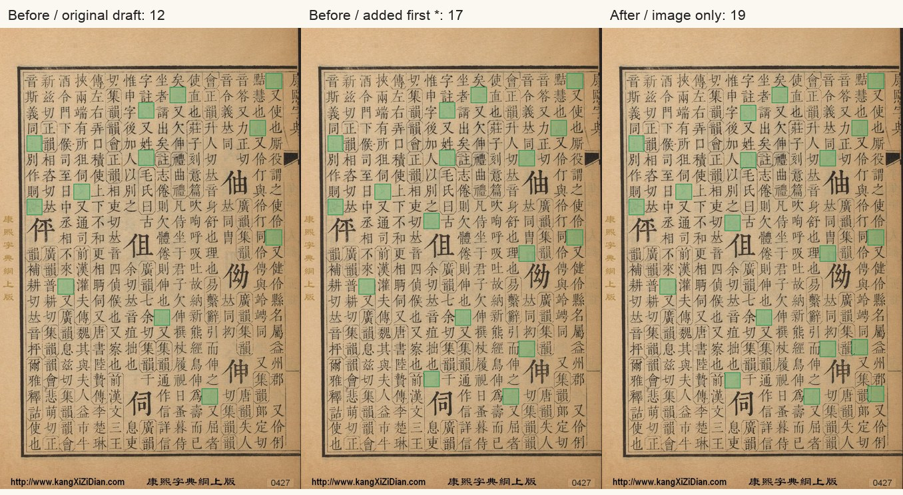
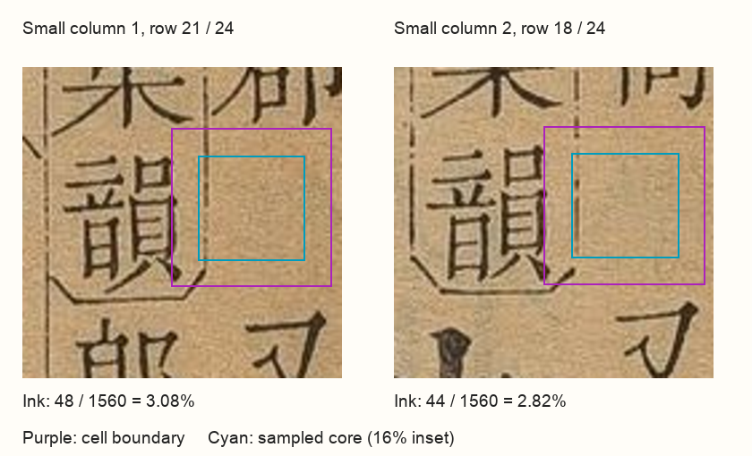
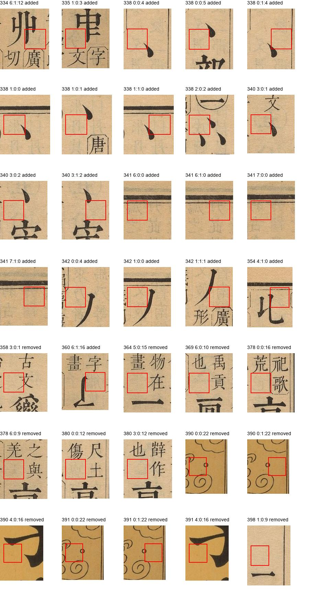
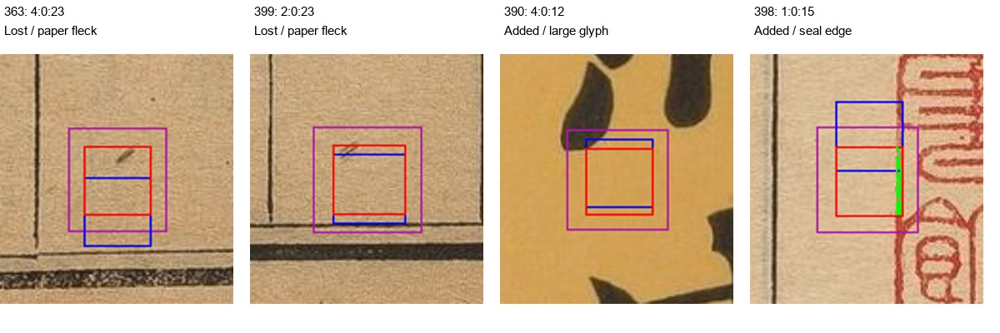
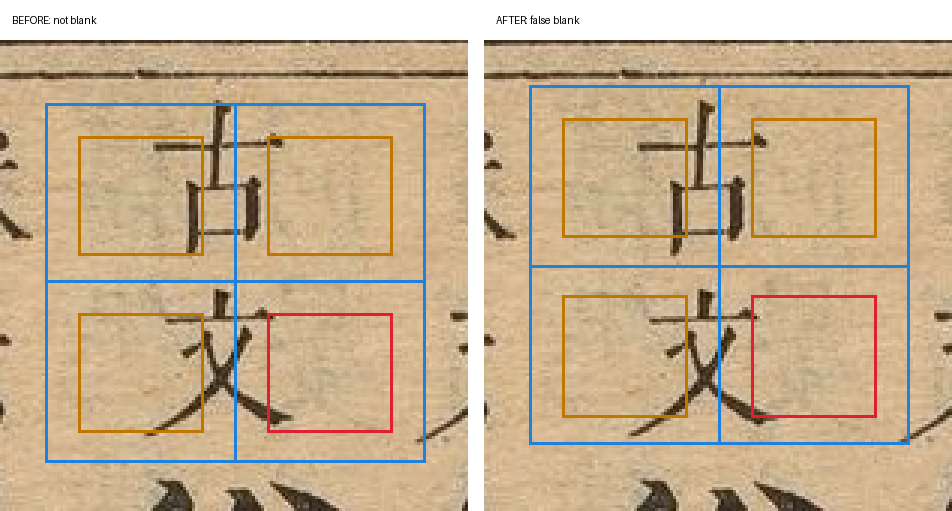
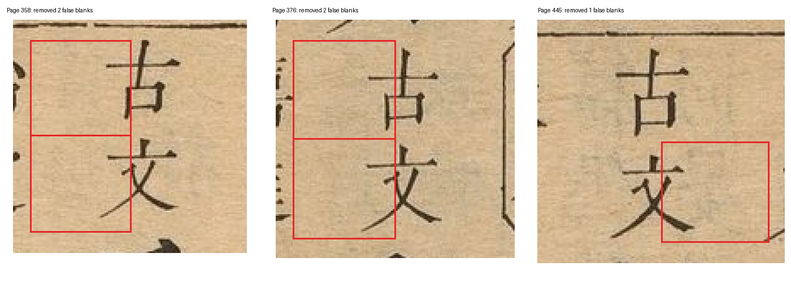

# 427 页原图空格识别修复报告

日期：2026-11-19（Asia/Shanghai）。对象：康熙字典校对界面的原图字格定位、空格识别与渲染侧对照。正文记录 427 页修复及当时的回归快照；附录 C 记录 445 页后续诊断，附录 D 记录用户授权后实施的居中小字修复与跨页验证。各阶段独立保留比较基线，没有修改转写内容。

## 1. 结论与验收范围

**427 页的两个问题均已修复：原图识别不再随草稿占格变化；两处伸入空格的书名框竖线被识别为装饰线。该页识别结果从初始草稿下的 12 格、仅补首个 `*` 后的 17 格，变为与草稿无关的 19 格。**

但“427 页修复完成”不能等同于“其他页完全不受影响”。对 312–427 页共 116 条清单做旧、新实现的直接回放，结果如下：

| 比较项目 | 页数／结果 | 含义 |
| --- | ---: | --- |
| 两版均成功定位 | 102 页 | 可以比较原图网格与空格集合 |
| 两版均定位失败 | 14 页 | 未新增失败；这些页没有可比较的空格结果，不能按零空格计 |
| 网格、空格集合均不变 | 23 页 | 在本次快照和比较精度下均相同 |
| 空格集合相同、网格坐标改变 | 65 页 | 高亮的逻辑格号相同，实际覆盖像素仍有移动 |
| 空格集合改变 | 14 页 | 427 页及另外 13 页；这 14 页网格也均有改变 |
| 网格坐标改变合计 | 79 页 | 65 + 14，最大单条边坐标变化为 @398 的 37.50 px |
| 102 页检测空格合计 | 3277 → 3307 | 新增 47 个逻辑格、移除 17 个，净增 30；不是准确率或召回率 |
| 除 427 外的集合变化 | 13 页，新增 40、移除 17 | 不能全部解释为识别质量改善 |

最终仍需保留的限制包括：@363、@399 各有一处纸斑导致的新增漏检；@390、@391 在不适合固定小字网格的题字页面上仍有局部留白误报；@398 的通用细线过滤也会接受印章边线。详细坐标、像素和性质见第 6 节。前一轮“抽查 14 页结果一致”只是**同一网格下比较判空机制**的阶段性结论，不是完整新旧流水线的全页结论。

**后续补充：@445 列首“古文”右下角的新增误报已修复，空格集合从 13 格恢复为 12 格。** 诊断确认取消草稿行跨度后的纵向拟合变化暴露了居中小字占位判断缺失，详见附录 C。后续通过原图居中小字占位保护消除误报，保留现有网格与判空阈值，实施与验收见附录 D。445 页不在上述 116 页范围内，不能把原来的“另外 13 页”理解为全数据集影响清单。

## 2. 比较基线、证据和坐标

### 2.1 基线冻结

- 修复前实现与 Git 提交 `6bbd4bbe06b392fd22dee2bee72312009da7dc45` 中的 `tools/dataset/ocr_scan.py`、`scan_grid.py` 逐字节一致。二者已另存为报告证据中的 `*_before.py`。
- 修复后实现已冻结为 `*_after.py`；生产文件仍位于 `tools/dataset/`。本报告不把工作区修改描述为已提交或已发布版本。
- 旧实现所需的每页草稿行跨度已保存为 [input-priors.json](evidence/2026-11-19-scan-blank-fix/input-priors.json)，避免以后修改 `.gj` 后改变旧算法基线。
- 报告编写时重新用当前解析器和旧版 `scanGridPrior` 核验：115 页仍能生成原跨度；只有 @427 已有后续转写修改。因此 @427 的“旧初始草稿”明确采用冻结跨度，不冒充当前磁盘上的草稿状态。[核验结果](evidence/2026-11-19-scan-blank-fix/prior-verification.json)
- 原图路径由 `kangxi-gold/manifest.json` 提供。直接回放记录了每张原图、当前标注、旧新源码、清单及依赖文件的 SHA-256。
- 报告编写阶段重新调用旧、新 API 入口，116 页结果全部与上一轮最终快照一致；另做分阶段替换以归因。[完整证据](evidence/2026-11-19-scan-blank-fix/verified-results.json)

主要证据目录：[2026-11-19-scan-blank-fix](evidence/2026-11-19-scan-blank-fix/README.md)。历史中间结果与最终验证分开保存，不能混用。

### 2.2 坐标约定

本文表格采用“**大列／侧／行**”：大列从右向左为 1–8，侧为该大列的右小列或左小列，行从上向下为 1–24。例如 `1右21` 是第一小列倒数第四格，`1左18` 是第二小列倒数第七格。

JSON 和诊断图标题保留代码坐标 `band:col:row`：`band` 从右向左 0–7；`col=0` 是左小列，`col=1` 是右小列；`row` 从上向下 0–23。对应转换为 `band+1`、左右侧、`row+1`。

“新增／移除”均指检测集合变化，不表示向原图或 `.gj` 写入／删除内容。集合比较按逻辑格号进行，网格坐标另列，避免把格号一致误称为采样像素一致。

## 3. 故障机制与 427 页修复前后对比

### 3.1 草稿位置为什么会影响原图识别

旧流程为：

```text
当前编辑文本 → gj2ir / layout3 → scanGridPrior 行跨度
                                  ├→ 逐大列纵向网格拟合
                                  └→ 大字行直接排除
原图 → 版框／列谷定位 ───────────────→ 小格墨迹判定 → 原图绿色高亮
```

旧 `detect_blank_cells(gray, band_boxes, row_spans)` 将跨度大于一行的目标视为大字，并直接跳过对应两行的两个小列。这个保护原意是防止把大字内部的白色象限当成小字空格；问题是该保护无条件信任正在校对的草稿位置。

427 页初始草稿少了页首空位。补 `*` 后，自动流式排版改变后续大字行位，例如第 2 大列的“伷、㑃、伸”分别从零基行 5、11、17 移到 6、12、18，第 5 大列的“伹、伺”从 9、19 移到 10、20。原本被错误视作大字区域的小格重新参与检测。

对照试验分别固定网格与固定排除范围：**只换大字排除范围就能从 12 格变成 17 格；只换拟合网格而保留原排除范围仍为 12 格。** 因而这五格不是阈值变好，而是重新获得检测机会。原图读取内容本身没有变化，缓存键包含行跨度，编辑后会发起新的计算。

### 3.2 三种状态及全部 19 格

| 状态 | 算法输入 | 空格数 | 相对初始草稿 |
| --- | --- | ---: | --- |
| A：旧算法＋初始草稿 | 原图＋初始行跨度 | 12 | 基线 |
| B：旧算法＋首个“又”前加 `*` | 同一原图＋修改后的行跨度 | 17 | 新增 5，移除 0 |
| C：修复后 | 原图＋固定 24 行版式 | 19 | 新增 7，移除 0；不读取草稿行跨度 |



上图由同一原图和各阶段实际返回的网格、空格集合叠加生成，非重新截取的浏览器画面。A、B 的渲染草稿本身不同；这里只比较左侧原图检测。

| 大列 | 小列 | 行号 | A：旧初始 | B：旧加 `*` | C：最终 | 变化原因 |
| ---: | --- | ---: | --- | --- | --- | --- |
| 1 | 右 | 1 | 检出 | 检出 | 检出 | 原先已检出，页首补 `*` 只改变转写 |
| 1 | 右 | 11 | 检出 | 检出 | 检出 | 无变化 |
| 1 | 右 | 21 | 漏检 | 漏检 | 检出 | 左邻书名框竖线进入采样区 |
| 1 | 左 | 4 | 检出 | 检出 | 检出 | 无变化 |
| 1 | 左 | 18 | 漏检 | 漏检 | 检出 | 左邻书名框竖线进入采样区 |
| 2 | 左 | 6 | 被排除 | 检出 | 检出 | 草稿大字行位错误 |
| 2 | 左 | 12 | 被排除 | 检出 | 检出 | 草稿大字行位错误 |
| 2 | 左 | 18 | 被排除 | 检出 | 检出 | 草稿大字行位错误 |
| 3 | 右 | 21 | 检出 | 检出 | 检出 | 无变化 |
| 4 | 右 | 2 | 检出 | 检出 | 检出 | 无变化 |
| 4 | 左 | 16 | 检出 | 检出 | 检出 | 无变化 |
| 5 | 右 | 3 | 检出 | 检出 | 检出 | 无变化 |
| 5 | 右 | 6 | 检出 | 检出 | 检出 | 无变化 |
| 5 | 左 | 10 | 被排除 | 检出 | 检出 | 草稿大字行位错误 |
| 5 | 左 | 20 | 被排除 | 检出 | 检出 | 草稿大字行位错误 |
| 7 | 右 | 8 | 检出 | 检出 | 检出 | 无变化 |
| 7 | 左 | 14 | 检出 | 检出 | 检出 | 无变化 |
| 8 | 左 | 5 | 检出 | 检出 | 检出 | 无变化 |
| 8 | 左 | 9 | 检出 | 检出 | 检出 | 无变化 |

最终集合由真实 0427.jpg 回归测试逐格断言，而非只断言数量 19。两处目标以外的 17 格保持检出；不存在用漏掉一格再误报一格凑够数量的问题。

### 3.3 两处书名框漏检的像素证据

旧判定四边各内缩 16%，只看字格中央区域。两格的书名框右侧竖线超出预期边缘范围，仍落入中央采样区。

| 项目 | 1右21（第一小列倒数第四格） | 1左18（第二小列倒数第七格） |
| --- | ---: | ---: |
| 原图采样框 `[x1,y1,x2,y2)` | `[1008,1359,1048,1398)` | `[948,1182,988,1221)` |
| 采样像素数 | 1560 | 1560 |
| 局部灰度阈值 | 132 | 137 |
| 过滤前墨迹像素 | 48（3.08%） | 44（2.82%） |
| 满足框线证据而屏蔽的墨迹 | 47 | 43 |
| 过滤后剩余墨迹 | 1（0.064%） | 1（0.064%） |
| 判空墨迹占比要求 | `<1.5%` | `<1.5%` |



紫框为字格，青框为采样区。过滤只影响经验证的窄竖线走廊；没有把整块采样区裁窄，也没有提高 1.5% 阈值。剩下的孤立纸纹不构成达到门槛的深色或长笔画连通区域。[逐格像素记录](evidence/2026-11-19-scan-blank-fix/p427-book-rule-pixels.json)

### 3.4 427 页网格变化不能与判空变化混淆

与 A 相比，最终只有第 2、5 大列的纵向拟合参数改变，横向范围不变。第 2 大列上边从 160.0 到 161.5 px、下边从 1588.48 到 1597.18 px；第 5 大列上边从 161.5 到 172.0 px、下边从 1589.98 到 1593.28 px。其余六列不变。

分阶段回放确认：这些几何变化在本页没有单独改变空格集合；5 格来自大字排除机制替换，2 格来自装饰线过滤。用户指出的两个目标均在第 1 大列，该列前后网格完全相同，故其恢复可直接归因于框线过滤。

## 4. 最终实现方案

### 4.1 原图检测与草稿解耦

新流程为：

```text
原图 → 版框／列谷定位 → 固定 24 行格点拟合
                       → 原图大字笔画保护 → 书名框细线证据过滤 → 空格集合

草稿 → 版式兼容性检查
     → 当前排版占格 ── 与上述空格集合比较 ──→ 渲染侧匹配／不匹配提示
```

具体变化：

1. `POST /dataset/scan-grid` 请求体从 `{page, spans}` 改为 `{page}`。旧客户端即使附带 `spans`，服务端也不使用；无需等待草稿校准才能测量原图。
2. `scanGridPrior` 替换为 `assertScanGridLayout`，只检查是否为支持的 8 大列、24 小格行、每大字 2×2 小格版式，不再传送文字占格。
3. 每列拟合使用固定的 24 个单行目标 `[0,1]…[23,24]`，仍由原图墨迹和版框约束起点、行距。没有墨迹证据的列保留检测版框，不强行寻找相位。
4. 原图结果按页和图像元数据缓存，算法版本升为 `body-grid-v7-image-only-book-rules`，避免继续使用旧结果。编辑期间复用已完成或进行中的原图请求；切页、关闭时仍取消过期请求。
5. 渲染侧仍随草稿更新，大小字占格的对照规则仍存在。**原图绿色高亮稳定不代表渲染侧红／蓝提示不会变化**；后者变化正是校对反馈。

数据集导出的 `locate_scan(layout, image_path, review)` 仍使用 IR 几何先验，本次未改写该导出流程。这里的解耦范围是校对界面 `/dataset/scan-grid`，不能扩大描述为项目内所有扫描定位都已无文本先验。

### 4.2 用原图证据保护大字内部留白

直接删除 `large_rows` 排除会误报“一、丨、丁、丶、丿”等大字的局部留白，因此新实现保留“大字内部不当小字空格”的目标，改由 `_scan_large_rows` 从原图推定：

- 以行游程构建八连通墨迹区域，记录面积、宽高和位置；使用 NumPy/Pillow，不新增 SciPy 运行依赖。
- 横向跨越两个小列的足够粗笔画，或位于大列中央、具有足够高度与厚度的笔画，作为大字候选证据。
- 宽笔画要求宽度超过约 `1.05×小格宽`，平均厚度至少 `0.08×小格高`；窄字头另需居中范围、平均厚度和中央实际墨迹行数证据。
- 排除横贯采样条带两端的细横框线、超出两个小字行高度的长连通线等明显非字头结构。
- 对候选的所有可能两行位置评分，以三角权重考察整个字的相关墨迹，而不是把某一条横笔画的中心直接当作字中心。这是保留“亠”等字头上方真空格的关键。
- 对不足一小格高的中央“丶”，参考邻近独立点状笔画；同时检测同高度两侧是否有配套文字部件，避免把小字“郞”的偏向中央部件当成大字“丶”。

这仍是固定版式下的图像启发式，不是经过通用字头检测评测的模型。在题字、印章、非标准排布中可能误判，报告第 6 节保留了实际反例。

### 4.3 书名框竖线过滤

`_book_rule_mask` 在每格原有中央采样区内寻找窄竖带。只有以下证据同时成立，才屏蔽其墨迹：

| 证据 | 最终约束与作用 |
| --- | --- |
| 够窄 | 连续墨迹列组宽度不超过 `max(3px, 0.08×格宽)` |
| 靠近格边 | 位于全格左或右侧 25% 范围，不能据此删除格中央普通竖笔 |
| 允许轻微漂移 | 候选走廊左右各容许 1px，但仍限定在原采样区内 |
| 跨格延续 | 在上下各约一格的上下文中，支持长度至少 `1.35×格高`，并超出本格至少约 0.4 格 |
| 断裂受限 | 可容忍约 0.15 格的局部断线，实际有墨迹行比例至少 65%；本格采样区内支持至少 45% |
| 有朝邻侧回折的框角 | 在候选端点附近存在相连转折，向格外邻侧延伸至少 0.2 格宽；向格内转折不接受 |

屏蔽后仍按原来的三个条件联合判空：墨迹比例 `<1.5%`；不存在达到面积门槛的深色连通核心；不存在达到面积和跨度门槛的浅色细长笔画。局部纸色阈值仍为 `clip(P80(core)-35, 70, 140)`，深色核心阈值仍再减 20，四边内缩仍为 16%。

因此，单格孤立竖笔、没有框角的跨格竖线、重复而断开的竖笔、向格内回折的笔画均不自动删除。框旁仍有细横笔、细竖笔、点或浅偏旁时，测试要求继续判为有墨迹。

## 5. 修复过程中遇到的问题及处置

下面按机制演进记录；未保存每一个临时改动的完整源码，故中途现象以当时命令输出、保留的审计 JSON 和裁片为据，不声称每个中间版本都可独立逐字节重建。

| 阶段／问题 | 实际观察 | 原因 | 最终处理及状态 |
| --- | --- | --- | --- |
| 只删除草稿大字排除 | @312 出现“一、子、上”的局部留白候选；@313“丁”、@330“丨”等也出现 | 大字仅一部分小格有墨迹 | 增加原图大字证据。早期无保护候选数 @312=120、@313=14、@318=14、@330=60，不能当作真实空格数 |
| 只凭横向宽笔画推断大字 | @364 的字头上方、@369、@378、@380 的字头上方空位被吞并 | 字的上横或断开部件被错误当成整个大字中心 | 改用完整两行墨迹评分，真实裁片验证 @364、@380 的上方空格保留；最终同网格判定恢复 |
| 只接受宽字头或很高的中央竖笔 | @338、@340 的“丶”，@342“丿”，以及部分窄／分体字头仍出现局部空格 | 字头没有足够宽的连通部件，或中心点很短 | 补入中央粗墨迹、窄字头与点群证据，并保留位置／厚度约束 |
| 扩大中央笔画候选后误伤小字 | @427 的目标 `1右21` 一度重新漏检；@353、@376 也出现新排除 | “郞”等小字偏旁向中央伸出，被误认作中央大字部件 | 同高度若两侧有配套文字部件则拒绝短中央字头候选，恢复 427 页第 19 格；最终回归通过 |
| 尝试按上下邻近关系直接聚合所有笔画 | 中间版本在 @316、331、342、345、347、353、360 等页又出现变化 | 相邻小字或另一字头被错误合并，整体两行位置被带偏 | 未保留该通用聚合方案；采用受约束的整字权重与专门点群分支 |
| 框线本身有缺损 | 第 2 个目标格的框线在早期过滤后仍未恢复 | 支持段被短缺口过早切开，无法证明跨格连续 | 按“允许的缺失行数”处理断点，修正相邻支持坐标差与实际空缺行数的关系；仍要求总支持率和框角 |
| 担心滤掉真笔画 | 单格“丨”、框旁的“一”、点、浅偏旁都有潜在风险 | 仅凭细长或低墨迹比例不足以判为装饰线 | 加入无框角、单格、向内转折、断开重复线和框旁真字的反例测试；不放宽总阈值、不增大内缩 |
| 改用固定图像格点后采样位置变化 | 完整回放中 79 页坐标发生变化，部分页尾纸斑进入采样区 | 网格原先受草稿行跨度影响，解耦后最优相位／行距不同 | 属最终方案的实际影响，不能用同网格回归掩盖；@363、399 两处仍留为漏检风险，未在本轮继续修复 |



这张图是中间版本的诊断拼图，红框标出当时新增或移除的候选；其中显示的问题不能全部当成最终状态。对应 [intermediate-audit.json](evidence/2026-11-19-scan-blank-fix/intermediate-audit.json) 与早期 [无大字保护试验](evidence/2026-11-19-scan-blank-fix/intermediate-no-large-mask.json)。最终状态以 `verified-results.json` 为准。

## 6. 其他页最终是否受影响

### 6.1 归因方法

直接比较旧、新 API 得到整体差异后，再按以下顺序替换，使用相同原图做消融：

1. **G：只换网格**，保留旧判空及旧草稿大字排除；
2. **L：换为图像大字保护**，暂时禁用书名框过滤；
3. **B：开启书名框过滤**，得到最终结果。

102 页阶段变动合计为 G `+35/-14`、L `+5/-6`、B `+10/-0`。阶段间会相互抵消，例如 @398 有一格被 G 移除、又被 B 找回，因此不能把阶段新增数直接当作最终净新增数。最终是 `+47/-17`。

### 6.2 发生空格集合变化的全部页面

| 页码 | 旧 → 新 | 新增 | 移除 | 最大边移 px | 主要来源 |
| ---: | ---: | ---: | ---: | ---: | --- |
| 328 | 63 → 66 | 3 | 0 | 12.90 | G：空列顶／底 |
| 336 | 178 → 182 | 4 | 0 | 13.18 | G：空列页底 |
| 341 | 102 → 106 | 4 | 0 | 8.14 | G：空列页顶／透印 |
| 351 | 100 → 102 | 2 | 0 | 14.40 | G：页底留白 |
| 363 | 319 → 322 | 4 | 1 | 17.74 | G：页底留白及纸斑 |
| 364 | 45 → 47 | 2 | 0 | 14.70 | G：页顶留白／透印 |
| 373 | 269 → 273 | 6 | 2 | 19.80 | G＋B：圈线、框边与空列 |
| 383 | 308 → 312 | 4 | 0 | 12.38 | G：空列顶／底 |
| 390 | 41 → 37 | 1 | 5 | 18.50 | G＋L：题字／装饰 |
| 391 | 41 → 37 | 1 | 5 | 18.50 | G＋L：题字／装饰 |
| 398 | 191 → 191 | 3 | 3 | 37.50 | G＋B：印章与框边 |
| 399 | 190 → 193 | 4 | 1 | 17.68 | G＋B：页底纸斑与框边 |
| 400 | 115 → 117 | 2 | 0 | 31.20 | G：页底留白 |
| 427 | 12 → 19 | 7 | 0 | 10.50 | L＋B：5 个误排除＋2 个框线漏检 |

表中“最大边移”是该页任一大列 bbox 边坐标的最大绝对变化，不是所有格统一平移，也不是定位误差的金标度量。逐格清单见附录 A；所有集合和 bbox 均保存在 JSON。

### 6.3 其他页变化的具体性质

| 页码 | 目视及分阶段核查结论 |
| --- | --- |
| 328、336、341、351、364、383、400 | 新增主要位于空列、页顶或页底留白，是 G 的采样范围变化；部分背景有透印。说明图像采样变了，不据此推算全页准确率 |
| 363 | G 新增 4 个页底格，同时移除 `5左24`。该格正文为空但有纸斑，新采样区包含更多斑点；这是仍未解决的一处新增漏检 |
| 373 | G 新增 4、移除 2；B 再新增 `5右23、5右24`。后两格靠长版面框线，说明过滤器实际接受通用边框证据，并非只识别书名。移除的 `3右1、3右3` 靠圆圈／较大笔画，不能只用净增 4 评价全页优劣 |
| 390、391 | 两页均由 G 与 L 共同作用，净少 4 格；新增 `5左13` 位于题字的大字局部留白。其固定小字格含义不可靠，大字保护仍不完整。两图 SHA-256 不同，虽然这次输出相同，不能当成同一张图去重 |
| 398 | 总数仍为 191，但新增 3、移除 3，位置发生变化。B 接受印章边线，其中 `2左16` 的 84 个墨迹像素全部被屏蔽；不能把印章边界自动视作已确认书名装饰。G 对印章附近格的采样也有较大移动，最大边移 37.50 px |
| 399 | G 新增 2、移除 `3左24`；B 新增 `8右23、8右24`。被移除格同样因纸斑进入采样区，仍是一处新增漏检；B 两格沿长框线 |



图中蓝框为旧采样区、红框为新采样区、紫框为新字格；印章案例绿色像素表示实际被过滤掉的墨迹。这里的诊断框由代码生成，不是原图中的印刷框线。

| 位置 | 旧采样 | 新采样 | 实际影响与未解决原因 |
| --- | --- | --- | --- |
| @363 `5左24` | 墨迹 1/1258；y=1509–1546 | 墨迹 35/1258；y=1492–1529 | 上移后含纸斑，墨迹比例从 0.08% 到 2.78%，新算法不再高亮；框线过滤未参与 |
| @399 `3左24` | 墨迹 7/1520；y=1489–1527 | 墨迹 29/1520；y=1484–1522 | 上移 5px 后含更多纸斑，从 0.46% 到 1.91%，新算法不再高亮；框线过滤未参与 |
| @390 `5左13`（@391 同类） | 墨迹 29/1260 | 墨迹 1/1225 | 新采样避开大字笔画，图像大字保护没有覆盖该局部，产生新增空格候选；题字版式需要另作适用性判断 |
| @398 `2左16` | 墨迹 60/1330 | 过滤前 84/1330，过滤后 0 | 印章边线满足几何框线条件而被滤除，说明仅灰度几何证据不能区分书名框与印章 |

[像素证据](evidence/2026-11-19-scan-blank-fix/remaining-limitations.json)。这些问题保留为未解决项；报告编写阶段未修改检测算法或阈值。

### 6.4 空格集合相同的 88 页

**网格也相同的 23 页：**

314、315、317、323、325、332、333、343、346、353、365、379、402、404、405、411、412、413、414、420、421、422、423。

**网格坐标改变、空格集合相同的 65 页：**

312、313、316、318、319、320、321、322、324、326、327、330、331、334、335、338、339、340、342、344、345、347、348、349、350、352、354、355、356、357、358、359、360、361、362、366、367、368、369、370、371、372、374、375、376、377、378、380、381、382、401、403、406、407、408、409、410、415、416、417、418、419、424、425、426。

这些页的“集合相同”仅说明新旧算法给出了同样的逻辑格号；没有对其全部字格建立人工空白真值。因此不能声称这 88 页没有任何原有漏检，也不能把 65 页的像素移动忽略。

### 6.5 两版均无法定位的 14 页

@329、337、384、385、386、387、388、389、392、393、394、395、396、397。

两版入口均返回 `No scan frame/grid evidence; provide a reviewed page with supported layout`。新旧失败页完全一致，没有新增定位失败，也没有把失败页面转为空白高亮；它们不进入 102 页的空格数量比较。这一结果只能证明定位失败行为未变，不能证明这些页面空格识别通过。

### 6.6 后续处理建议与当前边界

1. 对 @363、399 的纸斑问题，应把采样几何稳定性与斑点／笔画判别联合验证；不直接提高 1.5% 阈值，否则会误吞细点和细笔画。
2. 对 @390、391 这类题字、以及其他非正文排版，应先判断固定 16×24 小格是否适用，再决定是否显示空格；纯大字内部留白需要可靠的大字区域证据。
3. 对 @398 的红色印章，可考虑保留颜色、印章区域或独立装饰分类证据。现行灰度框角规则没有书名语义，不能保证排除印章框线。
4. 对大字启发式和书名框过滤，新增样本应加入真实扫描裁片及反例，比较集合与坐标两种变化。现有 116 页只是同源样本，未证明可泛化到其他版本和分辨率。

## 7. 代码、测试与复现

### 7.1 代码范围

| 文件 | 变化 |
| --- | --- |
| [scan_grid.py](../../tools/dataset/scan_grid.py) | API 去除草稿跨度依赖，固定行格点拟合，调用图像判空 |
| [ocr_scan.py](../../tools/dataset/ocr_scan.py) | 图像连通区域、大字保护、边框证据过滤；原有阈值与内缩保留 |
| [scan-grid.ts](../../guji-preview-grid/src/components/dataset/scan-grid.ts) | 只验证支持版式；删除向后端发送占格先验的函数 |
| [use-scan-grid.ts](../../guji-preview-grid/src/components/dataset/use-scan-grid.ts) | 请求体与缓存不再依赖草稿占格，更新算法缓存版本 |
| [scan-grid-plugin.ts](../../guji-preview-grid/scripts/scan-grid-plugin.ts) | 接口职责注释同步 |
| [test_scan_grid.py](../../tools/tests/test_scan_grid.py) | 原图实例、框线反例、细笔画、大字留白及空格保护 |
| [scan-grid.spec.ts](../../guji-preview-grid/test/scan-grid.spec.ts) | 编辑不重算／不中断原图请求，切页取消、失败重试与显示对照 |
| [应用说明](../../guji-preview-grid/README.md) | 新检测与缓存行为、适用边界 |

此轮不自动补写 `.gj` 空格、不更改原图、不运行 OCR；工作区中自动排版、其他转写等已有改动不属于本修复。427 页后续手工转写状态已与初始复现状态不同，见第 2 节。

### 7.2 已执行的验证

| 验证 | 结果 | 证明范围 |
| --- | --- | --- |
| `python3 -m unittest discover -s tools/tests -p test_scan_grid.py` | 17 项通过 | 含若干子场景；427 完整 19 格集合、旧跨度输入无影响、细笔画与框角反例、真实大字裁片 |
| `npm test -- test/scan-grid.spec.ts`（应用目录） | 10 项通过 | 编辑、请求、缓存、切页、重试与覆盖层行为 |
| `npm run build`（应用目录） | 通过 | TypeScript 与 Vite 构建；仍有既有 Vite 配置及 chunk 大小提示 |
| 对修改的 TS／TSX 文件运行 `oxlint` | 通过 | 静态检查 |
| `git diff --check` | 通过 | 补丁空白规范 |
| 当前开发服务 `/dataset/scan-grid`，`{"page":427}` | `ok=true`，19 格，两目标均存在 | 实际运行入口，不是只测离线函数 |
| 本报告旧新入口回放 | 116/116 与历史最终快照一致 | 102 页有效、14 页同样失败；全部定位页的集合及网格直接比对 |

测试通过不覆盖第 6 节全部遗留问题。没有执行全仓库测试来证明全项目无回归，也没有把人工金标准确率作为本次验收指标。

真实扫描回归资产包括完整 `kangxi-0427.jpg`、既有 @415 纸斑裁片，以及 @335、338、364、380 的大字／空格裁片；[裁片坐标及断言](../../tools/tests/fixtures/kangxi-scan-large-gaps.json)可追溯至原图。

### 7.3 重放方法

在仓库环境中安装 NumPy、Pillow，并挂载清单指定的原图目录后执行：

```sh
python3 docs/research/evidence/2026-11-19-scan-blank-fix/replay.py
```

该脚本加载冻结的旧、新源码及初始行跨度，对清单指定原图直接调用两版 API，再生成 `verified-results.json`。版框定位、渲染导入等未改动依赖仍来自仓库，哈希记录在证据中；未来重放前应检查图像和依赖哈希，不把不同输入下的结果覆盖解释为当日事实。脚本不保存标注、不启动抓取、不发送网络请求。

附录 A 列出所有集合变化坐标；附录 B 列出 116 页逐页结果。报告以“代码事实—复现实验—像素检查—未覆盖边界”分开记录，427 页修复通过与其他页面仍待处理的影响同时成立。

## 附录 A：最终新增／移除空格的完整坐标

| 页码 | 新增格 | 移除格 |
| ---: | --- | --- |
| 328 | 8左1、8左24、8右24 | — |
| 336 | 6右24、7左24、7右24、8右24 | — |
| 341 | 7左1、7右1、8左1、8右1 | — |
| 351 | 7左24、7右24 | — |
| 363 | 2左24、2右24、3右24、4右24 | 5左24 |
| 364 | 1左1、1右1 | — |
| 373 | 2左24、2右20、2右24、5右23、5右24、8左10 | 3右1、3右3 |
| 383 | 2左24、2右24、8左1、8右1 | — |
| 390 | 5左13 | 1右23、4右15、4右20、5右13、5右22 |
| 391 | 5左13 | 1右23、4右15、4右20、5右13、5右22 |
| 398 | 2左16、2左18、2左19 | 1左21、1右21、2左21 |
| 399 | 1左24、2左24、8右23、8右24 | 3左24 |
| 400 | 3左24、3右24 | — |
| 427 | 1左18、1右21、2左6、2左12、2左18、5左10、5左20 | — |

## 附录 B：116 页逐页比较

| 页码 | 定位 | 旧格数 | 新格数 | 新增／移除 | 最大边移 px | 判定 |
| ---: | --- | ---: | ---: | ---: | ---: | --- |
| 312 | 两版成功 | 113 | 113 | +0/−0 | 18.00 | 集合相同、坐标改变 |
| 313 | 两版成功 | 11 | 11 | +0/−0 | 10.50 | 集合相同、坐标改变 |
| 314 | 两版成功 | 9 | 9 | +0/−0 | 0.00 | 集合与坐标均相同 |
| 315 | 两版成功 | 14 | 14 | +0/−0 | 0.00 | 集合与坐标均相同 |
| 316 | 两版成功 | 9 | 9 | +0/−0 | 8.40 | 集合相同、坐标改变 |
| 317 | 两版成功 | 7 | 7 | +0/−0 | 0.00 | 集合与坐标均相同 |
| 318 | 两版成功 | 11 | 11 | +0/−0 | 9.00 | 集合相同、坐标改变 |
| 319 | 两版成功 | 11 | 11 | +0/−0 | 5.70 | 集合相同、坐标改变 |
| 320 | 两版成功 | 11 | 11 | +0/−0 | 14.40 | 集合相同、坐标改变 |
| 321 | 两版成功 | 5 | 5 | +0/−0 | 8.40 | 集合相同、坐标改变 |
| 322 | 两版成功 | 12 | 12 | +0/−0 | 14.10 | 集合相同、坐标改变 |
| 323 | 两版成功 | 14 | 14 | +0/−0 | 0.00 | 集合与坐标均相同 |
| 324 | 两版成功 | 9 | 9 | +0/−0 | 11.40 | 集合相同、坐标改变 |
| 325 | 两版成功 | 14 | 14 | +0/−0 | 0.00 | 集合与坐标均相同 |
| 326 | 两版成功 | 10 | 10 | +0/−0 | 4.50 | 集合相同、坐标改变 |
| 327 | 两版成功 | 6 | 6 | +0/−0 | 4.50 | 集合相同、坐标改变 |
| 328 | 两版成功 | 63 | 66 | +3/−0 | 12.90 | 集合改变 |
| 329 | 两版失败 | — | — | — | — | 不纳入空格比较 |
| 330 | 两版成功 | 49 | 49 | +0/−0 | 26.40 | 集合相同、坐标改变 |
| 331 | 两版成功 | 4 | 4 | +0/−0 | 13.50 | 集合相同、坐标改变 |
| 332 | 两版成功 | 13 | 13 | +0/−0 | 0.00 | 集合与坐标均相同 |
| 333 | 两版成功 | 12 | 12 | +0/−0 | 0.00 | 集合与坐标均相同 |
| 334 | 两版成功 | 6 | 6 | +0/−0 | 1.50 | 集合相同、坐标改变 |
| 335 | 两版成功 | 5 | 5 | +0/−0 | 13.50 | 集合相同、坐标改变 |
| 336 | 两版成功 | 178 | 182 | +4/−0 | 13.18 | 集合改变 |
| 337 | 两版失败 | — | — | — | — | 不纳入空格比较 |
| 338 | 两版成功 | 45 | 45 | +0/−0 | 11.70 | 集合相同、坐标改变 |
| 339 | 两版成功 | 11 | 11 | +0/−0 | 10.20 | 集合相同、坐标改变 |
| 340 | 两版成功 | 11 | 11 | +0/−0 | 14.10 | 集合相同、坐标改变 |
| 341 | 两版成功 | 102 | 106 | +4/−0 | 8.14 | 集合改变 |
| 342 | 两版成功 | 45 | 45 | +0/−0 | 7.50 | 集合相同、坐标改变 |
| 343 | 两版成功 | 15 | 15 | +0/−0 | 0.00 | 集合与坐标均相同 |
| 344 | 两版成功 | 3 | 3 | +0/−0 | 9.90 | 集合相同、坐标改变 |
| 345 | 两版成功 | 10 | 10 | +0/−0 | 11.70 | 集合相同、坐标改变 |
| 346 | 两版成功 | 8 | 8 | +0/−0 | 0.00 | 集合与坐标均相同 |
| 347 | 两版成功 | 10 | 10 | +0/−0 | 6.00 | 集合相同、坐标改变 |
| 348 | 两版成功 | 5 | 5 | +0/−0 | 12.00 | 集合相同、坐标改变 |
| 349 | 两版成功 | 2 | 2 | +0/−0 | 10.50 | 集合相同、坐标改变 |
| 350 | 两版成功 | 13 | 13 | +0/−0 | 17.10 | 集合相同、坐标改变 |
| 351 | 两版成功 | 100 | 102 | +2/−0 | 14.40 | 集合改变 |
| 352 | 两版成功 | 47 | 47 | +0/−0 | 7.50 | 集合相同、坐标改变 |
| 353 | 两版成功 | 11 | 11 | +0/−0 | 0.00 | 集合与坐标均相同 |
| 354 | 两版成功 | 11 | 11 | +0/−0 | 7.20 | 集合相同、坐标改变 |
| 355 | 两版成功 | 9 | 9 | +0/−0 | 10.50 | 集合相同、坐标改变 |
| 356 | 两版成功 | 13 | 13 | +0/−0 | 11.40 | 集合相同、坐标改变 |
| 357 | 两版成功 | 11 | 11 | +0/−0 | 7.20 | 集合相同、坐标改变 |
| 358 | 两版成功 | 8 | 8 | +0/−0 | 8.40 | 集合相同、坐标改变 |
| 359 | 两版成功 | 95 | 95 | +0/−0 | 13.20 | 集合相同、坐标改变 |
| 360 | 两版成功 | 47 | 47 | +0/−0 | 10.50 | 集合相同、坐标改变 |
| 361 | 两版成功 | 6 | 6 | +0/−0 | 10.50 | 集合相同、坐标改变 |
| 362 | 两版成功 | 10 | 10 | +0/−0 | 9.90 | 集合相同、坐标改变 |
| 363 | 两版成功 | 319 | 322 | +4/−1 | 17.74 | 集合改变 |
| 364 | 两版成功 | 45 | 47 | +2/−0 | 14.70 | 集合改变 |
| 365 | 两版成功 | 13 | 13 | +0/−0 | 0.00 | 集合与坐标均相同 |
| 366 | 两版成功 | 10 | 10 | +0/−0 | 7.20 | 集合相同、坐标改变 |
| 367 | 两版成功 | 14 | 14 | +0/−0 | 11.40 | 集合相同、坐标改变 |
| 368 | 两版成功 | 11 | 11 | +0/−0 | 11.40 | 集合相同、坐标改变 |
| 369 | 两版成功 | 10 | 10 | +0/−0 | 9.00 | 集合相同、坐标改变 |
| 370 | 两版成功 | 3 | 3 | +0/−0 | 8.40 | 集合相同、坐标改变 |
| 371 | 两版成功 | 14 | 14 | +0/−0 | 1.50 | 集合相同、坐标改变 |
| 372 | 两版成功 | 7 | 7 | +0/−0 | 7.50 | 集合相同、坐标改变 |
| 373 | 两版成功 | 269 | 273 | +6/−2 | 19.80 | 集合改变 |
| 374 | 两版成功 | 49 | 49 | +0/−0 | 11.70 | 集合相同、坐标改变 |
| 375 | 两版成功 | 14 | 14 | +0/−0 | 10.20 | 集合相同、坐标改变 |
| 376 | 两版成功 | 11 | 11 | +0/−0 | 8.70 | 集合相同、坐标改变 |
| 377 | 两版成功 | 8 | 8 | +0/−0 | 18.00 | 集合相同、坐标改变 |
| 378 | 两版成功 | 12 | 12 | +0/−0 | 1.50 | 集合相同、坐标改变 |
| 379 | 两版成功 | 12 | 12 | +0/−0 | 0.00 | 集合与坐标均相同 |
| 380 | 两版成功 | 7 | 7 | +0/−0 | 8.70 | 集合相同、坐标改变 |
| 381 | 两版成功 | 6 | 6 | +0/−0 | 7.20 | 集合相同、坐标改变 |
| 382 | 两版成功 | 11 | 11 | +0/−0 | 11.40 | 集合相同、坐标改变 |
| 383 | 两版成功 | 308 | 312 | +4/−0 | 12.38 | 集合改变 |
| 384 | 两版失败 | — | — | — | — | 不纳入空格比较 |
| 385 | 两版失败 | — | — | — | — | 不纳入空格比较 |
| 386 | 两版失败 | — | — | — | — | 不纳入空格比较 |
| 387 | 两版失败 | — | — | — | — | 不纳入空格比较 |
| 388 | 两版失败 | — | — | — | — | 不纳入空格比较 |
| 389 | 两版失败 | — | — | — | — | 不纳入空格比较 |
| 390 | 两版成功 | 41 | 37 | +1/−5 | 18.50 | 集合改变 |
| 391 | 两版成功 | 41 | 37 | +1/−5 | 18.50 | 集合改变 |
| 392 | 两版失败 | — | — | — | — | 不纳入空格比较 |
| 393 | 两版失败 | — | — | — | — | 不纳入空格比较 |
| 394 | 两版失败 | — | — | — | — | 不纳入空格比较 |
| 395 | 两版失败 | — | — | — | — | 不纳入空格比较 |
| 396 | 两版失败 | — | — | — | — | 不纳入空格比较 |
| 397 | 两版失败 | — | — | — | — | 不纳入空格比较 |
| 398 | 两版成功 | 191 | 191 | +3/−3 | 37.50 | 集合改变 |
| 399 | 两版成功 | 190 | 193 | +4/−1 | 17.68 | 集合改变 |
| 400 | 两版成功 | 115 | 117 | +2/−0 | 31.20 | 集合改变 |
| 401 | 两版成功 | 7 | 7 | +0/−0 | 8.70 | 集合相同、坐标改变 |
| 402 | 两版成功 | 12 | 12 | +0/−0 | 0.00 | 集合与坐标均相同 |
| 403 | 两版成功 | 12 | 12 | +0/−0 | 11.40 | 集合相同、坐标改变 |
| 404 | 两版成功 | 16 | 16 | +0/−0 | 0.00 | 集合与坐标均相同 |
| 405 | 两版成功 | 11 | 11 | +0/−0 | 0.00 | 集合与坐标均相同 |
| 406 | 两版成功 | 10 | 10 | +0/−0 | 4.50 | 集合相同、坐标改变 |
| 407 | 两版成功 | 11 | 11 | +0/−0 | 8.70 | 集合相同、坐标改变 |
| 408 | 两版成功 | 17 | 17 | +0/−0 | 10.50 | 集合相同、坐标改变 |
| 409 | 两版成功 | 9 | 9 | +0/−0 | 8.70 | 集合相同、坐标改变 |
| 410 | 两版成功 | 7 | 7 | +0/−0 | 12.00 | 集合相同、坐标改变 |
| 411 | 两版成功 | 0 | 0 | +0/−0 | 0.00 | 集合与坐标均相同 |
| 412 | 两版成功 | 13 | 13 | +0/−0 | 0.00 | 集合与坐标均相同 |
| 413 | 两版成功 | 14 | 14 | +0/−0 | 0.00 | 集合与坐标均相同 |
| 414 | 两版成功 | 9 | 9 | +0/−0 | 0.00 | 集合与坐标均相同 |
| 415 | 两版成功 | 11 | 11 | +0/−0 | 11.40 | 集合相同、坐标改变 |
| 416 | 两版成功 | 13 | 13 | +0/−0 | 7.50 | 集合相同、坐标改变 |
| 417 | 两版成功 | 8 | 8 | +0/−0 | 6.00 | 集合相同、坐标改变 |
| 418 | 两版成功 | 11 | 11 | +0/−0 | 10.50 | 集合相同、坐标改变 |
| 419 | 两版成功 | 13 | 13 | +0/−0 | 9.00 | 集合相同、坐标改变 |
| 420 | 两版成功 | 10 | 10 | +0/−0 | 0.00 | 集合与坐标均相同 |
| 421 | 两版成功 | 10 | 10 | +0/−0 | 0.00 | 集合与坐标均相同 |
| 422 | 两版成功 | 12 | 12 | +0/−0 | 0.00 | 集合与坐标均相同 |
| 423 | 两版成功 | 16 | 16 | +0/−0 | 0.00 | 集合与坐标均相同 |
| 424 | 两版成功 | 12 | 12 | +0/−0 | 15.60 | 集合相同、坐标改变 |
| 425 | 两版成功 | 12 | 12 | +0/−0 | 9.90 | 集合相同、坐标改变 |
| 426 | 两版成功 | 14 | 14 | +0/−0 | 7.50 | 集合相同、坐标改变 |
| 427 | 两版成功 | 12 | 19 | +7/−0 | 10.50 | 集合改变 |

## 附录 C：445 页“古文”误报的新增回归诊断

### C.1 问题、比较口径与结论

用户指出从左向右第 4 大列列首“古文”两字右下角出现空格高亮。对应本文坐标 `5右2`，代码坐标 `(band=4, col=1, row=1)`，即“文”所在行的右半格。

采用同一张 `0445.jpg` 和诊断时当前 `0445.gj`。通过旧版 `scanGridPrior` 从当前草稿生成并冻结旧接口所需的跨度；分别调用已冻结的修复前后 API。另用当前工作区实现重放，445 页完整输出与冻结的修复后输出一致。这里证明的是**同图同稿下的算法回归**，不声称曾观察到历史 UI 上的 445 页结果。

| 对照 | 目标格是否被判为空格 | 说明 |
| --- | --- | --- |
| 完整旧版 | 否 | 全页 12 格 |
| 完整新版 | 是 | 全页 13 格；其余 12 格集合不变 |
| 旧检测器＋新版网格 | 是 | 仅替换网格足以触发误报 |
| 新检测器＋旧版网格 | 否 | 新判空机制本身不要求出现此误报 |
| 新版关闭书名框过滤 | 是 | 目标格过滤掉的墨迹实际为 0 像素 |
| 新版关闭原图大字保护 | 是 | 目标格本就未被大字保护覆盖 |

两版原始版框和横向网格定位结果完全相同；区别发生在后续逐列纵向拟合。旧草稿对此列的大字跨度为 `[2,4)`，并未覆盖目标行；因此也不存在“旧版靠草稿大字误遮罩掩盖这个误报”的情况。新版原图大字保护同样只覆盖该列零基行 2、3。

### C.2 像素级触发过程

| 参数 | 修复前 | 修复后 |
| --- | ---: | ---: |
| 此列纵向起点 | 184.50 px | 178.50 px |
| 小格行距 | 59.44 px | 59.74 px |
| 目标核心采样框，左／上／右／下 | `[491,254,532,293)` | `[491,248,532,288)` |
| 核心区域墨迹 | 39 / 1599 = 2.44% | 16 / 1640 = 0.98% |
| 深色连通笔画检查 | 检出 | 未检出 |
| 书名框过滤删除的墨迹 | 0 | 0 |

灰度阈值均为 140，四边内缩仍为 16%，判空墨迹比例门限仍为 1.5%。取消草稿跨度后，拟合改用固定 24 个单行目标，此列起点上移 6 px、行距增加 0.30 px；目标核心区域随之上移，其下边从 y=293 收到 y=288，漏掉“文”的右下笔画。剩余墨迹低于比例门限，且两项笔画检查均未阻止判空。



图左为旧版，图右为新版。蓝框为逻辑小格，橙框为普通核心采样区，红框为出问题的右下核心采样区。可见红框中大部分是字旁留白，整行仍有完整的“文”。

**直接触发因素是本次纵向拟合变化；底层缺陷是原本就缺少居中小字的整体占位识别。** 旧版这次只是因采样框包含更多末端笔画而没有报错。仅恢复旧坐标不能保证其他页、其他扫描偏移下正确，也不能据此判定新版整列网格一定比旧版差。

### C.3 诊断时提出的修复方案

以下是实施前的方案记录。后续实际修改与验证见附录 D；其中全局纵向拟合优化未纳入本次局部修复。

1. **在原图端独立识别居中单列小字。** 对空格候选检查同一行的整大列及相邻行，组合实际笔画／连通域，比较“左右双列小字”与“中轴单列小字”两种布局。以中心位置、接近一小格的字高／字宽、跨中缝的笔画、相邻字中心一致性等联合证据确认，不依赖草稿“古文”文本或 `halfShift`。框线的跨行延续、边缘位置和拐角证据仍单独处理。
2. **按确认的字位保护，而非按四个局部白块判空。** “古”和“文”各占一个居中小字位；在固定小格接口中，将其与左右半格的重叠占位表达为非空，避免把字旁留白算成空格。精确限制到已确认的字符行，不直接降低 `_scan_large_rows` 的门限，也不把任意中缝墨迹或偏旁扩张成两行大字保护。
3. **改进纵向拟合的图像证据，同时保留草稿独立性。** 利用图像确认的普通小字行和行间留白估计相位、行距，对大字与特殊排布减权或分开评分，避免所有行都强制遵从同一种单行墨迹模型。该项应独立验证，不能只为 445 页强制回退 6 px；居中占位判断也应能承受实际会出现的小幅定位扰动。
4. **保持现有灰度、内缩和细笔画保护规则，补真实图像回归。** 445 页两处“古文”都应覆盖：本次列首位于零基第 4 大列行 0–1，另一处位于第 5 大列行 14–15，后者当前四格均未误报。增加普通单侧小字＋邻侧真空格、靠近中缝的偏旁、细笔画、居中文字上下真空格等反例，防止新占位保护吞掉真空格。

修复验收应要求：445 页该新增假空格消失、当前其余 12 格不因这项局部修复被随意移除；427 页保持已核验的 19 格，草稿修改仍不改变原图结果；重跑原 116 页及新增页，逐格复核变化，重点覆盖已发现的 363／399、390／391、398 等问题类型。不能只凭总数恢复为 12 或测试通过宣称无回归。

前端已将 `halfShift=0.5` 的“古文”映射为所有相交小格的文字占位，因此红色不匹配提示是在反映原图端的错误。现有前端居中测试使用空的 `blank_cells`，仅覆盖草稿占位逻辑，没有验证真实扫描算法；应增加真实图片的后端测试和贯通对照，不能仅在前端隐藏高亮。

### C.4 证据与复现

- [新旧完整结果、阶段对照和像素统计](evidence/2026-11-19-scan-blank-fix/p445-analysis.json)
- [旧版接口输入](evidence/2026-11-19-scan-blank-fix/p445-input.json)／[当前草稿布局快照](evidence/2026-11-19-scan-blank-fix/p445-layout.json)
- [专用重放脚本](evidence/2026-11-19-scan-blank-fix/replay_p445.py)／[重放验证输出](evidence/2026-11-19-scan-blank-fix/p445-verified.json)

```sh
python3 docs/research/evidence/2026-11-19-scan-blank-fix/replay_p445.py
```

重放使用冻结的新旧源码和输入，校验原图 SHA-256，并断言完整输出与诊断记录一致。该脚本复现的是诊断阶段的 12→13 回归，后续修复的验收使用附录 D 的独立证据目录。

## 附录 D：445 页居中小字修复实施与验收

### D.1 最终实现及边界

用户授权“执行修复”后，在 `tools/dataset/ocr_scan.py` 新增 `_scan_centered_rows`，由 `detect_blank_cells` 与现有大字占位保护并列调用。它在原图整大列内组合连通笔画，并要求至少两个相邻字符满足以下证据：

- 字形包围范围接近一个小字位：宽为小格宽的 0.4–1.1 倍，高为小格高的 0.45–1.15 倍；字符中心靠近大列中轴。
- 左右两侧均有笔画范围，中央窄带在足够多的像素行上存在墨迹，避免把两侧互不相关的碎片拼成居中文字。
- 相邻字符中轴一致、纵向间距接近一小格；各行只保护自身，没有扩大为通用两行大字遮罩。
- 同行所有有意义的笔画参与字形范围计算，保留另一小列的伴随文字和偏旁作为反证；跨行连续竖线或大字连通部件不接受为单行小字。

识别确认后，居中字位相交的左右小格不再产生空格候选。此过程不读取草稿、`halfShift` 或“古文”文字内容，也没有硬编码页码／目标格号。只有孤立一行的居中疑似字目前不会触发这项相邻字符保护，保留原有判定。

本轮实现附录 C 中的完整占位识别与对应回归测试，**没有更改 `fit_vertical`、版框／横向网格、16% 内缩、1.5% 判空比例或细笔画检查**。新旧网格下均应正确处理居中字符，因此采用占位修复解决本例；全局纵向拟合优化仍是独立工作，不以恢复旧版 6 px 偏移代替修复。

前端 `use-scan-grid.ts` 的会话缓存版本从 `body-grid-v8-fishtail-recovery` 更新到 `body-grid-v9-centered-small-runs`，使已打开的页面重新请求检测结果。检测接口仍只传 `{page}`；草稿编辑继续只更新渲染侧对照。

### D.2 修复中发现的问题与解决办法

| 问题／检查发现 | 处理方式与结果 |
| --- | --- |
| 仅检查半格核心区，避开“文”的末端笔画 | 在分半格之前组合整行笔画，识别居中字符的完整逻辑占位；445 的误报被移除 |
| “文”的上部与下部笔画并不连通 | 同行多个有效连通域一起计算字符范围，避免要求一个汉字必须是单一连通域 |
| 初版在 445 网格上移 6 px 的扰动测试中失效 | 上移带入页顶横框线，扩大了字符范围；仅在居中字位建模时排除横穿大列两边、且高度很小的横框线。未改变常规空格墨迹过滤；两处“古文”均通过 −6、−3、0、+3、+6 px 的测试 |
| 中缝附近偏旁、另一小列文字可能被误当成居中字 | 合并同行全部有效笔画，并检查整体宽度、中轴和邻行一致性；单侧正常小字、双列文字、脱离主体的偏旁、细竖笔和连续框线反例均通过 |
| 跨页回归发现 358、376 页也减少了空格 | 逐格查看原图，均为“古文”左侧的同类假空格；增加真实扫描裁片测试，保留这两项正向修复，没有按“集合变化即回归”回滚 |
| 验证期间用户持续增加页面 | 最终固定 312–451 共 140 页作为验收范围；冻结清单与源码，避免后续新增页改变本轮结论 |

### D.3 445 页修复前后与跨页影响

本轮“修复前”是已包含 427 修复、443 版框恢复的工作区。此处的 13→12 与附录 C 的 12→13 使用不同阶段的基线，二者不矛盾。

| 页面 | 本轮修复前 | 本轮修复后 | 空格集合差异及原图结论 |
| --- | ---: | ---: | --- |
| 445 | 13 | 12 | 仅移除 `5右2`，即用户指出的“文”右下角假空格；其余 12 格不变 |
| 358 | 8 | 6 | 移除 `4左1`、`4左2`，均为居中“古文”的左侧留白误报 |
| 376 | 11 | 9 | 移除 `6左10`、`6左11`，均为另一处居中“古文”的左侧留白误报 |
| 427 | 19 | 19 | 全部格号与网格坐标不变，两处书名框空格仍在 |

445 页列首与第二处“古文”分别被识别为零基大列 4 的行 0–1、大列 5 的行 14–15。第二处本轮前就未误报，修复后同样保持正确；真实图像测试同时覆盖两处。该页目标列起点仍为 178.50 px，未退回旧草稿驱动的 184.50 px。



红框标注本轮移除的假空格位置，供原图复核，不代表修复后 UI 仍显示这些框。

140 页完整 API 前后比较结果：

| 项目 | 结果 |
| --- | --- |
| 两版均成功定位 | 126 页 |
| 网格坐标完全一致 | 全部 126 个成功页面 |
| 空格集合改变 | 3 页：358、376、445；只移除上述 5 个误报，没有新增候选 |
| 成功定位且空格集合不变 | 123 页，含 427 页及前一轮另外 13 个受影响页面 |
| 两版均定位失败 | 14 页：329、337、384–389、392–397 |
| 新增定位失败／恢复定位 | 均为 0 |

**全部五个变化格已查看原图，均为正向纠错；在这个冻结范围内未发现本轮新增的负面集合变化。** 这不代表既有错误已全部消除：第 6 节所述 363／399 纸斑漏检、390／391 题字页误报和 398 印章边线问题，本轮集合保持原样；14 个无法定位页面也仍未解决。未对全部页面建立人工逐格真值，不能据此声称全书识别准确。

### D.4 验证与复现

- `python3 -m unittest discover -s tools/tests -p test_scan_grid.py`：**23 项通过**。新增 445 全页真实图像、两处居中标记的相位扰动、358／376 真实裁片、相邻真空格及偏旁／框线反例；原有 427、415 纸斑、细笔画和书名框检查继续通过。
- `npm test -- test/scan-grid.spec.ts`：**10 项通过**；`npx oxlint src/components/dataset/use-scan-grid.ts`、`git diff --check` 通过。
- 直接调用运行中的 `http://localhost:5173/dataset/scan-grid`：445 为 12 格且不含 `(4,1,1)`；427 为 19 格。没有额外声称完成浏览器截图验收。
- [冻结清单、源码与重放说明](evidence/2026-11-19-centered-small-fix/README.md)／[140 页逐页完整输出](evidence/2026-11-19-centered-small-fix/results.json)／[五个变化格检查记录](evidence/2026-11-19-centered-small-fix/reviewed-deltas.json)。验证时冻结的修复后检测器与生产文件逐字节一致。

```sh
python3 docs/research/evidence/2026-11-19-centered-small-fix/replay.py
```

这轮只修改检测器、相关测试／样本、前端缓存版本和文档；没有修改草稿、提交或推送。原报告的 116 页历史统计和附录 C 的诊断数据保留不覆盖。

## 附录 E：466 页底框粘连导致的空格漏检

用户报告 466 页“第 4 小列（从右往左）倒数第 2 小格”未被原图识别为空格。对应代码坐标 `(band=1, col=0, row=22)`。该格核心采样框为 `[782,1422,820,1461)`，在阈值 140 下墨迹为 **0/1482**，书名框过滤也没有参与，因此不是纸斑、阈值或框线过滤造成的漏检。

实际原因发生在判空之前：末行两个普通小字与页底横框相接，连通域沿横框贯穿整个大列。`_scan_large_rows` 将这个宽连通域误认为两行大字，把零基行 22、23 一起加入保护范围，目标空格因此没有进入墨迹判定。

修复在大字连通域分析前，只清除以下横线像素行：

- 位于已测量大列顶部或底部、距离不超过 0.15 个小格高；
- 横向覆盖大列分析宽度超过 65%。

该规则只作用于边界横框。列内的大字“一”等宽笔画不在边界范围内，继续作为大字证据；原有书名框过滤、16% 内缩和墨迹阈值均未改变。前端会话缓存版本升为 `body-grid-v10-boundary-frame-rules`，已打开页面会重新请求结果。

修复后 466 页空格由 **12 格变为 13 格**，只新增目标 `(1,0,22)`，没有移除候选，网格坐标完全不变。运行中的 `/dataset/scan-grid` 已确认返回 13 格且包含目标。

新增合成回归复现“底框同时粘连左右普通小字”的结构，并保留真正大字宽笔画测试。验证结果：Python 扫描测试 **24 项通过**，前端扫描测试 **10 项通过**，定向 oxlint 与 `git diff --check` 通过。

对审计开始时清单中的 312–467 共 **156 页**进行修复前后完整 API 回放：只有 466 页这一格变化，所有成功页网格坐标不变；没有新增或移除其他候选。原有 14 个定位失败页仍为 329、337、384–389、392–397。该结果证明本轮边界横框修复在当前范围内没有观察到其他集合变化，不等于这些页面已有完整人工空格真值。

详细数据见 [p466-boundary-frame.json](evidence/2026-11-19-scan-blank-fix/p466-boundary-frame.json)。本轮没有修改 466 页草稿或清单。
