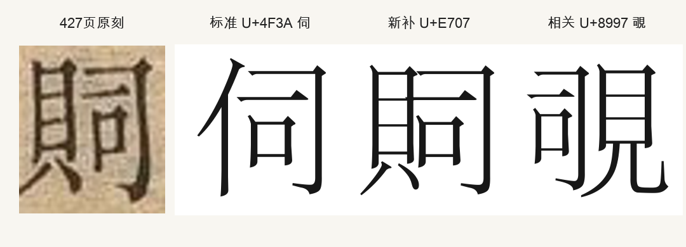
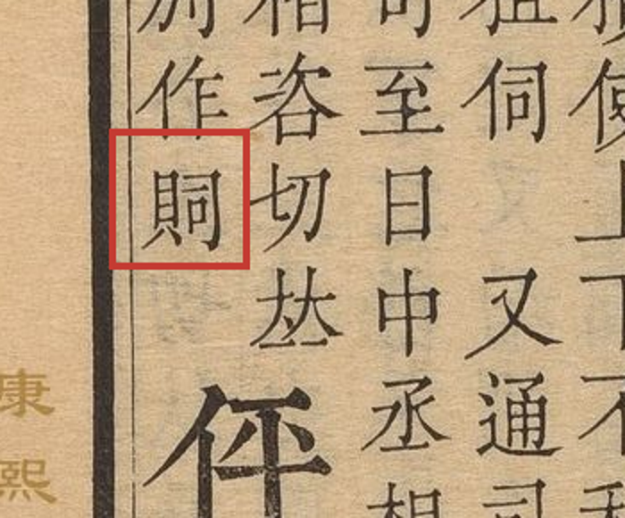
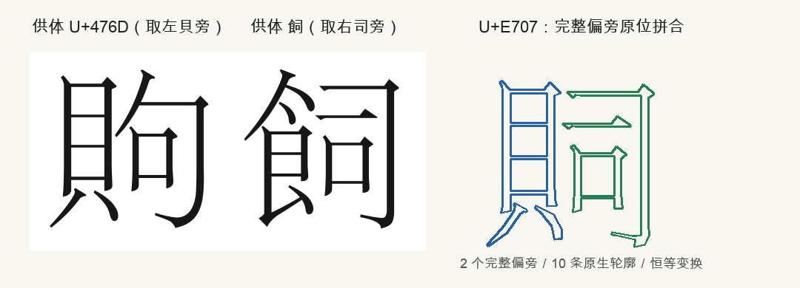
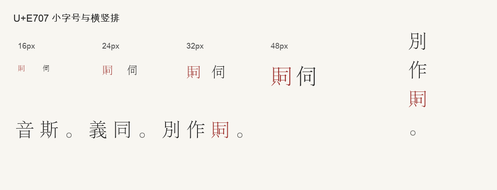

# U+E707〈貝司〉调研、核验与小字字体补录全过程

核验与补录日期：2026-11-19；首次写入时间：13:58:04+08:00；v2 偏旁方案时间：14:10:12+08:00；v3 去重叠方案时间：14:48:26+08:00。

**结果：伺条原文以“別作”明确把〈貝司〉列为伺 U+4F3A 的另一写法。Unicode 已收录抽象字符伺，但所查资料未确认精确 `⿰貝司` 字形的独立码位或可调用标准化变体；现有三份小字字体也未检得该形。因此项目分配 PUA U+E707，仅补入 `guji-plane0.ttf`，现行为登记 v3：左部取 䝭 U+476D 的完整貝旁，右部取飼 U+98FC 的完整司旁，两部件原生边界留约 4 字体单位净间隙。**标准 U+4F3A 不改，E707 不是新的通用 Unicode 字符。



## 1. 出处与字符身份

来源是《康熙字典》武英殿本伺条末段：

> 【廣韻】息兹切【集韻】【韻會】新兹切【正韻】相咨切，𠀤音斯。義同。別作〈貝司〉。

用户按书内阅读位置称 426 页；仓库扫描、网站图片编号及草稿定位到 **@427 / 0427.jpg**。原页 SHA-256 为 `9735cdb89e2cdb7f96c817472ea8b17b1ab818f2a8bf093e3a29567725c5a9e3`，目标 72×72 裁片 SHA-256 为 `dc3e0fb08acb35ca1c2aaa08c503d0b86515a28ed9f3a59f006023a573bcf731`。



本地 Unihan 18.0.0 收录 **伺 U+4F3A**，释义为“serve, wait upon, attend; examine”，CJKVI IDS 为 `⿰亻司`。全套本地 IDS 未检得精确 `⿰貝司`；覗 U+8997 是 `⿰司見`，䙾 U+467E 是 `⿰它見`，𣱇 U+23C47 是 `⿰司氏`，结构都不同。

所查 IVD 2025-07-14 快照有一条 `4F3A E0100; Adobe-Japan1; CID+2197`；Unihan 的 `kRSAdobe_Japan1_6` 同样把默认 U+4F3A 对应到 CID+2197。这条记录不能证明 `⿰貝司` 有标准变体序列。项目三份小字字体均无 format-14 cmap；plane0 的 GSUB 只有 `vert`，也没有调用目标异体的机制。

因此准确表述是：**字符身份已编码为伺 U+4F3A，精确貝司字形未确认独立编码或可调用标准化变体。**

## 2. 补录前字体核验

补录前 plane0、plane2、planeF 分别检查 **28,999、61,119、42,520** 个非空映射，共 **132,638** 个；每字体保存前 100 项候选。另渲染并目视检查 plane0 的 95 个未映射非 `.notdef` 字形；plane2、planeF 没有隐藏非 `.notdef` 字形。未检得 `⿰貝司`。

完整候选数据见 [font-search.json](evidence/e707/font-search.json)，编码、机制、字体基线及检索范围见 [audit.json](evidence/e707/audit.json)。这不是全球字体普查，不能推出所有第三方字体永久没有该形。

## 3. PUA 分配与适用范围

E702、E703 是 E701 历史试验保留位；E707 是 E706 后第一个未占用正式字位。登记范围：

- U+E707，scheme=`compose`，v3，usage=`small-only`；
- 只写 `guji-preview-grid/public/fonts/guji-plane0.ttf`；
- 不写 plane2、planeF、大字 `guji-large.ttf` 或系统字体；
- 不替换或重绘标准 U+4F3A；
- 缓存戳更新为 `e701-4-e704-1-e705-1-e706-1-e707-3`。

PUA 文本必须随项目字体交换，并附 U+4F3A、结构 `⿰貝司`、来源页位和本报告链接。

## 4. 字形构造与冻结配方



初版 v1 将独体貝、司分别压窄组合；v2 改用 䝭 的左貝旁与伺的右司旁，但两个供体部件的原生横向范围 `[32,443.06]` 与 `[345,971]` 相互交叠，造成组合字局部拥挤、笔画重叠。现行 v3 保留 䝭 左貝旁，右部改取飼中已经适配右旁位置的完整司轮廓：

| 部件 | 供体与完整轮廓 | 原生 bbox | 变换 `[xx,xy,yx,yy,dx,dy]` |
| --- | ---: | --- | --- |
| 左貝旁 | 䝭 U+476D 的 0、4、5、6、7、8，共 6 条 | `[32,-117,443.06,800]` | `[1,0,0,1,0,0]` |
| 右司旁 | 飼 U+98FC 的 1、2、3、7，共 4 条 | `[447,-122,951,779]` | `[1,0,0,1,0,0]` |

两个偏旁保留供体复合字中的原生坐标，均为恒等变换；没有缩放、平移、切笔、镜像、描摹、重绘或布尔并集。左貝旁 xMax 为 `443.06`，右司旁 xMin 为 `447`，自然留出约 4 字体单位净间隙。最终字形 10 轮廓、132 点，bbox `[32,-122,951,800]`，编译 glyf SHA-256 为 `ff258603fab29813e667fe0cd7486d2cc7ac4ee97eac646a51c791ccb1b878d7`。

现行冻结配方 [e707-songti-v3.json](../../tools/dataset/font-sources/e707-songti-v3.json)保存供体哈希、完整轮廓、变换、最终坐标与度量；v1、v2 配方保留为操作历史。[生成器](../../tools/dataset/guji_beisi_components.py)默认重建 v3 并逐项比较，`--write-recipe` 只写创作 JSON，不触碰生产字体。

## 5. 正式写入与保护检查

```bash
python3 tools/dataset/guji_pua_patch.py --cp E707 --replace \
  --expected-version 2 --scheme compose \
  --source tools/dataset/font-sources/e707-songti-v3.json --dry-run \
  --cache-version e701-4-e704-1-e705-1-e706-1-e707-3
python3 tools/dataset/guji_pua_patch.py --cp E707 --replace \
  --expected-version 2 --scheme compose \
  --source tools/dataset/font-sources/e707-songti-v3.json \
  --cache-version e701-4-e704-1-e705-1-e706-1-e707-3
```

| 项目 | 补前 → 补后 |
| --- | --- |
| 文件字节数 | 补前 **17,253,152** → v1 **17,253,552** → v2／v3 **17,253,564** |
| best cmap | **30,710 → 30,711 → 30,711 → 30,711** |
| glyphOrder | **30,806 → 30,807 → 30,807 → 30,807** |
| 字形 | `uniE707`，v2、v3 均为同码位替换 |
| v3 hmtx / vmtx | `[1024,32]` / `[1024,70]` |
| 字体 SHA-256 | `25857b0b…` → `f4355c73…` → `4dd33d63…` → `3409fd6cdebe85c58d60148d26acba80ec578831015b221e3101f3b794e752ab` |

首次新增保护补前 30,806 个字形；v2、v3 替换均保护除 `uniE707` 外的全部字形。逐一比较编译 glyf、hmtx 与 vmtx，均不变；v3 不改变文件大小、cmap 或 glyphOrder。U+476D、U+4F3A、U+98FC、E701、E704、E705、E706 的字形哈希保持不变。plane2、planeF、大字均未写入且不映射 E707。

v1 扫描遮罩 chamfer128 为 **1.650**；v2 为 **2.015**；v3 为 **1.945**，低于收紧后的 v3 回归闸 **2.0**。v3 同时满足完整偏旁来源、原生复合字比例和无笔画重叠，分数也优于 v2；该值只防止错位或错形，不是身份或刻本逐像素描摹证明。完整事件与哈希见 [patch-verification.json](evidence/e707/patch-verification.json)。自动回滚点：

字体、v1／v2 配方、首版报告与长期证据提交为 **`a7460461c588512c2161b2994a9eaea5090f14b3`**；v3 字体、配方与同步文档提交为 **`f94b598da444a5c3b105395e90497effccffd69c`**，后续回填提交不再改变字体字节。

```text
var/unencoded/kangxi-unencoded/font-backups/
guji-plane0.ttf.25857b0b476193a79e4b280e42302f0e00977385d2bbc62e603cc8e3a00568ed.ttf
guji-plane0.ttf.f4355c73a6ac620830395003bb323f37a3278d43ff586d2192ae52f6cc71bd7f.ttf
guji-plane0.ttf.4dd33d63a37aa36cfd445cbc975e986cce9dbd35b01e26752321af8d9b8b073d.ttf
```

## 6. 正文、渲染与验证

只将未跟踪草稿 `0427.gj` 中一个 `〈貝司〉` 替换为一个 U+E707；替换后该页 E707 恰有 1 个、描述性占位为 0、U+4F3A 字头仍有 1 个。整页草稿不因本次单点替换自动取得终校状态，且不纳入字体提交。[annotation.json](evidence/e707/annotation.json)记录前后哈希。



生成器冻结配方重建、生产字体 cmap／轮廓／横竖度量保护检查、小字号横竖排渲染与生产构建均通过。排除会读取未跟踪校对草稿的全语料格式化文件后，Vitest 为 **21 个测试文件、786 项全部通过**；`0427.gj` 定向格式化不变量 **1 项通过**。全量 22 文件共 945 项中 944 项通过，唯一失败是未纳入本次提交的 `0454.gj` 草稿排版不变量，与 E707 字体字节修改无关。构建仅保留既有的 Vite native config 与大 chunk 提示。

在实际预览应用打开 @427，只找到一个含 E707 的 `.m-cell`；v3 缓存戳加载后，CDP `CSS.getPlatformFontsForNode` 确认使用自定义字体 `ZhongHuaSongPlane00`、`glyphCount=1`，不是系统回退。字格约 19.18×20.95 px，字号 15.3458 px；记录见 [browser.json](evidence/e707/browser.json)。报告图片可只读复现：

```bash
python3 tools/dataset/guji_beisi_components.py
python3 tools/dataset/render_e707_report.py
```

回滚时必须同时处理 E707 字体映射、注册表、缓存戳和 0427.gj 的一个使用处，并追加撤销事件；若后续还有补字，不得直接覆盖整份旧字体。
