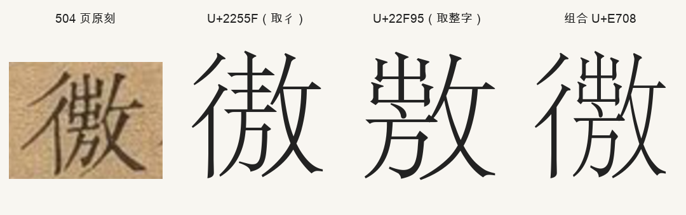
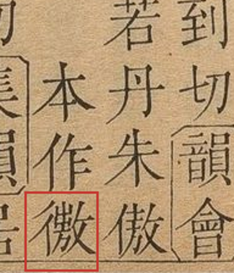
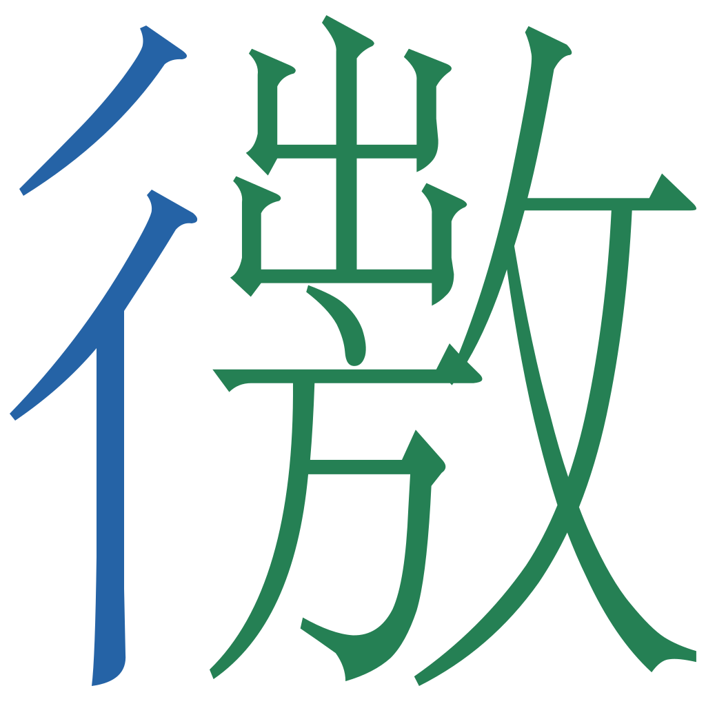
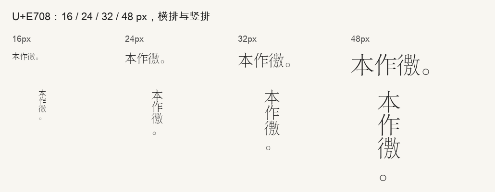
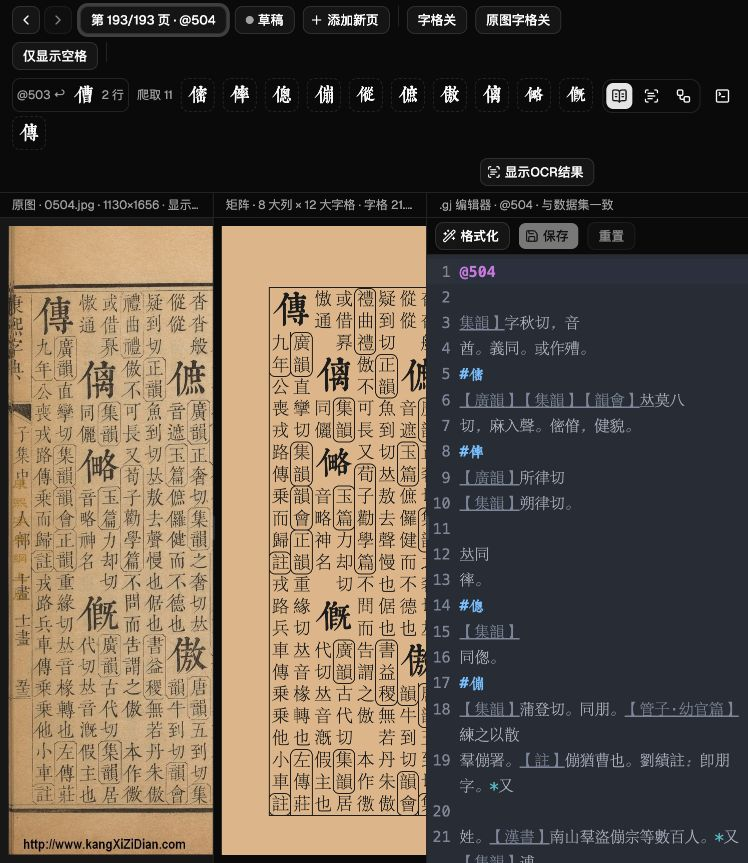

# U+E708〈彳𢾕〉小字字体补录报告

日期：2026-11-19；机器流水时间：22:55:27+08:00（Asia/Shanghai）；版本：compose v1。字体提交：待提交；文档回填提交：待提交。

**已将第 504 页傲条「本作」后的 `⿰彳𢾕` 补入小字 `guji-plane0.ttf`，项目字位为 PUA U+E708。按用户指定，左部取𢕟 U+2255F 的完整双人旁，右部取完整𢾕 U+22F95，保留上部出形。**只使用 U+22F95 会丢失左彳；使用现有 U+2255F 则变成右敖，均不能表示本次目标。



## 1. 出处、编码与补录理由

目标位于网站图片页 **@504 / 0504.jpg** 第 7 字头「傲 U+50B2」的释文末段：

> 【禮·曲禮】傲不可長。又【荀子·勸學篇】不問而告謂之傲。*本作〈彳𢾕〉。或借奡，慠通。



原图路径为 `/Volumes/WD-2T/guji-ocr/raw/kangxizidian/pages/0504.jpg`，SHA-256 `fa9378bac6ad3610d3f24ecdb8fe88ec925f6e159faf4b54923edfc847d79f34`。用户截图归档为 `tools/dataset/font-sources/e708-scan-original.png`，SHA-256 `74fb14557181dbb2a6410dc0e775ac48aca22f024b6a6570c346bac954deeb8c`；扫描遮罩采用灰度小于 120、移除少于 8 像素的孤立墨点，不手工改笔画。

本地 CHISE Basic、Ext-A–J 与兼容区、BabelStone IDS、CJKVI IDS 中检索 `⿰彳𢾕` 及展开结构，未确认这一完整构形的独立标准码位。IVD 2025-07-14 快照未见 U+2255F／U+22F95 变体序列；`50B2 E0100; Adobe-Japan1; CID+4183` 不能证明它表示本次目标。故结论限于**未确认精确目标的独立码位或可调用标准变体**，不是 Unicode 官方不存在证明，也不建立目标与 U+2255F 的字符同一关系。

三份小字字体共搜索 **132,639 个非空映射**（plane0 29,000、plane2 61,119、planeF 42,520），保存每份前 100 候选，目视每份前 48；另外检查 535 个彳相关候选的前 48 和 plane0 的全部 96 个未映射字形（含 `.notdef`）。未检得目标。三份字体均无 format-14 cmap，plane0 GSUB 仅有 `vert`。这是一轮全库候选排序加有限目视核查，不能冒充逐字人工普查。数据和图册分别见 [audit.json](evidence/e708/audit.json)、[font-search.json](evidence/e708/font-search.json) 与 `figures/e708/*candidates.png`。

因此使用项目 PUA U+E708；E702／E703 仍作历史试验保留位。补前四份字体 cmap 均未占用 E708。

## 2. 写入范围与原生部件

仅写入 `guji-preview-grid/public/fonts/guji-plane0.ttf`。plane2 是只读供体；plane2、planeF、guji-large 的全文件哈希在补前后逐一核实未变，系统字体不在本次操作范围。标准 U+2255F、U+22F95、U+50B2 均不重绘或改映射。



| 部件 | 供体与轮廓索引（从 0 起） | 原始 bbox | 放置后的曲线 bbox |
| --- | --- | --- | --- |
| 左彳 | plane2 𢕟 U+2255F，第 2、4 条 | `[14,-125,286.125,833]` | 原样保留 |
| 右𢾕 | plane2 𢾕 U+22F95，全部第 0、1、2、3 条 | `[24,-136,1016.125,843]` | `[304,-125,1010,848]` |

左部采用恒等变换 `[1,0,0,1,0,0]`。右部四条轮廓共享一次正向仿射 `[0.7116038805594053,0,0,0.9938712972420838,286.92150686657425,10.166496424923395]`，横向适配右半边，纵向基本保留。没有切笔、镜像、重绘或布尔并集。左右曲线边界净间隙 **17.875 字体单位**，超过独立闸值 16；横向范围分离，部件不会相交。

供体字体 SHA-256 为 `80df094a2e63091b222706696a8b244c9dba45219af866226a097d0fbb2bf28d`；编译供体 glyf 哈希为：

- U+2255F：`72a8fb9579a67b1f3327adac28289931acc759aa65b553f087d089b3b5b24b19`。
- U+22F95：`d4306ed8420e81e7ebe497f404b7771acc6db7d4f93f9133d867c67705d31ac5`。

冻结源为 [e708-songti-v1.json](../../tools/dataset/font-sources/e708-songti-v1.json)，可由 [生成器](../../tools/dataset/guji_chi_22f95_components.py)重建。最终 `uniE708` 为 **6 轮廓、263 点**；TrueType 控制点 bbox `[14,-125,1011,848]`（控制点 xMax 比曲线极值大 1），hmtx `[1024,14]`、vmtx `[1024,22]`，竖排原点 870。glyf SHA-256：`4e82b012dcffbdc845796687566068f13ce39eb7b05b31222ae94535121aaaa4`。

## 3. 干跑、写入与验证边界

创作期首次干跑因 vmtx23 与工具继承锚字㐺的 vmtx22 不同而停止；将右部 yMax 从 847 调到 848 后保持同一竖排原点 870。第二次干跑的扫描距离 **3.684** 超过暂设门槛 3.0，同样未写入字体。

对照校准结果如下，方法与写入器一致：PIL 220 px 渲染，墨迹保持比例归一到 128×128，再计算对称 chamfer。

| 对照 | 分数 | 解释 |
| --- | ---: | --- |
| 最终指定部件组合 | 3.684 | 原生宋体与扫描刻本存在比例、笔形差异 |
| 只有彳 | 8.839 | 丢失右部 |
| 只有𢾕 | 4.021 | 丢失左部 |
| 错误右部敖，即现有𢕟 | 3.488 | 错字分数反而更低，不能用该指标判定身份 |

最终冻结 **3.8 弱回归闸**，只防止扫描相似度明显退化；完整供体轮廓、编译哈希精确重建、左右不相交及视觉核验是另外必须通过的结构闸。没有为了降低扫描分数而变造供体笔画。保留 [校准反例](evidence/e708/chamfer-calibration.json)与[干跑结果](evidence/e708/dry-run.json)，不将门槛调整隐去或称为刻本逐像素复刻。

正式命令（仓库根目录）：

```bash
python3 tools/dataset/guji_chi_22f95_components.py
python3 tools/dataset/guji_pua_patch.py --cp E708 --dry-run \
  --cache-version e701-4-e704-1-e705-1-e706-1-e707-3-e708-1
python3 tools/dataset/guji_pua_patch.py --cp E708 \
  --cache-version e701-4-e704-1-e705-1-e706-1-e707-3-e708-1
python3 tools/dataset/verify_e708.py
python3 tools/dataset/guji_chi_22f95_components.py --preview
```

`guji_pua_patch.py` 在临时字体完成保护检查和渲染验证后，先核实输入未漂移，再建立按哈希备份、原子替换、更新注册表和追加 `var/unencoded/kangxi-unencoded/font-patches.jsonl`。干跑与正式结果的全文件哈希一致。长期机器记录见 [patch-verification.json](evidence/e708/patch-verification.json)。

| 指标 | 补前 | 补后 |
| --- | --- | --- |
| 字节数 | 17,253,564 | 17,254,352（+788） |
| cmap | 30,711 | 30,712 |
| glyphOrder | 30,807 | 30,808 |
| SHA-256 | `3409fd6cdebe85c58d60148d26acba80ec578831015b221e3101f3b794e752ab` | `740842c631185be99d889f5e1f2a535ddf5f1526ba3a17fa519aeb361f06a0e4` |

验证器逐一比较原有 **30,807 个字形**的编译 glyf、横竖度量、原 cmap 和 glyphOrder；全部保留。生产字形与冻结配方逐字节一致；人为破坏外部供体哈希或冻结轮廓的两个反例均被拒绝。E701／E704／E705／E706／E707 只同步共享文件哈希，字形与版本不变。

## 4. 实际使用与四层验收

只将未跟踪草稿 `kangxi-gold/annotations/0504.gj` 第 40 行的一个 `*本作*。` 改成 `*本作\uE708。`，实际保存单个 PUA 字符。前后全文只差这一处，哈希及计数在 [annotation.json](evidence/e708/annotation.json)。整页仍为草稿，不随字体提交。



实际预览应用重载后打开 @504，恰有一个 E708 `.m-cell`，字号 **17.022 px**、字格约 21.27×21.96 px。CDP `CSS.getPlatformFontsForNode` 确认 **ZhongHuaSongPlane00 / FZSONG_ZHSJ_SIP--GB1-5**，`isCustomFont=true`、`glyphCount=1`。记录见 [browser.json](evidence/e708/browser.json)；当前窄视口会裁去其他大列，本证据确认目标字格，不代表完成整页终校。



工程回归：**22 个测试文件、1,146 项测试全部通过**，`npm run build` 通过，dist 字体与生产字体 SHA-256 一致；保留已有的 Vite native-config 迁移及大 chunk 提示。测试运行于当前工作区，包括原有并行排版修改和未跟踪草稿，不能冒充洁净提交上的独立结果。JSON 校验、冻结配方重建和 `git diff --check` 通过。环境版本、命令和日志见 [engineering.json](evidence/e708/engineering.json)。

已同步 PUA 注册表（v1，small-only）、CSS 缓存戳 `e701-4-e704-1-e705-1-e706-1-e707-3-e708-1`、Changelog、操作登记簿、应用字体表、根导航、文档导航、证据索引、补录流程及五份既有共享小字报告的后续状态说明；历史哈希不覆盖。

## 5. 交换、回滚与提交

U+E708 是项目私用字，交换正文时须附字体、`⿰彳𢾕` 描述和 @504 出处。不能把它宣传为新获 Unicode 标准编码。构形按用户指定供体制作，宋体轮廓保留出形，但不承诺逐笔复制木刻的角度、粗细和比例。

补前 Git HEAD `5423c29af90c485ea7f973664c13952be24c58f4`，plane0 blob `2325861242fa0e94a64dfd232d1efcd897141a7d`。自动备份：

```text
var/unencoded/kangxi-unencoded/font-backups/
guji-plane0.ttf.3409fd6cdebe85c58d60148d26acba80ec578831015b221e3101f3b794e752ab.ttf
```

若之后没有字体变更，可从该哈希备份或 Git blob 恢复；若已有后续补录，必须针对 E708 移除／替换，并重新运行全量保护检查。同步撤销注册表／共享哈希、缓存戳、0504 页使用处和现行文档状态，追加逆向事件；不要用旧整字体覆盖后续新增字。0504 补前全文仅保留本地 `var/font-audit/0504-e708/0504.gj.before`，可逆的单点操作已归档到 annotation.json。

字体、recipe、源图、证据与报告按明确路径提交；并行排版代码、0312 页、manifest 与其他未跟踪校对草稿均不纳入。
