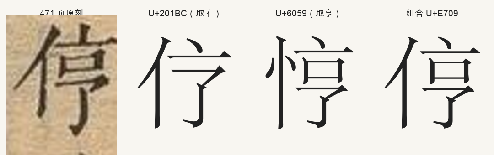
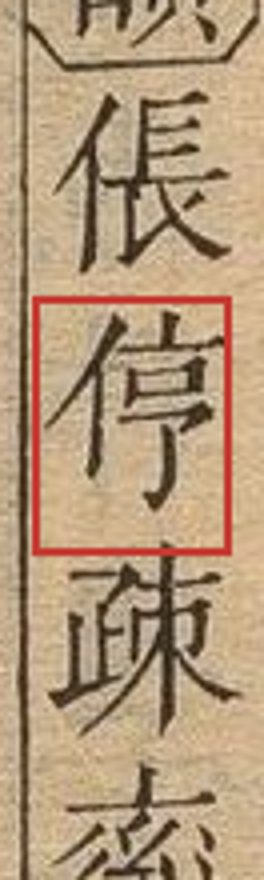
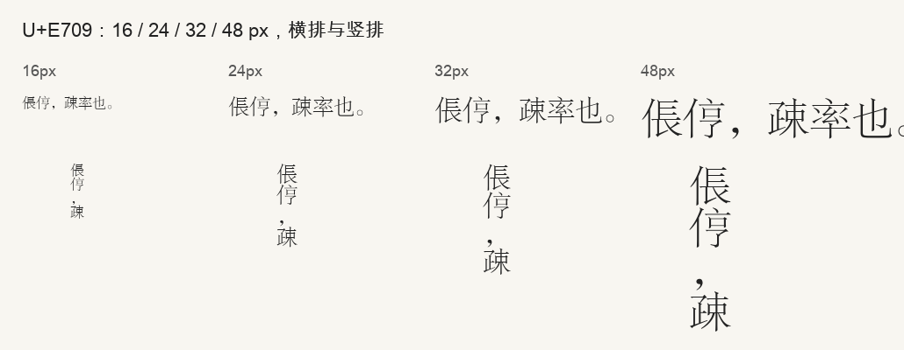

# U+E709〈亻亨〉小字字体补录报告

日期：2026-11-20；机器流水时间：11:35:47+08:00（Asia/Shanghai）；版本：compose v1。字体提交：**待提交**；文档回填提交：**待提交**。

**已将第 471 页倀条「【集韻】倀〈亻亨〉，疎率也。」的 `⿰亻亨` 补入小字 `guji-plane0.ttf`，项目字位为 PUA U+E709。按用户指定，左部取𠆼 U+201BC 的完整单人旁，右部取悙 U+6059 的完整右部（亨）。**该字无标准 Unicode 码位（IRG WS2024 候选 UK-30044，2025-11 证据受理）；用停（⿰亻亭）、悙或亨整字代替都会改变原文。



## 1. 出处、编码与补录理由

目标位于网站图片页 **@471 / 0471.jpg** 第 1 字头「倀 U+5000」释文末句：

> *又【廣韻】【集韻】𠀤豬孟切，音趟。【廣韻】萌倀，失道也。【集韻】倀〈亻亨〉，疎率也。



原图路径为 `/Volumes/WD-2T/guji-ocr/raw/kangxizidian/pages/0471.jpg`，SHA-256 `290710cf98a56a9e231d141544e7e5c9a403f430935e0816728ada94a4a2727a`。裁片 `tools/dataset/font-sources/e709-scan-original.png`（x∈[102,151]、y∈[664,728)，剔除 x99–100 界栏残线），SHA-256 `c5ed70f688152d3f9a83d58941093977b01b659cd623644d349e295444b945a6`；扫描遮罩采用灰度小于 120、移除少于 8 像素的孤立墨点，不手工改笔画，SHA-256 `3811129e15fc069a5495a303143d15b8b6eeb317ae2611579d7139491f85f901`。

**站方记录是身份的硬证据**：爬取库倀（U+5000）词条 `text_paragraphs` 原文即四字符描述式转写「倀〈亻亨〉，疎率也。」（U+3008 U+4EBB U+4EA8 U+3009），且 `pua_other=[]`——站方自己都未给该形分配 PUA 码位，E815–E864 同步槽位无现成字形可复用。金标草稿 0471.gj 亦转写为〈亻亨〉。

本地 CHISE IDS（Basic＋Ext-B）无任何已编码字 IDS 为 `⿰亻亨`；BabelStone、CJKVI 亦无（见 [audit.json](evidence/e709/audit.json)）。IRG WS2024 候选 **UK-30044**（序列 00127，人部九画）2025-11 于 IRG #63 证据受理，但尚未进入任何已发布扩展区；UK 证据原件为《江西通志》雍正刊本（n2686r），并非集韵宋本。相似字 𠆼 U+201BC 总六画（kRSUnicode 9.4），与九画目标不同字。**停 U+505C（⿰亻亭）是本例最大的形近陷阱**：视觉模型对同一裁片先后给出 𢘊／停／亨 三种读数；笔画级复核（口下仅一条横＋竖钩，无冖丁两层）与站方库、金标转写共同排除亭形——身份判定不依赖视觉模型。

三份小字字体共搜索 **132,640 个非空映射**（plane0 29,001、plane2 61,119、planef 42,520），保存每份前 100 候选、目视每份前 48（[font-candidates.png](figures/e709/font-candidates.png)），未检得目标。原页扫描存在各向异性挤压（邻字墨迹宽高比 0.55–0.67 vs 字体约 1.0），排序被小墨迹字形主导，仅作穷尽性辅助。数据见 [font-search.json](evidence/e709/font-search.json)。

因此使用项目 PUA U+E709；E702／E703 仍作历史试验保留位。补前四份字体 cmap 均未占用 E709。

## 2. 写入范围与原生部件

仅写入 `guji-preview-grid/public/fonts/guji-plane0.ttf`。plane2 只读供体；plane2、planeF、guji-large 的全文件哈希在补前后逐一核实未变，系统字体不在本次操作范围。标准 U+201BC、U+6059、U+4EA8、U+505C 均不重绘或改映射。


| 部件 | 供体与轮廓索引（从 0 起） | 原始 bbox | 放置后的曲线 bbox |
| --- | --- | --- | --- |
| 左亻 | plane2 𠆼 U+201BC，第 0 条（撇竖连体单轮廓） | `[8,-125,362.76,847]` | 原样保留 |
| 右亨 | plane0 悙 U+6059，第 0、1、3、4、7 条 | `[350,-120,985.64,853]` | `[381,-125,1017,848]` |

左部恒等变换 `[1,0,0,1,0,0]`。右部五轮廓共享一次近恒等正向仿射 `[1.00056,0,0,1.0,30.80,-5.0]`（缩放不超过 0.06%，入框后 yMax 恰为 848，继承锚字竖排原点 870）。没有切笔、镜像、重绘或布尔并集。左右曲线边界净间隙 **18.24 字体单位**，超过独立闸值 16；横向范围分离，部件不会相交。

供体字体 SHA-256：plane2 `80df094a2e63091b222706696a8b244c9dba45219af866226a097d0fbb2bf28d`；编译供体 glyf 哈希为：

- U+201BC：`9267eb1b2c236808074e1ba09e26ae9eca6f720cc1ed6d12faf6da7d919f61cf`。
- U+6059：`9121288fe52e85733bc1cf47d40fc6a19635e21280f3934dcff7fa8ea6ac0be5`。

冻结源为 [e709-songti-v1.json](../../tools/dataset/font-sources/e709-songti-v1.json)，可由[生成器](../../tools/dataset/guji_ren_heng_components.py)重建。最终 `uniE709` 为 **6 轮廓、121 点**；控制点 bbox `[8,-125,1019,848]`，hmtx `[1024,8]`、vmtx `[1024,22]`，竖排原点 870。glyf SHA-256：`5a45879271c1622de3d61f4123ee9a195af94620f341cd97a3b1482bc17ffd2e`。

## 3. 干跑、写入与扫描距离的边界

正式命令（仓库根目录）：

```bash
python3 tools/dataset/guji_ren_heng_components.py --write-recipe
python3 tools/dataset/guji_pua_patch.py --cp E709 --dry-run \
  --cache-version e701-4-e704-1-e705-1-e706-1-e707-3-e708-1-e709-1
python3 tools/dataset/guji_pua_patch.py --cp E709 \
  --cache-version e701-4-e704-1-e705-1-e706-1-e707-3-e708-1-e709-1
python3 tools/dataset/verify_e709.py
python3 tools/dataset/guji_ren_heng_components.py --preview
python3 tools/dataset/guji_ren_heng_components.py --calibrate
```

干跑通过（哈希与正式写入一致），记录见 [dry-run.json](evidence/e709/dry-run.json)。本页扫描的各向异性挤压使扫描距离失去身份判别力，校准以**同页无争议邻字**建立真值带：

| 对照 | 分数 | 解释 |
| --- | ---: | --- |
| 最终指定部件组合 | 6.412 | 落在真值带内 |
| 停（⿰亻亭 形近混淆字） | 5.126 | 也在带内——该指标不能判定身份 |
| 只有亻 | 7.103 | 丢失右部 |
| 只有亨 | 3.786 | 窄形在挤压扫描上占优，不代表更像 |
| 悙（错忄旁） | 7.559 | 错偏旁 |
| 倀 vs 自身扫描（真值带） | 6.492 | 同页同列基线 |
| 疎 vs 自身扫描（真值带） | 5.186 | 同上 |
| 率 vs 自身扫描（真值带） | 7.036 | 同上 |

最终冻结 **7.5 弱回归闸**，只防几何性退化；完整供体轮廓、编译哈希精确重建、左右不相交、站方库与笔画级身份核验是独立必需闸。没有为降低扫描分数变造供体笔画。记录见 [chamfer-calibration.json](evidence/e709/chamfer-calibration.json)。

| 指标 | 补前 | 补后 |
| --- | --- | --- |
| 字节数 | 17,254,352 | 17,254,744（+392） |
| cmap | 30,712 | 30,713 |
| glyphOrder | 30,808 | 30,809 |
| SHA-256 | `740842c631185be99d889f5e1f2a535ddf5f1526ba3a17fa519aeb361f06a0e4` | `936f79433f8624b0e69cd93ab13712b14c72bd59679026ea95b73112f48dcba8` |

验证器逐一比较原有 **30,808 个字形**的编译 glyf、横竖度量、原 cmap 和 glyphOrder；全部保留。生产字形与冻结配方逐字节一致；内部供体哈希、外部供体哈希与冻结轮廓三个破坏性反例均被拒绝。E701／E704–E708 只同步共享文件哈希，字形与版本不变。见 [patch-verification.json](evidence/e709/patch-verification.json)。

## 4. 实际使用与四层验收

只将未跟踪草稿 `kangxi-gold/annotations/0471.gj` 第 34 行的一处「倀〈亻亨〉，疎率也。」改为「倀\ue709，疎率也。」，实际保存单个 PUA 字符。前后全文只差这一处，哈希及计数在 [annotation.json](evidence/e709/annotation.json)。整页仍为草稿，不随字体提交。



实际预览应用打开 @471，恰有一个 E709 `.m-cell`，字号 **16.024 px**、字格约 20.0×20.8 px，CSS 栈以 GujiPlane0 打头。IAB 会话无 CDP `getPlatformFontsForNode`，改用**页面内 canvas 单字体族探针**：`100px GujiPlane0`（无回退）下 E709 墨迹 2,118 px²（介于亨 1,653 与倀 2,316 之间），而未映射 E70A 墨迹为 0——字格渲染的就是补录字形本身，非系统回退非豆腐。字格特写与记录见 [browser.json](evidence/e709/browser.json)（宽幅截图表面多次超时，以字格裁片＋墨迹探针覆盖渲染闸）。

工程回归：**22 个测试文件、1,148 项测试全部通过**，`npm run build` 通过（保留既有大 chunk 提示），dist 四字体与 public 哈希一致；JSON 校验、冻结配方重建和 `git diff --check` 通过。测试运行于当前工作区，包括并行排版修改和未跟踪草稿，不能冒充洁净提交上的独立结果。环境版本、命令和日志见 [engineering.json](evidence/e709/engineering.json)。

已同步 PUA 注册表（v1，small-only）、CSS 缓存戳 `e701-4-e704-1-e705-1-e706-1-e707-3-e708-1-e709-1`、Changelog、操作登记簿、应用字体表、根导航、文档导航与证据索引；历史哈希不覆盖。

## 5. 交换、回滚与提交

U+E709 是项目私用字，交换正文时须附字体、`⿰亻亨` 描述和 @471 出处。不能把它宣传为新获 Unicode 标准编码；**若 UK-30044 将来获得正式码位，须按注册表 related_characters 惯例回迁标准 cmap**。构形按用户指定供体制作，宋体轮廓完整保留，但不承诺逐笔复制木刻的角度、粗细和比例；原页扫描存在各向异性挤压，扫描相似度仅是弱回归辅助。

补前 Git HEAD `d73f9a52b9947f25430913ff45125ab2bac6e5f9`，plane0 blob `947173ae9014f12f46d61e24b58df46cab29ef2a`。自动备份：

```text
var/unencoded/kangxi-unencoded/font-backups/
guji-plane0.ttf.740842c631185be99d889f5e1f2a535ddf5f1526ba3a17fa519aeb361f06a0e4.ttf
```

若之后没有字体变更，可从该哈希备份或 Git blob 恢复；若已有后续补录，必须针对 E709 移除／替换，并重新运行全量保护检查。同步撤销注册表／共享哈希、缓存戳、0471 页使用处和现行文档状态，追加逆向事件；不要用旧整字体覆盖后续新增字。0471 补前全文仅保留本地 `var/font-audit/0471-e709/0471.gj.before`，可逆的单点操作已归档到 annotation.json。

字体、配方、源图、证据与报告按明确路径提交；并行排版代码、0312 页、manifest 与其他未跟踪校对草稿均不纳入。
