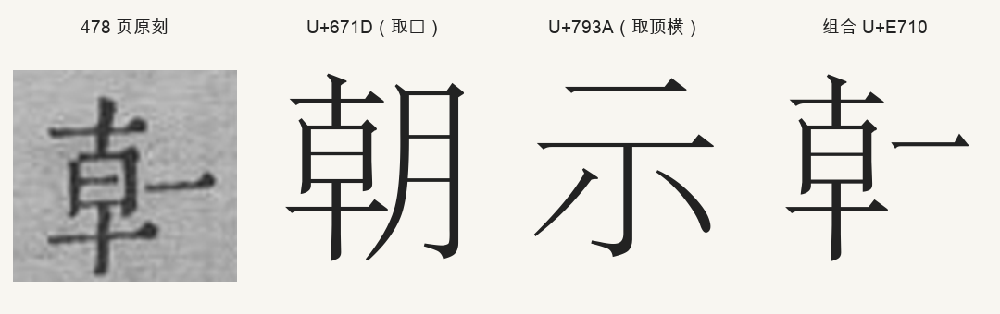
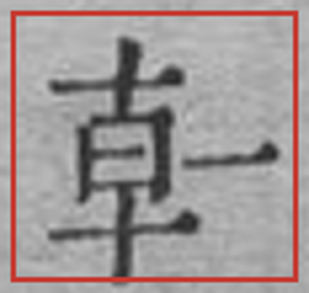
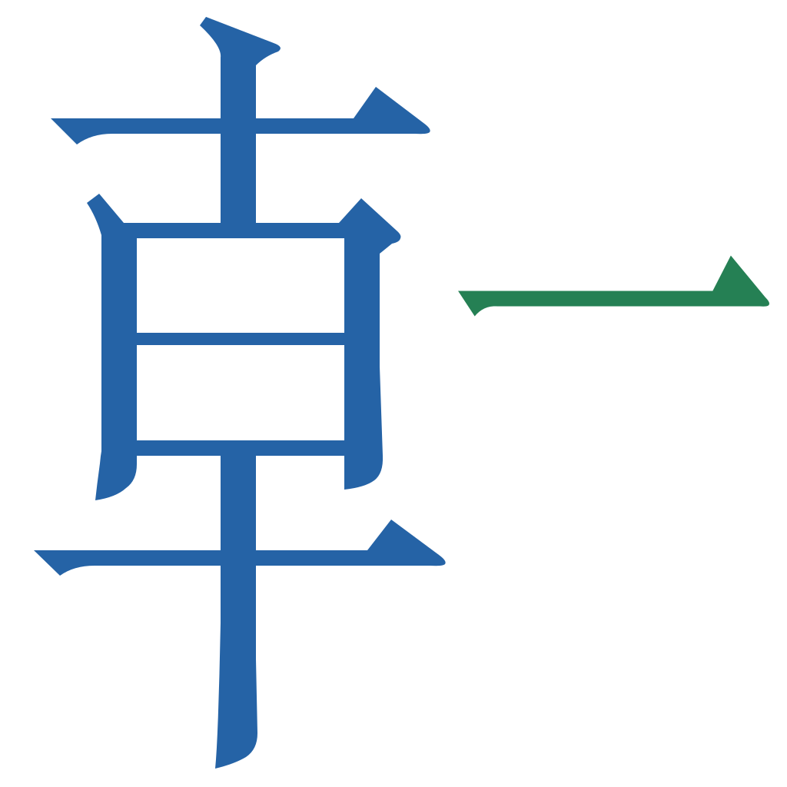
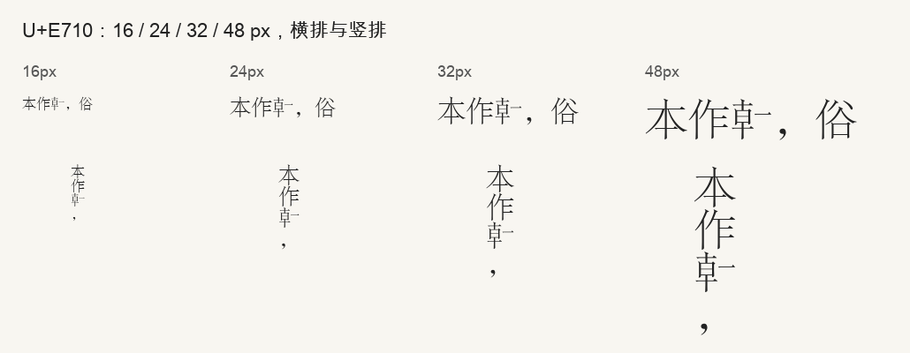

# U+E710〈𠦝一〉小字字体补录报告

日期：2026-11-20；机器流水时间：13:18:32+08:00（Asia/Shanghai）；版本：compose v1。字体提交：`8c553c838dff53f8354e4b6e0b381898ff101d1d`；文档回填提交：`3affb4ef32091d34cf27d6fa578591dab00019fb`。

**已将第 478 页倝条「本作〈𠦝一〉」的 `⿰𠦝一` 补入小字 `guji-plane0.ttf`，项目字位为 PUA U+E710。按用户指定，左部取朝 U+671D 的完整左半（𠦝），右部取示 U+793A 的顶部短横。**该字无标准 Unicode 码位（CHISE 收录全部 ⿰𠦝X 组合，无一与一 pairing；倝本身是 ⿰𠦝人）；用倝、朝或𠦝整字代替都会改变原文。



## 1. 出处、编码与补录理由

目标位于网站图片页 **@478 / 0478.jpg** 第 1 字头「倝 U+501D」释文：

> 【集韻】居案切，音幹。日始出，光倝倝也。本作〈𠦝一〉，俗作𣉙，別作𧹳。



原图路径 `/Volumes/WD-2T/guji-ocr/raw/kangxizidian/pages/0478.jpg`，SHA-256 `a358d1f7756b17bb55a268bfbd2cad9e37ff4b3a7a4e93d99e851b4e709f1f34`。按 E708 惯例归档用户提供的站方缩放截图为字形源（清晰无挤压，墨迹宽高比 0.94 对组合 0.98）：`tools/dataset/font-sources/e710-scan-original.png`，SHA-256 `a0ebf81e3db61962f9786c21636dfb6376470fcd30ea169806983d9bd7d77787`；遮罩灰度阈值 128、去小于 8 像素孤立墨点，SHA-256 `35fe7ed0eba31e859101aecfe84a4bc79a86fa59b27ad13fcb5c987d392cbb7b`。

**站方记录再次一锤定音且带新事实**：倝词条 `text_paragraphs` 原文为「本作〈\uE854一〉，俗作𣉙，別作𧹳。」且 `pua_other=['U+E854']`——站方给 **𠦝 单字**分配了自家 PUA E854（plane0 的 E815–E864 站方同步带内，3 轮廓、bbox `(50,-128,626,851)` 与𠦝同构），整字仍以 **两字符序列** 转写。即站方体系里这个本作形同样没有单一编码——E854 只是𠦝的槽位，不得当作整字使用（已写入注册表 station_record）。

本地 CHISE IDS 收录的 ⿰𠦝X 组合为：彡（𢒨）、文（𣁖）、朋（𣎠）、束（𣙈）、乚（乹）、**人（倝 U+501D）**、戈（戟）、月（朝）、韋（韓）、韦（韩）——**无一与「一」配对**。倝的 CHISE IDS 是 ⿰𠦝人（康熙按语称《集韻》从𠦝从入，部件账有出入但不影响目标身份）；本作形以「一」代右侧部件。同条俗作𣉙 U+23259、別作𧹳 U+27E73 均在 plane2 在库，小字可直接显示，无需补录。

三份小字字体共搜索 **132,641 个非空映射**（plane0 29,002、plane2 61,119、planef 42,520），保存每份前 100 候选、目视每份前 48（[font-candidates.png](figures/e710/font-candidates.png)），最近邻是戟/朝族（右部为戈/月），无一右侧裸横。数据见 [font-search.json](evidence/e710/font-search.json)。

因此使用项目 PUA U+E710；E702／E703 仍作历史试验保留位。补前四份字体 cmap 均未占用 E710。

## 2. 写入范围与原生部件

仅写入 `guji-preview-grid/public/fonts/guji-plane0.ttf`。两供体均在目标字体内（本例无外部供体）；plane2、planeF、guji-large 的全文件哈希补前后逐一核实未变，系统字体不在范围。标准 U+671D、U+793A、U+2099D、U+4E00、U+501D 及站方 E854 均不重绘或改映射。



| 部件 | 供体与轮廓索引（从 0 起） | 原始 bbox | 放置后的曲线 bbox |
| --- | --- | --- | --- |
| 左𠦝 | plane0 朝 U+671D，第 1、4、5 条（连体框＋日内两横） | `[44,-128,579.64,850]` | `[44,-130,579.64,848]` |
| 右一 | plane0 示 U+793A，第 3 条（顶部短横） | `[198,750,833.64,829]` | `[596,458.5,1001,537.5]` |

左部恒等变换并入全局 -2 竖向平移（E708 惯例，使 yMax=848 继承锚字竖排原点）。右部为一次正向仿射 `[0.63715,0,0,1,469.844,-291.5]`：**x 向缩至 0.637 复现木刻比例（一≈𠦝宽的 0.71–0.75）、y 向保持**，短横起点=十字臂端+16 单位（596−579.64=16.36，达到标准间隙闸），垂直居于日的上内横高度（y 中心 498）。这一布局是原刻几何法则的直译：截图逐行核验显示短横与日的上内横同高、起笔恰在十字臂端。没有切笔、镜像、重绘或布尔并集。

供体编译 glyf 哈希：

- U+671D：`7439a3f87d351ca031f70adb39bd0a49d52692f9b49e6ea9baf163501563abec`。
- U+793A：`dbaa90466c9630cb2a86fb99237e40922228e972846c6d08bcc9cc09cfbc5674`。

冻结源为 [e710-songti-v1.json](../../tools/dataset/font-sources/e710-songti-v1.json)，可由[生成器](../../tools/dataset/guji_zao_yi_components.py)重建。最终 `uniE710` 为 **4 轮廓、100 点**；控制点 bbox `[44,-130,1003,848]`，hmtx `[1024,44]`、vmtx `[1024,22]`，竖排原点 870。glyf SHA-256：`268a51a9306ec9ad955583c869ee3b8853cefedcd6ed26327e33917bb6ea562c`。

## 3. 干跑、写入与验证边界

正式命令（仓库根目录）：

```bash
python3 tools/dataset/guji_zao_yi_components.py --write-recipe
python3 tools/dataset/guji_pua_patch.py --cp E710 --dry-run \
  --cache-version e701-4-e704-1-e705-1-e706-1-e707-3-e708-1-e709-1-e710-1
python3 tools/dataset/guji_pua_patch.py --cp E710 \
  --cache-version e701-4-e704-1-e705-1-e706-1-e707-3-e708-1-e709-1-e710-1
python3 tools/dataset/verify_e710.py
python3 tools/dataset/guji_zao_yi_components.py --preview
python3 tools/dataset/guji_zao_yi_components.py --calibrate
```

干跑通过（哈希与正式写入一致），记录见 [dry-run.json](evidence/e710/dry-run.json)。与 E709 的挤压扫描不同，本例遮罩清晰，扫描距离恢复判别力：

| 对照 | 分数 | 解释 |
| --- | ---: | --- |
| 最终指定部件组合 | **4.091** | 显著最优 |
| 倝（⿰𠦝人，同字头形近混淆） | 5.501 | 错右部 |
| 朝（⿰𠦝月） | 5.764 | 错右部 |
| 只有𠦝 | 6.161 | 丢失右横 |
| 只有一 | 12.844 | 丢失左部 |
| 未映射对照 | 不适用 | 见 §4 canvas 探针零墨迹 |

最终冻结 **4.6 弱回归闸**（介于组合分与最近混淆对照之间）。完整供体轮廓、编译哈希精确重建、不相交和小字号渲染是独立必需闸。没有为降低扫描分数变造供体笔画。记录见 [chamfer-calibration.json](evidence/e710/chamfer-calibration.json)。

| 指标 | 补前 | 补后 |
| --- | --- | --- |
| 字节数 | 17,254,744 | 17,255,056（+312） |
| cmap | 30,713 | 30,714 |
| glyphOrder | 30,809 | 30,810 |
| SHA-256 | `936f79433f8624b0e69cd93ab13712b14c72bd59679026ea95b73112f48dcba8` | `80da57fa51b66fc3c09ee690326a0967e06da76dd00ef660d25feec06afcbb45` |

验证器逐一比较原有 **30,809 个字形**的编译 glyf、横竖度量、原 cmap 和 glyphOrder；全部保留。生产字形与冻结配方逐字节一致；两笔供体哈希与冻结轮廓三个破坏性反例均被拒绝。E701／E704–E709 只同步共享文件哈希，字形与版本不变。见 [patch-verification.json](evidence/e710/patch-verification.json)。

## 4. 实际使用与四层验收

只将未跟踪草稿 `kangxi-gold/annotations/0478.gj` 的一处「本作〈𠦝一〉，」改为「本作\ue710，」，实际保存单个 PUA 字符。前后全文只差这一处，哈希及计数在 [annotation.json](evidence/e710/annotation.json)。整页仍为草稿，不随字体提交。



实际预览应用打开 @478，恰有一个 E710 `.m-cell`，字号 **16.942 px**、字格约 21.2×22.1 px，CSS 栈以 GujiPlane0 打头。页面内 canvas 单字体族探针：`100px GujiPlane0`（无回退）下 E710 墨迹 1,557 px²（朝 2,689、plane2 𠦝 2,061），而未映射 E711 墨迹为 0——字格渲染的是补录字形本身，非系统回退非豆腐。字格特写与记录见 [browser.json](evidence/e710/browser.json)（交互注记：本应用 Radix 下拉需完整 pointerdown/mousedown/pointerup/mouseup/click 序列方开，单纯 DOM click 与坐标点击均不触发）。

工程回归：**22 个测试文件、1,148 项测试全部通过**，`npm run build` 通过（保留既有大 chunk 提示），dist 四字体与 public 哈希一致；JSON 校验、冻结配方重建和 `git diff --check` 通过。测试运行于当前工作区，包括并行排版修改和未跟踪草稿，不能冒充洁净提交上的独立结果。环境版本、命令和日志见 [engineering.json](evidence/e710/engineering.json)。

已同步 PUA 注册表（v1，small-only）、CSS 缓存戳 `e701-4-e704-1-e705-1-e706-1-e707-3-e708-1-e709-1-e710-1`、Changelog、操作登记簿、应用字体表、根导航、文档导航与证据索引；历史哈希不覆盖。

## 5. 交换、回滚与提交

U+E710 是项目私用字，交换正文时须附字体、`⿰𠦝一` 描述和 @478 出处。不能把它宣传为新获 Unicode 标准编码。与 E709 的 UK-30044 不同，本字目前**未进入任何已知 IRG 候选流程**；若将来出现候选或获码，按 E709 报告 §5.2 的七步回迁机制处理。站方 E854 槽位是𠦝单字的同步字形，与本字位互不相干，复用或迁移时不得混淆。

补前 Git HEAD `74db71413b2f25749a2018732d516ccef3d3e9ba`，plane0 blob `c4c7027380907d9f26094ca1227b55fc8fabe68c`。自动备份：

```text
var/unencoded/kangxi-unencoded/font-backups/
guji-plane0.ttf.936f79433f8624b0e69cd93ab13712b14c72bd59679026ea95b73112f48dcba8.ttf
```

若之后没有字体变更，可从该哈希备份或 Git blob 恢复；若已有后续补录，必须针对 E710 移除／替换，并重新运行全量保护检查。同步撤销注册表／共享哈希、缓存戳、0478 页使用处和现行文档状态，追加逆向事件；不要用旧整字体覆盖后续新增字。0478 补前全文仅保留本地 `var/font-audit/0478-e710/0478.gj.before`，可逆的单点操作已归档到 annotation.json。

字体、配方、源图、证据与报告按明确路径提交；并行排版代码、0312 页、manifest 与其他未跟踪校对草稿均不纳入。
