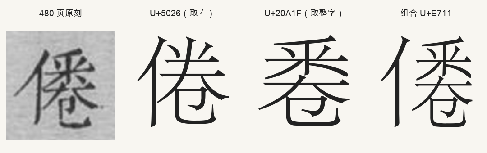
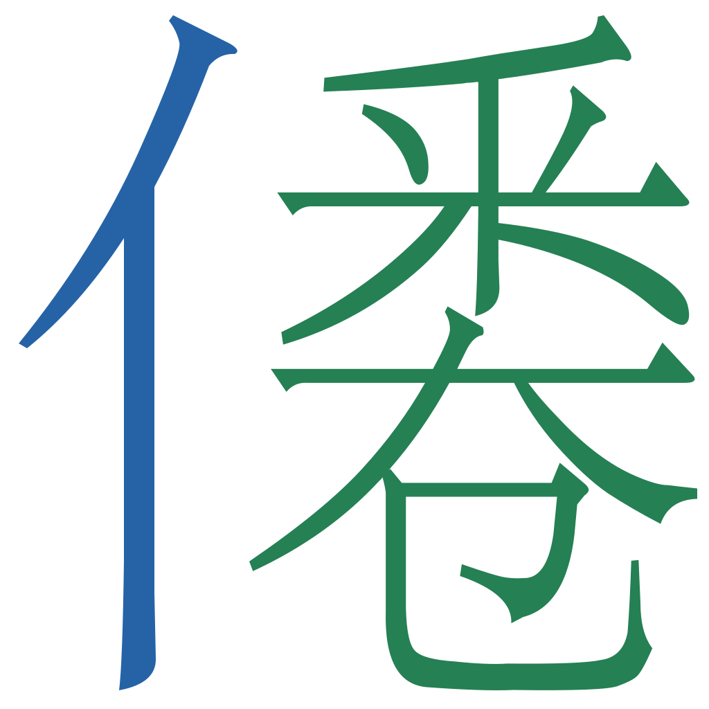
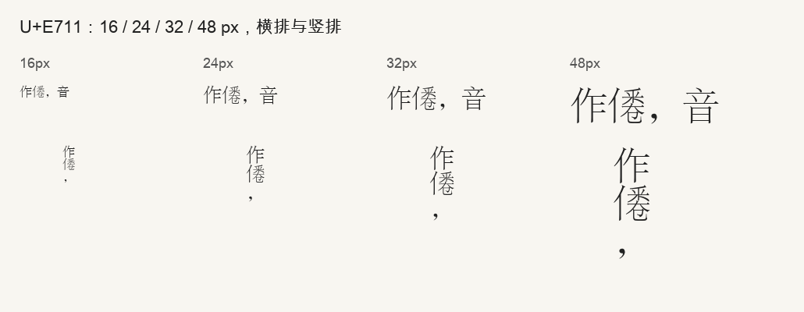

# U+E711〈亻𠨟〉小字字体补录报告

日期：2026-11-20；机器流水时间：15:22:41+08:00（Asia/Shanghai）；版本：compose v1。字体提交：`64059adef39099faf163bf00498b72857735007c`；文档回填提交：**待提交**。

**已将第 480 页倦条按语「人部作〈亻𠨟〉」的說文人部形 `⿰亻𠨟` 补入小字 `guji-plane0.ttf`，项目字位为 PUA U+E711。按用户指定，左部取倦 U+5026 的完整单人旁，右部取𠨟 U+20A1F 整字。**该合体无标准 Unicode 码位（CHISE 无 ⿰亻𠨟）；部件 𠨟 本身已编码且在 plane2 在库，但用倦（⿰亻卷）或𠨟单独代替都会改变原文。



## 1. 出处、编码与补录理由

目标位于网站图片页 **@480 / 0480.jpg** 第 1 字头「倦 U+5026」释文按语：

> 【說文】力部作𠢏，人部作〈亻𠨟〉，音義同。宜合倦爲券字，重文不必分爲二。


原图路径 `/Volumes/WD-2T/guji-ocr/raw/kangxizidian/pages/0480.jpg`，SHA-256 `0173f4683de7be650a01f5bb545bcf8d3747a80d4fed8d1f3fa14821813248e3`。按 E708/E710 惯例归档用户站方缩放截图为字形源：`tools/dataset/font-sources/e711-scan-original.png`，SHA-256 `a0adb27725b4933511fcffe87efbe2fdf8ddc3f24f4e4901b9529e4e3c5bb4de`；遮罩灰度阈值 128、去小于 8 像素孤立墨点，SHA-256 `e45b5cb15d066eaec21d7f0744fe98836390bb88e588e248129e6e295363de80`。

**站方记录**：倦词条 `text_paragraphs` 原文同用描述式「人部作〈亻𠨟〉」（U+3008 U+4EBB U+20A1F U+3009），`pua_other=[]`——部件𠨟本身标准编码（与 E710 的 E854 案不同），站方用真实字符转写，整字无单一编码。

CHISE 无 `⿰亻𠨟` 已编码字；𠨟 U+20A1F 自身 IDS 为 `⿵⿱釆大㔾`（plane2 在库）。同按语的力部形 𠢏 U+2088F 亦在 plane2 在库，无需补录。倦 U+5026 是 ⿰亻卷，右部非𠨟，不能代替目标。

三份小字字体共搜索 **132,642 个非空映射**（plane0 29,003、plane2 61,119、planef 42,520），保存每份前 100 候选、目视每份前 48（[font-candidates.png](figures/e711/font-candidates.png)），最近邻是缺亻的 𠨟/卺 族字形，无一命中。数据见 [font-search.json](evidence/e711/font-search.json)。

因此使用项目 PUA U+E711；E702／E703 仍作历史试验保留位。补前四份字体 cmap 均未占用 E711。

## 2. 写入范围与原生部件

仅写入 `guji-preview-grid/public/fonts/guji-plane0.ttf`。左供体在目标字体、右供体在 plane2（只读外部供体，E708 同型）；plane2、planeF、guji-large 全文件哈希补前后逐一核实未变，系统字体不在范围。标准 U+5026、U+20A1F、U+2088F 均不重绘或改映射。



| 部件 | 供体与轮廓索引（从 0 起） | 原始 bbox | 放置后的曲线 bbox |
| --- | --- | --- | --- |
| 左亻 | plane0 倦 U+5026，第 1 条（撇竖连体单轮廓） | `[27,-127,342.70,848]` | 原样保留 |
| 右𠨟 | plane2 U+20A1F，第 0、1、2 条（龹部框、下框、内点） | `[20,-112.5,998,859]` | `[360,-127,1007,848]` |

左部恒等变换。右部三轮廓共享一次正向仿射 `[0.6616,0,0,1.0036,346.77,-14.09]`：x 向压至家族右半宽（右界 1007 对齐倦家族的 1006）、y 向近恒等（底 −127 顶 848 与亻带对齐）。左右曲线边界净间隙 **17.30 字体单位**，超过独立闸值 16；横向范围分离，部件不会相交。没有切笔、镜像、重绘或布尔并集。

供体字体 SHA-256：plane2 `80df094a2e63091b222706696a8b244c9dba45219af866226a097d0fbb2bf28d`；编译供体 glyf 哈希：

- U+5026：`e50d5b46e4175f548f6df8547de301d7c13902978d12c5f33730ec0f8bd2ec0c`。
- U+20A1F：`631d831305289c7e4892340722f35def246cf23f15016fc53cbdf13bffcce049`。

冻结源为 [e711-songti-v1.json](../../tools/dataset/font-sources/e711-songti-v1.json)，可由[生成器](../../tools/dataset/guji_ren_juan_components.py)重建。最终 `uniE711` 为 **4 轮廓、238 点**；控制点 bbox `[27,-129,1007,848]`，hmtx `[1024,27]`、vmtx `[1024,22]`，竖排原点 870。glyf SHA-256：`4fc10c675722299e827aa9aa6d32293f06682f5efd2d7a6a205f7ef19b91ef75`。

## 3. 干跑、写入与扫描距离的边界

正式命令（仓库根目录）：

```bash
python3 tools/dataset/guji_ren_juan_components.py --write-recipe
python3 tools/dataset/guji_pua_patch.py --cp E711 --dry-run \
  --cache-version e701-4-e704-1-e705-1-e706-1-e707-3-e708-1-e709-1-e710-1-e711-1
python3 tools/dataset/guji_pua_patch.py --cp E711 \
  --cache-version e701-4-e704-1-e705-1-e706-1-e707-3-e708-1-e709-1-e710-1-e711-1
python3 tools/dataset/verify_e711.py
python3 tools/dataset/guji_ren_juan_components.py --preview
python3 tools/dataset/guji_ren_juan_components.py --calibrate
```

干跑通过（哈希与正式写入一致），记录见 [dry-run.json](evidence/e711/dry-run.json)。**本例存在一处如实记录的形差**：原刻为短亻形（撇头起于全字约 27% 高度），而倦供体亻是通高连体；构形按用户指定供体原样取件、不做形变，因此扫描距离被该形差支配：

| 对照 | 分数 | 解释 |
| --- | ---: | --- |
| 最终指定部件组合 | 3.377 | 携带短亻形差 |
| 裸𠨟（plane2 原形） | 2.321 | 原刻亻墨量小，裸右部反而更近 |
| 倦（⿰亻卷 形近混淆） | 3.311 | 与组合同段，指标无判别力 |
| 只有亻 | 9.763 | 丢失右部 |
| 𠨟 整字（错缺亻） | 2.441 | 同右部结论 |

最终冻结 **4.0 弱回归闸**（仅拒 9.763 级别的粗破坏）。与 E709 同性质：指标失效如实存档，身份靠站方库＋转写＋完整部件来源；若日后希望更贴原刻，可照 E707 v2 先例以「短亻」方案迭代 v2 并按规范留痕。记录见 [chamfer-calibration.json](evidence/e711/chamfer-calibration.json)。

| 指标 | 补前 | 补后 |
| --- | --- | --- |
| 字节数 | 17,255,056 | 17,255,760（+704） |
| cmap | 30,714 | 30,715 |
| glyphOrder | 30,810 | 30,811 |
| SHA-256 | `80da57fa51b66fc3c09ee690326a0967e06da76dd00ef660d25feec06afcbb45` | `9e949d43f2938c9113312a59525731e0fffcc78faa40b97f52cb37820dd48626` |

验证器逐一比较原有 **30,810 个字形**的编译 glyf、横竖度量、原 cmap 和 glyphOrder；全部保留。生产字形与冻结配方逐字节一致；内部供体哈希、外部供体哈希与冻结轮廓三个破坏性反例均被拒绝。E701／E704–E710 只同步共享文件哈希，字形与版本不变。见 [patch-verification.json](evidence/e711/patch-verification.json)。

## 4. 实际使用与四层验收

只将未跟踪草稿 `kangxi-gold/annotations/0480.gj` 的一处「人部作〈亻𠨟〉，」改为「人部作\ue711，」，实际保存单个 PUA 字符。前后全文只差这一处，哈希及计数在 [annotation.json](evidence/e711/annotation.json)。整页仍为草稿，不随字体提交。



实际预览应用打开 @480，恰有一个 E711 `.m-cell`，字号 **16.942 px**、字格约 21.2×22.1 px，CSS 栈以 GujiPlane0 打头。页面内 canvas 单字体族探针：`100px GujiPlane0`（无回退）下 E711 墨迹 2,633 px²（倦 2,543、plane2 𠨟 2,320），而未映射 E712 墨迹为 0——字格渲染的是补录字形本身，非系统回退非豆腐。字格特写与记录见 [browser.json](evidence/e711/browser.json)（交互注记：应用页清单计数在本次会话中由 193 增至 200，自动化不得硬编码页数）。

工程回归：**22 个测试文件、1,176 项测试全部通过**（含并行工作区新增的 28 项），`npm run build` 通过（保留既有大 chunk 提示），dist 四字体与 public 哈希一致；JSON 校验、冻结配方重建和 `git diff --check` 通过。测试运行于当前工作区，包括并行排版修改和未跟踪草稿，不能冒充洁净提交上的独立结果。环境版本、命令和日志见 [engineering.json](evidence/e711/engineering.json)。

已同步 PUA 注册表（v1，small-only）、CSS 缓存戳 `e701-4-e704-1-e705-1-e706-1-e707-3-e708-1-e709-1-e710-1-e711-1`、Changelog、操作登记簿、应用字体表、根导航、文档导航与证据索引；历史哈希不覆盖。

## 5. 交换、回滚与提交

U+E711 是项目私用字，交换正文时须附字体、`⿰亻𠨟` 描述和 @480 出处。不能把它宣传为新获 Unicode 标准编码。本字目前未进入任何已知 IRG 候选流程；若将来出现候选或获码，按 E709 报告 §5.2 的七步回迁机制处理。与 E710 的站方 E854 案不同，本例部件标准编码（U+20A1F），将来若整字获码只需替换合体槽位。

补前 Git HEAD `0a699fdef95a85153d69be479d2e503361f80485`，plane0 blob `a1aecc215e8ce0d0a8b59f6f476bbc2785ac901f`。自动备份：

```text
var/unencoded/kangxi-unencoded/font-backups/
guji-plane0.ttf.80da57fa51b66fc3c09ee690326a0967e06da76dd00ef660d25feec06afcbb45.ttf
```

若之后没有字体变更，可从该哈希备份或 Git blob 恢复；若已有后续补录，必须针对 E711 移除／替换，并重新运行全量保护检查。同步撤销注册表／共享哈希、缓存戳、0480 页使用处和现行文档状态，追加逆向事件；不要用旧整字体覆盖后续新增字。0480 补前全文仅保留本地 `var/font-audit/0480-e711/0480.gj.before`，可逆的单点操作已归档到 annotation.json。

字体、配方、源图、证据与报告按明确路径提交；并行排版代码、0312 页、manifest 与其他未跟踪校对草稿均不纳入。
