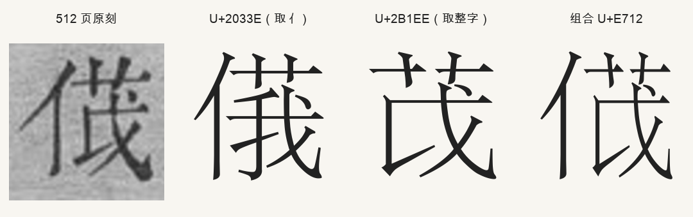
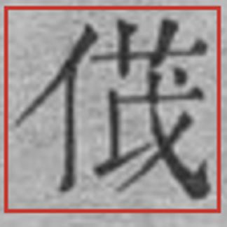
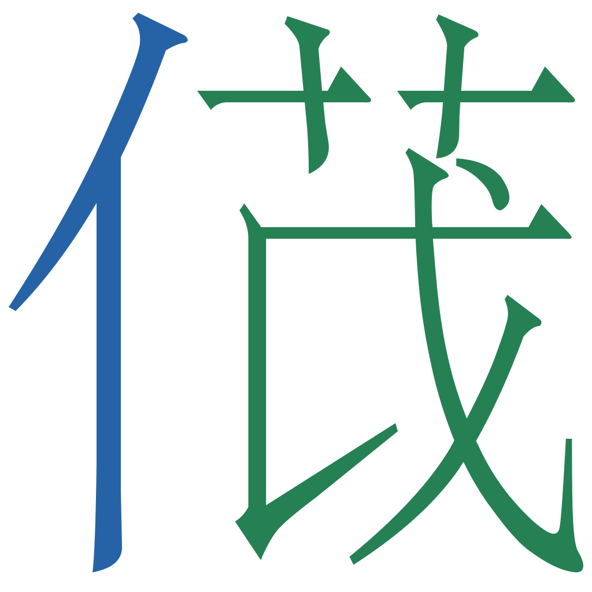
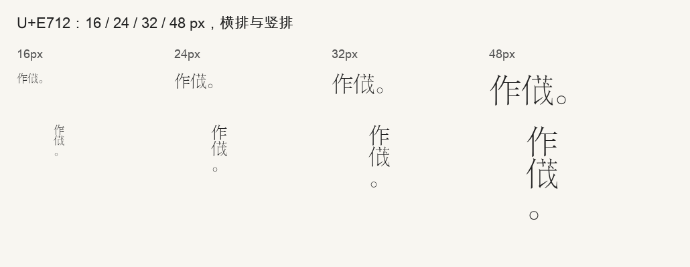

# U+E712〈亻𫇮〉小字字体补录报告

日期：2026-11-20；机器流水时间：17:12:26+08:00（Asia/Shanghai）；版本：compose v1。字体提交：**待提交**；文档回填提交：**待提交**。

**已将第 512 页𠌾条「或作〈亻𫇮〉」的 `⿰亻𫇮` 补入小字 `guji-plane0.ttf`，项目字位为 PUA U+E712。按用户指定，左部取𠌾 U+2033E 的完整单人旁，右部取𫇮 U+2B1EE 整字。**该合体无标准 Unicode 码位（CHISE 无 ⿰亻𫇮）；用𠌾（⿰亻莪）或𫇮单独代替都会改变原文。



## 1. 出处、编码与补录理由

目标位于网站图片页 **@512 / 0512.jpg** 第 1 字头「𠌾 U+2033E」释文：

> 【字彙補】古文義字。白𠌾，八駿名。【穆天子傳】右驂赤蘎，而左白𠌾。或作〈亻𫇮〉。



原图路径 `/Volumes/WD-2T/guji-ocr/raw/kangxizidian/pages/0512.jpg`，SHA-256 `af73c3be879c564ea0b4fd73fa43fa6aa4092aceb7b08d2dd96267a40e0941bf`。按 E708/E710-E711 惯例归档用户站方缩放截图为字形源：`tools/dataset/font-sources/e712-scan-original.png`，SHA-256 `501202676d795dccb7538ef637d3c08e144ee2e0bf756f0e02a465a879d728b7`；遮罩灰度阈值 128、去小于 8 像素孤立墨点，SHA-256 `2ed0d7ee4a376919f9ae97896d0fbd7c89e970c04fb404bb30fd7786a8fa38e6`。

**本例出现首例站方转录分歧**：𠌾词条 `text_paragraphs` 原文作「或作**𠌾**。𠌾字从戉不从我。」——「或作」后的变体形被站方懒代为字头𠌾 本身（U+2033E 重复出现），`pua_other=[]`。金标转写作〈亻𫇮〉，且用户截图结构清晰支持：左亻＋右上羊（丷+横+竖）下我形的𫇮部件——与𠌾 的 ⿰亻莪（右部莪）明确不同。站方段落在此**不能仲裁**，身份以金标转写＋截图结构＋CHISE 部件账为据（已写入注册表 station_record）。

CHISE 无 `⿰亻𫇮` 已编码字；𠌾 U+2033E 自身 IDS 为 `⿰亻莪`（其右部非𫇮，佐证「或作」形确非𠌾）；𫇮 U+2B1EE 标准编码、plane2 在库。義 U+7FA9 是𠌾 的本字（字彙補「古文義字」），非本字位对象。

三份小字字体共搜索 **132,643 个非空映射**（plane0 29,004、plane2 61,119、planef 42,520），保存每份前 100 候选、目视每份前 48（[font-candidates.png](figures/e712/font-candidates.png)），无一命中。数据见 [font-search.json](evidence/e712/font-search.json)。

因此使用项目 PUA U+E712；E702／E703 仍作历史试验保留位。补前四份字体 cmap 均未占用 E712。

## 2. 写入范围与原生部件

仅写入 `guji-preview-grid/public/fonts/guji-plane0.ttf`。**两供体均为 plane2 外部供体（首例：左部也来自供体字体的字头字形）**；plane2、planeF、guji-large 全文件哈希补前后逐一核实未变，系统字体不在范围。标准 U+2033E、U+2B1EE、U+7FA9 均不重绘或改映射。



| 部件 | 供体与轮廓索引（从 0 起） | 原始 bbox | 放置后的曲线 bbox |
| --- | --- | --- | --- |
| 左亻 | plane2 𠌾 U+2033E，第 1 条（撇竖连体单轮廓） | `[15,-125,324.76,843]` | `[15,-120,324.76,848]` |
| 右𫇮 | plane2 U+2B1EE，第 0、1、2、3 条（整字四轮廓） | `[29,-118.09,987.25,847]` | `[341,-120,1009,845]` |

左部恒等变换并入全局 +5 竖向平移（使 yMax=848 继承锚字竖排原点，E708 惯例）。右部四轮廓共享一次正向仿射 `[0.6971,0,0,0.9999,320.78,-1.92]`：x 向压至家族右半宽（右界 1009 对齐家族 1006–1009）、y 向近恒等。左右曲线边界净间隙 **16.24 字体单位**，达到独立闸值 16；横向范围分离，部件不会相交。没有切笔、镜像、重绘或布尔并集。

供体字体 SHA-256：plane2 `80df094a2e63091b222706696a8b244c9dba45219af866226a097d0fbb2bf28d`；编译供体 glyf 哈希：

- U+2033E：`c7784b460721df2da6577c0c9bf2b20d11593bcfe1e1ff172702ff222e28ffb5`。
- U+2B1EE：`b0976dd71825c0edc4e43e4fa46d5c04f993a5ca1ad4d2818c3a756d86e48d68`。

冻结源为 [e712-songti-v1.json](../../tools/dataset/font-sources/e712-songti-v1.json)，可由[生成器](../../tools/dataset/guji_ren_yi_components.py)重建。最终 `uniE712` 为 **5 轮廓、200 点**；控制点 bbox `[15,-121,1010,848]`，hmtx `[1024,15]`、vmtx `[1024,22]`，竖排原点 870。glyf SHA-256：`52127b0ad42ede9085e020ab506d0d0974fc5e5e7b717f018c07835f5fd3e971`。

## 3. 干跑、写入与扫描距离的边界

正式命令（仓库根目录）：

```bash
python3 tools/dataset/guji_ren_yi_components.py --write-recipe
python3 tools/dataset/guji_pua_patch.py --cp E712 --dry-run \
  --cache-version e701-4-e704-1-e705-1-e706-1-e707-3-e708-1-e709-1-e710-1-e711-1-e712-1
python3 tools/dataset/guji_pua_patch.py --cp E712 \
  --cache-version e701-4-e704-1-e705-1-e706-1-e707-3-e708-1-e709-1-e710-1-e711-1-e712-1
python3 tools/dataset/verify_e712.py
python3 tools/dataset/guji_ren_yi_components.py --preview
python3 tools/dataset/guji_ren_yi_components.py --calibrate
```

干跑通过（哈希与正式写入一致），记录见 [dry-run.json](evidence/e712/dry-run.json)。**与 E711 同性质**：原刻为短亻形（撇头约 24% 高度起）而供体亻通高，按用户指定供体原样取件、形差如实存档，扫描距离被其支配：

| 对照 | 分数 | 解释 |
| --- | ---: | --- |
| 最终指定部件组合 | 3.672 | 携带短亻形差 |
| 𠌾（⿰亻莪 形近混淆） | 2.969 | 原刻亻墨量小，错字反而更近 |
| 裸𫇮 | 3.973 | 缺亻 |
| 𫇮 整字（plane2 原形） | 3.990 | 同上 |
| 只有亻 | 11.355 | 唯一被闸拒绝的级别 |

最终冻结 **4.4 弱回归闸**。身份靠金标转写＋截图结构＋完整部件来源；站方段落懒代𠌾 在此不能仲裁。若日后希望更贴原刻，可照 E707 v2 先例以短亻方案迭代 v2。记录见 [chamfer-calibration.json](evidence/e712/chamfer-calibration.json)。

| 指标 | 补前 | 补后 |
| --- | --- | --- |
| 字节数 | 17,255,760 | 17,256,376（+616） |
| cmap | 30,715 | 30,716 |
| glyphOrder | 30,811 | 30,812 |
| SHA-256 | `9e949d43f2938c9113312a59525731e0fffcc78faa40b97f52cb37820dd48626` | `61167a2a733c20ab5e71486cb3b205f0e9f20ce4f565bee84174392740d11912` |

验证器逐一比较原有 **30,811 个字形**的编译 glyf、横竖度量、原 cmap 和 glyphOrder；全部保留。生产字形与冻结配方逐字节一致；两笔外部供体哈希与冻结轮廓三个破坏性反例均被拒绝。E701／E704–E711 只同步共享文件哈希，字形与版本不变。见 [patch-verification.json](evidence/e712/patch-verification.json)。

## 4. 实际使用与四层验收

只将未跟踪草稿 `kangxi-gold/annotations/0512.gj` 的一处「或作〈亻𫇮〉。」改为「或作\ue712。」，实际保存单个 PUA 字符。前后全文只差这一处，哈希及计数在 [annotation.json](evidence/e712/annotation.json)。整页仍为草稿，不随字体提交。



实际预览应用打开 @512，恰有一个 E712 `.m-cell`，字号 **16.104 px**、字格约 20.1×20.8 px，CSS 栈以 GujiPlane0 打头。页面内 canvas 单字体族探针：`100px GujiPlane0`（无回退）下 E712 墨迹 2,424 px²（plane2 𠌾 1,721、plane2 𫇮 1,518），而未映射 E713 墨迹为 0——字格渲染的是补录字形本身，非系统回退非豆腐。字格特写与记录见 [browser.json](evidence/e712/browser.json)。

工程回归：`npm run build` 通过（保留既有大 chunk 提示），dist 四字体与 public 哈希一致；JSON 校验、冻结配方重建和 `git diff --check` 通过。**测试：22 文件 1,208 项中 1,206 通过、2 失败**——失败两例位于已提交的 `test/dataset-preview.spec.ts`（工具栏开关相邻/禁用断言），时序与归因分析表明其源于本次运行期间用户正在编辑的 `src/components/dataset/DatasetView.tsx`（工作区 84 行未提交改动），E712 变更集不被该测试引用、且同一套件在 E711 时点全绿（1,176/1,176）；完整归因见 [engineering.json](evidence/e712/engineering.json)。E712 自身的验证面（重建/结构/字形/渲染/构建）全绿。

已同步 PUA 注册表（v1，small-only）、CSS 缓存戳 `e701-4-e704-1-e705-1-e706-1-e707-3-e708-1-e709-1-e710-1-e711-1-e712-1`、Changelog、操作登记簿、应用字体表、根导航、文档导航与证据索引；历史哈希不覆盖。

## 5. 交换、回滚与提交

U+E712 是项目私用字，交换正文时须附字体、`⿰亻𫇮` 描述和 @512 出处。不能把它宣传为新获 Unicode 标准编码。本字未进入任何已知 IRG 候选流程；若将来出现候选或获码，按 E709 报告 §5.2 的七步回迁机制处理。部件𫇮已标准编码，将来整字获码时只需替换合体槽位（同 E711 类型）。

补前 Git HEAD `e36ab2437ccc5404ed175487c09f10c2cf8b49cc`，plane0 blob `f39becfcd796fa2cae65fb5e60cc4489ad12a1c4`。自动备份：

```text
var/unencoded/kangxi-unencoded/font-backups/
guji-plane0.ttf.9e949d43f2938c9113312a59525731e0fffcc78faa40b97f52cb37820dd48626.ttf
```

若之后没有字体变更，可从该哈希备份或 Git blob 恢复；若已有后续补录，必须针对 E712 移除／替换，并重新运行全量保护检查。同步撤销注册表／共享哈希、缓存戳、0512 页使用处和现行文档状态，追加逆向事件；不要用旧整字体覆盖后续新增字。0512 补前全文仅保留本地 `var/font-audit/0512-e712/0512.gj.before`，可逆的单点操作已归档到 annotation.json。

字体、配方、源图、证据与报告按明确路径提交；并行排版代码（含 DatasetView.tsx 进行中改动）、0312 页、manifest 与其他未跟踪校对草稿均不纳入。
