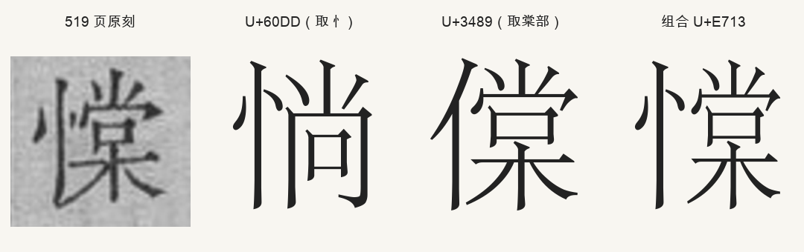
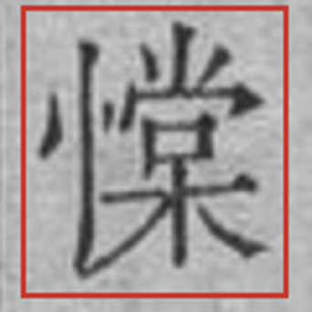
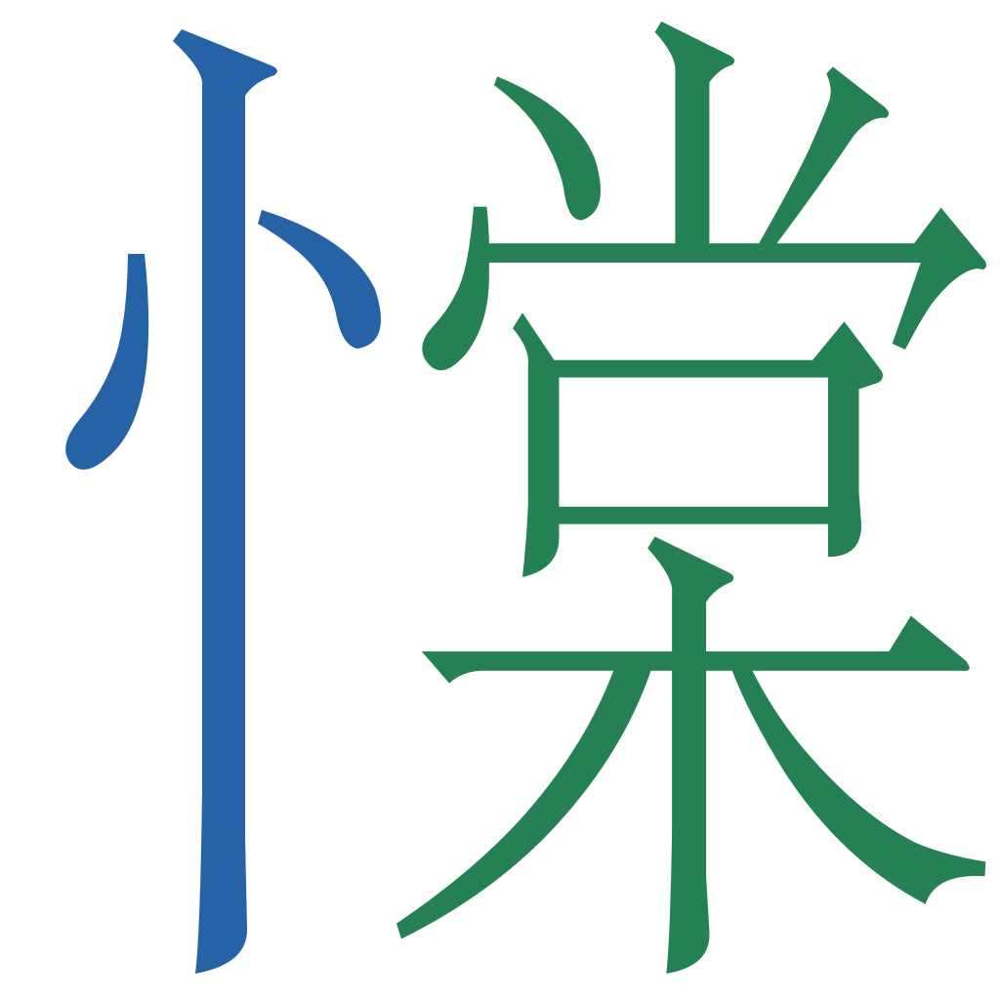
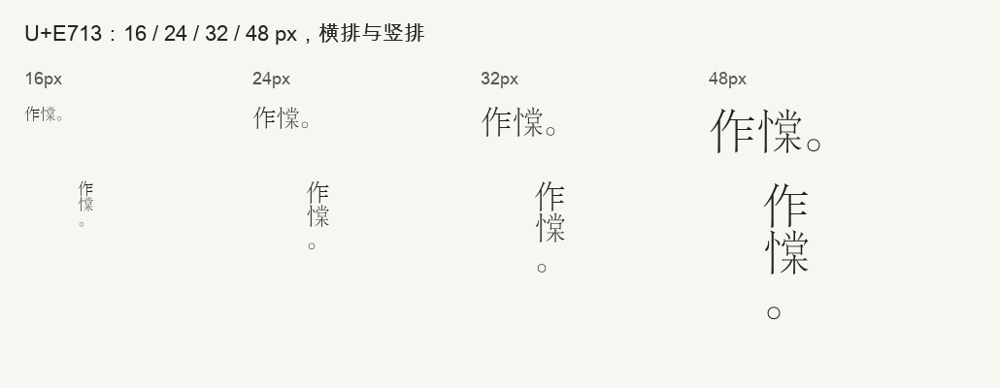

# U+E713〈忄棠〉小字字体补录报告

日期：2026-11-20；机器流水时间：19:26:14+08:00（Asia/Shanghai）；版本：compose v1。字体提交：**待提交**；文档回填提交：**待提交**。

**已将第 519 页㒉条「同惝。或作〈忄棠〉。」的 `⿰忄棠` 补入小字 `guji-plane0.ttf`，项目字位为 PUA U+E713。按用户指定，左部取惝 U+60DD 的完整竖心旁，右部取㒉 U+3489 的完整右部（棠的部件形）。**该合体无标准 Unicode 码位（CHISE 无 ⿰忄棠）；用惝（⿰忄尚）、㒉（⿰亻棠）或棠整字代替都会改变原文。



## 1. 出处、编码与补录理由

目标位于网站图片页 **@519 / 0519.jpg** 第 1 字头「㒉 U+3489」释文：

> 【集韻】同惝。或作〈忄棠〉。



原图路径 `/Volumes/WD-2T/guji-ocr/raw/kangxizidian/pages/0519.jpg`，SHA-256 `d0dd7734d97861ce3c14ce4b73754092d7eec2e2918f028ff70b51a9989f621e`。按 E708/E710-E712 惯例归档用户站方缩放截图为字形源：`tools/dataset/font-sources/e713-scan-original.png`，SHA-256 `ae27b618c2300f18a35597c3525b0b9405437fbe0cc90f1ec314510e9e37a163`；遮罩灰度阈值 128、去小于 8 像素孤立墨点，SHA-256 `f6341991e120f9063b1cbae7cc31acf2f2969d31214b757c750f859914165dc6`。

**站方记录为真实字符描述式**：㒉词条 `text_paragraphs` 原文即「或作〈忄棠〉。」（忄 U+5FC4＋棠 U+68E0 均为 BMP 常规字），`pua_other=[]`——站方与金标转写一致，仅合体无单一编码。截图逐行核验确认两部件构形：左忄（通高竖＋左右两点）、右上尚下木的棠部件形，与「取㒉字为右侧部件」的部件形读法吻合（㒉 的右部即棠 的部件形，E710 取朝左半的同型语义）。

CHISE 无 `⿰忄棠` 已编码字；惝 U+60DD 是 ⿰忄尚、㒉 U+3489 是 ⿰亻棠——两个近亲的右部都与棠 不同，不能代替目标。

三份小字字体共搜索 **132,644 个非空映射**（plane0 29,005、plane2 61,119、planef 42,520），保存每份前 100 候选、目视每份前 48（[font-candidates.png](figures/e713/font-candidates.png)）。plane0 头名即供体㒉 本身（0.89，亻/忄 在粗分辨率下难分），另有棠右+亻左与忄左+他右的近邻，但忄+棠 合一者无一命中。数据见 [font-search.json](evidence/e713/font-search.json)。

因此使用项目 PUA U+E713；E702／E703 仍作历史试验保留位。补前四份字体 cmap 均未占用 E713。

## 2. 写入范围与原生部件

仅写入 `guji-preview-grid/public/fonts/guji-plane0.ttf`。两供体均在目标字体内（同 E710/E711 型内部供体）；plane2、planeF、guji-large 全文件哈希补前后逐一核实未变，系统字体不在范围。标准 U+60DD、U+3489、U+68E0 均不重绘或改映射。



| 部件 | 供体与轮廓索引（从 0 起） | 原始 bbox | 放置后的曲线 bbox |
| --- | --- | --- | --- |
| 左忄 | plane0 惝 U+60DD，第 2、6、7 条（竖＋左右点） | `[67.17,-127,390,840]` | 原样保留 |
| 右棠 | plane0 㒉 U+3489，第 0、1、3、4、5 条（㒉的完整右部；第 2 条是亻，弃用） | `[274,-136,999.8,851]` | `[406,-127,1010,848]` |

左部恒等变换原生坐标。右部五轮廓共享一次正向仿射 `[0.8322,0,0,0.9878,177.98,7.35]`：x 向压至家族右半宽（右界 1010）、y 带对齐 `[-127,848]`——**yMax=848 由右部天然供给，无需全局平移**（左部原生顶 840）。左右曲线边界净间隙 **16.00 字体单位**，达到独立闸值；横向范围分离，部件不会相交。没有切笔、镜像、重绘或布尔并集。

供体编译 glyf 哈希：

- U+60DD：`6a138848d3cf3c872d21eeb14e796d914f4b650fda5bbc98a2c3c10c97e10c48`。
- U+3489：`22a946df86334b1629f5704e755d49fdd6dadbf27ccca836d76c897822829383`。

冻结源为 [e713-songti-v1.json](../../tools/dataset/font-sources/e713-songti-v1.json)，可由[生成器](../../tools/dataset/guji_xin_tang_components.py)重建。最终 `uniE713` 为 **8 轮廓、186 点**；控制点 bbox `[59,-127,1011,848]`，hmtx `[1024,59]`、vmtx `[1024,22]`，竖排原点 870。glyf SHA-256：`63714dbcc11993f609ac1f063eb9c046a58408836d831dff2dc9f82a8f436969`。

## 3. 干跑、写入与验证边界

正式命令（仓库根目录）：

```bash
python3 tools/dataset/guji_xin_tang_components.py --write-recipe
python3 tools/dataset/guji_pua_patch.py --cp E713 --dry-run \
  --cache-version e701-4-e704-1-e705-1-e706-1-e707-3-e708-1-e709-1-e710-1-e711-1-e712-1-e713-1
python3 tools/dataset/guji_pua_patch.py --cp E713 \
  --cache-version e701-4-e704-1-e705-1-e706-1-e707-3-e708-1-e709-1-e710-1-e711-1-e712-1-e713-1
python3 tools/dataset/verify_e713.py
python3 tools/dataset/guji_xin_tang_components.py --preview
python3 tools/dataset/guji_xin_tang_components.py --calibrate
```

干跑通过（哈希与正式写入一致），记录见 [dry-run.json](evidence/e713/dry-run.json)。截图清晰，扫描距离恢复判别力（同 E710/E713 前例）：

| 对照 | 分数 | 解释 |
| --- | ---: | --- |
| 最终指定部件组合 | **2.516** | 显著最优 |
| 惝（⿰忄尚，同字头释义字） | 2.864 | 错右部 |
| 棠 整字（plane0 独体形） | 3.130 | 独体比例与部件形不同 |
| 只有棠部件 | 3.334 | 丢失竖心旁 |
| 只有忄 | 9.187 | 丢失右部 |

最终冻结 **2.7 弱回归闸**（组合与最近混淆对照之间）。完整供体轮廓、编译哈希精确重建、不相交和小字号渲染是独立必需闸。没有为降低扫描分数变造供体笔画。记录见 [chamfer-calibration.json](evidence/e713/chamfer-calibration.json)。

| 指标 | 补前 | 补后 |
| --- | --- | --- |
| 字节数 | 17,256,376 | 17,256,940（+564） |
| cmap | 30,716 | 30,717 |
| glyphOrder | 30,812 | 30,813 |
| SHA-256 | `61167a2a733c20ab5e71486cb3b205f0e9f20ce4f565bee84174392740d11912` | `eb3791216daa8cebbcf7973f4870e65e66adf8e8e6a8152c5e674bbebfc7d5c2` |

验证器逐一比较原有 **30,812 个字形**的编译 glyf、横竖度量、原 cmap 和 glyphOrder；全部保留。生产字形与冻结配方逐字节一致；两笔供体哈希与冻结轮廓三个破坏性反例均被拒绝。E701／E704–E712 只同步共享文件哈希，字形与版本不变。见 [patch-verification.json](evidence/e713/patch-verification.json)。

## 4. 实际使用与四层验收

只将未跟踪草稿 `kangxi-gold/annotations/0519.gj` 的一处「〈忄棠〉」改为「\ue713」（该页转写中括注独占一行，替换仅括注本体，行结构不变）。前后全文只差这一处，哈希及计数在 [annotation.json](evidence/e713/annotation.json)。整页仍为草稿，不随字体提交。



实际预览应用打开 @519，恰有一个 E713 `.m-cell`，字号 **16.064 px**、字格约 20.1×20.8 px，CSS 栈以 GujiPlane0 打头。页面内 canvas 单字体族探针：`100px GujiPlane0`（无回退）下 E713 墨迹 2,339 px²（惝 2,493、㒉 2,620），而未映射 E714 墨迹为 0——字格渲染的是补录字形本身。**过程坑存档**：首次探针在未更新缓存戳时测得 0 墨——浏览器仍持旧 `?v=` URL 的 E712 版字体；更新 `index.css` 戳并重载后恢复正常。教训：**缓存戳更新须先于浏览器验收**（已记入 browser.json）。记录见 [browser.json](evidence/e713/browser.json)。

工程回归：**22 个测试文件、1,220 项测试全部通过**（含并行工作区新增测试），`npm run build` 通过（保留既有大 chunk 提示），dist 四字体与 public 哈希一致；JSON 校验、冻结配方重建和 `git diff --check` 通过。测试运行于当前工作区，不能冒充洁净提交上的独立结果。环境版本、命令和日志见 [engineering.json](evidence/e713/engineering.json)。

已同步 PUA 注册表（v1，small-only）、CSS 缓存戳 `e701-4-e704-1-e705-1-e706-1-e707-3-e708-1-e709-1-e710-1-e711-1-e712-1-e713-1`、Changelog、操作登记簿、应用字体表、根导航、文档导航与证据索引；历史哈希不覆盖。

## 5. 交换、回滚与提交

U+E713 是项目私用字，交换正文时须附字体、`⿰忄棠` 描述和 @519 出处。不能把它宣传为新获 Unicode 标准编码。本字未进入任何已知 IRG 候选流程；若将来出现候选或获码，按 E709 报告 §5.2 的七步回迁机制处理。部件忄、棠 均为 BMP 常规字，将来整字获码时只需替换合体槽位。

补前 Git HEAD `dab5ae981cf69c3f51668f82d90d916d8fd0c155`，plane0 blob `e2db3b398f476107163c3c67cf2b7b895e43a186`。自动备份：

```text
var/unencoded/kangxi-unencoded/font-backups/
guji-plane0.ttf.61167a2a733c20ab5e71486cb3b205f0e9f20ce4f565bee84174392740d11912.ttf
```

若之后没有字体变更，可从该哈希备份或 Git blob 恢复；若已有后续补录，必须针对 E713 移除／替换，并重新运行全量保护检查。同步撤销注册表／共享哈希、缓存戳、0519 页使用处和现行文档状态，追加逆向事件；不要用旧整字体覆盖后续新增字。0519 补前全文仅保留本地 `var/font-audit/0519-e713/0519.gj.before`，可逆的单点操作已归档到 annotation.json。

字体、配方、源图、证据与报告按明确路径提交；并行进行中的应用改动与其他未跟踪校对草稿均不纳入。
