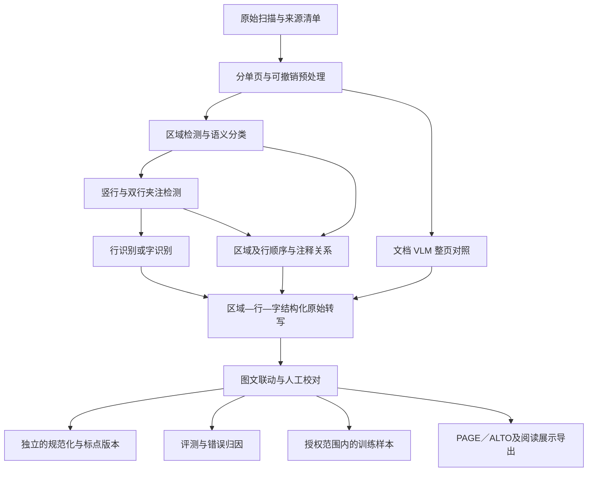

# 中文竖排古籍 OCR 综合调研报告

资料核查截至 **2026-11-11**。本报告整合此前三轮调研，面向中文刻本、影印本、抄本的文字识别、版式分析、阅读顺序与人工校对，作为本仓库后续选型和实验的统一依据。

调研覆盖 **13 项数据资源、16 项代码／模型／评测工具、27 篇论文、15 篇技术文章**，另列古籍酷服务和古籍云桌面软件。其中包含派生教学样本，不代表 13 个独立金标库。完整书目与用户提供链接的对应关系见[参考文献与来源](references.md)，逐项获取状态、许可与核查程度见[资源索引](resources.json)。

本次工作是资料阅读、发布文件检查与报告整合，**尚未安装或运行 OCR 模型、复现模型成绩、调用古籍酷 API，或运行古籍云软件**。下文明确区分来源自报成绩、直接文件核查与本项目建议。

## 阅读导航

- [1. 主要结论与选型](#decisions)
- [2. 范围、证据与任务定义](#scope)
- [3. 技术路线比较](#routes)
- [4. 数据集与评测资源](#datasets)
- [5. 代码、模型与工具](#tools)
- [6. 关键论文的方法启示](#methods)
- [7. 古籍酷与古籍云的工程经验](#workflows)
- [8. 性能证据及其可比性](#performance)
- [9. 已完成的数据与代码核查](#audits)
- [10. guji-ocr 的建议架构与数据表示](#architecture)
- [11. 评测协议](#evaluation)
- [12. 实验顺序与交付物](#experiments)
- [13. 许可、复现与待解决问题](#limitations)
- [14. 参考资料与维护方式](#maintenance)

<a id="decisions"></a>
## 1. 主要结论与选型

中文竖排古籍 OCR 的主要困难已经超出“认出单个汉字”：长竖列、双行夹注、多区目录、眉批、版心、异体字和退化页面会同时影响检测、转写和序列化。应以**可定位、可解释、可校对的结构化转写**为目标，分别测量各环节，而非只比较最终一段文本的“准确率”。

| 目标 | 优先资源 | 决策理由与前提 |
| --- | --- | --- |
| 建立历史中文专项基线 | **CHAT + kraken** | 有历史中文分割与识别模型；需验证二值图、比例和栏宽等输入要求；CHAT 模型仅非商业使用 |
| 建立可训练、可部署的工程基线 | **PaddleOCR** | 检测、识别、训练和部署工具较完整；古籍语义类别和夹注顺序仍需适配 |
| 识别正文、夹注、眉批、版心等语义版式 | **SCUT-CAB** | 4 类物理元素、27 类逻辑元素；需申请数据，阅读顺序标注主要针对正文 |
| 研究字／行检测、识别及顺序 | **MTHv2、M5HisDoc** | 有位置、文本与顺序信息；必须检查两库及 SCUT-CAB 的原页重叠 |
| 单独改进阅读顺序 | **HanDoc-OrderOCR / Reading between the Lines** | 历史中文专项顺序模块；应与简单排序在相同检测框上比较 |
| 比较整页文档 VLM | **PaddleOCR-VL-1.6、dots.ocr／dots.mocr、OvisOCR3** | 固定权重与代码版本，同页测试文本、区域和顺序；不能用通用榜单替代古籍实测 |
| 研究 VLM 微调与推理加速 | **HunyuanOCR-1.5** | 有 SFT、DFlash、RL 和多后端部署入口；自定义许可限制跨模型利用输出 |
| 建立公共评测对照 | **EvaHan2026、经审校的 AncientDoc 子集** | 前者分识别／版式任务；后者适合困难整页，但公开标签不能直接作为唯一金标 |
| 补充手写、字形与长尾字 | **CASIA-AHCDB、Chronicles-OCR、HierCode** | 分别提供单字材料、跨书体评测和未见字方法；都不能替代古籍语义版式数据 |
| 设计校对和人工干预流程 | **eScriptorium、古籍酷、古籍云** | 重点借鉴画栏、排序、图文定位、候选字和校订记录；后两者未确认开放核心源码 |

建议先建立目标书籍的人工金标和同页基线，再决定训练方向。专项模型、模块化流水线和 VLM 各自解决的问题不同，目前证据不足以选出一个对所有古籍都最好的模型。

<a id="scope"></a>
## 2. 范围、证据与任务定义

### 2.1 研究对象与证据层级

核心对象是有完整阅读结构的中文竖排书页，包括规整刻本、大小字混排、夹注、眉批、多区目录、插图及部分写本。家谱作为版式特殊的子方向；甲骨、金文、篆书和文化遗产问答作为扩展，不与一般古籍正文 OCR 合并计分。

本报告综合作者仓库、机构数据页、正式出版页、预印本、模型卡、许可、评分代码及技术文章。证据分为以下几类：

| 证据 | 已做的工作 | 能支持的结论 |
| --- | --- | --- |
| 论文及作者说明 | 部分全文、方法／结果章节或摘要与仓库说明核对 | 方法设计、作者实验、资源宣称；阅读深度逐项见书目 |
| 发布文件直接核查 | AncientDoc 标签及图像树、两张图；Chronicles 标签；11 页样本标签与 notebook；部分评分和许可文件 | 特定发布文件的数量、格式、重复与局部问题 |
| 厂商／第三方文章 | 8 篇古籍酷文章和 7 篇微信正文，以及所链接原始资源 | 工程线索、作者自测、工作流设计；不视作独立复现 |
| 项目建议 | 根据上述证据提出架构、金标和实验方案 | 后续可检验的方案，不代表本仓库已完成相应系统 |

公开网页、完整文件可取得、允许商业使用、能够复现训练是四个独立条件。“未确认”表示现有调研没有建立相应证据，并非断言资源不存在。动态仓库和在线演示的当前状态不能反推文章发表时的具体版本。

### 2.2 必须拆分的任务

| 环节 | 目标输出 | 古籍场景中的关键问题 |
| --- | --- | --- |
| 图像预处理 | 分单页、方向、裁切／展平图及坐标变换 | 双页扫描、书脊弯曲、透印、淡墨、黑边；过度二值化可能损字 |
| 物理版式 | 文字区、插图、版框、版心等区域 | 界栏与笔画相近；图文混排；版心可能含文字 |
| 语义版式 | 正文、标题、夹注、眉批、卷次、页码等 | 区域几何不能自动确定语义；小字也可能是正文或页码 |
| 字／行检测 | 单字框、多边形、竖行或基线 | 密集粘连、双行小字、字号变化、残缺、倾斜 |
| 文字识别 | 忠实底本的原始 Unicode 转写及不确定标记 | 生僻字、异体字、字典外字、缺损与手写风格 |
| 顺序与关系恢复 | 区域／行顺序、正文与注释依附关系 | 栏内通常自上而下、栏间通常自右向左；双行夹注和局部分区需要额外关系 |
| 校对与整理 | 人工修订、规范化、标点、导出及修改记录 | 纠错、简繁转换和标点可能改变底本信息，须与原始识别分层保存 |

整页旋转 90° 会同时旋转字形，不能自动解决竖排。方向处理应服从模型的训练约定，保留原图坐标映射；也不能把全页按横坐标排序当作通用阅读顺序算法。

<a id="routes"></a>
## 3. 技术路线比较

| 路线 | 代表资源 | 优点 | 对本项目的限制／实验重点 |
| --- | --- | --- | --- |
| 投影切栏＋行／字识别 | TKH、RGD、Tesseract 及部分桌面工具 | 简单、容易定位问题，规整刻本可作低成本基线 | 切行是强前提；版框、夹注和弯曲会破坏投影；需保留人工画栏入口 |
| 古籍专项分割＋识别 | CHAT + kraken | 训练材料和版式更贴近历史中文；可输出可校对结构 | 输入约束、字类覆盖、模型许可及目标书籍域差异需验证；顺序权重不能默认齐全 |
| 模块化检测＋识别＋版式／顺序 | PaddleOCR、HRCenterNet、HanDoc-OrderOCR | 能分任务训练、替换组件、解释错误和保留坐标 | 上游漏检会传递；通用版式标签需要古籍化；双行夹注要专门建模 |
| 识别引导检测／联合分析 | RGD、2020 联合方法、NSR 2023 方法 | 文字与位置共享信息，可能改善密集字定位 | 字典外字或识别漏字可能影响检测召回；论文代码开放程度不一 |
| 页级弱监督识别 | PageNet | 探索降低逐字标注成本，由页级文字学习定位与转写 | 官方只公开推理；复杂语义版式与注释关系仍需单独评价 |
| 文档 VLM 整页解析 | PaddleOCR-VL、dots、Hunyuan、Ovis | 联合建模文本、布局、顺序，减少手写规则 | 漏列、重复、补字、归一化和长页截断；位置粒度及可训练程度因版本不同 |
| 人工干预与迭代训练 | eScriptorium、古籍云／古籍酷的工作流 | 把专家时间集中到难页和不确定字，可积累修订数据 | 自动化指标之外还要测校对时间、操作成本和修改可追溯性 |

这些路线可以组合。例如先用区域检测避免整页串行，再按区调用行识别或 VLM；对已切好行和完整页分别评测，才能知道收益来自识别器、切行还是顺序。对难字增加第二模型复核也有价值，但应保留各模型原始结果和分歧，避免语言模型静默“改成通顺文本”。

<a id="datasets"></a>
## 4. 数据集与评测资源

下表的规模与许可均按已调研来源记录，未验证所有大文件下载。对需申请的数据，网页或 HF 压缩包入口不等于免申请授权。

### 4.1 核心书页、位置与版式数据

| 资源 | 规模与标注 | 最适合的用途 | 获取与边界 |
| --- | --- | --- | --- |
| [TKH / MTH](https://github.com/HCIILAB/TKH_MTH_Datasets_Release)，2018 | TKH：1,000 页、23,471 行、323,491 字、1,471 字类；MTH：500 页、17,178 行、197,886 字、3,664 字类；主要是字框与字标签 | 规整佛典与跨版本字检测／识别基线；理解 RGD 的输入条件 | 非商业研究；有网盘入口；未确认完整 RGD 训练代码与权重 |
| [MTHv2](https://github.com/HCIILAB/MTHv2_Datasets_Release)，2020 | 常用统计 3,199 图、1,081,678 字、6,733 字类；字／行位置、转写、顺序和边界线段 | 字／行检测、识别、顺序的模块化实验 | 学术研究；README 约 3,200 图，实际实验须固定文件清单 |
| [SCUT-CAB](https://github.com/HCIILAB/SCUT-CAB_Dataset_Release)，2022 | 4,000 页、31,925 个元素；4 类物理版式、27 类逻辑版式；主要正文顺序 | 正文、夹注、标题、版心等语义版式的首选来源 | 机构申请解压密码；CC BY-NC-ND 4.0；[标注指南入口](https://github.com/HCIILAB/SCUT-CAB_Dataset_Release/blob/main/guideline/guideline_ancient.pdf)已发现但未通读 |
| [M5HisDoc](https://github.com/HCIILAB/M5HisDoc)，2023 | 8,000 图；403,824 行、4,367,392 字、16,151 字类；字／行文字、位置和顺序 | 多字体、多版式和退化鲁棒性；检测／识别综合对照 | 机构非商业研究、CC BY-NC-ND 4.0；含原页复用和增强，见下文 |
| [CHDAC](https://pmc.ncbi.nlm.nih.gov/articles/PMC10246825/)，2022 竞赛／2023 论文 | 8,000 图，训练／验证／测试 4,000／1,000／3,000；家谱、医书、佛经、方志；文本区域、转写和顺序 | 端到端历史文档分析、方向和顺序方法研究 | 全文可读；完整公开数据、训练代码及许可未确认；不是 M5HisDoc 或 MCS-Bench |
| [ICDAR2019 HDRC CHINESE](https://arxiv.org/abs/1903.03341) | FamilySearch 家谱；来源收藏超过 20,000 页，不能作为固定公开精标集规模 | 家谱结构、行检测和识别专项 | 当前完整下载与使用条件未确认，正式复现需先确认挑战版本 |

**M5HisDoc 的 8,000 图由 4,000 原图与其 4,000 增强图组成。** 原图中含 MTHv2 的 300 图、SCUT-CAB 的 700 图。原图与增强图必须同组切分，跨库比较还需追溯原页；否则训练测试泄漏可能比模型差异更大。MTHv2 也延续早期 TKH／MTH，应核对谱系而非按数据集名称认定独立。

SCUT-CAB 的物理类别为版心条、图、版框、文字，逻辑类别更细。不能把 4 类现代通用版式检测结果当作已完成 27 类古籍语义理解；其正文顺序也不意味着所有夹注依附关系均已标注。

### 4.2 大规模预训练与单字资源

| 资源 | 规模及标注来源 | 推荐使用方式 | 限制 |
| --- | --- | --- | --- |
| [HisDoc1B](https://github.com/SCUT-DLVCLab/HisDoc1B)，2025 | 40,281 册、3,163,330 页、1,082,544,808 字、30,615 字类；字框、Unicode、顺序、自动标点和书册关系 | 大规模预训练、长尾字符及书级研究；以独立人工金标评价 | 主要半自动生成；GitHub 与 Figshare 许可冲突；8.56 GB 发布文件的完整内容未验证 |
| [CASIA-AHCDB](https://nlpr.ia.ac.cn/pal/CASIA-AHCDB.html)，2019 | 官方简介超过 220 万手写单字、10,658 类，源自超过 12,000 页，含四库全书及古代佛经材料 | 手写单字识别、跨风格、低样本字类 | 不是整页版式集；不同来源统计口径不一；完整再利用许可未确认 |

HisDoc1B 并非十亿字逐一人工校对。[论文全文](https://pmc.ncbi.nlm.nih.gov/articles/PMC11775332/)描述每书取一页，共 40,281 页调整字位置，再用检测、分类、启发式排序和标点模型扩展标注，另随机抽取 100 页验证质量。这是规模化训练资源的价值所在，也意味着测试集应另行审校。

CASIA 官方简介的 10,658 类与其他论文表格中的 10,350 类、2,276,740 样本不是同一统计口径。本报告采用官方近似规模，不将差异拼接成更精确的虚假总数。

### 4.3 整页、竞赛与扩展评测

| 资源 | 范围与标注 | 适用任务及使用条件 |
| --- | --- | --- |
| [AncientDoc](https://github.com/bytedance/AncientDoc)／[HF](https://huggingface.co/datasets/ByteDance/AncientDoc)，2025 预印本／2026 正式论文 | 标称 2,973 页、约百部书、14 类，约 97% 楷书；OCR、翻译及多类 QA；LLM 预标注与人工修订 | 困难整页与文档理解；不是语义版式集。当前图像与标签数量有差异，已确认两张定向样例有错误／遗漏；须固定并审校子集。发布者声明 CC0，原始影像权利另核 |
| [EvaHan2026](https://github.com/GoThereGit/EvaHan) | 正式论文 A／B／C 各 5,000 训练图＋200 测试图；A 印本，B 版式，C 手写；A／C 含裁切文本图 | 古籍识别与异体字评价；B 类别 `text/image/book_edge/seal`。不能按 15,600 整页理解规模；数据仍描述为注册分发，完整许可待确认 |
| [Chronicles-OCR](https://github.com/VirtualLUOUCAS/Chronicles-OCR)／[HF](https://huggingface.co/datasets/VirtualLUO/Chronicles-OCR) | 七书体各 400 条，共 2,800 记录；甲骨／金文／篆含字框与现代映射，隶／楷／行／草主要为段落转写 | 历史字形、跨书体解析、严格 spotting；优先补充成熟四书体。不是古籍语义版式集；代码 Apache-2.0，数据声明仅研究用途 |
| [MCS-Bench](https://github.com/SCUT-DLVCLab/MCS-Bench) | 古文、书法、绘画、甲骨、印章、文物、插图七子域，45 任务 | 文化遗产理解扩展；不替代书页 OCR 基准。代码 MIT，数据 CC BY-NC-SA 4.0，需机构申请 |
| [AncientDoc_OCR 11 页样本](https://github.com/ziqian2001/AncientDoc_OCR) | 11 张图、11 条参考文本、1,829 个 CJK 统一表意字符；附 Tesseract notebook | 教学和脚本检查；源于 AncientDoc，不是独立新金标。图文隐式配对与 Unicode 清洗存在风险，见第 9 节；许可未确认 |

AncientDoc 所称跨越战国到清，指文献内容／归属的时间覆盖，不表示每张扫描图都是相应朝代的实物。论文亦讨论了重刊、重印及现存数字资源偏向，不能据时间标签推出古字形均衡覆盖。

<a id="tools"></a>
## 5. 代码、模型与工具

### 5.1 专项模型与模块化工具

| 资源 | 已核实的公开内容 | 对古籍的价值与复现边界 |
| --- | --- | --- |
| [CHAT models](https://github.com/colibrisson/CHAT_models)／[Zenodo](https://doi.org/10.5281/zenodo.8383732) | `chat_seg.mlmodel`、`chat_rec.mlmodel` 和 demo；分割 Main／Margin／Illustration／Other，行类型含 DoubleLine | 历史中文专项首试对象。分割有二值图、9:16 比例假设，识别建议栏宽 >90 px；作者称约 170 万行、>16,000 字类、>99%，均非本次实测。阅读顺序模型仍列待发布；CC BY-NC 4.0 |
| [kraken](https://github.com/mittagessen/kraken)／[文档](https://kraken.re/) | 可训练的分割、顺序、识别；top-to-bottom；PAGE XML、ALTO、hOCR；Linux／macOS ARM 支持 | 承载 CHAT 及后续自训模型。引擎 Apache-2.0，模型许可分别核对；引擎支持顺序训练不代表 CHAT 已发布相应中文权重 |
| [eScriptorium](https://gitlab.com/scripta/escriptorium) | 基于 kraken 的标注、转写、校对与训练工作台，MIT | 适合多人标注闭环；不是自带中文高精度模型；数据库、队列等服务依赖较重 |
| [PaddleOCR](https://github.com/PaddlePaddle/PaddleOCR) | 检测／识别训练推理部署、PP-StructureV3、文档 VLM；当前 README 已介绍 PP-OCRv6 | 工程基线。通用区域分类要适配古籍语义，行方向和顺序要明确配置；代码 Apache-2.0，具体模型另核 |
| [Tesseract / tessdata_best](https://github.com/tesseract-ocr/tessdata_best) | 已确认 [`chi_tra_vert.traineddata`](https://github.com/tesseract-ocr/tessdata_best/blob/main/chi_tra_vert.traineddata) 入口；Apache-2.0 | 离线 CPU 对照，重点测试合理 PSM、切栏和预处理；单次整页低分不能代表全部可用配置 |
| [HRCenterNet](https://github.com/Tverous/HRCenterNet) | 历史中文单字检测；train／evaluate／test、权重链接；MIT | 可研究密集字框；不包含完整文字识别。旧依赖和权重下载需实际复现验证 |
| [PageNet](https://github.com/HCIILAB/PageNet) | 官方推理、MTHv2 配置及权重入口 | 页级弱监督方法研究；明确未公开训练代码，仅非商业研究，不能称为完整可训练开源系统 |
| [HanDoc-OrderOCR](https://github.com/Polo-Marco/HanDoc-OrderOCR) | DB++ 检测、SVTR 识别、CNN 顺序模块；Docker／Gradio／Colab 说明 | 顺序专项对照。部署涉及 CUDA，模型自动准备未实测；README 限学术／研究使用，未确认为标准宽松许可 |

### 5.2 文档 VLM 候选

| 模型 | 版本、输出与开放内容 | 需要验证的古籍能力／限制 |
| --- | --- | --- |
| [PaddleOCR-VL-1.6](https://huggingface.co/PaddlePaddle/PaddleOCR-VL-1.6) | 0.9B，模型卡 Apache-2.0；官方声称加强古籍、生僻字和印章 | 与模块化 PaddleOCR 分开测试；1.5 厂商成绩不能转移到 1.6；固定实际解析链路与输出粒度 |
| [dots.ocr](https://github.com/studio-dots-ai/dots.ocr)／[模型](https://huggingface.co/rednote-hilab/dots.ocr) | 联合版式、文本和阅读关系；通用区域 `bbox/category/text` 与顺序 | 区域框不等于字框；通用 Footnote 不等于古籍夹注关系。旧仓库转至 studio-dots-ai，当前 README 混有新模型说明，要固定 revision |
| [dots.mocr](https://github.com/studio-dots-ai/dots.mocr)／[模型](https://huggingface.co/rednote-hilab/dots.mocr) | 3B；dots.ocr-1.5 于 2026-03-19 改名；JSON／Markdown，图形结构化及 SVG | 重点测竖列方向、夹注、多区和长页。1.7B 是旧语言骨干口径，不等于整体参数量；图形重绘不能取代原图存档 |
| [HunyuanOCR-1.5](https://github.com/Tencent-Hunyuan/HunyuanOCR)／[模型](https://huggingface.co/tencent/HunyuanOCR) | 约 1B；SFT、DFlash、RL 训练入口；Transformers、vLLM、llama.cpp／GGUF 文档 | 微调与部署研究价值较高；统一 GPU 环境 CUDA 13，另有分配置路径。自定义许可限制地域、商业规模及用输出改进其他模型 |
| [OvisOCR2](https://huggingface.co/ATH-MaaS/OvisOCR2) | 0.8B、Apache-2.0；页图转 Markdown，公式 LaTeX、表格 HTML、图像区域坐标 | 标准输出不含逐字位置、置信度与候选字；完整训练数据、合成引擎、奖励实现及 4B 教师对应发布未确认，可保留为历史基线 |
| [OvisOCR3](https://huggingface.co/ATH-MaaS/OvisOCR3) | 0.8B、模型卡 Apache-2.0；增加结构化 JSON、版式 JSON、OCR 框、KIE、跨页表格等 | 当前候选；只核对模型卡及论文摘要，未通读全文或实测。不能外推 OvisOCR2 的 Markdown 限制，也不能据一般 OCR 框宣称逐字精确对齐 |

dots 两个仓库同时有 MIT `LICENSE` 与附加模型 `LICENSE AGREEMENT`，协议写明冲突时 MIT 优先；资源记录应保留两者，而非只摘取许可徽标。公开权重和推理命令也不表示全套训练数据、训练引擎均已公开。

### 5.3 评测代码与暂缓使用的线索

[EvaHan 评测脚本](https://github.com/GoThereGit/EvaHan)提供文字与区域 JSON 接口，含异体字处理规则，复用前需确认脚本许可。[Chronicles-OCR 工具](https://github.com/VirtualLUOUCAS/Chronicles-OCR/tree/main/Opensource)提供 API／本地 vLLM 推理、规则评分、框格式转换和汇总，代码 Apache-2.0；数据仍受单独研究用途声明约束。这两项是资源索引中独立列出的评测工具。

HierCode 论文值得研究未见字，但本次未确认官方完整代码；检索到的 `wcshds/hiercode` 自述“HierCode-style”，不能视为作者实现。EvaHan 引用的 `RAY5/Xunzi_Qwen2_VL_7B_Instruct` 模型卡此前读取返回 404，保留为待核实线索，不宣称当前权重可直接下载。

<a id="methods"></a>
## 6. 关键论文的方法启示

本节按问题组织论文，不将已读摘要的条目描述为全文复现。27 篇论文的完整题名、链接及阅读深度见[书目](references.md#papers)。

### 6.1 RGD：识别引导紧致单字检测

用户指定的 [IEEE 8364534](https://ieeexplore.ieee.org/document/8364534/) 对应 Yang 等 2018 年论文 *Dense and Tight Detection of Chinese Characters in Historical Documents: Datasets and a Recognition Guided Detector*，IEEE Access 6:30174–30183，[DOI](https://doi.org/10.1109/ACCESS.2018.2840218)。已核对全文及数据表。

方法链路是：垂直投影切竖行 → CNN／全连接／CTC 的 RGPN → 从非 blank 识别位置产生单字候选 → 边框回归。两网络共享部分卷积特征，实验共享前三层效果最好；重复候选抑制结合重叠与识别字符。这里使用的是识别特征和标签上下文，并非用 LLM 在输出后润色。

实验二值行输入为 1000×100，输出 1,472 类包含 TKH 的 1,471 字类及 blank；识别器先预训练，再训练检测。MTH 实验明确保证每个输入只有一行，不能据此认定任意复杂整页、双行夹注和顺序问题已解决。识别器没有提出的字还可能直接漏检，长尾字召回应单测。

下表是论文的**检测 F1（%）**，不是 OCR 准确率。TKH 随机 700／300 页训练测试；MTH 用于跨版本检验。

| 方法 | 参数 | TKH IoU .7 | TKH IoU .8 | MTH IoU .7 | MTH IoU .8 |
| --- | ---: | ---: | ---: | ---: | ---: |
| RGD | 9.29M | 94.60 | 83.82 | 88.17 | 61.54 |
| RGD-VGG16 | 64.02M | 94.98 | 85.85 | 91.29 | 73.01 |
| DMP-Nets-Line | 178.56M | 96.22 | 81.06 | 84.89 | 45.92 |
| TextBoxes-Line | 90.64M | 95.91 | 86.97 | 81.11 | 62.36 |

RGD 的价值是较小模型、严格边框与跨版本检测表现，不是所有条件都第一。摘要 97.25% 属于引导网络识别成绩，预训练段落 AR 95.44%／CR 97.34% 又有不同口径，不能混入检测表或充当整页正确率。

对本项目最直接的启示：分别测试单行与整页；检测同时报 IoU .5／.7／.8，观察截笔画、混邻字和罕见字漏检；不要只依赖 IoU .5 的漂亮分数。

### 6.2 联合分析、弱监督与阅读顺序

[2020 联合分析论文](https://doi.org/10.1109/ICFHR2020.2020.00017)关联 MTHv2，适合研究版式、单字检测与识别的分工；当前调研确认数据发布，但未确认完整算法训练实现。[HRCenterNet](https://arxiv.org/abs/2012.05739)专攻 anchor-free 密集字检测，可作为局部定位模块，不能代替识别器。

[PageNet](https://arxiv.org/abs/2207.14807)研究页级弱监督，将定位和识别结合，含 MTHv2 实验。它提供降低精细标注需求的思路，但训练代码未公开，当前更适合作为方法与推理对照。[NSR 2023 论文](https://pmc.ncbi.nlm.nih.gov/articles/PMC10246825/)结合多方向检测、双路径识别、裁切校正与启发式顺序，可借鉴错误分解，不应因为全文公开就推定工程能直接复用。

[Reading between the Lines](https://doi.org/10.1609/aaai.v38i21.30572)把历史中文阅读顺序作为独立学习任务，关联 HanDoc-OrderOCR。顺序实验应固定检测框，先比较区域规则、几何规则与学习模块，再做整页端到端测试；否则检测召回差异会掩盖顺序模块的实际贡献。

### 6.3 数据构造、稀有字与 VLM 训练

SCUT-CAB、M5HisDoc、HisDoc1B 的价值分别是语义标注定义、综合退化条件和规模化构造。它们的标注来源、复用页和增强关系，比单纯页数更影响实验有效性。[HierCode](https://arxiv.org/abs/2403.13761)以层次部件／码本支持零样本文字识别，是生僻字方向的方法线索，尚不等于现成的古籍整页系统。

[OvisOCR2 报告](https://arxiv.org/abs/2607.13639)的数据路径值得借鉴：真实文档经 PaddleOCR-VL-1.5 或 MinerU2.5-Pro 解析、结构统一和过滤；合成数据从同一 HTML 生成图像与答案；4B 分支强化学习后，以 on-policy distillation 传给 0.8B 并融合候选权重。同源合成能减少图文结构错配，但教师错误仍可能传递，不能将所有真实标签视为正确。

[HunyuanOCR-1.5](https://arxiv.org/abs/2607.04884)强调 Agentic Data Flow 与 DFlash：按错误提出数据需求、搜集与验证数据，以及用草稿 token 和目标验证加速解码。可借鉴错误驱动的数据闭环，但完整生产训练数据未确认公开，输出回流还受模型许可约束。

PaddleOCR 系列提供从轻量检测识别、结构分析到 0.9B 文档 VLM 的连续阅读路径。旧 PP-OCR 论文、PaddleOCR 3.0、PP-OCRv5 论文和当前 PP-OCRv6／VL-1.6 应分版本记录，不能用一篇旧论文覆盖当前所有能力。

<a id="workflows"></a>
## 7. 古籍酷与古籍云的工程经验

两者都提供贴近古籍的工作流，但本次未确认其核心源码及完整开放训练管线。它们主要贡献产品与接口设计参考，不能与标准开源引擎合并统计。

### 7.1 古籍酷：区域—行—字结构与不确定性

[古籍酷博客](https://ocr.gj.cool/blog)的排版 2.0、春季技术报告、模型对比、标点及使用案例共 8 篇已读；对应链接见[文章索引](references.md#gj-articles)。[API 文档](https://ocr.gj.cool/doc/v1)提供了较具体的结构：

| 接口／字段 | 调研确认的含义 | 建议借鉴的设计 |
| --- | --- | --- |
| `layout_type=2` | 新版引擎并自动检测区域，`area_ids` 有效 | 显式区分区域检测和后续识别／排序 |
| `layout_type=1` 默认／`0` | 前者为新版引擎手工区域；后者为旧版引擎 | 固定实际运行配置，不能只写“使用新版 OCR” |
| `AreaBBox`、`LineBBox`、`coors` | 区域、行、字坐标 | 支持图文联动、逐字复核及原图回溯 |
| `char_ids/line_ids/area_ids` | 层级归属 | 使用稳定 ID，保留多粒度结果 |
| `char_probs/coor_probs/option` | 识别置信、定位置信、候选字 | 分开呈现认错风险与框定位风险；校准后再设阈值 |
| `anno` | 大小字属性分数 | 小字属性和正文／注释语义分开，不能直接作为夹注概率 |
| `layer`、`text` | 列与子区域／夹注关系；文本可用 `【】` 包夹注 | 局部结构应独立保存；括号只是导出约定 |

当前古籍接口文档写明不支持数字、标点、字母；手工 `area` 按传入顺序处理，但一处文字提示为“从左至右”，集成时须实测坐标和顺序，不能照抄成古籍通则。`ocr_plus` 异体字保真功能属于企业测试申请，不能假设普通接口默认开放。

春季报告的 CNN→ViT 是不确定样本再路由的条件级联，不是已公开融合编码器。语义纠错需独立保存前后文本。标点服务的 `keep_wrap=1` 保留换行，`target` 依据指定字符跳过行；字符启发式不能替代标题或夹注分类。科判编辑的 `layer/title/text/nodes/code` 有助于人工层级整理，但不是自动版式识别证明。

### 7.2 古籍云：画栏、局部排序和逐列校对

[微信介绍](https://mp.weixin.qq.com/s/NAWJJ5gBssbA2SBY5qHrbw)及[官网资源页](http://gujiyun.cn/ziyuan.html)给出 Windows 下载入口，列出图像／PDF 导入、预处理、画栏、夹注顺序、图文联动、工程保存和可搜索 PDF 导出。最值得借鉴的是：

- 正文、注文、眉批、版心分别画框，允许局部右先／左先／单框顺序；同版式可复用人工模板。
- 分列校对、点击字格定位和“写回校改”，减少全文大文本框中的定位成本。
- 检测／切分与识别后端可替换，另保留“仅切分”模式；家谱的谱系图与人物记载页需不同规则。
- 样式学习、自动检注与文字识别训练分别描述，避免把版式路由误当完整识别器训练。

文章列出的 RapidOCR／PP-OCRv6、Tesseract、PaddleOCR、CathayOCR ncnn Vulkan 等后端未逐项验证安装包。作者声明默认离线，帮助同时提供可选联网 AI 转写和出处检索。“全免费”“首款”不是开源、商用授权或历史首创的证据；资源页限个人研究／分享、禁止商用。

去红印、版框、版心等预处理应保留原图及可撤销记录。朱批、鱼尾、版心和印章可能就是研究对象，是否移除应由任务范围决定。

<a id="performance"></a>
## 8. 性能证据及其可比性

### 8.1 古籍酷 2026-04-03 模型对比

下表均为[厂商博文](https://ocr.gj.cool/article/2026-04-03-ocr-model)所报竖排“准确率”，**不是本次实测，计分定义不足以认定等于 `1−CER`**。

| 模型 | 总体 | 夹注少 | 夹注多 | 写本 |
| --- | ---: | ---: | ---: | ---: |
| PaddleOCR-VL-1.5 | 97.44% | 98.70% | 97.36% | 96.09% |
| chandra-ocr-2 | 92.61% | 96.68% | 88.88% | 95.51% |
| dots.ocr | 91.87% | 94.92% | 89.00% | 94.48% |
| GLM-OCR | 89.02% | 96.01% | 86.61% | 75.18% |
| Qwen3.5-4B，关闭思考 | 81.91% | 94.53% | 73.86% | 82.93% |
| dots.mocr | 69.24% | 75.04% | 58.62% | 86.15% |

文章未给可下载测试集、明确样本数与分层权重、完整金标与提示／推理配置。Paddle 分数来自 OpenAI 兼容接口的文本输出，并非完整区域检测流水线。Qwen 竖排思考模式在超时 300 秒、上下文 16,384 时报告 38% 失败；横排高分又排除了失败／重复，不能与全量分数混排。

该文支持把夹注、方向排序和超时设为重点测试项，也支持将 PaddleOCR-VL 纳入候选，尚不能证明其对所有古籍最优。chandra、GLM、Qwen 在此仅为文章比较对象，未完成与核心候选相同深度的代码／许可核查。

### 8.2 dots.mocr 的 11 页第三方测试

[微信测试](https://mp.weixin.qq.com/s/aUdOM5Puffl2Ywx_EqztHg)称于 2026-07-22 使用官方在线演示，样本为 11 页、1,829 字，主要是序文／人物传记；空白、标点和缺字占位排除，繁简异体不合并。文章报 dots.mocr **CER 8.9%、`1−CER` 91.1%**；Tesseract 5.5.2、`chi_tra_vert`、PSM 5 为 **CER 64.8%**。

91.1% 与古籍酷的 69.24%不能互相否定：样本、日期、部署、权重快照、评价范围和公式均不同，且缺少 dots 的完整逐页输出与评分脚本。11 页也不能代表复杂夹注分布。应在共同金标上检验“规整正文可用，但局部排序或复杂夹注仍弱”的假设。

文章中模型识别藏书印却被正文参考当作插入，是任务范围问题：正文、印章、版心、批注应事先分区定义，不能在看到输出后改变评分规则。

### 8.3 其他自报数字应放在哪一层

| 来源／成绩 | 实际含义 | 不能推导的结论 |
| --- | --- | --- |
| CHAT 作者描述 >99% | 作者模型与训练材料的成绩描述，非本次测量 | 任意书籍、复杂整页或顺序均达 99% |
| 古籍酷 99.40%、0.14 秒／页 | 厂商报告 RTX 5060 Ti、约 347 字／页的设置，缺少公开受控数据 | 对本项目吞吐或准确率的承诺；与 VLM 耗时直接排名 |
| 古籍云约 95% | 官网限定清晰黑白刻本，没有完整评测协议 | 手写、退化和复杂夹注同样适用 |
| HunyuanOCR-1.5 OmniDocBench v1.6 94.74 | 通用文档综合得分 | 古籍字符准确率 94.74% |
| Hunyuan DFlash 6.37×／2.14× | 作者 Transformers／vLLM 加速；单请求例 3.032→1.408 秒／页 | 任意设备和古籍页面均达到相同速度 |
| Hunyuan Chronicles 0.54／0.79 | 古文字组／成熟书体组文本解析的归一化编辑相似度 | 单字框准确率，或古籍整页 CER 46%／21% |
| OvisOCR2 OmniDocBench v1.6 96.58 | 1,651 个 PDF 页的文本／公式／表格等综合指标 | 与上表古籍“准确率”直接比较 |
| OvisOCR2 PureDocBench 81.55／77.09／66.56 | Clean／Digital／Real 三种条件的分数，真实退化明显下降 | 已证明古籍退化鲁棒性优于其他模型 |

论文表格、厂商自测、小样本 CER 与通用文档 Overall 应分别记录。它们提供候选和失败假设，不能拼成统一排行榜。

<a id="audits"></a>
## 9. 已完成的数据与代码核查

本节是此前调研直接观察到的发布文件情况，不是新增模型实验。原始计数、哈希和方法见[证据目录](evidence/README.md)。

### 9.1 AncientDoc：数量不一致与定向样例遗漏

已读取当前 HF 完整图像树元数据、下载 `label.csv`，仅下载古籍酷批评文章所指的两张图作目视检查。

| 项目 | 观测结果 |
| --- | --- |
| 正式论文／数据卡 | 2,973 页 |
| 14 类主目录 | 135 个书目目录，2,980 PNG，LFS 内容哈希互异 |
| 嵌套 `imgs/imgs/` | 455 PNG，内容哈希均已存在于主目录 |
| 全部 PNG 路径 | 3,435，不能作为独立图像数 |
| `label.csv` | 2,584 记录、2,580 非空 OCR；类别＋名称无重复，全部匹配主目录图像 |
| 当前两个入口 | ByteDance 与 yuchuan123 的标签 LFS 哈希和图像树对象相同，仅证明本次访问时一致 |

两张定向样例分别是：

- [金湯借箸十二籌／page_21.png](https://huggingface.co/datasets/ByteDance/AncientDoc/blob/main/imgs/兵家类/金湯借箸十二籌/page_21.png)：图为“籌清野第五”，标签含“清野第⑤”；左下“詰奸細”缺失。双页含上下分区，未据此重建唯一整页顺序金标。
- [選擇天鏡／page_302.png](https://huggingface.co/datasets/ByteDance/AncientDoc/blob/main/imgs/天文算法类/選擇天鏡/page_302.png)：标签漏开头“冬至為旺…”“以根元向旺…”两列，并漏中部“順飛一中二乾三兌四艮五離六坎七”15 字；右缘标题裁切，不用作完整标题判错依据。

这是按已知问题选择的样例，不能估算全库错误率。博客的 33.99% 是服务输出与发布文本的差异，不能直接当成标签错误率；58.83% 与 33.99% 也不能相加推断人工修订量。CER 因插入可大于 100%，本身不是造假证据。

2,973 与 2,980 的原因、论文具体实验清单及标签缺项仍待核实。建议保留 AncientDoc 作为困难样本资源：固定哈希、去重、图文配对，按书籍和版式分层审校，保留原标签、修订标签和理由；不宜直接充当唯一裁决金标。

### 9.2 Chronicles-OCR：标注重复、框格式与公式

实际 JSONL 为 2,800 记录、七书体各 400，只有 **2,799 个不同 `image_path`**。隶书 `images/隶书/f1df4491b1af67c5.jpg` 在第 1,377／1,498 条完全重复；1,200 条有 `spotting` 字段，其中 5 条金文列表为空。这是标注和路径检查，未对全体图像作内容去重或人工审校。

甲骨框可为 `[x,y,w,h]`，金文／篆可为坐标字典，官方转换函数已有适配，不能统一当 `[x1,y1,x2,y2]`。下载后相对路径也需按真实目录核对。

Spotting 主分数要求 **IoU ≥ .75 且字符匹配**；bbox-only F1 是另一个诊断指标。文本解析先去 `[UNK]`／部分占位并规范化，实际高分为好：

```text
score = 1 − Levenshtein(prediction, reference)
              / max(len(prediction), len(reference))
```

论文与 README 对 NED／`1−NED` 的命名不一致，复现应写公式、代码版本及清洗规则。它不等于以参考长度为分母的 `1−CER`；重复与空框如何处理也须公开。

### 9.3 11 页样本：Unicode 与图文配对风险

第三方 `AncientDoc_OCR` 的 `gt.txt` 为 11 条、1,829 个 CJK 统一表意字符，包括 `㷔`、`䃅`、`䑓`。notebook 只保留 `U+4E00–U+9FA5`，会丢掉这三个字；批量代码对预测清洗、参考直接使用，可能不对称。它还先按图片字节大小排序，再按位置取标签，缺少显式文件名配对。

复用前应改为显式 `image_path → reference` 清单，人工检查配对，对预测和参考采用同一公开规则，并保留扩展区汉字。本次未运行 notebook，也不能证明微信作者使用了相同流程；8.9% CER 没有被独立复现。

<a id="architecture"></a>
## 10. guji-ocr 的建议架构与数据表示

### 10.1 可替换、可回溯的处理流程

以下是待实施方案，目标是把错误定位到具体环节，并让人工能修正上游结构：



模块化与 VLM 两条链路应分别保存来源和输出，统一适配到公共表示；初期无需同时运行全部模型。检测框、VLM 区域框和字符强制对齐产生的位置有不同可靠程度，不能为了统一接口把不存在的逐字定位包装成模型原生字框。

### 10.2 建议最小数据契约

| 对象 | 建议字段／信息 | 用途 |
| --- | --- | --- |
| 来源页 | `page_id/book_id/edition_id`、原图路径与 SHA-256、来源与授权、尺寸 | 书级切分、追溯、去重及原图保存 |
| 图像变换 | 裁切、旋转、展平记录，原图与处理图坐标映射 | 框和校对定位能返回原图；非线性展平不能只用仿射矩阵冒充 |
| 区域 | 稳定 `region_id`、框／多边形、物理类型、语义类型、父区域 | 将文字与插图等物理结构、正文与夹注等语义分开 |
| 行 | `line_id/region_id`、位置、方向、原始转写、识别置信来源 | 竖行检测、逐列校对和阅读顺序 |
| 字 | 可选 `char_id/line_id`、原始字符、位置、候选字、定位与识别置信 | 字级校勘；模型没有字框时明确缺失或另记推导方法 |
| 关系 | 局部阅读顺序、正文—注释依附、左右子列与待确认状态 | 处理夹注、眉批和多区目录；未知依附允许人工确认 |
| 版本 | 模型原始文本、人工修订、规范化、标点及各自变更记录 | 忠实转写与整理文本分离，避免静默简化或补字 |
| 运行 | 模型及权重 revision、配置、提示、耗时、失败状态、输出许可来源 | 可复现比较、失败统计和训练数据回流约束 |

Unicode 不应限于基本区；异体、兼容字、扩展区、不可编码字及缺损占位需有明确规范。视觉上无法判定的字保留不确定状态，语言模型推测应另列建议，不能覆盖忠实转写。

### 10.3 校对界面与现有预览应用的关系

建议支持画框／改框、拆并行、拖动局部顺序、连接注释、候选字选择、原图与文本双向定位，以及按模型分歧筛选难页。批量复用版式模板时保留每页偏移修正，避免把同书所有页强制套成一张模板。

仓库现有 [guji-preview](../../guji-preview/README.md) 与 [guji-preview-grid](../../guji-preview-grid/README.md) 是 `.gj` 编辑和刻本排版预览应用，分别提供流式与字格矩阵渲染。它们可以承接校订文本的阅读展示，但排版正确不证明 OCR、源图对齐或版式检测已经实现。

PAGE XML／ALTO 适合作为与标注工具交换的格式，具体层级和关系需做映射验证；`.gj`、Markdown、TXT、HTML 可作为展示／阅读导出。单独的 `.gj` 或 Markdown 不能替代原图坐标、模型来源和校订历史。

<a id="evaluation"></a>
## 11. 评测协议

### 11.1 先建立独立金标

建议先用 20–30 页开发样本跑通流程，再扩充到 **100–200 页目标书籍样本**；这是项目建议规模，不是已完成标注。按书籍／版本划分开发与保留测试，同书相邻页、原图与增强图、跨库重复页不能跨分组。公共训练集和公开演示可能已被模型见过，自有留出页有额外价值，但也不能无证据断言模型无污染。

> 2026-11-12 落地：第一个自有小金标 [kangxi-gold](../../kangxi-gold/README.md)（康熙字典武英殿版·子集上·一部，@312–@328 共 17 页，整页文本金标 + 严格 CER 脚本；下载与页码对齐证据见 [evidence](evidence/2026-11-12-kangxi-gold-images.json)）。规模尚未达到 20–30 页建议下限；文本级先行，行/字坐标留待 OCR 对齐半自动补充。同日[站点结构调研](2026-11-12-kangxizidian-网站结构调研.md)：阅读页字头缩略图文件名含全典流水号与 Unicode/K 码，可抓全书「页→字头」索引用于扩页选择与字头级校验；**同日补充核查（报告第 7 节）推翻「站点无纯文本」旧判断**——字头详情页 `/search/index_v.php?stype=Word&sword={字}&detail=y` 提供完整释文纯 Unicode 文本与双版本页位映射（丁条对金标正文零差异、丂条相似比 1.0），扩页可改用站点全文作预标注底稿、人工转为校对；字内坐标仍不可得。

按实际材料分层覆盖规整刻本、双行夹注、眉批、目录多区、插图、版框／版心、退化和写本；家谱仅在项目明确需要时纳入独立子集。小金标应优先覆盖核心场景，而非为凑类别引入大量不相关古文字。

先制定正文、夹注、眉批、版心、印章各自的识别范围，约定缺字／残字、重文符号、异体字、原有标点和序列化顺序。文字、区域和关系建议复核，争议由第二位标注者或专家裁决；发布原标、修订和理由，统计仍未裁定的项。

### 11.2 同时测“已切好行”和“完整页”

| 实验条件 | 固定部分 | 主要回答的问题 |
| --- | --- | --- |
| 人工正确行裁片 → 识别器 | 行位置与方向 | 字形识别、稀有字和退化能力 |
| 整页 → 检测／版式 | 统一位置金标 | 漏列、字框紧致性、语义分类和夹注检测 |
| 相同人工／预测框 → 顺序模块 | 框及内容，分别设两种条件 | 排序能力及其对检测误差的敏感性 |
| 整页 → 最终结构／文本 | 全链路输入输出协议 | 用户实际可用性、漏字、顺序、重复与耗时 |
| 相同页 → 人工校对 | 校对范围、工具与质量标准 | 修订时间、操作量及最终残错 |

由裁片到整页的性能差不是单纯“识别下降”，应进一步归因于检测遗漏、类别错误、顺序和序列化。

### 11.3 指标与统计方式

```text
CER = (替换数 S + 删除数 D + 插入数 I) / 参考字符数 N
```

严格 CER 保留繁简异体差别；另报有版本号的异体／规范化匹配结果。预测和参考应用相同清洗规则，不能只清洗一边；空参考页、不可辨字和排除区域应预定义。`1−CER` 可能为负，不应强行截断后仍称原始 CER。

| 维度 | 建议报告 |
| --- | --- |
| 文字 | 全量微平均 CER（总编辑量／总参考字数）、页均 CER、各版式／书籍分层 CER；S／D／I 分项；稀有字与扩展区召回 |
| 字／行定位 | Precision／Recall／F1，字框 IoU .5／.7／.8；必要时单测截笔画、混邻字、行完整性 |
| 物理／语义版式 | 每类 AP／F1，宏平均、混淆表；夹注／眉批等少数类单列；固定类别映射和阈值 |
| 阅读顺序 | 匹配区域／行上的成对顺序准确率；同时报告检测覆盖和端到端缺项，防止漏框后顺序虚高 |
| 注释关系 | 夹注检出召回、依附关系 Precision／Recall／F1、双行局部顺序与正文串入率 |
| 生成失败 | 漏整列、幻觉、重复、截断、无字页误读、拒绝、超时、无效 JSON，按页统计并保留输出 |
| 成本 | 全量成功率、冷启动与稳定态耗时、中位数／P95、峰值内存／显存、页分辨率、并发、人工校对分钟／页 |

应同时报告全量 CER 和失败率。空输出失败按全删计；超时保留已有输出并按事先约定评分，另提供失败页视为空输出的统一诊断结果；不能删除失败页后只报成功页高分。对布局等无法解析的输出，预定义为失败／零召回并单列数量。

### 11.4 复现实验记录

每次保存页清单及哈希、数据集版本、切分、区域范围、金标修订版本、代码 commit、模型权重 revision、字符规范、全部提示、缩放裁切、解码／上下文／超时、硬件与依赖、原始响应及评分代码。按书籍报告结果或作书级重采样估计不确定性，避免把同书大量相似页当作互相独立的证据。

<a id="experiments"></a>
## 12. 实验顺序与交付物

下面按依赖关系推进，不预设训练必然优于现成模型，也不借用其他论文数字设本项目准确率承诺。

| 阶段 | 工作 | 应形成的可检查产物／决策 |
| --- | --- | --- |
| 1. 定义任务和金标 | 确定书籍范围、区域范围、异体／缺字规范；20–30 页开发样本，再扩充按书划分的 100–200 页 | 来源授权表、显式图文清单、区域—行—字／关系标注、金标指南与复核记录 |
| 2. 跑通基线 | CHAT＋kraken 与模块化 PaddleOCR；有 CPU／离线需求时加 Tesseract；同页及人工行裁片对照 | 模型与环境清单、逐页原始输出、文字／位置／顺序错误分解；确认输入方向、栏宽和坐标契约 |
| 3. 比较整页 VLM | 固定 PaddleOCR-VL-1.6、dots 具体版本与 OvisOCR3；资源不足时先选代表模型 | 同页结构输出、CER、漏列／重复／超时、区域粒度及成本表；OvisOCR2 仅在需复查历史比较时加入 |
| 4. 改进结构 | 按错误选择 SCUT-CAB 语义适配、夹注检测、HanDoc 顺序或局部人工干预；单独做消融 | 固定框的顺序实验、夹注子集、语义类别映射、自动与手动修正成本；决定应训练哪个模块 |
| 5. 训练和数据回流 | 取得许可后，使用独立人工修订数据微调；可研究 Hunyuan 自身微调，保留输出来源约束 | 训练／验证／留出测试划分、数据谱系、训练配置、基线增益及回归项；测试集不参与错误驱动训练 |
| 6. 校对与导出 | 图文联动、改框排序、版本记录，连接阅读展示与交换格式 | 可回溯工程文件、校订日志、PAGE／ALTO 映射、`.gj`／HTML 等导出、实际人工耗时 |

验收重点是目标材料上的稳定收益：在相同测试页和范围下减少漏字、错序与校对时间，并完整报告失败和成本。公共集只作补充；未经审校的 AncientDoc 和 11 页派生样本不承担唯一验收职责。

<a id="limitations"></a>
## 13. 许可、复现与待解决问题

### 13.1 按使用方式审查许可

代码、权重、训练数据、原始影像、模型输出及衍生训练数据是不同对象。以下差异会直接影响选型：

| 资源／用途 | 已知条件 | 对后续工作的影响 |
| --- | --- | --- |
| kraken、PaddleOCR、Tesseract、HRCenterNet、eScriptorium | 软件分别为 Apache-2.0 或 MIT，模型和数据另算 | 可优先研究工程集成；不能把引擎许可传递给任意下载权重 |
| CHAT、TKH／MTH、MTHv2、SCUT-CAB、M5HisDoc、PageNet、HanDoc | 非商业或学术研究限制，部分含 NC／ND 或机构申请 | 研究可用性与商业部署分开；修改、训练和再分发按具体文本与授权核对 |
| HisDoc1B | GitHub CC BY-NC-ND／机构限制，与 Figshare CC BY 冲突 | [两处来源](https://figshare.com/articles/dataset/HisDoc1B_Dataset/26272375)须向发布者澄清，不能自行取较宽松版本 |
| dots 模型 | MIT 与附加模型协议并存，写明冲突 MIT 优先 | 保存实际版本两份文本，按拟用方式逐项核对 |
| HunyuanOCR | Tencent Hunyuan Community License | 地域排除欧盟、英国、韩国，大规模月活另有条款；第 5(b) 禁止用模型或输出改进其他 AI 模型，Hunyuan 及其衍生除外，不能默认生成伪标签训练 Paddle／CHAT |
| OvisOCR2／3、PaddleOCR-VL-1.6 | 已读模型卡为 Apache-2.0 | 仍需固定具体权重版本及相关组件来源，公开推理不等于全套训练复现 |
| AncientDoc、Chronicles、MCS-Bench | 发布声明分别为 CC0、仅研究、数据 NC-SA；代码许可可能不同 | 区分数据发布者许可与原影像来源权利；派生样本不自动获得更宽授权 |
| 古籍酷／古籍云 | 前者商业服务；后者资源页禁止商用、未确认开源许可 | 以服务／软件条款为准，主要借鉴交互与接口，不作为可任意再分发的开源引擎 |
| CASIA、EvaHan、CHDAC、HDRC、11 页样本 | 完整再利用许可或获取情况存在缺项 | 使用、训练或发布衍生数据前补齐对应授权记录 |

这些是调研时来源文本的归纳，许可与文件版本应纳入实际资源清单。尤其不要在搭建自动回流流程后才追查输出来源。

### 13.2 复现成熟度与开放缺口

PaddleOCR、kraken、eScriptorium、HRCenterNet 有训练或工具链入口，尚需本机验证；Hunyuan 有训练脚本，但并非完整生产数据开放。CHAT 是可用权重与输入约束；PageNet 明确只有推理；RGD、部分联合方法、HierCode 的完整官方训练实现未确认。VLM 模型卡、演示和公开权重也不等于从头训练可复现。

尚未解决的问题包括：

1. **共同人工金标缺失。** 当前跨模型数字不在同一协议下；需要目标书籍上冻结的共同输入、范围和字符规范。
2. **复杂注释关系不足。** 通用框类别、大小字概率和扁平文本均不足以表达正文—夹注—眉批关系；需要局部顺序与依附金标。
3. **长尾字与保真。** 字类覆盖、Unicode 范围、语言先验替换异体字、缺损补字应分别分析；HierCode 等方向尚需实际验证。
4. **训练数据谱系不清。** 跨库原页、增强图、第三方派生样本和模型预训练可能重叠，必须记录谱系，未知部分如实披露。
5. **发布与标注版本未对齐。** AncientDoc 数量差异、Chronicles 重复／空框、公共集下载与许可缺项需要固定或澄清。
6. **生产成本未知。** 本次没有实测硬件、吞吐、显存和人工校对；不能由“0.8B／1B”或外部榜单直接判断本地可用性。

<a id="maintenance"></a>
## 14. 参考资料与维护方式

本报告是综合后的主要阅读入口；[参考文献与来源](references.md)列出全部 27 篇论文、15 篇文章及用户链接对应；[resources.json](resources.json)保存稳定资源 ID、任务分类、URL、许可、核查程度和证据路径；[证据说明](evidence/README.md)解释已有文件核查的范围与限制。

三份旧报告保留原文件名、原路径和原文，作为历史参考。它们反映调研推进过程，不再要求读者依次拼接才能获得完整结论：

- [中文竖排古籍 OCR：论文、项目与数据集调研](2026-11-11-中文竖排古籍OCR调研.md)
- [古籍酷博客与 RGD 论文补充调研](2026-11-11-古籍酷与RGD论文补充调研.md)
- [七篇微信古籍 OCR 资料：原始来源追踪与选型补充](2026-11-11-微信七篇古籍OCR资料追踪.md)

后续模型实验应单独形成带日期的实验报告，保存配置、样本清单、原始输出与评分结果，再更新本报告的结论和资源状态。历史参考与既有证据保留为当时快照，修正采用新增记录或明确版本，不覆盖过去的观察。
